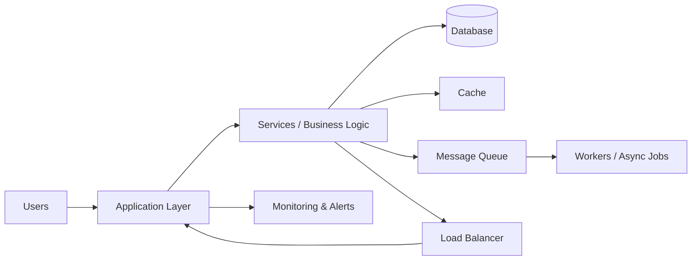
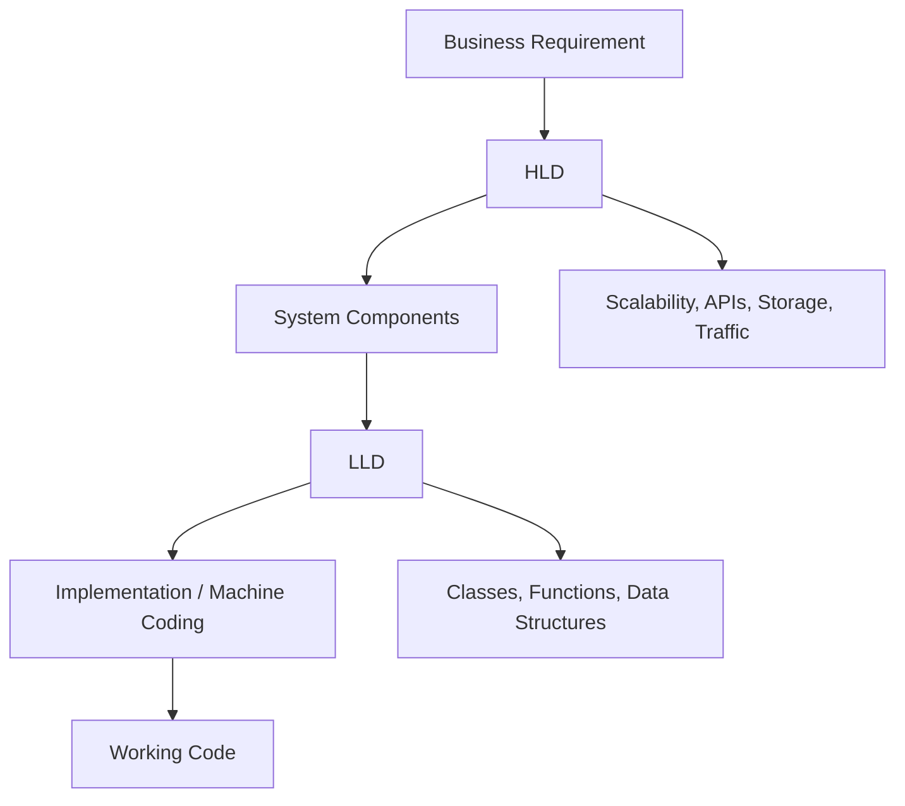
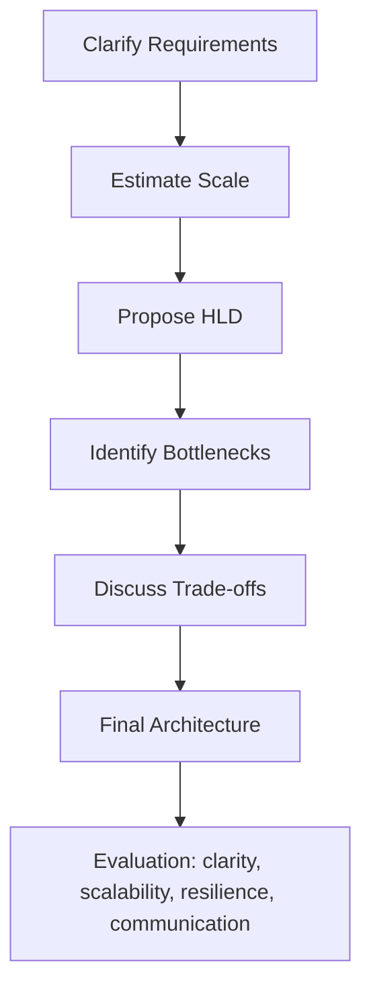

# Introduction to System Design

### Key topics
- What is System Design?
- HLD vs LLD vs Machine Coding
- How System Design is evaluated in interviews

---

## 1) What is System Design?

System design is the process of defining the architecture, components, interfaces, data flow, and operational constraints of a software system so that it can meet business and technical requirements at scale.

In simple terms, if software development answers "How do we build this feature?", system design answers "How do we build a system that can support millions of users, remain available, respond fast, and keep evolving without breaking?"

### Why system design matters

Every software product eventually needs to handle:
- more users
- more requests
- more data
- more failure modes
- more teams working in parallel

A feature that works in a local demo can still fail in production if there is no plan for:
- traffic spikes
- database bottlenecks
- retries and timeouts
- data consistency
- observability
- scale-out architecture

### Core goals of a good system design

A system is considered strong when it balances several goals:

- Functional correctness: Does it do the required job?
- Scalability: Can it handle growth in users, requests, or data?
- Reliability: Does it keep working when parts fail?
- Availability: Can it serve users continuously with minimal downtime?
- Performance: Is the system fast enough for the user experience?
- Maintainability: Can engineers evolve the system without chaos?
- Security: Is it protected against common attacks and misuse?
- Cost-efficiency: Can it work without excessive infrastructure cost?

### Example: a simple e-commerce checkout system

If you design an online shopping platform, you are not only thinking about a checkout button. You need to think about:
- customer requests reaching the app
- authentication and session handling
- inventory checks
- payment processing
- order creation
- notifications and analytics
- retries when payment services fail

This is system design in action.

### The big idea: design for uncertainty

Real production systems face unpredictable traffic patterns and failures. A good design does not assume everything always works perfectly. It assumes:
- servers crash
- networks fail
- databases get slow
- queues back up
- users retry requests

Therefore, system design is about building resilient, scalable, and observable systems, not just “working code.”

### Mermaid diagram: high-level system design flow

### Real-world takeaway

System design is the bridge between a product idea and a production-ready architecture. It helps teams answer questions like:
- How many users can this handle?
- What breaks when traffic increases?
- How do we make the system resilient?
- How do we store and retrieve data efficiently?
- What trade-offs are we making to optimize for speed, consistency, or cost?

### Practice angle

When asked in interviews, do not start with a huge architecture diagram. Start with:
1. Clarify requirements
2. Define constraints and assumptions
3. Estimate scale
4. Define major components
5. Discuss bottlenecks and trade-offs

---

## 2) HLD vs LLD vs Machine Coding

These three are related but very different.

### High-Level Design (HLD)

HLD focuses on the overall architecture of the system.

It answers questions such as:
- What are the major components?
- How do they communicate?
- Which services or modules exist?
- Where do we use databases, caches, queues, or CDNs?
- What are the important trade-offs?

This is usually what system design interviews test.

#### Example HLD concerns
- Monolithic vs microservices
- Database choice (SQL vs NoSQL)
- Replication and sharding
- Load balancing and API gateways
- Caching strategy
- Event-driven architecture
- Observability and failure handling

### Low-Level Design (LLD)

LLD focuses on the internal logic and implementation details of a single component or module.

It answers questions like:
- What are the classes, interfaces, and methods?
- How are data models structured?
- What algorithm is used?
- How does a service handle requests internally?
- What are the edge cases and validations?

Example: designing the internal class structure of a payment service or a URL shortener service.

### Machine Coding

Machine coding is coding-focused problem solving, usually done in a coding environment.

This is not system design; it usually tests:
- algorithm knowledge
- coding fluency
- data structure use
- correctness and optimization
- handling edge cases

Examples include:
- implementing LRU cache
- solving top-k frequent elements
- designing a parser or traversal
- implementing a queue with constraints

### Comparison

| Area | Focus | Typical Questions | Output |
|---|---|---|---|
| HLD | Architecture and system-level decisions | How should the system be structured? | High-level diagrams and components |
| LLD | Module internals and logic | How will this component work? | Classes, APIs, schemas, algorithms |
| Machine Coding | Code implementation | Write code to solve a problem | Executable working code |

### Difference in practical terms

Imagine you are asked to design a ride-sharing app.

- HLD: Which services exist? API gateway, user service, ride service, payment service, notifications, matching engine, map service?
- LLD: How does the matching engine select nearby drivers? What fields are in the Ride table? How are driver availability states stored?
- Machine coding: Write the algorithm for nearest driver search or implement a priority queue for trip matching.

### Mermaid diagram: layered view

### Why this distinction matters in interviews

Interviewers often expect you to move from the big picture to details in a logical order:
1. Start with requirements and constraints
2. Propose the architecture (HLD)
3. Go deeper into bottlenecks or critical components (LLD)
4. If necessary, talk about algorithmic or coding-level optimization

Many candidates get stuck because they mix up the layers and jump into code too early or over-design the system without clarifying the problem.

---

## 3) How System Design is evaluated in interviews

System design interviews are not just about “drawing boxes.” They test clarity of thought, communication, technical judgment, and the ability to make trade-offs under pressure.

### What interviewers look for

A strong system design answer usually demonstrates:

- Requirement clarification: listening carefully and asking the right questions
- Structured thinking: breaking a complex problem into parts
- Clear trade-off reasoning: explaining why one choice is better than another
- Scalability awareness: thinking beyond a single server
- Data and storage decisions: choosing the right DB or patterns
- Failure awareness: discussing how the system behaves under errors
- Communication skills: explaining the design in a way that is easy to follow

### Typical evaluation rubric

A good interviewer may score you on several dimensions:

1. Problem framing
   - Can you clarify scope and assumptions?
   - Do you identify core use cases and constraints?

2. Architecture quality
   - Is the design logical and modular?
   - Are key components separated appropriately?

3. Scalability and performance
   - Do you consider traffic growth, read/write patterns, and latency?

4. Data modeling and storage
   - Do you pick storage strategies based on access patterns?
   - Are you aware of SQL vs NoSQL trade-offs?

5. Reliability and resilience
   - Do you mention retries, timeouts, circuit breakers, queues, replication, backups, and failover?

6. Trade-off discussion
   - Do you explain what you are optimizing for and what you are sacrificing?

7. Communication and structure
   - Can you explain the design in a crisp step-by-step manner?

### Common interview flow

Most system design interviews follow this pattern:

1. Requirement clarification
   - What is the product?
   - Who are the users?
   - What are the expected scale and constraints?

2. High-level architecture
   - Define major services, components, and APIs

3. Back-of-the-envelope estimation
   - Estimate traffic, storage, bandwidth, and throughput

4. Deep dive on critical modules
   - Choose the most important component and design it in detail

5. Bottleneck analysis
   - Identify the strongest constraints and how to solve them

6. Trade-offs and improvements
   - Explain alternatives and why they are or are not chosen

### Example of good interviewer expectations

If the problem is “Design a URL shortener,” an interviewer may expect discussion on:
- API endpoints for URL creation and redirect
- database schema for URL mappings
- hashing and ID generation
- caching frequently accessed links
- rate limiting and abuse prevention
- analytics and link expiration policies

They are not necessarily asking for a perfect production architecture. They want to see if you can reason under constraints.

### The most important mindset

A strong candidate does not try to impress with obscure buzzwords. They focus on:
- clarity
- prioritization
- trade-offs
- reasoning

Bad answers often sound impressive but fail in fundamentals. Example issues:
- jumping directly to microservices for a tiny app
- ignoring bottlenecks and single points of failure
- using overly complex patterns without need
- not discussing read/write behavior
- forgetting latency and backups

### Mermaid diagram: interview evaluation flow

### Interview success formula

A strong system design answer usually combines:
- requirements + constraints
- clean architecture
- realistic assumptions
- concrete trade-offs
- clear explanation

In short, system design interviews are designed to test whether you can think like a real software architect: not just code, but design for scale, reliability, and business value.

---

## Practice Questions & Answers

### Q1. What is the difference between a system that works and a system that is well-designed?

Answer:
A system that works only satisfies the immediate functional requirement. A well-designed system also handles changing traffic, failures, growth, and operational complexity. The difference is that a well-designed system is resilient, scalable, observable, and maintainable.

Example: A backend that stores user records in a single database and handles 100 users might work. But it will not scale to millions of users without replication, sharding, caching, backups, and monitoring.

### Q2. Why is requirement clarification important before designing a system?

Answer:
Most bad designs come from making assumptions too early. Clarifying requirements prevents you from building the wrong system. You need to know:
- expected read/write traffic
- latency sensitivity
- data durability expectations
- consistency needs
- security constraints
- whether the goal is to optimize cost, speed, or reliability

If you do not clarify these upfront, your design may optimize for the wrong things.

### Q3. What is a Single Point of Failure (SPOF)?

Answer:
A SPOF is any component whose failure causes the entire system to fail or become unavailable. Examples include a single database instance, one load balancer, or one payment service without failover.

A good system design removes or reduces SPOFs using redundancy, replication, health checks, failover, and distributed patterns.

### Q4. Why do system design interviews care about trade-offs?

Answer:
There is no universally perfect architecture. A design that is highly consistent may be slower or more expensive. A design that is highly available may sacrifice some consistency during failures. Interviewers want to see if you understand these trade-offs and can justify them based on the use case.

Example: A banking app prioritizes consistency and correctness; a social media feed may prioritize availability and fast reads.

### Q5. What is the first thing you should do when solving a system design problem?

Answer:
Start by clarifying the problem and setting scope.

A good first response is:
- What are the core user actions?
- Is the system read-heavy or write-heavy?
- What is the expected scale?
- Are there latency requirements?
- Is consistency critical?

This helps anchor the design and avoids building a system for the wrong workload.

### Q6. How does HLD differ from LLD in a real project?

Answer:
HLD describes the building blocks of the system at a high level. LLD describes how each block is implemented. In a real project:
- HLD decides the services, storage choices, communication patterns, and deployment model
- LLD decides the data structures, schemas, algorithms, class responsibilities, code flow, and validation logic

A team can have a good HLD but still build a poor feature if the LLD is weak.

### Q7. Why do interviewers ask about scalability even in beginner interviews?

Answer:
Because real systems do not stay small forever. Without discussing scale, you cannot evaluate whether the architecture will remain practical as user demand grows.

Interviewers want to see if you understand concepts like:
- load balancing
- caching
- replication
- partitioning
- queue-based processing
- autoscaling

### Q8. What is the most common mistake candidates make in system design interviews?

Answer:
They start designing too quickly and never clarify assumptions. Another common mistake is drawing architecture without considering bottlenecks, failure modes, or trade-offs.

The best candidates keep the design simple at first, then add complexity only when needed.

---

## Quick revision checklist

Before you finish a system design answer, check whether you have discussed:
- functional requirements
- non-functional requirements
- traffic assumptions
- storage model
- API boundaries
- bottlenecks
- scaling strategy
- failure handling
- trade-offs
- monitoring and operations

If you can clearly explain these, you are already thinking like a system designer.

---

## Summary

System design is not about memorizing random architecture diagrams. It is about learning how to reason about complexity, constraints, and scale in a structured way.

For this module, the key message is simple:
- Understand what a system is and why it needs design
- Know the difference between HLD, LLD, and machine coding
- Learn how interviews evaluate architecture reasoning

This foundation will make the rest of the HLD modules much easier to understand.

For a realistic mock interview walkthrough, refer to [mock.md](./mock.md).
