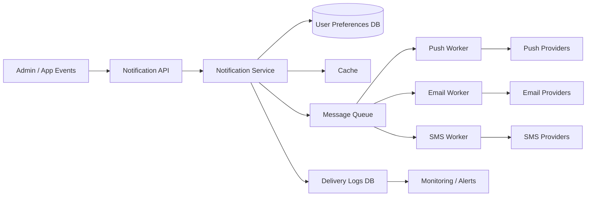
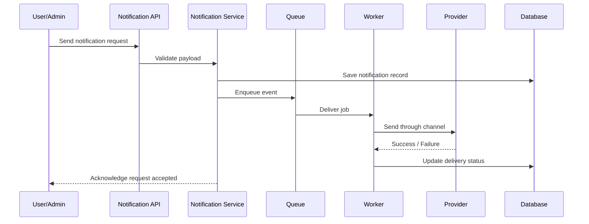

# Mock Interview: Real-World System Design Q&A

This mock session is designed to mimic a real system design interview for a product team building a large-scale notification platform.

---

## Scenario

You are asked to design a notification service for a mobile app that sends:
- push notifications
- email notifications
- SMS alerts
- in-app messages

The system must support millions of users and handle bursts during promotions, alerts, and events.

---

## Interviewer Q1: What are the core requirements?

### Candidate answer

I would first clarify the problem and assumptions:

Functional requirements:
- users can receive notifications for account activity, order updates, promotions, and system alerts
- admins can trigger bulk notification campaigns
- users can prefer channels such as email, push, or SMS
- notifications must be delivered reliably and traceably

Non-functional requirements:
- low latency for critical notifications
- high availability
- retries for failed delivery attempts
- support for large-scale campaigns
- observability for delivery and failure metrics

I would also assume:
- the system is read-heavy for user preference lookups
- notifications are asynchronous for most cases
- delivery can be best-effort for non-critical messages, but critical events must be retried and tracked

---

## Interviewer Q2: Walk me through the architecture.

### Candidate answer

The design has five main layers:

1. Client / app layer
   - mobile app, web app, admin dashboard
2. API layer
   - receives notification requests and validates payloads
3. Notification service
   - determines user preferences, priority, channel, and scheduling
4. Message queue
   - decouples producers from delivery workers
5. Delivery workers
   - send via push, email, or SMS providers

I would also include:
- cache for user preferences and templates
- database for notification metadata and delivery records
- monitoring and alerting for failed deliveries and provider latency

### Mermaid architecture diagram

---

## Interviewer Q3: How do you handle scale and latency?

### Candidate answer

The main scale challenge is handling spikes when there are large campaigns or system-wide events.

I would use:
- a queue between the notification service and delivery workers
- separate worker pools for each channel
- rate limiting per provider to avoid overload
- priority queues for critical notifications
- batching for email campaigns
- caching for template and user preference data

This keeps the API layer responsive even if provider delivery is slow.

---

## Interviewer Q4: How do you ensure reliability?

### Candidate answer

Reliability has to be designed in from the beginning.

I would include:
- idempotent notification processing so retries do not create duplicate sends
- durable message storage in the queue
- retry policies with exponential backoff
- dead-letter queues for permanently failed messages
- acknowledgment from workers only after successful processing
- auditing of delivery logs for troubleshooting

I would also store a delivery record with status like queued, sent, failed, retried, or dropped.

---

## Interviewer Q5: How do you avoid duplicate notifications or missed notifications?

### Candidate answer

This is a classic reliability problem.

I would design the system with a unique notification ID per message. When the system retries a send, it checks whether that notification ID was already processed. This makes the operation idempotent.

For example:
- create notification record in DB with status = pending
- enqueue message with notification ID
- worker reads message and updates status to in_progress
- upon success, mark sent
- on failure, retry with backoff

This avoids double-send due to repeated retries and also makes failure analysis easier.

---

## Interviewer Q6: What are the trade-offs?

### Candidate answer

Important trade-offs include:

- consistency vs availability: a strong delivery record may add latency, but it improves auditability
- queueing vs immediate send: asynchronous delivery improves responsiveness but introduces eventual delivery delay
- batching vs real-time sending: batching is efficient for marketing emails but poor for urgent transactional notifications
- provider dependencies: using multiple providers increases reliability but adds complexity

The key is to choose the correct optimization based on the notification type. For example:
- password reset emails: high reliability, moderate latency
- promotional emails: high throughput, smaller urgency
- payment confirmations: reliable and time-sensitive

---

## Interviewer Q7: What would the data model look like?

### Candidate answer

I would separate user-facing notification records from delivery logs.

Notification table:
- notification_id
- user_id
- template_id
- channel
- priority
- created_at
- status
- payload

Delivery log table:
- notification_id
- provider_name
- provider_message_id
- attempt_count
- status
- error_reason
- sent_at

This makes it easier to audit and debug failures while keeping the core notification record simple.

---

## Interviewer Q8: How would you test this design in production?

### Candidate answer

I would validate the system with:
- load testing for campaign spikes
- failure injection for provider outages
- retry behavior checks for timeouts and rate limits
- queue backlog monitoring
- delivery SLA dashboards
- alerting for high failure or queue lag

A production-ready notification system is judged not by how it behaves in a happy path, but by how it recovers from failure and scale spikes.

---

## Interviewer Q9: Can you show the request flow with a sequence diagram?

### Candidate answer

This sequence shows the asynchronous flow that allows the system to stay responsive even under heavy load.

---

## Final interviewer follow-up

### Interviewer: If you had to simplify this design, what is the minimum viable architecture?

### Candidate answer

The simplest working version would be:
- API receives notification request
- save metadata to DB
- push request to message queue
- worker sends to provider
- log outcome

This is enough for a small product. As traffic grows, you add caching, multiple worker pools, retries, DLQ, monitoring, and provider fallbacks.

---

## Quick takeaway

This mock interview demonstrates the real pattern system design interviews expect:
- start with requirements
- define clear architecture boundaries
- talk about scale, async processing, and failure handling
- explain trade-offs and design choices
- keep the conversation grounded in business realities

If you can explain these ideas clearly, you are already thinking like a system designer.
