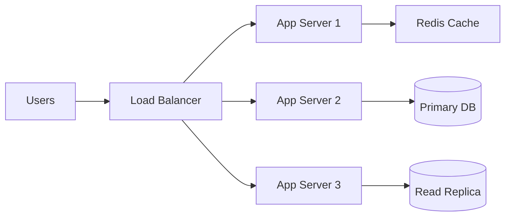
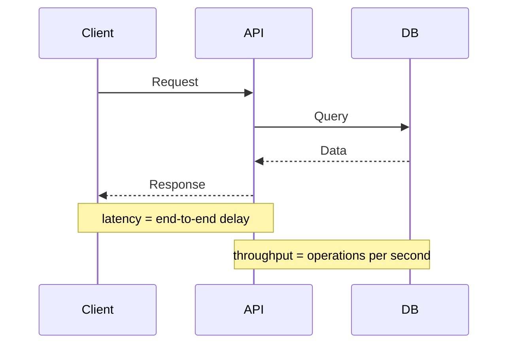

# Core System Design Concepts

System design is not about memorizing definitions. It is about understanding trade-offs: cost vs. latency, correctness vs. responsiveness, simplicity vs. resilience, and speed vs. operational risk.

A strong interview answer explains what the system is optimizing for, what it is protecting against, and what the failure modes are.

### Quick reference

| Concept | What it means | Typical design levers |
| --- | --- | --- |
| Scalability | System keeps working as demand grows | Load balancers, sharding (splitting data across servers), caching, queues |
| Availability | System is reachable and serving requests | Redundancy, failover, health checks |
| Reliability | System behaves correctly under failure | Idempotency, durable writes, retries |
| Latency | Time for a single request to complete | Faster storage, fewer round trips, async work |
| Throughput | Work completed per unit of time | Parallelism, batching, queueing |
| Consistency | Readers observe the correct state | Replication, leader election, coordination |
| Resilience | System keeps working when dependencies fail | Timeouts, retries, circuit breakers, fallbacks |

## 1) Scalability

Scalability is the ability to handle growth without a proportional drop in performance or reliability.

There are two main directions:
- Vertical scaling: add more CPU, memory, or disk to a single machine
- Horizontal scaling: add more machines and distribute work across them

Most large systems prefer horizontal scaling because vertical scaling is bounded by hardware limits and creates a larger blast radius when one machine fails.

The core idea is to scale the parts that can be scaled independently:
- stateless app servers behind a load balancer
- read-heavy workloads with caches and read replicas
- write-heavy workloads with sharding or partitioning
- background jobs with async workers and queues

Sharding (horizontal partitioning) splits a dataset across multiple database servers. Each server stores only part of the data, and a shard key—such as a user ID—determines where each record lives. This spreads storage and write load, but queries that span shards and moving data between shards add complexity.

A queue is like a waiting line for work: the app puts a job in the queue, and a worker picks it up and processes it later. This lets the app respond without waiting for a slow job and helps absorb sudden bursts of work.

| Scaling pattern | Best for | Why it helps |
| --- | --- | --- |
| Vertical scaling | Small systems or short-term bursts | Adds CPU/RAM without re-architecting |
| Horizontal scaling | Large or high-traffic systems | Spreads load and reduces bottlenecks |
| Stateless app servers | Web/API tiers | Any instance can serve traffic |
| Cache / read replicas | Read-heavy workloads | Reduces DB pressure and improves latency |
| Sharding / partitioning | Write-heavy or large data workloads | Limits hot spots and scales storage |
| Async workers + queues | Burst or slow operations | Decouples request handling from expensive work |

A social feed may work on one DB, but at millions of users it needs partitioning, replicas, caching, and parallel workers.

Interview signal: strong candidates identify the bottleneck first, then explain how each layer scales independently.

---

## 2) Availability

Availability is how often a system is able to serve requests successfully. It is usually expressed as uptime, such as 99.9% or 99.99%.

A system does not need to be perfect to be useful; it needs to meet an operational target. But availability is expensive. More redundancy, more monitoring, and more failover logic increase cost and complexity.

The usual levers are:
- redundant instances across zones or regions
- automatic failover
- health checks and circuit breakers
- graceful degradation for non-critical features

A checkout service must remain available even when an app instance fails. Traffic is shifted to healthy nodes, and the DB continues operating through failover.

Availability is not just deployment discipline. It is architectural design: isolate failures, avoid single points of failure, and ensure the system can still serve core functionality while degraded.

---

## 3) Reliability

Reliability means the system does the right thing consistently, even under failure.

A system can be available and still be unreliable. For example, an API may return 200 OK while silently dropping writes or serving stale data. Reliability is about correctness over time.

This usually means:
- validating data and enforcing schema contracts
- idempotent APIs to avoid duplicate effects
- durable writes before acknowledging success
- retries with safe semantics
- monitoring, alerting, rollback plans, and recovery automation

A payment system is a classic example: a user should never be charged twice because of a retry or timeout. Idempotency keys are a common solution.

The design principle is simple: assume failures happen, and design for them explicitly.

---

## 4) Single Point of Failure (SPOF)

A SPOF is any component whose failure causes critical functionality to collapse.

Examples:
- one DB instance with no replica
- one load balancer without failover
- one API gateway serving all traffic
- one queue without redundancy

SPOFs are the most common reason systems fail in production. Removing them means reducing dependencies on any single component.

Common fixes:
- run multiple instances behind a load balancer
- enable DB replication and failover
- deploy across availability zones or regions
- decouple services with queues so one backend issue does not break the entire request path

A design may look simple at first, but if one component is indispensable, it is not actually robust.

---

## 5) Latency vs Throughput vs Bandwidth

These terms are often mixed up, but they measure different things:

- Latency: time to complete one request, usually in milliseconds
- Throughput: number of operations per unit of time, such as requests/sec or transactions/min
- Bandwidth: total data transfer capacity of a network or storage path

They are related but not interchangeable.

A high-bandwidth disk can still produce poor application latency if requests wait on locks, queues, or network round trips. Similarly, a system can have high throughput while each individual request is slow if work is serialized or over-queued.

In practice:
- a streaming app may need high throughput to serve many clients
- each chunk still needs low latency for smooth playback
- a single network link may have high capacity but poor unfairness or queueing behavior

Interview answer: discuss the bottleneck, not just the metric name.

---

## 6) Consistent Hashing

Consistent hashing is a way to distribute keys or requests across a set of servers while minimizing rebalancing when the cluster changes.

Hashing means passing a key (such as a user ID) through a function that turns it into a number, which can help choose where to store or find its data. With a simple approach like dividing that number by the number of servers and using the remainder, adding or removing a server can make many keys move. In a distributed system, that is expensive and disruptive.

With consistent hashing, data is mapped to a ring, and each server owns a range of keys along that ring. When a server joins or leaves, only a small subset of keys changes ownership.

This makes it valuable for:
- distributed caches
- sharded key-value stores
- partitioned services
- consistent load distribution

The real advantage is not theoretical elegance; it is reduced churn during scaling and rebalancing.

---

## 7) CAP Theorem

CAP theorem says that in a distributed system you cannot guarantee all three at once:
- Consistency: every read sees the latest write
- Availability: every request gets a response
- Partition tolerance: the system keeps operating despite a network partition—a break in communication that prevents some servers from reaching others.

In the presence of a network partition, you must choose between consistency and availability.

- CP: prefer consistency, accept temporary unavailability
- AP: prefer availability, accept stale or divergent data
- CA: not achievable in a distributed system with partitions

Examples:
- banking systems usually prioritize CP
- social feeds often prioritize AP

The key nuance is that CAP is about behavior during partitions, not a permanent design choice forever. Many systems shift modes depending on operation or data type.

---

## 8) Consistency Models

Consistency models define what readers are allowed to observe after writes.

| Consistency model | Guarantee | Common use cases |
| --- | --- | --- |
| Strong consistency | Every read after a successful write sees the latest value | Banking, inventory, critical metadata |
| Eventual consistency | Replicas converge over time; stale reads are possible briefly | Feeds, analytics, search indexing, caches |
| Causal consistency | Related events appear in order | Messaging, collaboration, workflow systems |
| Read-your-writes | A user sees their own latest changes immediately | Profile updates, dashboards, document editing |
| Session consistency | Reads in one session stay consistent with earlier reads in that session | Carts, personalization, app state |

A good answer does not pick a model by instinct. It explains the business requirement and the cost of the chosen semantics.

---

## 9) Back-of-the-Envelope Estimation

Back-of-the-envelope estimation is a quick mental model for sizing a system before implementation.

A typical flow is:
1. define traffic assumptions
2. estimate request rate
3. estimate payload sizes
4. compute storage and bandwidth needs
5. estimate database, CPU, memory, and network requirements

Example:
A service receives 100,000 writes/day and each payload is 1 KB.
- writes per second ≈ 1.16
- daily data volume ≈ 100 MB
- with replication and overhead, actual growth is often 3x to 5x

This rough math helps answer questions like:
- can a single DB handle it?
- do we need sharding?
- is caching worth it?
- what are the peak traffic bottlenecks?

In interviews, this shows that you can reason under uncertainty and turn vague requirements into concrete design constraints.

---

## 10) Resilience

Resilience is the ability to continue delivering partial or full functionality when dependencies fail.

It is broader than uptime. A resilient system degrades gracefully rather than failing catastrophically.

Patterns that improve resilience:
- retries with exponential backoff
- timeouts to prevent hung calls
- circuit breakers to stop repeated failures against a bad dependency
- bulkheads to isolate faults
- fallbacks and cached responses
- queueing and decoupling to absorb bursts

Example: a recommendation service can fail under load, but the app can still return a cached recommendation or generic fallback instead of crashing the entire request path.

Resilience is about preserving useful behavior under stress, not only keeping the service alive.

---

## 11) Maintainability

Maintainability is the ease with which a system can be changed, debugged, operated, and extended without causing regressions.

It depends on:
- clear boundaries and interfaces
- good naming and documentation
- strong observability: logs, metrics, and traces
- automated tests and CI/CD
- safe deployments and rollback paths
- consistent team conventions

A system can be technically impressive and still fail operationally if it is hard to understand, debug, or evolve.

Example: a monolith may be simpler at first, but a poorly partitioned microservices architecture can become operationally worse than a single app. Maintainability is not about choosing a fashionable architecture; it is about reducing long-term complexity.

---

## 12) Autoscaling

Autoscaling is the automatic adjustment of compute resources based on current demand.

Common triggers:
- CPU or memory utilization
- request rates
- queue depth
- custom business metrics

Typical setup:
- metrics pipeline gathers the signals
- autoscaling policy decides when to scale out or in
- load balancer routes traffic to healthy instances
- health checks replace unhealthy nodes automatically

Autoscaling is valuable for bursty workloads, but it is not magic. Poor thresholds create flapping, delayed reactions, or unstable capacity changes.

A strong answer mentions both the benefit and the caveat: scale based on meaningful signals, and avoid overreacting to noisy metrics.

---

## Final takeaway
The real skill in system design is not reciting definitions. It is recognizing that every property is a trade-off:

| Property | Main question | Typical trade-off |
| --- | --- | --- |
| Scalability | Can the system grow with demand? | More machines, more complexity, more coordination |
| Availability | Can the system stay online? | More redundancy, more operational cost |
| Reliability | Does it keep doing the right thing? | More validation, logging, and failure handling |
| Latency | How fast is one request? | Faster path may reduce batching or reuse |
| Throughput | How much work can it do? | Parallelism and queueing add complexity |
| Consistency | How fresh must reads be? | Stronger guarantees usually mean more coordination |
| Resilience | How gracefully does it fail? | More fallbacks and isolation may mean more code |
| Maintainability | Can the system evolve safely? | Simpler systems are easier to change, but may cap growth |

The best system design answers explain the objective, the constraints, the bottlenecks, and the trade-offs. That is what makes a design sound rather than merely plausible.
