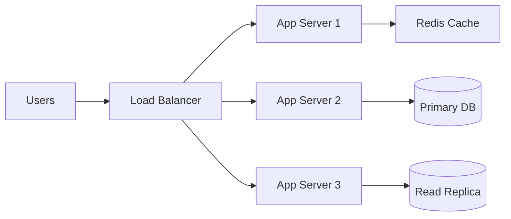
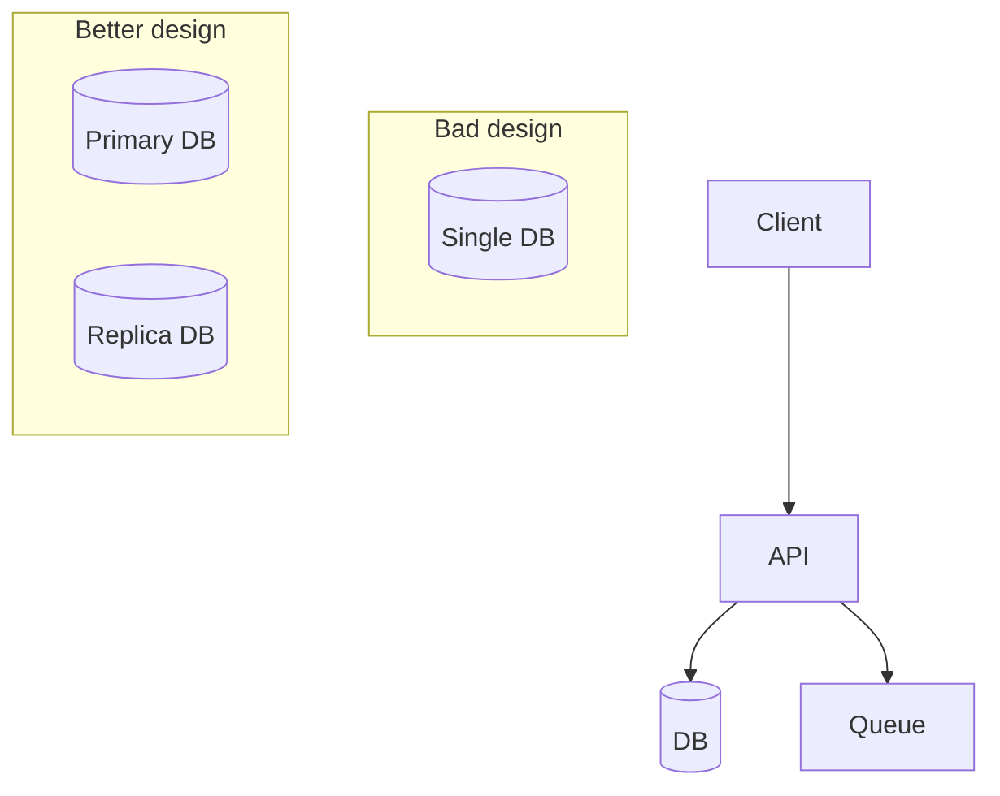
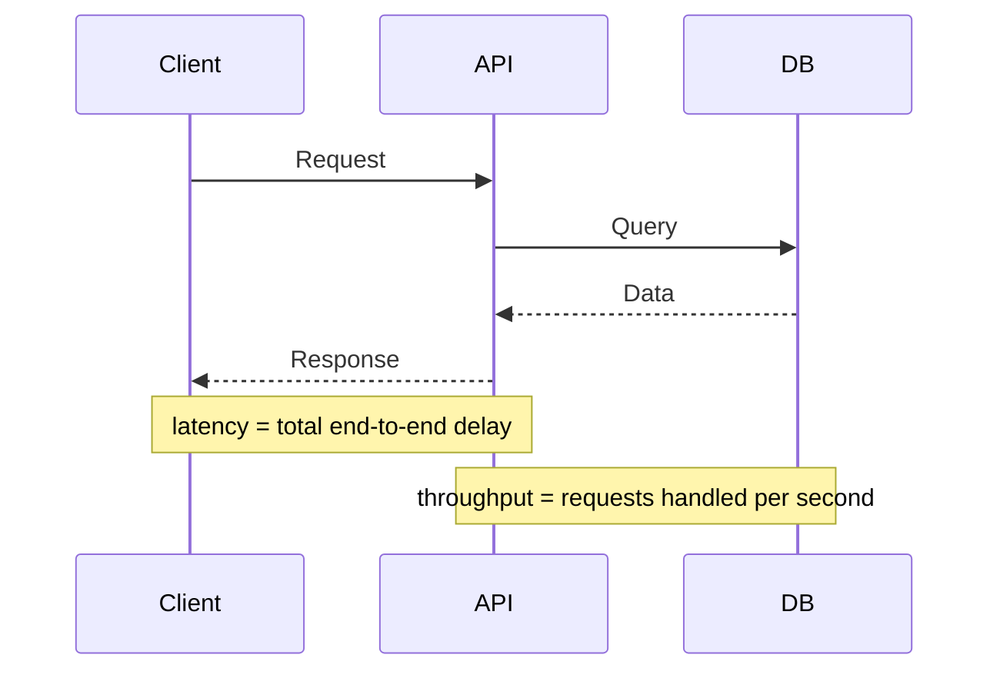
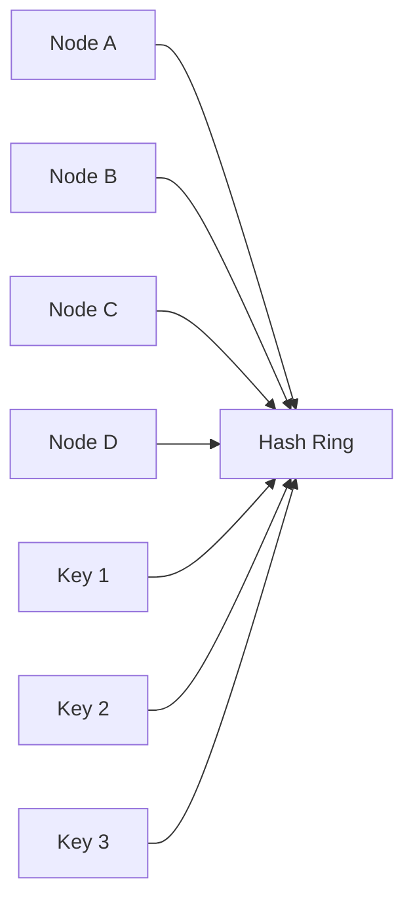
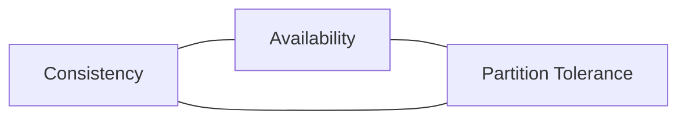
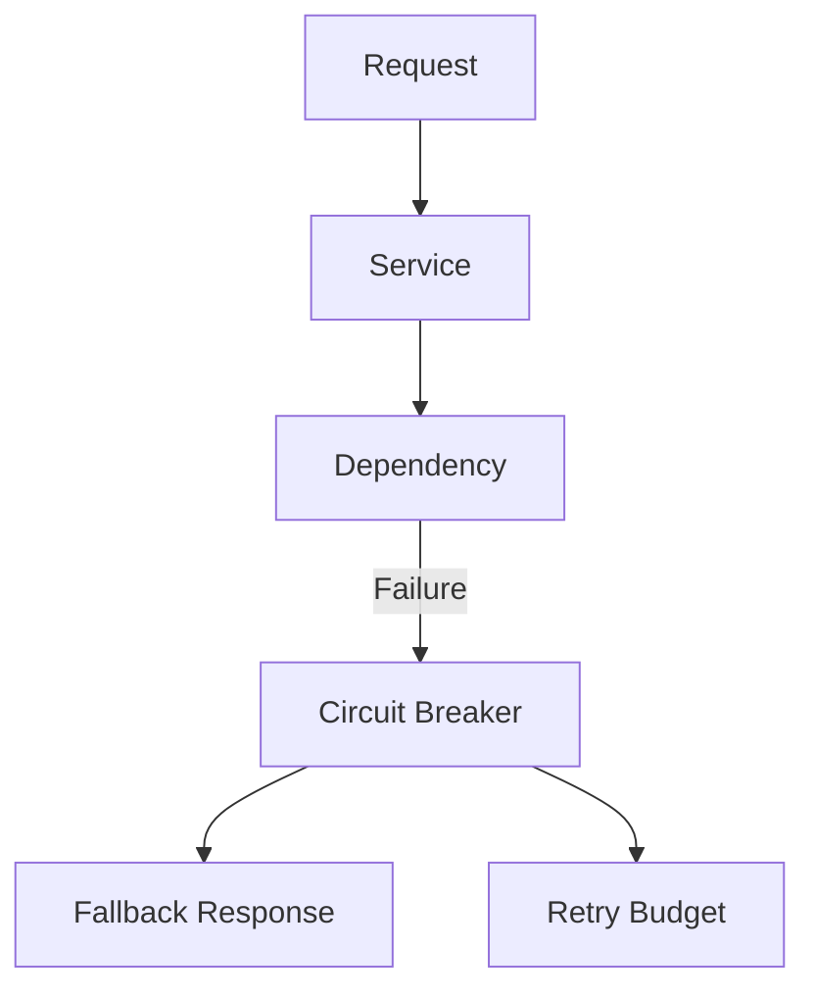
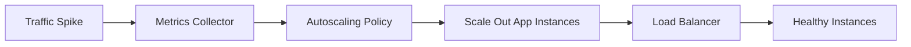

# Core System Design Concepts

These concepts are the foundation of modern distributed system design. In interviews, the goal is not just to memorize definitions but to reason about trade-offs under real-world constraints such as cost, latency, correctness, and operational complexity.

## 1) Scalability

Scalability is the ability of a system to handle increasing load without a proportional drop in performance or a collapse in reliability. There are two main dimensions:

- Vertical scalability: increase resources of a single machine (CPU, RAM, disk)
- Horizontal scalability: add more machines and distribute load

Most large systems aim for horizontal scalability because vertical scaling hits hardware limits and introduces single-machine risk.

### Why it matters
A system may work for 100 users but fail at 1 million. Scalability is about planning for growth before it becomes a production issue.

### Key ideas
- Add more application instances behind a load balancer
- Partition data across shards or partitions
- Cache read-heavy data
- Use async processing for bursty workloads

### Example
Imagine a social media feed service. At 1,000 users per day, a single database works fine. At 1,000,000 users per day, a single database becomes a bottleneck. A scalable design adds a web tier, a cache layer, read replicas, and partitioning.

### Interview angle
When an interviewer asks about scalability, they often want to know whether you can reason about bottlenecks and whether you know how to scale stateless components, data stores, and background workers separately.

---

## 2) Availability

Availability is the proportion of time a system is ready to serve requests successfully. It is usually expressed as a percentage or uptime target such as 99.9% (roughly 43.8 minutes downtime per month) or 99.99% (about 4.3 minutes per month).

### Why it matters
If your product is unavailable, revenue, user trust, and customer retention can drop instantly.

### High-level intuition
Availability is not just a deployment problem; it is a system design problem. A system with many moving parts can have poor availability if one component fails and triggers a cascade.

### Design levers
- Redundancy: run multiple instances across regions or zones
- Failover: automatically redirect traffic to healthy nodes
- Health checks: detect failed services early
- Graceful degradation: let some non-critical features fail without taking down the core system

### Example
An e-commerce checkout service must stay available even if one app server fails. A load balancer routes traffic to healthy instances, and a database failover ensures reads and writes continue.

### Trade-off
More availability often means more complexity and higher cost. You trade operational simplicity for resilience.

---

## 3) Reliability

Reliability means that a system behaves correctly and consistently over time, even in the presence of failures. A system can be available but unreliable if it returns corrupted data or silently drops requests.

### Reliability vs Availability
- Availability = system is up
- Reliability = system does the right thing when it is up

A simple analogy: a hospital alarm may be available (powered on), but if it keeps giving false alerts, it is not reliable.

### How reliability is improved
- Data validation and schema checks
- Idempotent APIs
- Retries with safe semantics
- Durable storage and replication
- Monitoring and alerting
- Automated recovery and rollback strategies

### Example
A payment system must be reliable: if a user clicks "Pay" twice, the system should not charge them twice. Idempotency keys are a common solution.

### Design principle
The most reliable systems are designed with failure assumptions, not with the mindset that failures never happen.

---

## 4) Single Point of Failure (SPOF)

A Single Point of Failure is any component whose failure causes the whole system to fail or lose critical functionality.

### Common SPOFs
- A single database instance with no replicas
- One load balancer without failover
- A single API gateway handling all traffic
- An unreplicated message queue

### Why it matters
SPOFs are a major reason systems experience downtime. Removing them increases resilience.

### How to eliminate SPOFs
- Use multiple instances behind a load balancer
- Use database replication and failover
- Deploy across availability zones / regions
- Use queue-based decoupling so one backend outage does not disable the whole request path

### Interview perspective
When you hear "What are the failure modes?" or "What is your main bottleneck?" the answer often starts with identifying SPOFs and then proposing redundancy or fallback paths.

---

## 5) Latency vs Throughput vs Bandwidth

These terms are related but not interchangeable.

### Latency
Latency is the time to complete a single request. It is usually measured in milliseconds.

Examples:
- API request round trip: 200 ms
- Database query: 20 ms
- Cache hit: 1-5 ms

### Throughput
Throughput is how many operations a system handles per unit of time.

Examples:
- 10,000 requests/second
- 500 transactions/minute
- 1 MB/s ingestion rate

### Bandwidth
Bandwidth is the maximum data transfer capacity of a network path or storage channel.

Example:
- 1 Gbps network link
- 200 MB/s disk throughput

### Relationship
A system with high bandwidth may still have poor latency if the request path is slow. A system can have high throughput but poor per-request latency if it serializes work poorly.

### Example
A video streaming app may have high throughput because it serves many users, but each video chunk still needs low latency so the stream feels smooth. A disk can have high bandwidth but the application may still suffer due to queueing or network round trips.

---

## 6) Consistent Hashing

Consistent hashing is a technique used to distribute data or requests across a changing set of servers with minimal redistribution when the cluster size changes.

### Problem it solves
In a normal hash table, adding or removing a server requires rehashing almost everything. In distributed systems, that is expensive and creates large-scale churn.

### How it works
Data is mapped onto a ring (hash ring). Each server is also assigned a position on the ring. Requests are routed to the nearest server in the clockwise direction.

### Why it matters
It is used in:
- distributed caches (like memcached or Redis clustering)
- distributed key-value stores
- load balancing and partitioning

### Example
If a new shard is added, only a subset of keys move to the new node. This reduces disruption and allows incremental balancing.

### Key insight
Consistent hashing is about preserving locality: most keys stay on their original server despite cluster changes.

---

## 7) CAP Theorem

CAP theorem states that in a distributed system, you cannot achieve all three of the following at the same time:

- Consistency: every read gets the latest write
- Availability: every request gets a response
- Partition tolerance: system continues operating despite network failures

### Interpretation
In the presence of a network partition, you must choose between consistency and availability.

- CP: choose consistency, sacrifice availability
- AP: choose availability, sacrifice consistency
- CA: impossible in a distributed system with partitions

### Real-world examples
- Banking systems often prefer CP: a balance must be correct even at the cost of temporary unavailability.
- Social media feeds often prefer AP: show a slightly stale feed rather than fail users entirely.

### Important nuance
CAP is often misunderstood. It does not say you must pick one forever. It means during partition events, you must choose a side. Many systems operate in a hybrid mode depending on read/write requirements.

---

## 8) Consistency Models

Consistency models describe how visible updates are to readers after writes. There is no single right model; the correct one depends on the behavior required by the application.

### Strong consistency
After a write completes, every subsequent read sees that value.

Use case: banking, inventory, payment systems.

### Eventual consistency
After a write, all replicas eventually converge. Reads may briefly show stale values.

Use case: social feeds, analytics, search indexing.

### Causal consistency
If A causally precedes B, then all nodes that see B must also see A.

Use case: collaborative apps and messaging systems.

### Read-your-writes consistency
A user should see their own latest writes even if the system is replicated.

Use case: user profile updates, document editing.

### Session consistency
All reads in a client session are consistent with earlier reads in that session.

Use case: shopping carts, user dashboards.

### Interview insight
A good candidate explains the exact requirement behind a consistency choice and ties it to cost and complexity.

---

## 9) Back-of-the-Envelope Estimation

Back-of-the-envelope estimation is a quick, rough mental model used to size systems before implementation.

### Typical workflow
1. Define traffic assumptions
2. Estimate request rate
3. Estimate payload sizes
4. Compute storage and throughput needs
5. Estimate CPU, RAM, network, and database capacity

### Example
Suppose a service gets 100,000 writes/day and each write is 1 KB.

- Write rate = 100,000 / 86,400 ≈ 1.16 writes/sec
- Raw data per day ≈ 100 MB/day
- With replication and overhead, maybe 300-500 MB/day

This rough calculation helps you decide whether a single database is enough or whether you need partitioning, sharding, or archival storage.

### Why it matters in interviews
It demonstrates that you can reason under uncertainty, which is critical in system design.

### Common estimates
- requests per second
- peak-to-average traffic ratio
- storage growth over time
- network throughput requirements
- cache hit rate impacts on DB load

---

## 10) Resilience

Resilience is the ability of a system to continue functioning when one or more components fail.

### Patterns that improve resilience
- Retries with exponential backoff
- Circuit breakers: stop repeated calls to a failing dependency
- Timeouts: avoid blocking threads forever
- Bulkheads: isolate failures so one component cannot take down the whole app
- Fallbacks: serve cached or degraded responses during failures
- Queueing and decoupling: absorb bursts and reduce synchronous dependency risk

### Example
A recommendation service may fail during peak load. A resilient system returns a cached recommendation or a generic fallback instead of crashing the user flow.

### Key idea
Resilience is not just about uptime; it is about preserving partial functionality when components fail.

---

## 11) Maintainability

Maintainability is the ease with which teams can evolve, debug, and extend the system without introducing regressions.

### Indicators of maintainability
- Clear module boundaries and interfaces
- Good naming and documentation
- Observability: logs, metrics, traces
- Automated tests and CI/CD
- Easy deployment and rollback
- Consistent patterns and standards

### Why it matters
A system that is technically powerful but hard to operate becomes an engineering liability.

### Example
A monolith may be easy to understand initially, but as it grows, it becomes harder to deploy and debug. A modular microservices architecture may improve maintainability if boundaries are designed well; otherwise it creates distributed complexity.

### Trade-off
Maintainability often conflicts with short-term speed, but it reduces operational and technical debt over time.

---

## 12) Autoscaling

Autoscaling automatically adjusts the number of compute resources in response to current load.

### Common autoscaling triggers
- CPU utilization
- memory utilization
- requests per second
- queue depth
- custom business metrics

### Typical architecture
- Auto Scaling Group / Kubernetes HPA / managed service scaling rules
- Load balancer distributes traffic
- Health checks ensure unhealthy instances are replaced
- Metrics pipeline collects system signals

### Why it matters
Autoscaling helps absorb demand spikes without over-provisioning resources during quiet periods.

### Key caution
Autoscaling is not magic. Poorly tuned thresholds can create flapping, delayed scale-up, or noisy scaling events.

### Interview insight
Strong answers mention both horizontal scaling and the importance of metrics, safe thresholds, and cooldown periods.

---

## Final takeaway
The core system design concepts are not isolated rules. They interact with one another:

- scalability affects how much traffic you can handle
- availability and reliability shape the user trust boundary
- SPOFs hide hidden single-machine risks
- latency, throughput, and bandwidth behave differently under load
- consistency and partition tolerance force hard engineering trade-offs
- resilience and maintainability determine how systems survive and evolve over time

A strong system design candidate can explain not just what a concept means, but when to use it, what it costs, and what the trade-offs are.
