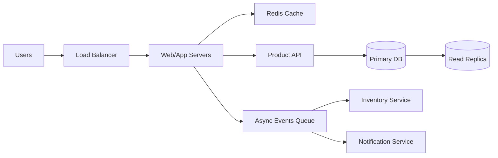
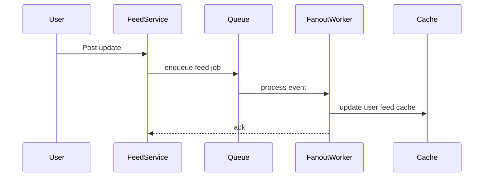
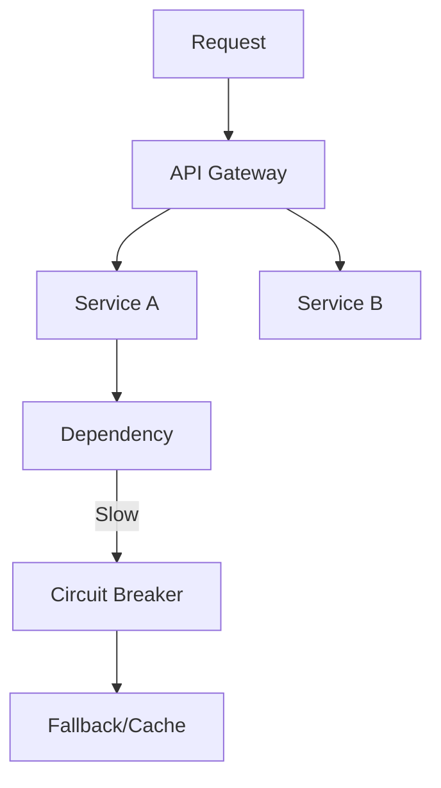

# Real-World Interview Questions and Model Answers

This file focuses on realistic system design interview scenarios and how to answer them well.

## 1) Interview Question: Design a high-traffic e-commerce website.

### Expected answer
A strong answer starts by identifying core requirements:

- high availability for product pages and checkout
- horizontal scalability for application servers
- database scaling and read-write split
- pay attention to peak traffic during promotions
- resilience around payment and inventory services

### Architecture sketch

### Strong answer points
- Use stateless app servers behind a load balancer
- Cache popular products and catalog pages
- Use read replicas for product queries
- Partition or shard inventory tables if needed
- Keep checkout and payment flows separate from non-critical features
- Use asynchronous messaging for email and analytics updates
- Add failover and circuit breakers around payment gateways

### Trade-off discussion
A classic trade-off is between product-page freshness and speed. Cache invalidation and stale data windows are important at scale.

---

## 2) Interview Question: A social media platform gets 10x traffic during a viral event. How would you handle it?

### Strong answer
The main issue is traffic spikes. We should decouple read-heavy feed generation from write-heavy social actions.

Key ideas:
- Use CDN for static assets and media
- Cache feeds and popular user profiles
- Use message queues for feed fan-out events
- Scale the write path independently from the read path
- Introduce rate limiting and sharding for hot users or trending content

### Good interviewer signal
You are showing awareness that not all workloads have the same bottlenecks. Feed rendering is often read-heavy, but posting is write-heavy and should be decoupled from streaming fan-out.

---

## 3) Interview Question: How would you design a payment system with strict reliability requirements?

### Strong answer
A payment service has extremely high correctness requirements. That usually means strong consistency, idempotency, and high observability.

Key requirements:
- no double charging
- strong consistency for ledger updates
- auditability of transactions
- retry safety with idempotency keys
- failover and disaster recovery

### Important design decisions
- Use a transactional database for ledger records
- Add idempotency keys to payment API requests
- Keep retries safe and bounded
- Integrate circuit breakers around external payment providers
- Use persistence before acknowledgment

### Strong answer statement
"I would design the payment system as a high-consistency transactional boundary. The critical guarantee is that payment submission is processed exactly once semantically, even if the client retries. That means using a ledger, idempotency keys, and durable writes before returning success."

---

## 4) Interview Question: A service is slow during peak hours. How do you debug it?

### Strong answer
I would first identify whether the issue is CPU, I/O, network, dependency latency, or database saturation.

Systematic approach:
- Measure p99 and p999 latency
- Check database query latency and slow logs
- Inspect cache hit rate
- Look for hot keys or unbalanced shards
- Review queue depth and worker lag
- Compare CPU and memory usage across instances
- Validate if upstream dependencies are timing out

### Good answer quality
The best candidates do not jump into solutions before diagnosing. They identify bottlenecks and ask whether the problem is in the application layer, infrastructure, or external dependency layer.

---

## 5) Interview Question: Explain how you would ensure resiliency for a microservices system.

### Strong answer
Resilience is about containing failures so that one service outage does not bring down the whole user experience.

Key patterns:
- timeouts and retry budgets
- circuit breakers around slow dependencies
- bulkheads to isolate noisy neighbors
- cached or degraded fallback responses
- async messaging for non-critical tasks
- health checks and traffic shedding under overload

### What interviewers want to hear
You should discuss the cost of resilience: extra code, operational complexity, and monitoring burden. However, in production, resilience often saves the business from outages.

---

## 6) Interview Question: When would you choose strong consistency instead of eventual consistency?

### Model answer
I would choose strong consistency when stale reads could create user-visible errors or financial damage. Examples include account balances, inventory reservations, or shipping status updates.

I would choose eventual consistency when slight staleness is acceptable and latency or availability is more important. Examples include social feed updates, analytics dashboards, and recommendation systems.

### Good framing
A strong answer explains business requirements, not just the technical theory.

---

## 7) Interview Question: How would you handle a database bottleneck?

### Strong answer
I would first identify the bottleneck type:
- CPU bound
- memory constrained
- I/O bound
- lock contention
- unindexed queries
- hotspot shard

Then I would apply the appropriate fixes:
- add indexes
- optimize queries
- read replicas
- partitioning/sharding
- cache reads
- improve concurrency settings
- move background analytics to a different store or queue

### Real-world interview quality signal
This answer shows that you understand scaling up does not always mean "throw more hardware at it." Often the best fix is query tuning, better data modeling, or a cleaner traffic split.

---

## 8) Interview Question: What is the difference between a SPOF and a bottleneck?

### Model answer
A single point of failure is a component whose failure causes the entire system to fail. A bottleneck is a component that slows down the system under load, even if the system still works.

Examples:
- a single database is both a SPOF and likely a bottleneck
- a slow cache is a bottleneck but not necessarily a SPOF if multiple replicas exist

This distinction is important because they require different mitigations.

---

## 9) Interview Question: Why are retries dangerous without proper safeguards?

### Strong answer
Retries can amplify load and create duplicate operations. This is especially dangerous in payment, order processing, or email sending paths.

Safeguards include:
- idempotency keys
- exponential backoff
- retry budgets
- deduplication on the consumer side
- timeouts and circuit breakers to avoid retry storms

### Example
If a payment gateway times out after processing a charge, a naive retry might charge the customer twice. This is why idempotency is critical.

---

## 10) Interview Question: Why is observability part of system design, not just operations?

### Strong answer
Observability is a design concern because you cannot manage what you cannot measure. Good design includes metrics, logs, traces, and alerting for all critical paths.

Without observability, a system may appear healthy while quietly suffering from latency spikes, hidden failures, or customer-visible regressions. Observability turns architecture into something operable.

---

## Final reflection

The strongest system design interview answers avoid being purely theoretical. They connect architecture choices to business goals:

- user experience
- cost
- uptime
- correctness
- maintainability
- operational risk

If you can explain why a design trade-off exists, what it optimizes, and what it gives up, you will sound like a strong candidate.

