# Networking Fundamentals

Networking is the path a request takes between a client and a service. In system design, understanding that path helps explain latency, capacity, failure modes, security boundaries, and how to diagnose production issues. The topics below connect protocol fundamentals to practical architecture decisions.

## 1) OSI Model

The OSI model divides network communication into seven conceptual layers. Real implementations do not always map neatly to the model, but it is a useful vocabulary for locating responsibilities and debugging failures.

| Layer | Name | Examples and responsibility |
|---|---|---|
| 7 | Application | HTTP, DNS, SMTP; request and response semantics |
| 6 | Presentation | Data representation, serialization, encryption concepts |
| 5 | Session | Managing dialog state and session coordination |
| 4 | Transport | TCP and UDP; ports, delivery behavior, flow control |
| 3 | Network | IP addressing and routing between networks |
| 2 | Data link | Ethernet, Wi-Fi; frames and local-link delivery |
| 1 | Physical | Radio, fiber, copper, and electrical or optical signals |

When an application sends data, each layer adds information needed by the layer below it. The receiver unwraps those headers in reverse order. This process is commonly called encapsulation and decapsulation.

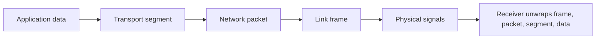

The model is especially useful as a troubleshooting checklist. A DNS lookup or HTTP status code points toward application-level behavior; a connection refusal often points toward transport or service configuration; an unreachable route suggests IP routing; a disconnected cable or weak wireless signal is a physical or link-layer problem. A single symptom can have causes at multiple layers, so treat the model as a diagnostic guide rather than proof of a root cause.

**System-design application:** Identify where a control belongs. A firewall rule may filter IP addresses or ports, while an API gateway may enforce HTTP authentication and quotas. Choosing the right layer affects what information is available and which traffic is protected.

## 2) IP Addressing

An Internet Protocol (IP) address identifies a network interface for packet routing. IPv4 uses 32-bit addresses, commonly written as four decimal octets (for example, `192.0.2.10`). IPv6 uses 128-bit addresses, written in hexadecimal groups, and provides a vastly larger address space.

An IP address is interpreted with a network prefix. The prefix length indicates which bits identify the network and which identify a host. For example, `192.0.2.0/24` represents a network whose first 24 bits are the prefix. Routers use prefixes to choose where to forward packets; they do not normally use application concepts such as a URL path.

Addresses are commonly described as:

- **Public:** globally routable, subject to routing and network policy.
- **Private:** intended for internal networks and not globally routed; common IPv4 private ranges include `10.0.0.0/8`, `172.16.0.0/12`, and `192.168.0.0/16`.
- **Loopback:** refers to the local host, such as `127.0.0.1` in IPv4 and `::1` in IPv6.

IP is best-effort: it routes packets but does not itself promise delivery, ordering, or recovery from loss. Those concerns are handled by transport protocols or the application. Addresses can also change as workloads move, which is why services generally use DNS names and service discovery instead of hard-coding machine IPs.

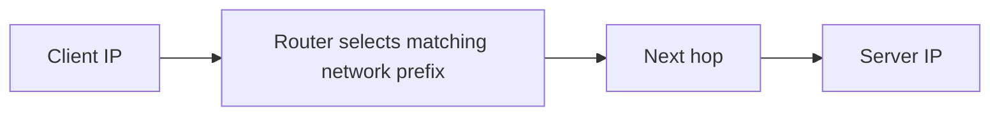

**System-design application:** Private addressing, subnet boundaries, and route tables help isolate internal services. Public exposure should be deliberate; a service can remain privately addressed while a load balancer or gateway provides the public entry point.

## 3) TCP vs UDP

TCP and UDP are transport protocols that deliver data between processes identified by IP address and port.

**TCP (Transmission Control Protocol)** establishes a connection and provides an ordered byte stream. It detects loss, retransmits missing data, and uses flow and congestion control. Applications read a stream of bytes, not a sequence of application messages, so protocols such as HTTP define how messages are framed. TCP is a good fit when reliable, ordered delivery is important, such as database connections and many web requests.

**UDP (User Datagram Protocol)** sends independent datagrams without establishing a transport connection. It does not guarantee delivery, ordering, or retransmission. This reduces protocol overhead and lets applications choose their own recovery behavior. DNS queries, some real-time media, and latency-sensitive protocols may use UDP; applications must tolerate loss or provide needed reliability themselves. QUIC, used by HTTP/3, runs over UDP but implements reliability and congestion control at the transport layer.

| Property | TCP | UDP |
|---|---|---|
| Delivery and ordering | Reliable, ordered byte stream | Best-effort datagrams |
| Setup | Connection establishment | No transport handshake |
| Recovery and flow control | Built in | Application or higher protocol decides |
| Typical fit | APIs, databases, file transfer | DNS, real-time traffic, QUIC |

TCP is not always “slow” and UDP is not automatically “fast”: end-to-end performance depends on loss, congestion, implementation, message size, and application behavior. A reliable UDP-based protocol may need to implement many capabilities itself.

## 4) HTTP vs HTTPS

HTTP is an application-layer request/response protocol. A client sends a method, target, headers, and sometimes a body; a server responds with a status code, headers, and optionally a body. HTTP semantics define meaning (for example, `GET` retrieves a representation and `POST` submits data), while the underlying connection carries the bytes.

HTTPS is HTTP protected by TLS. TLS authenticates the server using certificates, negotiates cryptographic keys, and encrypts and integrity-protects application traffic in transit. HTTPS does not by itself guarantee that the server's application is safe, that a user is authorized, or that data is encrypted after it reaches the server. Those require application security controls and secure storage practices.

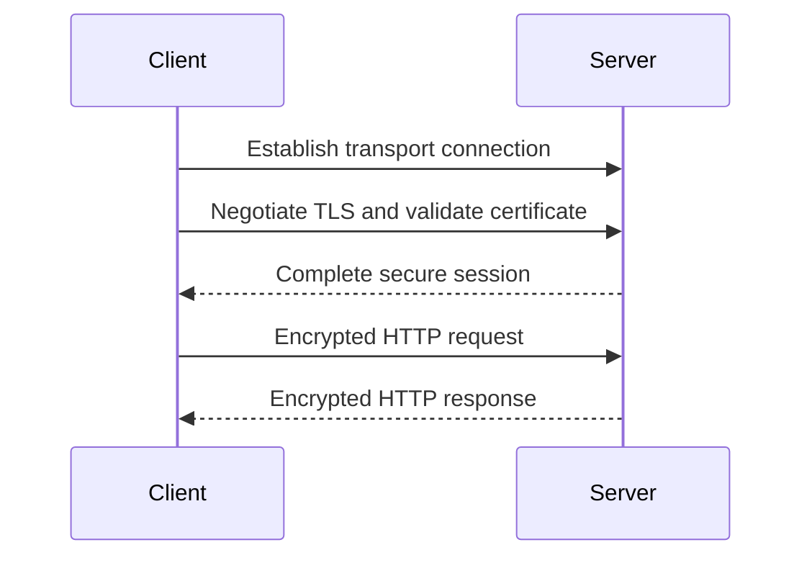

**System-design application:** Terminating TLS at a load balancer can simplify certificate operations and reduce application-server work, but traffic from the balancer to backend services may also need encryption depending on the threat model and network boundaries.

## 5) Domain Name System (DNS)

DNS maps names such as `api.example.com` to records used to locate services. It is a distributed, hierarchical naming system: a recursive resolver looks up answers from authoritative servers and can cache them for the record's time to live (TTL).

A typical lookup works as follows:

1. The client checks its local cache and configured resolver.
2. The recursive resolver checks its cache; on a miss, it follows referrals through the DNS hierarchy.
3. An authoritative DNS server returns the requested record, such as an A/AAAA address or a CNAME alias.
4. The resolver caches the answer for its TTL and returns it to the client.

Common records include A (IPv4 address), AAAA (IPv6 address), CNAME (alias), MX (mail routing), and TXT (text used by verification and policy systems). DNS answers can support traffic steering and service discovery, but caching means a change may not be visible everywhere immediately. TTL is a trade-off: shorter values can make changes propagate sooner but increase lookup traffic; longer values improve cache reuse but prolong stale answers.

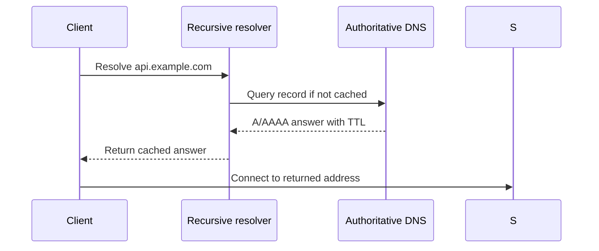

DNS resolution and connecting to the returned address are separate steps. A successful lookup does not prove that the destination is reachable or healthy. DNS is also not a substitute for application-level health checks: a client or resolver may continue using a cached address after a service has failed.

## 6) TLS Handshake Overview

TLS (Transport Layer Security) provides confidentiality, integrity, and usually server authentication for a connection. In a simplified handshake, the client and server agree on protocol parameters and cryptographic algorithms, the server presents a certificate, the client verifies that the certificate is valid for the requested hostname and trusted chain, and both sides derive session keys. Subsequent application data is encrypted and integrity-protected.

Modern TLS commonly uses ephemeral key agreement so that compromise of a server's long-term certificate key does not necessarily reveal previously captured sessions (forward secrecy). Exact handshake messages vary by TLS version and configuration; TLS 1.3 streamlined the handshake compared with earlier versions.

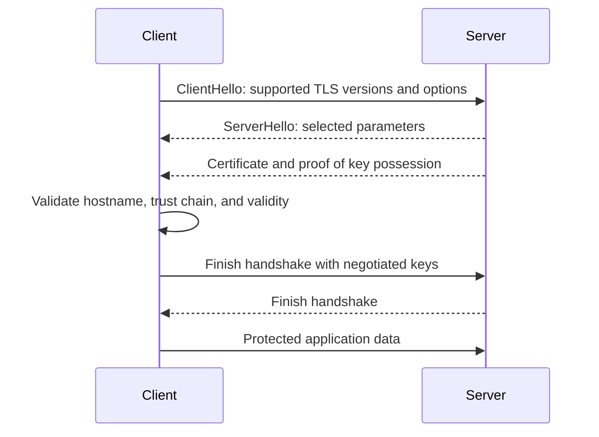

Certificate validation matters: encryption to an unauthenticated endpoint can still expose users to an impostor. Certificates expire and must be renewed; services also need safe key storage, rotation, and monitoring. TLS protects data in transit between its endpoints, not necessarily every network hop if TLS is terminated and traffic proceeds in plaintext afterward.

**Operational considerations:** Handshake latency, certificate management, cipher configuration, and connection reuse affect performance and reliability. Mutual TLS adds client authentication and is often used for service-to-service identity, but it also introduces certificate lifecycle and authorization responsibilities.

## 7) Checksums

A checksum is a value computed from data to detect accidental changes or corruption. The receiver computes the value again and compares it with the expected checksum. Network protocols and storage systems use checksums to detect errors that can occur during transmission or persistence.

Checksums are not all equivalent. A simple checksum or CRC can efficiently detect many accidental errors but is not designed to resist an attacker who deliberately changes data. Cryptographic hashes make deliberate collision or tampering harder, while a message authentication code (MAC) or digital signature can authenticate integrity against an attacker under the relevant key assumptions. TLS provides authenticated integrity for protected records, so an application should not mistake a basic checksum for security.

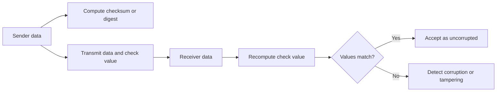

**System-design application:** Checksums can help validate large files, object-store uploads, backups, and replicated data. For important data, pair integrity checks with repair or re-fetch logic and use a cryptographic integrity mechanism when malicious tampering is in scope.

## 8) Proxy vs Reverse Proxy

A **forward proxy** acts on behalf of clients. Clients send traffic through it to reach external services. It can enforce outbound policy, filter requests, cache responses, or hide client network details from destinations.

A **reverse proxy** acts on behalf of servers. Clients connect to the reverse proxy, which forwards requests to backend services. Load balancers, API gateways, and web application firewalls often provide reverse-proxy behavior. The proxy can terminate TLS, route by hostname or path, apply limits, and centralize observability.

| Concern | Forward proxy | Reverse proxy |
|---|---|---|
| Represents | Client or client network | Origin service or server fleet |
| Typical placement | Outbound path | Inbound path |
| Common uses | Egress control, caching, filtering | Routing, TLS termination, load balancing |

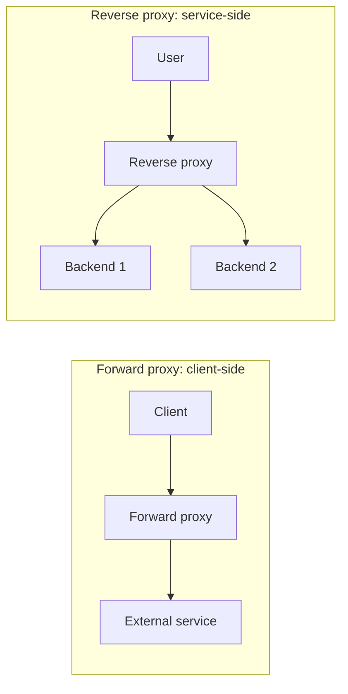

Proxies create a policy and failure boundary. They must be sized, monitored, and deployed redundantly when they are on a critical path. Trust forwarded headers only from known proxies; otherwise clients may spoof apparent source addresses or scheme information.

## 9) NAT and Firewalls

Network Address Translation (NAT) rewrites address information as packets cross a network boundary. A common use is allowing many private IPv4 devices to share a smaller set of public addresses. Port address translation distinguishes concurrent connections by mapping address-and-port combinations. NAT can affect inbound connectivity and complicate protocols that embed address information, so it should not be treated as a security control by itself.

A firewall enforces traffic policy. Rules may allow or deny traffic based on addresses, ports, protocols, connection state, or—in application-aware products—higher-layer information. Stateful firewalls track active flows and permit return traffic for an allowed connection; stateless rules evaluate packets independently.

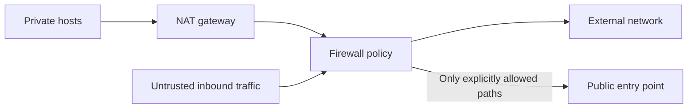

Use least privilege: expose only the required ports and destinations, separate public entry points from internal services, and log meaningful policy decisions. NAT changes how addresses appear; the firewall's explicit rules are what allow or block traffic. In cloud systems, security groups, network ACLs, and application-layer controls may operate at different scopes and should be reasoned about together.

## 10) HTTP/1.1 vs HTTP/2 vs HTTP/3

HTTP versions preserve core HTTP semantics but differ in how messages are transported and multiplexed.

- **HTTP/1.1** commonly uses persistent TCP connections, but requests on a connection are generally processed in order. Browsers often open multiple connections to reduce head-of-line blocking. Textual message framing and connection management can add overhead.
- **HTTP/2** uses binary framing and multiplexes multiple streams over one TCP connection. Header compression reduces repeated metadata. Because streams share one TCP connection, packet loss can delay delivery across streams until TCP recovers the missing bytes.
- **HTTP/3** uses HTTP over QUIC, which runs over UDP. QUIC provides encrypted transport and independent streams, reducing cross-stream blocking from packet loss at the transport layer. It can also reduce connection setup latency in some cases. UDP availability and middlebox behavior still matter.

| Version | Transport | Multiplexing | Important consideration |
|---|---|---|---|
| HTTP/1.1 | TCP | Limited; often multiple connections | Connection count and sequential request handling |
| HTTP/2 | TCP | Multiple streams per connection | TCP loss can stall all streams on that connection |
| HTTP/3 | QUIC over UDP | Independent streams | Requires compatible clients, servers, and network paths |

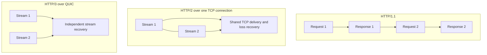

The newest version is not automatically best for every deployment. Measure client support, network conditions, CPU cost, connection reuse, and end-to-end latency. A version upgrade does not remove application bottlenecks such as slow database queries or oversized payloads.

## 11) Keep-Alive Connections

Keep-alive means reusing a connection for multiple requests rather than creating a new transport connection every time. Reuse avoids repeated connection setup and, for HTTPS, can avoid repeated TLS handshakes. HTTP/1.1 connections are persistent by default unless closed; HTTP/2 and HTTP/3 are designed to carry multiple streams over a connection.

Connection reuse saves latency and CPU, but long-lived connections consume server-side resources such as file descriptors, memory, and connection-tracking state. Systems need appropriate idle timeouts, maximum connection lifetimes, pool sizes, and load-balancer settings. Mismatched timeouts can cause stale pooled connections and intermittent failures.

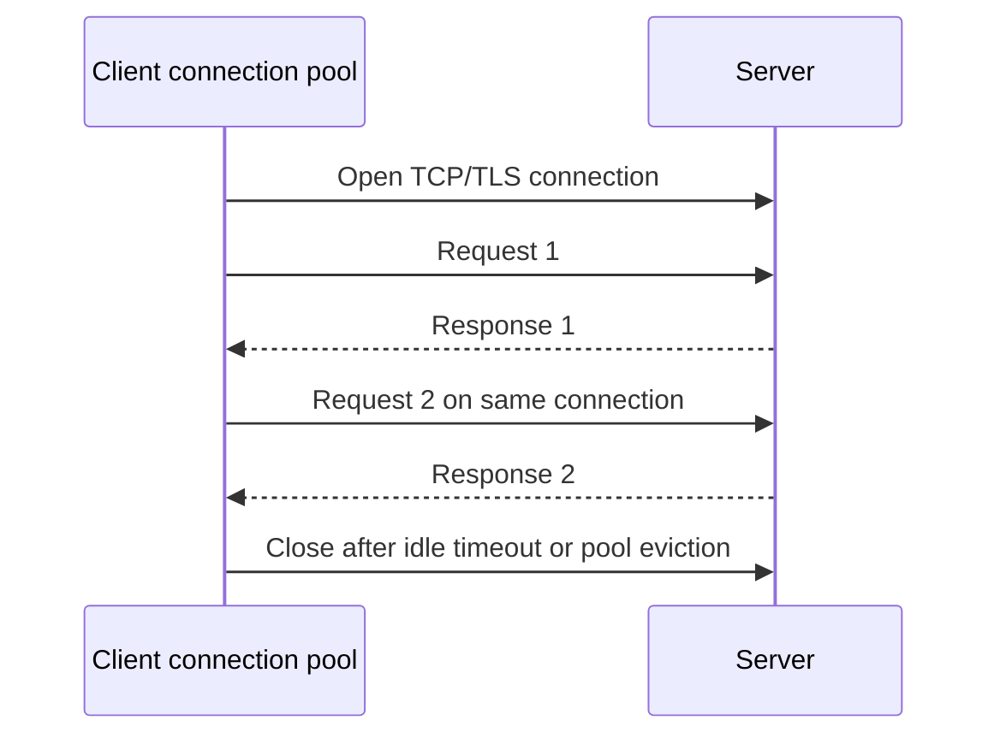

**System-design application:** Connection pools help bound and reuse database or service connections. Too many pooled connections can overload a dependency; too few can cause queueing in the client. Pool sizing should be based on measured concurrency and the capacity of the downstream service.

## 12) HTTP Headers and Security Headers

HTTP headers carry metadata about a request or response: content type, caching policy, authentication credentials, accepted encodings, and more. Headers influence how clients, proxies, and servers interpret a message. They should be validated and handled with care because untrusted values can affect routing, caching, logging, and security decisions.

Useful security-related response headers include:

- **Strict-Transport-Security (HSTS):** tells supporting browsers to use HTTPS for a domain for a configured period. Enable carefully, especially when using subdomains.
- **Content-Security-Policy (CSP):** restricts permitted content sources and can reduce the impact of some cross-site scripting attacks. Start with report-only policies and refine them to fit the application.
- **X-Content-Type-Options: `nosniff`:** prevents browsers from guessing a different content type in supported contexts.
- **Referrer-Policy:** controls how much referrer information browsers send.
- **Cache-Control:** controls caching behavior; it is also important to avoid storing sensitive responses in shared caches.

Security headers are defense in depth, not a replacement for output encoding, authorization, secure cookie attributes, or correct TLS configuration. Header behavior can vary between browsers and intermediaries, so test actual responses at the public edge.

## 13) CORS

Cross-Origin Resource Sharing (CORS) is a browser-enforced policy that controls whether JavaScript running at one origin may read a response from another origin. An origin is the combination of scheme, hostname, and port. CORS is not authentication and does not prevent non-browser clients from making requests; it governs browser access to responses.

For a simple cross-origin request, the browser sends an `Origin` header and checks the server's `Access-Control-Allow-Origin` response. For requests using non-simple methods or headers, the browser may first send a preflight `OPTIONS` request asking which methods and headers are allowed.

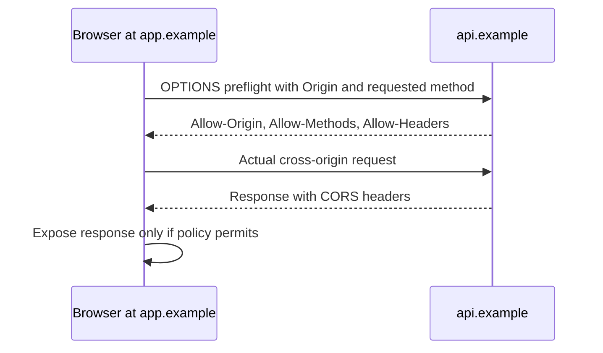

When credentials such as cookies are included, the server must allow credentials explicitly and return a specific allowed origin; wildcard origin is not valid for credentialed access. Avoid reflecting arbitrary `Origin` values. Configure only trusted origins, methods, and headers, and use CSRF protections where cookie-based authentication is involved.

## Putting the request path together

A typical browser request involves several of these topics in sequence: DNS finds an address, IP routing moves packets, TCP or QUIC carries transport data, TLS protects the connection, and HTTP expresses the request. A reverse proxy or load balancer may then route it through internal services whose network access is constrained by firewalls and private addressing.

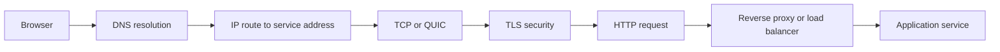

When diagnosing a failure, follow the path in order and distinguish name resolution, connection establishment, TLS negotiation, HTTP response, and application processing. Each stage has different signals and remediation.
