# Networking Fundamentals

Networking is the path a request takes between a client and a service. In system design, understanding that path helps explain latency, capacity, failure modes, security boundaries, and how to diagnose production issues. The topics below connect protocol fundamentals to practical architecture decisions and make trade-offs easier to reason about.

## 1) OSI Model

The OSI model divides network communication into seven conceptual layers. Real implementations do not always map neatly to the model, but it is a useful vocabulary for locating responsibilities and debugging failures.

| Layer | Name | Examples and responsibility |
|---|---|---|
| 7 | Application | HTTP, DNS, SMTP; request and response semantics |
| 6 | Presentation | Data representation, serialization, encryption concepts |
| 5 | Session | Managing dialog state and session coordination |
| 4 | Transport | TCP and UDP; ports, delivery behavior, flow control |
| 3 | Network | IP addressing and routing between networks |
| 2 | Data link | Ethernet, Wi-Fi; frames and local-link delivery |
| 1 | Physical | Radio, fiber, copper, and electrical or optical signals |

When an application sends data, each layer adds information needed by the layer below it. The receiver unwraps those headers in reverse order. This process is commonly called encapsulation and decapsulation.

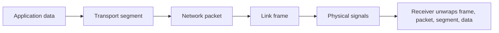

The model is especially useful as a troubleshooting checklist. A DNS lookup or HTTP status code points toward application-level behavior; a connection refusal often points toward transport or service configuration; an unreachable route suggests IP routing; a disconnected cable or weak wireless signal is a physical or link-layer problem. A single symptom can have causes at multiple layers, so treat the model as a diagnostic guide rather than proof of a root cause.

**System-design application:** Identify where a control belongs. A firewall rule may filter IP addresses or ports, while an API gateway may enforce HTTP authentication and quotas. Choosing the right layer affects what information is available and which traffic is protected.

## 2) IP Addressing

An Internet Protocol (IP) address identifies a network interface for packet routing. IPv4 uses 32-bit addresses, commonly written as four decimal octets (for example, `192.0.2.10`). IPv6 uses 128-bit addresses, written in hexadecimal groups, and provides a vastly larger address space.

An IP address is interpreted together with a network prefix. The prefix length indicates which bits identify the network and which identify the host. For example, `192.0.2.0/24` represents a network whose first 24 bits are the prefix. Routers use prefixes to choose where to forward packets; they do not normally use application concepts such as a URL path.

Addresses are commonly described as:

- **Public:** globally routable, subject to routing and network policy.
- **Private:** intended for internal networks and not globally routed; common IPv4 private ranges include `10.0.0.0/8`, `172.16.0.0/12`, and `192.168.0.0/16`.
- **Loopback:** refers to the local host, such as `127.0.0.1` in IPv4 and `::1` in IPv6.

IP is best-effort: it routes packets but does not itself promise delivery, ordering, or recovery from loss. Those concerns are handled by transport protocols or the application. Addresses can also change as workloads move, which is why services generally use DNS names and service discovery instead of hard-coding machine IPs.

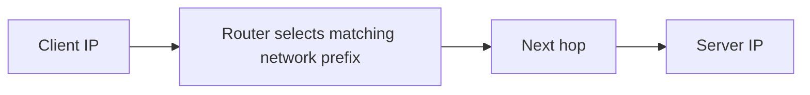

**System-design application:** Private addressing, subnet boundaries, and route tables help isolate internal services. Public exposure should be deliberate; a service can remain privately addressed while a load balancer or gateway provides the public entry point.

## 3) TCP vs UDP

TCP and UDP are transport protocols that deliver data between processes identified by an IP address and port.

**TCP (Transmission Control Protocol)** establishes a connection and provides an ordered byte stream. It detects loss, retransmits missing data, and uses flow and congestion control. Applications read a stream of bytes, not a sequence of application messages, so protocols such as HTTP define how messages are framed. TCP is a good fit when reliable, ordered delivery matters, such as database connections and many web requests.

**UDP (User Datagram Protocol)** sends independent datagrams without establishing a transport connection. It does not guarantee delivery, ordering, or retransmission. This reduces protocol overhead and lets applications choose their own recovery behavior. DNS queries, some real-time media, and latency-sensitive protocols may use UDP; applications must tolerate loss or provide reliability themselves. QUIC, used by HTTP/3, runs over UDP but implements reliability and congestion control at the transport layer.

| Property | TCP | UDP |
|---|---|---|
| Delivery and ordering | Reliable, ordered byte stream | Best-effort datagrams |
| Setup | Connection establishment | No transport handshake |
| Recovery and flow control | Built in | Application or higher protocol decides |
| Typical fit | APIs, databases, file transfer | DNS, real-time traffic, QUIC |

TCP is not always “slow” and UDP is not automatically “fast”: end-to-end performance depends on loss, congestion, implementation, message size, and application behavior. A reliable UDP-based protocol may need to implement many capabilities itself.

## 4) HTTP vs HTTPS

HTTP is an application-layer request/response protocol. A client sends a method, target, headers, and sometimes a body; a server responds with a status code, headers, and optionally a body. HTTP semantics define meaning (for example, `GET` retrieves a representation and `POST` submits data), while the underlying connection carries the bytes.

HTTPS is HTTP protected by TLS. TLS authenticates the server using certificates, negotiates cryptographic keys, and encrypts and integrity-protects application traffic in transit. HTTPS does not by itself guarantee that the server's application is safe, that a user is authorized, or that data is encrypted after it reaches the server. Those require application security controls and secure storage practices.

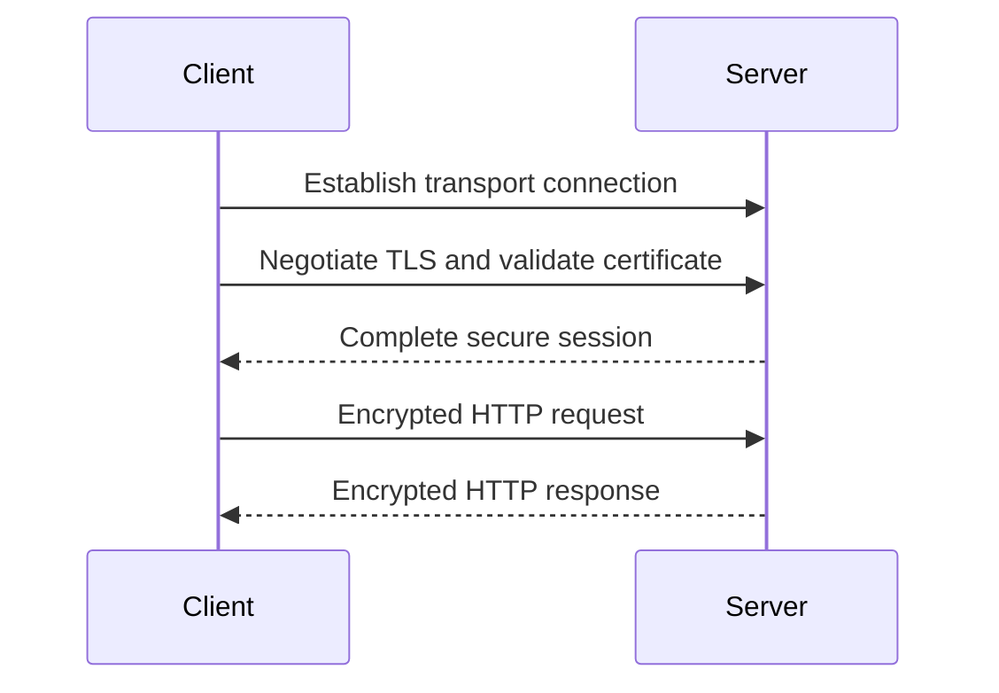

**System-design application:** Terminating TLS at a load balancer can simplify certificate operations and reduce application-server work, but traffic from the balancer to backend services may also need encryption depending on the threat model and network boundaries.

## 5) Domain Name System (DNS)

DNS maps names such as `api.example.com` to records used to locate services. It is a distributed, hierarchical naming system: a recursive resolver looks up answers from authoritative servers and can cache them for the record's time to live (TTL).

- **Recursive resolver:** a DNS server that resolves names on behalf of a client. It checks its cache first and then follows referrals through the DNS hierarchy until it reaches the answer. In simple terms, it is the DNS server that “does the lookup work” for you.
- **Authoritative DNS:** a DNS server that holds the official records for a domain. It is the source of truth for records such as A, AAAA, MX, and CNAME. In simple terms, it is the server that says, “This is the real answer for this domain.”

A typical lookup works as follows:

1. The client checks its local cache and configured resolver.
2. The recursive resolver checks its cache; on a miss, it follows referrals through the DNS hierarchy.
3. An authoritative DNS server returns the requested record, such as an A/AAAA address or a CNAME alias.
4. The resolver caches the answer for its TTL and returns it to the client.

Common records include A (IPv4 address), AAAA (IPv6 address), CNAME (alias), MX (mail routing), and TXT (text used by verification and policy systems). DNS answers can support traffic steering and service discovery, but caching means a change may not be visible everywhere immediately. TTL is a trade-off: shorter values can make changes propagate sooner but increase lookup traffic; longer values improve cache reuse but prolong stale answers.

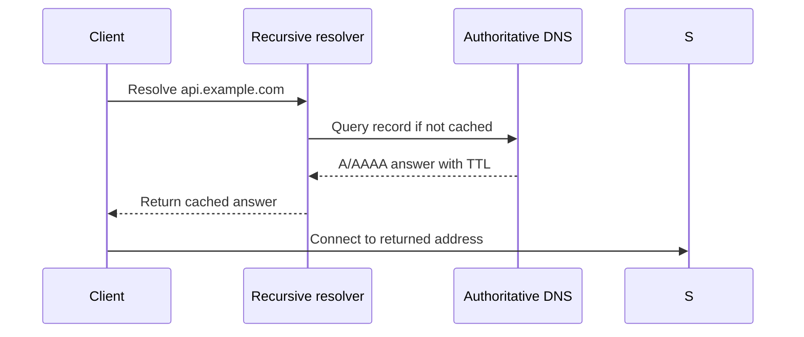

DNS resolution and connecting to the returned address are separate steps. A successful lookup does not prove that the destination is reachable or healthy. DNS is also not a substitute for application-level health checks: a client or resolver may continue using a cached address after a service has failed.

## 6) TLS Handshake Overview

TLS (Transport Layer Security) is the protocol that secures connections such as HTTPS. It gives you three important guarantees: confidentiality, integrity, and authentication. In plain English, TLS helps ensure that a third party cannot read the traffic, cannot silently modify it, and cannot pretend to be the service you intended to reach.

At a high level, the TLS handshake is the process where a client and server agree on how they will communicate securely before sending actual application data. This is not just a certificate check; it is also a key-exchange process. The goal is to establish shared session keys that both parties can use for encrypted communication, while also verifying that the server is who it claims to be.

### Why the handshake exists

Without TLS, the network is like a postal service that lets anyone read or change the contents of a letter. TLS tries to prevent that by adding cryptographic protections on top of the transport connection. The main ideas are:

- **Confidentiality:** only the sender and receiver can understand the data.
- **Integrity:** the data cannot be altered without detection.
- **Authentication:** the client can verify the server identity, and sometimes the server can verify the client identity.

### Basic TLS flow

A typical HTTPS connection starts after the underlying TCP connection is established. Then TLS begins:

1. The client sends a `ClientHello` with supported protocol versions, cipher suites, and optional parameters such as the hostname it wants to reach.
2. The server replies with a `ServerHello`, choosing a compatible TLS version and encryption settings.
3. The server presents its certificate, which contains its public key and identity information.
4. The client validates the certificate: it checks that the certificate is signed by a trusted certificate authority, that it is still valid, and that it matches the requested hostname.
5. The client and server perform a key agreement process. In modern TLS, they usually use an ephemeral key exchange so that the session keys are unique to this connection rather than tied to a long-term server key.
6. Both sides derive shared session keys from that exchange and verify the handshake completed successfully.
7. Application data is then encrypted and integrity-protected using those session keys.

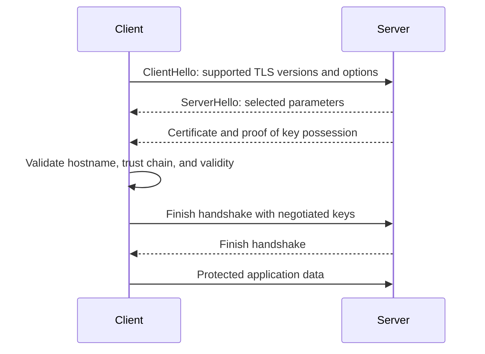

### Public keys, private keys, and certificates

TLS uses a mix of asymmetric and symmetric cryptography:

- **Asymmetric cryptography** uses a public/private key pair. The public key can be shared openly, while the private key is kept secret by the owner.
- **Certificates** bind an identity such as `api.example.com` to a public key. They are signed by a trusted certificate authority (CA), which is why browsers trust them.
- **Symmetric cryptography** uses the same key on both sides for efficiency. After the handshake, both sides use symmetric encryption for the actual request and response traffic.

This combination is important: public-key cryptography is used to establish trust and exchange secret material, while symmetric cryptography is used to encrypt the bulk of the traffic efficiently.

### Why forward secrecy matters

Modern TLS commonly uses ephemeral key agreement so that even if a server’s long-term private key is later compromised, past captured sessions are not automatically exposed. This property is called **forward secrecy**. It is an important design goal for modern secure web traffic.

### Certificates are not optional

Certificate validation matters: encryption to an unauthenticated endpoint can still expose users to an impostor. If the certificate is expired, not trusted, or does not match the hostname, the client should reject it.

Certificates also need operational care:

- They expire and must be renewed before that date.
- Private keys must be stored securely.
- Key rotation and monitoring are required in production.
- A certificate only proves the identity of the endpoint it covers; it does not automatically guarantee an application is safe or that the server is authorized to do everything.

### Important practical note

TLS protects data in transit between its endpoints, but not necessarily every network hop if TLS is terminated and traffic continues in plaintext afterward. For example, traffic may be encrypted from browser to load balancer, then decrypted and forwarded to an internal service without TLS.

### Operational considerations

**Handshake latency, certificate management, cipher configuration, and connection reuse affect performance and reliability.** A TLS handshake adds CPU and network round-trips, so connection reuse is important for high-traffic systems. **Mutual TLS (mTLS)** adds client authentication and is often used for service-to-service identity, but it also introduces certificate lifecycle and authorization responsibilities.

### Short mental model

If you want a simple way to think about TLS:

- The client says, “Who are you?”
- The server presents a certificate.
- The client checks whether the certificate is valid and trusted.
- Both sides agree on keys.
- Then they send encrypted application traffic.

That is the core idea behind the TLS handshake.

## 7) Checksums

A checksum is a value computed from data to detect accidental changes or corruption. The receiver computes the value again and compares it with the expected checksum. Network protocols and storage systems use checksums to detect errors that can occur during transmission or persistence.

Checksums are not all equivalent. A simple checksum or CRC can efficiently detect many accidental errors, but it is not designed to resist an attacker who deliberately changes data. Cryptographic hashes make collision or tampering harder, while a message authentication code (MAC) or digital signature can authenticate integrity against an attacker under the relevant key assumptions. TLS provides authenticated integrity for protected records, so an application should not mistake a basic checksum for security.

**Mental model:** A checksum is like a comparison tag for data: the receiver recomputes it and checks whether it matches. A match suggests the data stayed intact, but a basic checksum does not prove who sent it or prevent deliberate changes.

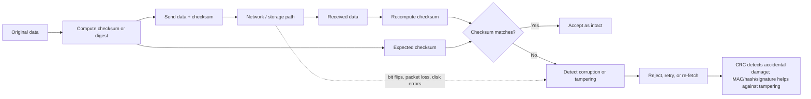

**System-design application:** Checksums can help validate large files, object-store uploads, backups, and replicated data. For important data, pair integrity checks with repair or re-fetch logic and use a cryptographic integrity mechanism when malicious tampering is in scope.

## 8) Proxy vs Reverse Proxy

A **forward proxy** acts on behalf of clients. Clients send traffic through it to reach external services. It can enforce outbound policy, filter requests, cache responses, or hide client network details from destinations.

A **reverse proxy** acts on behalf of servers. Clients connect to the reverse proxy, which forwards requests to backend services. Load balancers, API gateways, and web application firewalls often provide reverse-proxy behavior. The proxy can terminate TLS, route by hostname or path, apply limits, and centralize observability.

A useful mental model is: a forward proxy sits on the client path; a reverse proxy sits on the server path.

| Concern | Forward proxy | Reverse proxy |
|---|---|---|
| Represents | Client or client network | Origin service or server fleet |
| Typical placement | Outbound path | Inbound path |
| Common uses | Egress control, caching, filtering | Routing, TLS termination, load balancing |

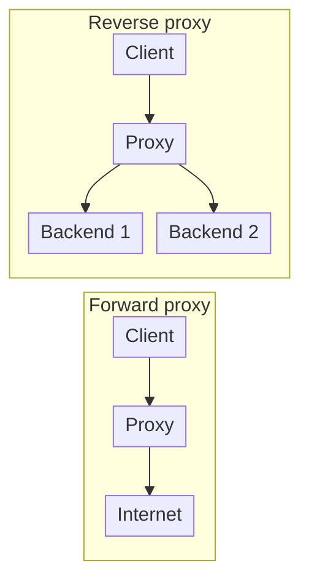

Proxies create a policy and failure boundary. They must be sized, monitored, and deployed redundantly when they are on a critical path. Trust forwarded headers only from known proxies; otherwise clients may spoof apparent source addresses or scheme information.

## 9) NAT and Firewalls

Think of a home network: your laptop and phone have private addresses that work inside the home, while the router has a public address for communicating with the internet.

**NAT (Network Address Translation)** is the router's address-changing job. When your laptop starts a connection to a website, the router replaces the laptop's private address with its public address and records which connection it belongs to. When the website replies, the router uses that record to send the reply back to the laptop. Port address translation (PAT), the common form of NAT for IPv4, uses port numbers to keep many devices' connections distinct while they share one public IP address.

**A firewall is the traffic gatekeeper.** It checks traffic against rules, which can use IP addresses, ports, protocols, connection state, and sometimes application details. A stateful firewall remembers allowed connections and lets their replies back through; a stateless firewall checks each packet against the rules independently.

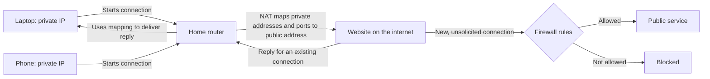

In short: **NAT changes addresses; a firewall allows or blocks traffic.** NAT often makes it harder for an outside host to start a connection to a device inside a home network, but that behavior is not a replacement for firewall rules or other security controls. In cloud systems, security groups, network ACLs, and application-layer controls may apply at different scopes, so reason about each boundary separately.

**System-design application:** Use least privilege: expose only the required ports and destinations, separate public entry points from internal services, and log meaningful policy decisions.

## 10) HTTP/1.1 vs HTTP/2 vs HTTP/3

HTTP is the set of rules a browser and a website use to exchange requests and responses. All three versions can do things like request a page or send form data; the main difference is how those messages travel.

**Picture a webpage that needs three things:** an HTML file, a picture, and a style sheet. A *connection* is the communication path between the browser and the server. A *stream* is one exchange of data within that path.

**Multiplexing** means sending small pieces of several streams over the same connection, taking turns between them instead of finishing one whole response before starting another. For example, the browser can receive a piece of the HTML, then a piece of the picture, then more HTML. This is like several people sharing one road by taking turns to use it; it does not mean each stream gets its own connection.

- **HTTP/1.1: take turns on a path.** A browser typically waits for one request's response before sending the next on that connection. It can open several connections to get more things at once, but each connection is still mostly taking turns. This is like having several checkout lines, with one customer served at a time in each line.
- **HTTP/2: share one path.** It multiplexes several streams over one TCP connection, so the browser does not have to finish one response before sending another. But TCP delivers data in order: if a packet goes missing, the connection must wait for it to be recovered, which can briefly hold up data for all those conversations. HTTP/2 also compresses repeated headers (request details such as cookies), reducing some overhead.
- **HTTP/3: separate the streams' waiting.** It carries HTTP over **QUIC**, a transport protocol (rules for moving data between devices) built on UDP. UDP alone does not ensure data arrives, so QUIC adds reliable delivery and encryption. QUIC tracks delivery separately for each stream: if data for the picture is lost, it can wait for that data without automatically holding up the HTML or style-sheet stream. Connection setup can also take fewer round trips in some cases.

In everyday terms: HTTP/1.1 mostly takes turns, HTTP/2 lets exchanges share a connection but can make them wait on a lost packet, and HTTP/3 avoids that particular cross-stream wait. HTTP/3 does not prevent every delay: streams still share network capacity, and network conditions, server work, or a slow database can still slow a page.

| Version | Transport | Multiplexing | Important consideration | Typical use case |
|---|---|---|---|---|
| HTTP/1.1 | TCP | Limited; often uses several connections | Requests on each connection mostly take turns | Legacy systems and broad compatibility, or when HTTP/2/3 is unavailable |
| HTTP/2 | TCP | Multiple streams on one connection | A lost packet can briefly hold up all streams on that connection | Common choice for websites and APIs that benefit from multiplexing and have TCP connectivity |
| HTTP/3 | QUIC over UDP | Multiple streams with independent delivery | Needs QUIC support and a network path that allows it | Latency-sensitive or mobile traffic, especially on lossy or changing networks, when QUIC is supported |
| HTTPS (not an HTTP version) | TLS with HTTP/1.1 or HTTP/2 over TCP; TLS is integrated into QUIC for HTTP/3 | Depends on the HTTP version | Protects traffic in transit and authenticates the server when its certificate is validated | Use for virtually all public browser and API traffic that needs confidentiality and server authentication |

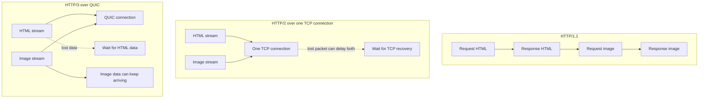

The newest version is not automatically best for every deployment. Browsers and servers negotiate a version they both support, and a network may affect which transports work well. Measure real end-to-end latency and resource use; changing HTTP versions does not fix application bottlenecks such as slow database queries or oversized payloads.

**HTTPS is not a fourth HTTP version or a transport like TCP or QUIC.** It is HTTP protected by TLS: HTTP/1.1 and HTTP/2 commonly use TLS over TCP, while HTTP/3 uses QUIC, which incorporates TLS. The HTTP version determines how requests and responses are carried; HTTPS provides encryption in transit and server authentication across those versions.

## 11) Keep-Alive Connections

Keep-alive means reusing a connection for multiple requests rather than creating a new transport connection every time. Reuse avoids repeated connection setup and, for HTTPS, can avoid repeated TLS handshakes. HTTP/1.1 connections are persistent by default unless closed; HTTP/2 and HTTP/3 are designed to carry multiple streams over a connection.

Connection reuse saves latency and CPU, but long-lived connections consume server-side resources such as file descriptors, memory, and connection-tracking state. Systems need appropriate idle timeouts, maximum connection lifetimes, pool sizes, and load-balancer settings. Mismatched timeouts can cause stale pooled connections and intermittent failures.

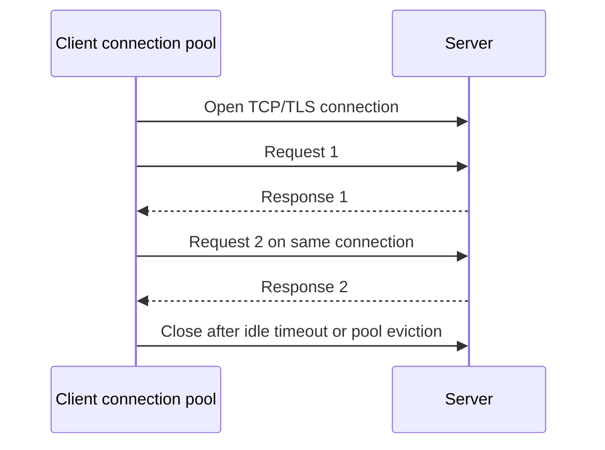

**System-design application:** Connection pools help bound and reuse database or service connections. Too many pooled connections can overload a dependency; too few can cause queueing in the client. Pool sizing should be based on measured concurrency and the capacity of the downstream service.

## 12) HTTP Headers and Security Headers

HTTP headers carry metadata about a request or response: content type, caching policy, authentication credentials, accepted encodings, and more. Headers influence how clients, proxies, and servers interpret a message. They should be validated and handled with care because untrusted values can affect routing, caching, logging, and security decisions.

Useful security-related response headers include:

- **Strict-Transport-Security (HSTS):** tells supporting browsers to use HTTPS for a domain for a configured period. Enable carefully, especially when using subdomains.
- **Content-Security-Policy (CSP):** restricts permitted content sources and can reduce the impact of some cross-site scripting attacks. Start with report-only policies and refine them to fit the application.
- **X-Content-Type-Options: `nosniff`:** prevents browsers from guessing a different content type in supported contexts.
- **Referrer-Policy:** controls how much referrer information browsers send.
- **Cache-Control:** controls caching behavior; it is also important to avoid storing sensitive responses in shared caches.

These headers are helpful, but they are not a substitute for application security controls such as input validation, output encoding, and correct authorization logic.

Security headers are defense in depth, not a replacement for output encoding, authorization, secure cookie attributes, or correct TLS configuration. Header behavior can vary between browsers and intermediaries, so test actual responses at the public edge.

## 13) CORS

**CORS** (Cross-Origin Resource Sharing) is a rule browsers use to decide whether a web page is allowed to read data from another origin. An origin is made of the **scheme** (`http` or `https`), **hostname**, and **port**. For example, `https://shop.example` and `https://api.example` are different origins. So are `http://localhost:3000` and `http://localhost:5000` because their ports differ.

By default, a page can read responses from its own origin. If JavaScript on `https://shop.example` calls `https://api.example`, the browser checks whether the API allows that page's origin. The API grants permission with a response header such as `Access-Control-Allow-Origin: https://shop.example`. If the permission is missing or does not match, the browser does not let the page's JavaScript read the response—even if the API received the request and sent a response.

Some cross-origin requests can be sent right away. For others—for example, a `PUT` request or a request with a non-standard header—the browser first sends a **preflight** request: an `OPTIONS` request asking whether the API allows the planned method and headers. If the API approves, the browser sends the actual request. If not, it stops before sending it.

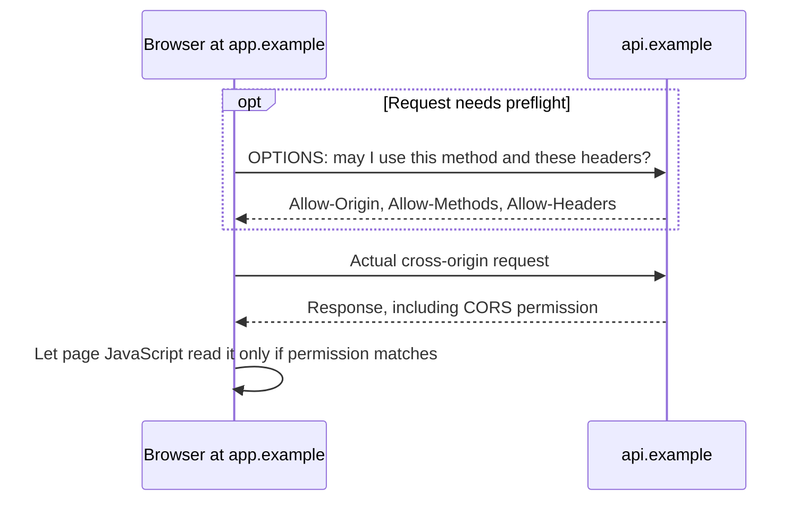

**CORS is not authentication or a firewall.** It does not stop non-browser clients (such as `curl` or another server) from making requests, and it does not decide whether a user is authorized. The API must still authenticate users and check permissions for every request.

When a browser request includes credentials such as cookies, the API must explicitly allow credentials and name the specific allowed origin; `*` cannot be used for credentialed access. Configure only trusted origins, methods, and headers—do not blindly echo any `Origin` the API receives. CORS is also not a substitute for CSRF protections when using cookie-based authentication.

## 14) Putting the request path together

A typical browser request involves several of these topics in sequence: DNS finds an address, IP routing moves packets, TCP or QUIC carries transport data, TLS protects the connection, and HTTP expresses the request. A reverse proxy or load balancer may then route it through internal services whose network access is constrained by firewalls and private addressing.

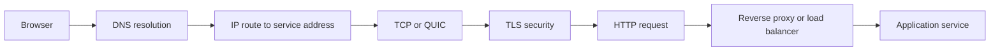

When diagnosing a failure, follow the path in order and distinguish name resolution, connection establishment, TLS negotiation, HTTP response, and application processing. Each stage has different signals and remediation.
