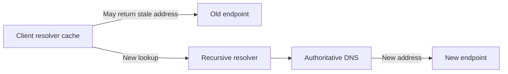
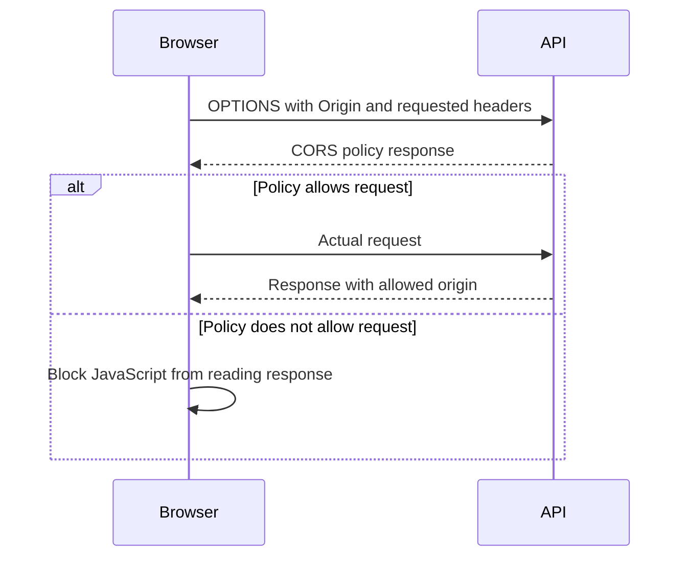
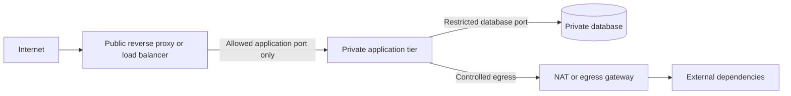

# Networking Fundamentals: Real-World Interview Questions and Model Answers

These scenarios emphasize a clear investigation path, practical trade-offs, and the difference between symptoms and root causes. In an interview, clarify the requirements and state assumptions before proposing a change.

## 1) A regional API is intermittently unreachable after a DNS failover. How would you investigate?

### Model answer

I would first distinguish name-resolution failures from connection and application failures. I would compare answers from the affected clients' recursive resolvers with authoritative DNS, check the record TTL and the time of the last change, and determine whether clients are still using a cached address. Then I would test connectivity to both the old and new destinations and inspect load-balancer health and service logs.

I would not assume that changing DNS immediately moves all clients. Some clients and resolvers retain answers until expiry, and DNS health checks can only steer future resolutions. For faster recovery, I would design the service to tolerate a transition window, keep the old endpoint available when possible, and use health-aware routing or client retry logic with bounded backoff. I would also monitor DNS answer distribution and actual connection success separately.

### Trade-offs to discuss

- Lower DNS TTL can reduce stale-answer duration but increases query volume and does not eliminate client caching behavior.
- Keeping both endpoints healthy during a transition improves safety but costs more.
- DNS steering is useful for coarse routing; it is not a substitute for service health checks and robust clients.

## 2) Users report that an HTTPS service is slow only on first connection. What would you check?

### Model answer

I would compare first-request latency with subsequent requests and break the first request into DNS lookup, transport connection establishment, TLS negotiation, and server processing. Distributed traces and client-side timing can show whether the delay is before the request reaches the application. I would inspect DNS cache hit rates, packet loss, connection reuse, TLS handshake time, certificate-chain delivery, and the load balancer's TLS termination behavior.

If handshake overhead dominates, keep-alive and connection pooling may help, as may tuning TLS and edge configuration. I would validate the actual client mix before enabling a protocol change such as HTTP/3. If the delay is from a cold application or backend connection pool, transport changes will not fix the root cause. I would measure p50 and tail latency before and after each change.

## 3) A browser frontend cannot call an API hosted on another origin. How do you debug it?

### Model answer

I would inspect the browser console and network panel to see whether the browser sent a preflight `OPTIONS` request, what the API returned, and whether the actual request was sent. I would compare the request's `Origin`, method, and requested headers with the server's CORS response. If credentials are included, I would confirm that the response specifies the exact trusted origin and allows credentials; wildcard origin is incompatible with credentialed CORS.

I would configure a narrow allowlist of expected origins, methods, and headers rather than reflecting arbitrary origins. I would also explain that CORS is a browser response-access policy, not API authentication. Cookie-based authentication still needs appropriate CSRF protections, and server-side authorization must be enforced independently.

## 4) A company wants to expose an internal service to the internet. What network design would you propose?

### Model answer

I would avoid assigning the application instance itself a public address. I would use a controlled public entry point such as a reverse proxy, API gateway, or load balancer, terminate TLS there or at a trusted service boundary, and keep application and data tiers on private networks. Firewall rules would allow only the required inbound ports and narrowly scoped paths from the edge tier to backend services. Egress would also be controlled where practical.

I would validate forwarded headers only when they originate from trusted proxies, centralize access logs and health checks, and deploy the public edge redundantly. NAT may be used for outbound connectivity or address conservation, but it is not the security policy; firewall rules and application authorization remain necessary.

## 5) You are choosing between HTTP/2 and HTTP/3 for a mobile application. How would you decide?

### Model answer

I would gather the client and network profile first: supported operating systems and libraries, network mobility, packet loss, proxy behavior, and whether the current bottleneck is connection setup, loss, or server processing. HTTP/2 offers multiplexed streams over TCP and is broadly supported, but loss on the shared TCP connection can delay multiple streams. HTTP/3 uses QUIC over UDP and independent streams, which can help on lossy or changing networks, but can encounter UDP restrictions and needs operational support.

I would run a gradual, measurable rollout with a fallback path and compare connection success, handshake time, p95/p99 latency, CPU, and error rates by client and network. I would not assume a newer protocol will fix slow application queries, oversized responses, or a saturated service.

## 6) A backend fleet is exhausting file descriptors during traffic spikes. What networking changes would you consider?

### Model answer

I would determine whether the descriptors are consumed by inbound sockets, outbound dependency connections, leaked sockets, or excessively long-lived idle connections. I would inspect active and idle connection counts, pool wait times, connection churn, timeouts, and per-instance traffic. Then I would verify load-balancer keep-alive settings and whether clients reuse connections as expected.

I would set bounded connection pools and idle timeouts that are consistent across clients, proxies, and servers; size pools based on downstream capacity; and add backpressure rather than allowing unlimited connections. I would check for socket leaks and load imbalance before raising the operating-system limit. Increasing the limit can be a temporary safety measure, but it does not solve runaway concurrency or an overloaded dependency.

## 7) How would you distinguish network packet corruption from malicious tampering?

### Model answer

A basic checksum or CRC is useful for detecting many accidental transmission errors, but an attacker can often change both the data and its checksum. For integrity against active attackers, I would rely on authenticated cryptographic mechanisms such as TLS record protection or a MAC; a digital signature may be appropriate when verifiable origin is needed. The design should also define how detected corruption is handled, such as retransmission, rejecting an object, or restoring a verified copy.

## 8) A service is reachable by IP but not by hostname. What is your investigation path?

### Model answer

I would check the exact hostname resolution from the affected environment, including search domains, resolver configuration, cache state, and A/AAAA/CNAME records. If DNS returns the expected address, I would verify that the client sends the expected hostname at the application layer and, for HTTPS, that the certificate covers it. I would then check proxy configuration, routing, firewall rules, and whether the service uses host-based routing.

Reaching the IP alone does not prove that the hostname path is correct: DNS, TLS hostname validation, and virtual-host routing all depend on the name. I would test each stage independently and compare a working client with a failing one.

## Interview approach

For any networking scenario:

1. Clarify who is affected, where, and when; identify the user-visible symptom.
2. Locate the failure stage: DNS, routing, transport, TLS, HTTP edge, or application.
3. Use evidence from client timings, logs, metrics, and traces before changing architecture.
4. Choose the narrowest fix and explain its failure modes, security impact, and cost.
5. Define measurable success criteria and a safe rollout or rollback plan.
