# Load Balancing

Load balancing is one of the most important patterns in distributed systems. It is the mechanism that distributes incoming traffic across multiple backend servers so no single node becomes overloaded, unavailable, or a bottleneck. In production systems, a good load balancing strategy improves throughput, availability, fault tolerance, and user experience.

At a high level, load balancing sits in front of application servers, databases, caches, or even entire data centers. It decides where to send each request based on health, capacity, geography, or routing policy.

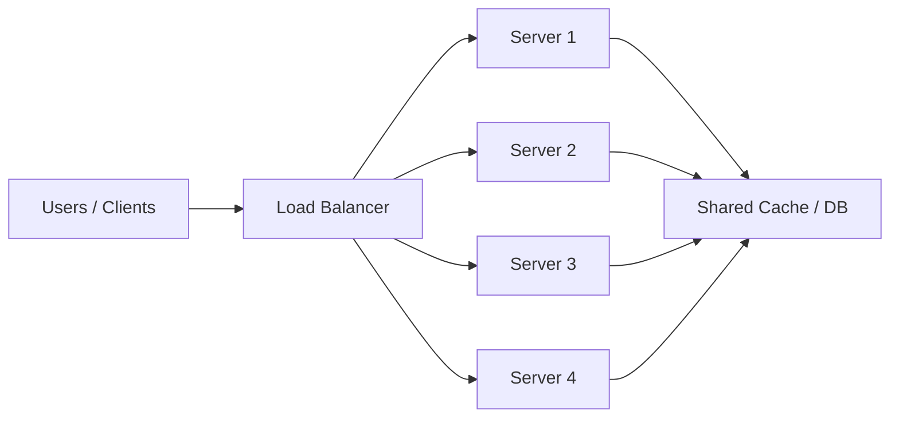

## 1) What are Load Balancers?

A load balancer is a component that distributes traffic across multiple backend instances. It can live at different network layers:

- Layer 4 (L4): routes based on IP address and TCP/UDP information
- Layer 7 (L7): routes based on HTTP headers, URLs, cookies, or application-level attributes

### Why load balancers matter
Without a load balancer, a single server may become overloaded. With a load balancer, traffic is spread out across healthy instances so that:

- request latency stays stable under load
- failures are isolated to a subset of machines
- scaling becomes easier
- services can be kept available through redundancy

### Common use cases
- distribute traffic across web app servers
- route traffic across multiple regions
- protect backends from sudden spikes
- perform health checks and failover
- support blue-green and canary deployments

### Important distinction
A load balancer does not magically make a system scalable if the backend itself is a bottleneck. It only distributes work efficiently. The real system design still needs proper database scaling, caching, async processing, and capacity planning.

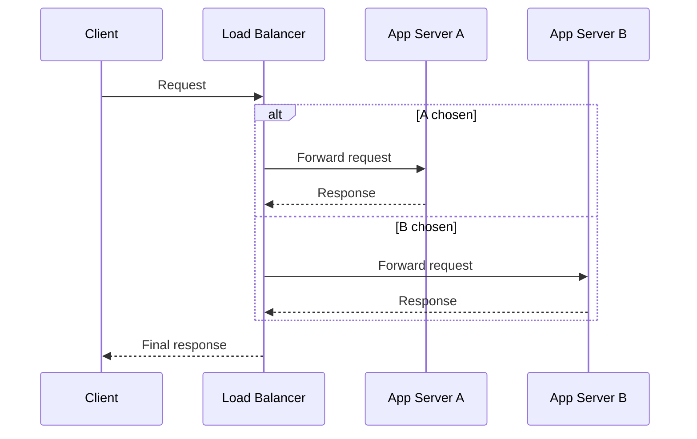

### Interview angle
When asked this in an interview, explain not just the definition but the purpose: load balancers reduce risk, improve performance, support availability, and make horizontal scaling possible.

---

## 2) Load Balancing Algorithms

The algorithm decides which backend receives the next request. The best algorithm depends on the workload and health of the servers.

### Common algorithms

#### Round Robin
Each request goes to the next backend in order.

Pros:
- simple and predictable
- works well when all instances have similar capacity

Cons:
- ignores server load differences
- can be inefficient if some servers are slower than others

#### Weighted Round Robin
Each server gets a weight based on capacity. A bigger server gets more requests.

Use when:
- servers have different CPU/RAM sizes
- some nodes are more powerful than others

#### Least Connections
Routes traffic to the backend with the fewest active connections.

Use when:
- requests vary in duration
- some backends are busier than others

Good for latency-sensitive workloads with uneven request processing times.

#### Least Response Time
Chooses the server with both low connection count and low response delay.

Good for systems where request latency matters a lot.

#### IP Hash / Client Hashing
Uses the client IP or some hash of a key to consistently route the same client to the same server.

Pros:
- enables sticky routing
- useful for session-affinity workflows

Cons:
- uneven load distribution if the client population is skewed
- not ideal for dynamic environments with frequent changes

#### Random
Simple but not usually preferred for production because it can produce uneven traffic distribution.

### Choosing an algorithm
The decision is not just about fairness. It is about balancing:

- traffic distribution
- resource utilization
- latency
- session affinity requirements
- cost of rebalancing

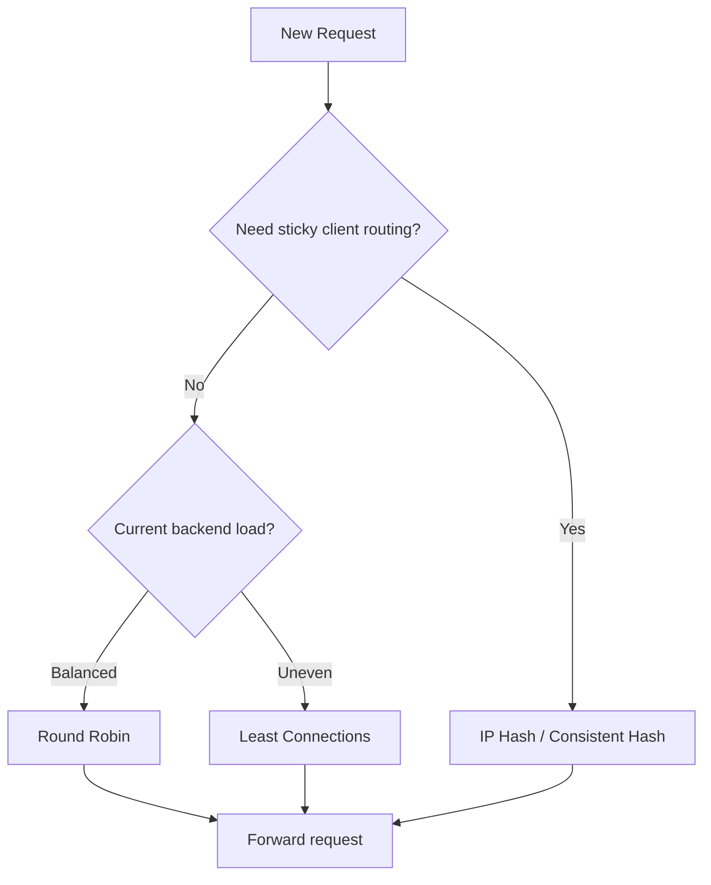

### Interview insight
Good answers mention that load balancing is not a one-size-fits-all problem. Different algorithms optimize for different objectives: fairness, speed, or session consistency.

---

## 3) DNS Load Balancing

DNS load balancing routes client requests to different IPs based on DNS answers. It is often used for geographic distribution and high-availability.

### How it works
A DNS server returns one or more IP addresses for a domain name. The resolver may pick one, or the DNS provider might rotate responses across a set of healthy IPs.

### Benefits
- simple to deploy
- supports global traffic routing
- helps spread load across regions

### Limitations
- DNS caching can cause stale routing decisions
- TTL (time to live) controls how often clients refresh the IP
- lower control than L4/L7 load balancers
- not ideal for per-request decisions

### Use cases
- route users to the nearest healthy data center
- failover when a region becomes unhealthy
- distribute traffic across multiple public endpoints

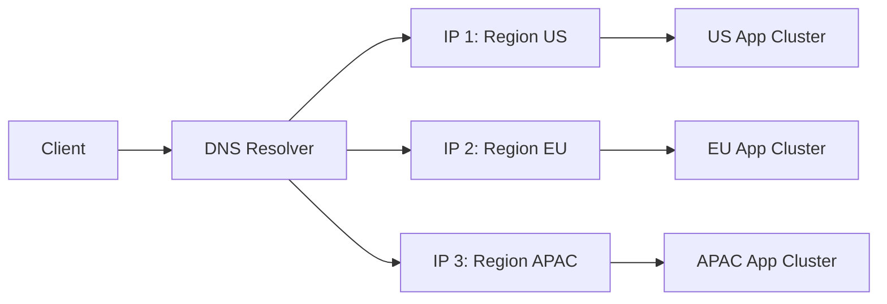

### Important nuance
DNS load balancing is often used at the edge, but it is not a full replacement for in-region load balancers. It is coarse-grained and works well for geography, not for fine-grained request-level control.

---

## 4) Anycast Routing

Anycast routing allows multiple servers in different locations to share the same IP address. Network routing sends traffic to the nearest or best available instance based on BGP and routing table decisions.

### Why it matters
It is commonly used in CDNs, DDoS mitigation, and global service entry points.

### How it works
Each server advertises the same IP address to the Internet. The network routes the user to the closest or most optimal edge based on topology, latency, or health.

### Benefits
- very low latency for global users
- excellent for edge services and content delivery
- good failover capability across regions

### Challenges
- difficult to debug because request routing is controlled by the network, not the app
- requires careful operational setup and coordination
- not every system can use it easily

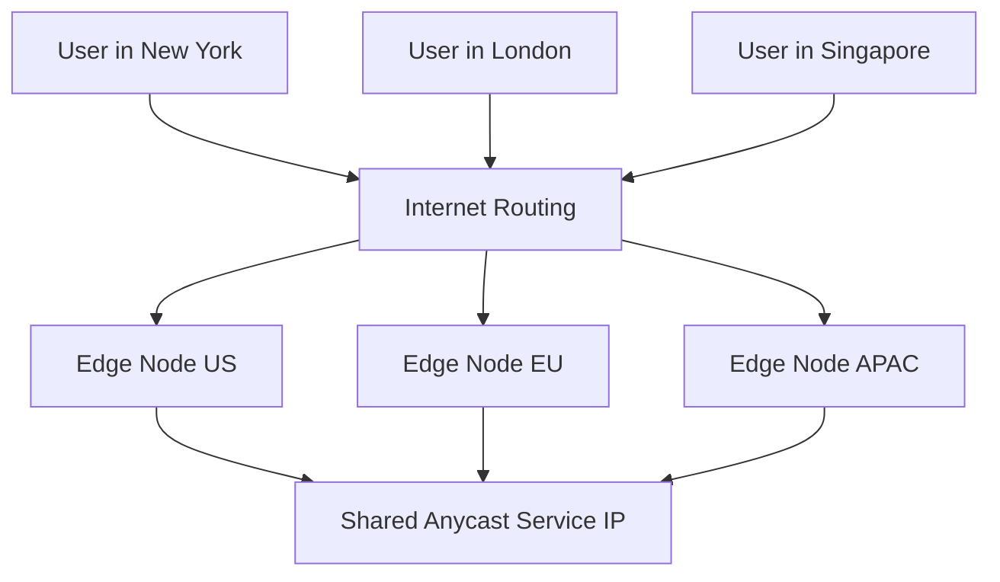

### Interview angle
Explain that Anycast is a network-level routing optimization, whereas DNS and application load balancers are more application- or policy-driven.

---

## 5) Global vs Regional Load Balancers

A global load balancer operates across multiple regions or countries. A regional load balancer routes traffic inside a single region or availability zone.

### Global load balancer
Used when:
- user traffic is spread across geographies
- you need failover across regions
- you want to reduce latency by routing users to the closest healthy site

Typical responsibilities:
- geo-routing
- health checks across regions
- DNS or edge-based traffic steering
- disaster recovery orchestration

### Regional load balancer
Used inside a region to:
- distribute requests across servers in a single zone
- handle local failover and health-aware routing
- keep traffic within a data center or region

### Trade-offs
- Global load balancing improves latency and resilience but adds complexity
- Regional load balancing is simpler and cheaper, but less resilient to regional outages

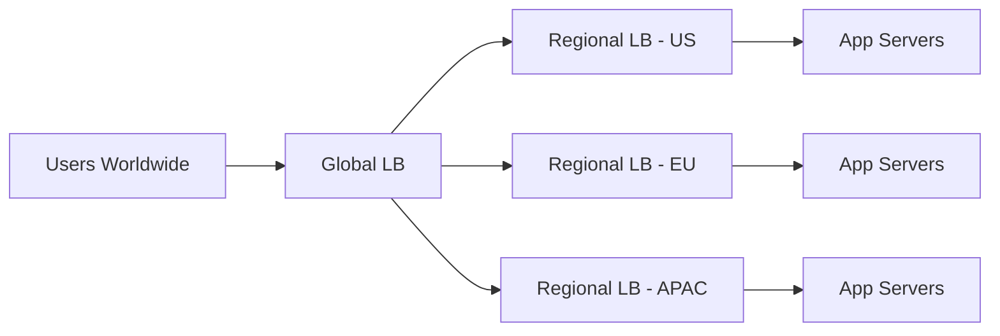

### Design implication
For a global service, a typical pattern is: edge/global routing first, then local regional load balancing, then application-level scaling.

---

## 6) Hardware vs Software Load Balancers

### Hardware load balancers
These are dedicated appliances designed for high-throughput, optimized networking, and enterprise-grade reliability.

Pros:
- high performance
- specialized hardware features
- strong operational support in large enterprises

Cons:
- expensive
- less flexible
- slower to adapt to modern cloud-native deployment patterns

### Software load balancers
These run on commodity servers or virtual machines. Common examples include NGINX, HAProxy, Envoy, and cloud-managed load balancers.

Pros:
- cost-effective
- flexible and programmable
- easy to integrate into cloud architectures
- suitable for modern microservices and containers

Cons:
- may require more tuning
- throughput depends on host resources
- operational complexity may rise at very large scale

### Which to choose?
- enterprise networking with strict SLA and specialized hardware -> hardware LB
- cloud-native, dynamic, API-driven architectures -> software or managed LB

### Interview answer
A strong answer says that hardware is often chosen for performance-critical, on-premise enterprise environments, while software load balancers dominate cloud-native and hybrid systems because they are easier to automate and scale.

---

## 7) Rendezvous Hashing

Rendezvous hashing, also known as highest-random-weight hashing (HRW), is used when you want a stable assignment of keys to servers with minimal disruption as the server pool changes.

### Why it matters
Unlike naive hashing, rendezvous hashing keeps most keys pinned to the same server even when nodes are added or removed. That makes it attractive for caches, data partitions, and distributed systems.

### Intuition
Each server and key are assigned a score based on a hash function. The key is assigned to the server with the highest score. When nodes change, only some keys move, not all of them.

### Benefits
- stable under incremental cluster changes
- reduces unnecessary data movement
- useful in distributed caches and partitioned systems

### Example
Imagine a system with 10 cache nodes. If one node fails, only a subset of keys is reassigned. That is better than rehashing the entire cache and causing a large cold miss spike.

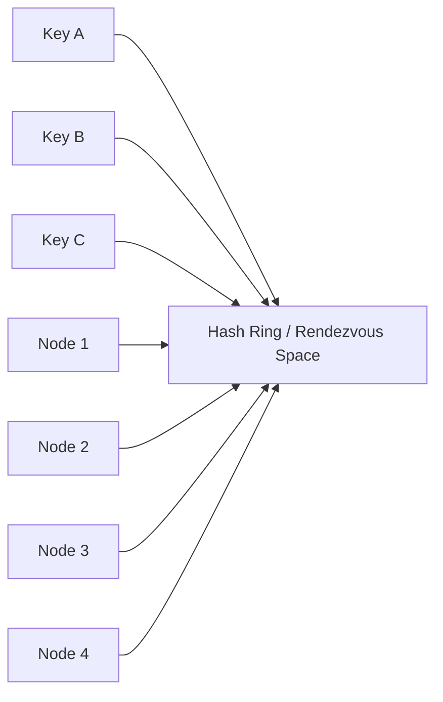

### Where it appears
- cache sharding
- distributed key-value stores
- consistent request routing in dynamic clusters

---

## 8) Health Checks (Active vs Passive)

Health checks are how a load balancer decides whether a server is healthy enough to receive traffic.

### Active health checks
The load balancer periodically probes each server.

Examples:
- HTTP GET /health
- TCP connection check
- gRPC health endpoint
- custom heartbeat endpoints

Benefits:
- more accurate and proactive
- allows the LB to remove unhealthy nodes quickly

Drawbacks:
- adds extra traffic and operational overhead
- must be tuned to avoid false positives

### Passive health checks
The load balancer infers health from observed traffic or request failures.

Examples:
- connection reset
- timeouts
- 5xx spikes
- slow response rates

Benefits:
- simple and low overhead
- useful when active checks are not possible

Drawbacks:
- slower to respond to failures
- can route more traffic to unhealthy nodes before recovery

### Good production pattern
Use both: active checks for targeted health verification and passive checks for rapid failure detection during real traffic.

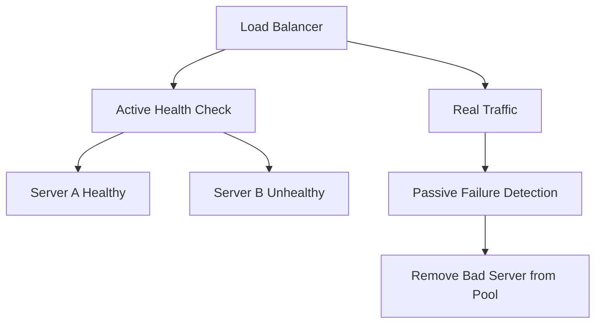

### Interview point
This is often the difference between a system that “looks healthy” and a system that truly recovers from failures.

---

## 9) Sticky Sessions

Sticky sessions are a routing policy that sends a client back to the same backend instance for subsequent requests.

### Why use them
Some applications store session state locally in memory. In that case, a request from the same user must consistently hit the same server.

### Benefits
- preserves in-memory session state
- can reduce repeated authentication or cart setup work

### Problems
- creates uneven load across servers
- can reduce resilience when one node fails
- not compatible with fully stateless architectures

### Better alternatives
Modern systems usually prefer:
- distributed session stores
- JWTs or signed tokens
- external session/cache backends
- stateless app servers

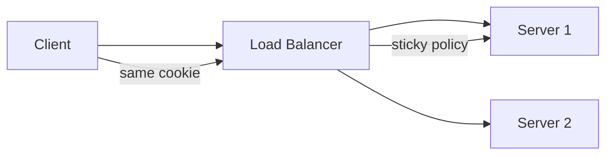

### Good interview answer
Sticky sessions are useful when the app is stateful, but for scalable cloud systems you should prefer stateless services and shared external state.

---

## 10) Load Balancer Failover

Failover is the process of switching traffic to a backup or secondary load balancer when the primary one becomes unhealthy.

### Common failover patterns

#### Active-active
Multiple load balancers accept traffic simultaneously.

Pros:
- higher availability
- better throughput
- graceful handling of partial failure

Cons:
- more operational complexity
- requires synchronization and shared health logic

#### Active-passive
Primary load balancer handles traffic; secondary stays ready.

Pros:
- simpler to operate
- lower cost

Cons:
- backup may not handle full traffic immediately
- failover time may be higher

### Typical mechanisms
- virtual IP (VIP) reassignment
- health check and route switching
- keepalived / VRRP / BGP-based failover 
- regional failover orchestration

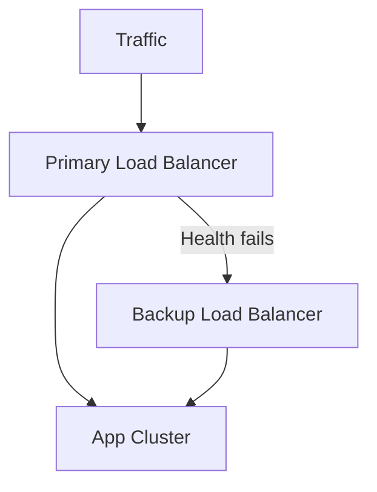

### Practical point
For critical systems, failover should be tested regularly. A backup that has never been exercised can still fail in a real outage due to misconfiguration or stale state.

---

## 11) Load Shedding

Load shedding is the intentional dropping or deprioritizing of some requests to protect the system from overload. It is a defensive strategy used when a system is under too much demand to handle all traffic successfully.

### Why it happens
When traffic exceeds capacity, continuing to accept all requests may lead to cascading failure. Instead of letting the whole system collapse, the system selectively discards less valuable work.

### Examples
- reject low-priority API requests
- limit background tasks during peak demand
- send 429 Too Many Requests to clients
- degrade optional features such as recommendations or analytics

### Good trade-off
Load shedding is usually better than total outage, but it must be designed carefully so critical tasks still get priority.

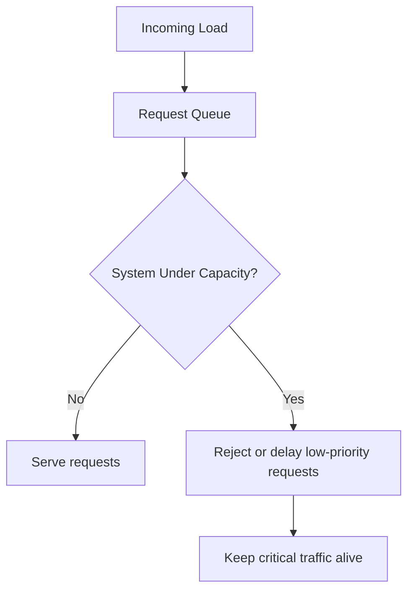

### Interview takeaway
A strong candidate explains that load shedding is not a sign of failure; it is an intentional admission control strategy that protects service health and user experience.

---

## Final takeaway
Load balancing is about distributed traffic management and system resilience. A well-designed load balancing layer:

- spreads load to avoid overload
- routes around unhealthy instances
- supports global and regional traffic patterns
- integrates with health checks and failover
- can degrade gracefully under extreme conditions

The most important thing in interviews is not memorizing terms but explaining the trade-offs:

- round robin is simple but less aware of uneven capacity
- consistent hashing helps with stable routing
- DNS helps with geo routing but is coarse-grained
- health checks prevent unhealthy nodes from receiving traffic
- sticky sessions may work for stateful apps but should not be the default for modern stateless platforms
- failover and load shedding protect availability when systems approach overload

When you can explain why a design decision is chosen and what trade-offs it introduces, you are already thinking like a strong system design candidate.
