# Load Balancing

Load balancing distributes incoming traffic across multiple backend servers so no single node becomes overloaded, unavailable, or a bottleneck. In production systems, it improves throughput, availability, fault tolerance, and user experience.

At a high level, it sits in front of application servers, databases, caches, or even entire data centers and decides where to send each request based on health, capacity, geography, or routing policy.

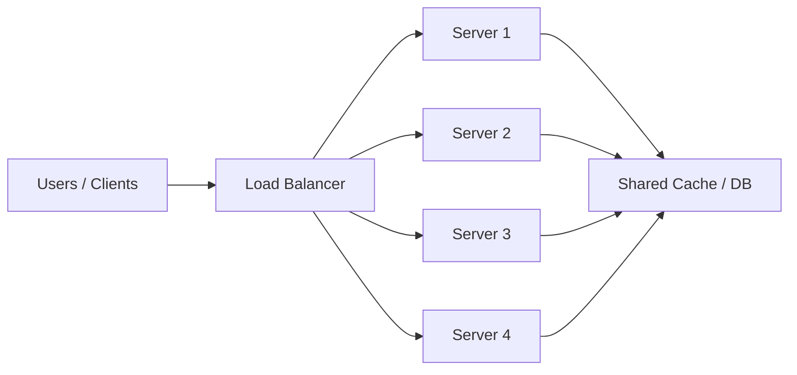

## 1) What are Load Balancers?

A load balancer is a component that distributes traffic across multiple backend instances.

| Layer | Routing basis | Best for | Typical use |
|---|---|---|---|
| L4 | IP, TCP, UDP metadata | Connection-level routing | High-throughput, simple traffic distribution |
| L7 | HTTP headers, URLs, cookies, app-level attributes | Request-aware routing | Routing by path, user, region, or service |

### Why load balancers matter
Without a load balancer, a single server may become overloaded. With one, traffic is spread across healthy instances so that:

- request latency stays stable under load
- failures are isolated to a subset of machines
- scaling becomes easier
- services stay available through redundancy

### Common use cases

| Use case | Goal |
|---|---|
| Web app traffic distribution | Avoid hot servers |
| Multi-region routing | Reduce latency and improve resilience |
| Burst protection | Absorb sudden spikes |
| Health checks + failover | Remove unhealthy nodes automatically |
| Blue-green / canary rollouts | Route traffic gradually |

### Important distinction
A load balancer does not magically make a system scalable if the backend itself is the bottleneck. It only distributes work efficiently; the real system still needs proper database scaling, caching, async processing, and capacity planning.

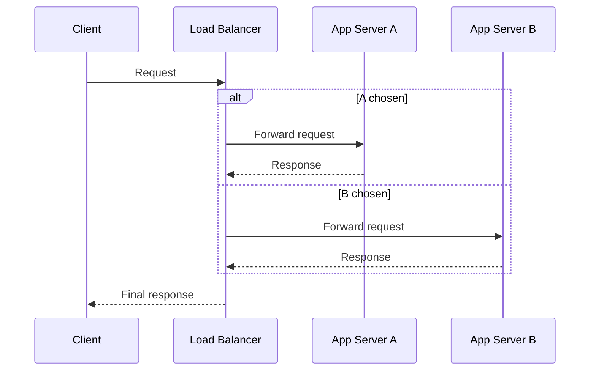

### Interview angle
When asked in an interview, explain not just the definition but the purpose: load balancers reduce risk, improve performance, support availability, and enable horizontal scaling.

---

## 2) Load Balancing Algorithms

The algorithm decides which backend receives the next request. The best choice depends on workload, capacity, and health.

| Algorithm | How it works | Best for | Strengths | Weaknesses |
|---|---|---|---|---|
| Round Robin | Cycles through servers in order | Similar-capacity nodes | Simple, predictable | Ignores uneven server load |
| Weighted Round Robin | Higher-capacity servers get more requests | Mixed-power pools | Better capacity matching | Still not load-aware |
| Least Connections | Sends traffic to server with fewest active connections | Uneven request durations | Good for busy workloads | Doesn't consider latency directly |
| Least Response Time | Chooses the fastest server by latency + connection count | Latency-sensitive services | Strong performance signal | More complex |
| IP Hash / Client Hashing | Hashes client key to fixed server | Sticky routing / session affinity | Stable routing | Can create skew and poor load distribution |
| Random | Picks a server at random | Simple fallback | Very easy to implement | Unbalanced under load |

### Choosing an algorithm
The decision is not only about fairness; it is about balancing:

- traffic distribution
- resource utilization
- latency
- session affinity requirements
- rebalancing cost

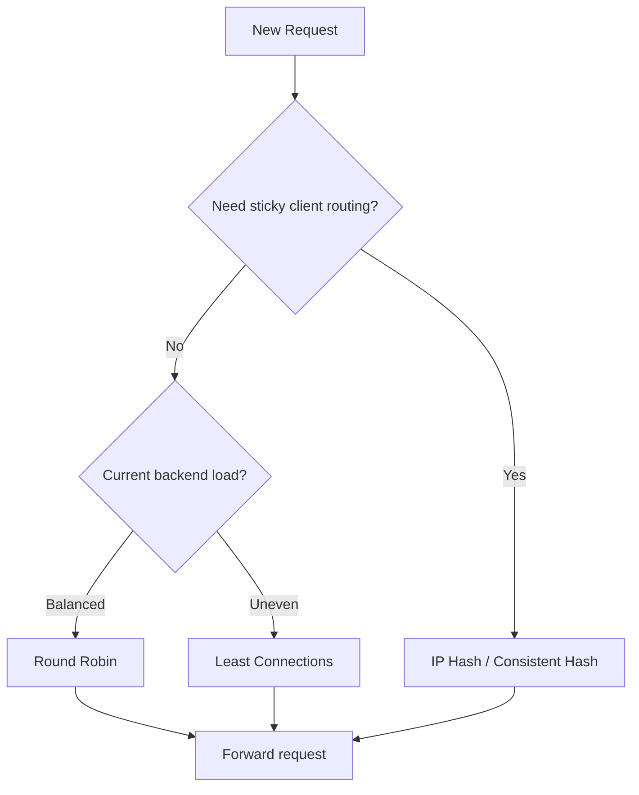

### Interview insight
Good answers mention that load balancing is not a one-size-fits-all problem. Different algorithms optimize for fairness, speed, or session consistency.

---

## 3) DNS Load Balancing

DNS load balancing returns different IPs for the same domain based on DNS policy. It is often used for geographic distribution and high availability.

| Aspect | Summary |
|---|---|
| How it works | Resolver gets one or more IPs; provider may rotate them |
| Best use | Global routing and failover |
| Strengths | Simple, cheap, region-aware |
| Limits | Cached responses, coarse control, not per-request |

### Benefits
- simple to deploy
- supports global traffic routing
- helps spread load across regions

### Limitations
- DNS caching can cause stale routing decisions
- TTL (time to live) controls refresh frequency
- lower control than L4/L7 load balancers
- not ideal for per-request decisions

### Use cases
- route users to the nearest healthy data center
- failover when a region becomes unhealthy
- distribute traffic across multiple public endpoints

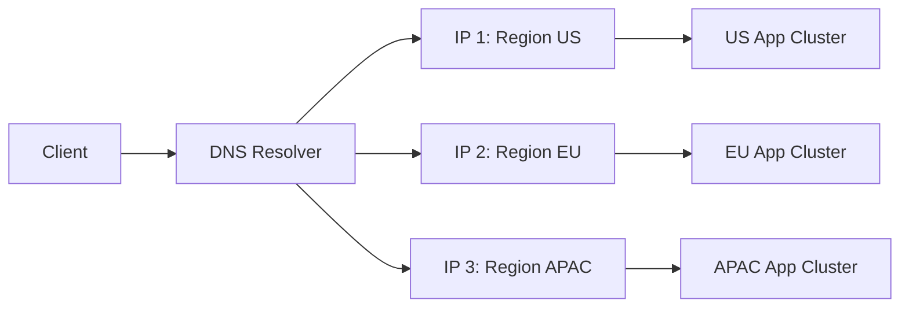

### Important nuance
DNS load balancing is often used at the edge, but it is not a full replacement for in-region load balancers. It is coarse-grained and works well for geography, not for fine-grained request-level control.

---

## 4) Anycast Routing

Anycast routes multiple servers in different locations to the same IP address. Network routing sends traffic to the nearest or best available instance based on BGP and routing table decisions.

| Aspect | Summary |
|---|---|
| Typical use | CDNs, DDoS mitigation, global ingress |
| Strengths | Very low latency, good failover across regions |
| Challenges | Hard to debug, operationally complex |

### How it works
Each server advertises the same IP address to the Internet. The network routes the user to the closest or most optimal edge based on topology, latency, or health.

### Benefits
- very low latency for global users
- strong for edge services and content delivery
- good failover capability across regions

### Challenges
- routing is controlled by the network, not the app
- requires careful operational setup and coordination
- not every system can use it easily

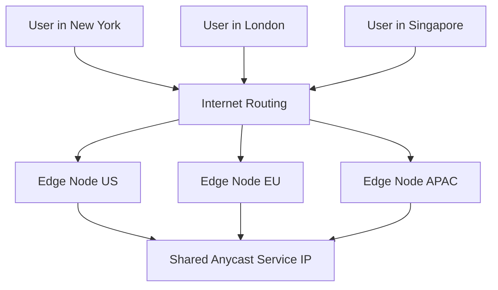

### Interview angle
Anycast is a network-level routing optimization; DNS and application load balancers are more policy- or app-driven.

---

## 5) Global vs Regional Load Balancers

| Scope | Used for | Strengths | Trade-offs |
|---|---|---|---|
| Global | Multi-region routing, disaster recovery, geo-aware latency | Lower user latency, better resilience | More complexity |
| Regional | Traffic inside one region/zone | Simpler, cheaper, local failover | Less resilient to regional outages |

### Global load balancer
Used when:
- user traffic is spread across geographies
- you need failover across regions
- you want to route users to the closest healthy site

Typical responsibilities:
- geo-routing
- cross-region health checks
- DNS or edge-based traffic steering
- disaster recovery orchestration

### Regional load balancer
Used inside a region to:
- distribute requests across servers in a single zone
- handle local failover and health-aware routing
- keep traffic within a data center or region

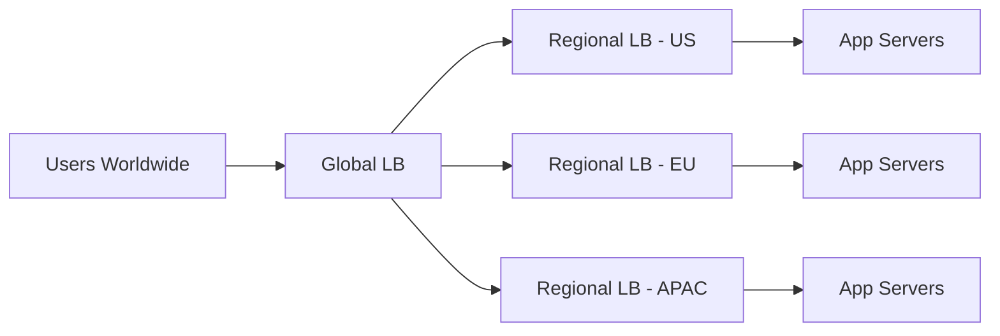

### Design implication
For a global service, a common pattern is: edge/global routing first, then regional balancing, then application-level scaling.

---

## 6) Hardware vs Software Load Balancers

| Type | Strengths | Weaknesses | Best fit |
|---|---|---|---|
| Hardware LB | Very high throughput, specialized features, enterprise support | Expensive, less flexible, slower to adapt | On-prem, SLA-heavy environments |
| Software LB | Cost-effective, programmable, cloud-friendly | Needs tuning, host-resource dependent | Cloud-native and hybrid systems |

### Hardware load balancers
Dedicated appliances designed for high-throughput networking and enterprise-grade reliability.

### Software load balancers
Run on commodity servers or VMs. Common examples include NGINX, HAProxy, Envoy, and cloud-managed load balancers.

### Which to choose?
- enterprise networking with strict SLA and specialized hardware -> hardware LB
- cloud-native, dynamic, API-driven architectures -> software or managed LB

### Interview answer
Hardware is often chosen for performance-critical, on-prem enterprise environments, while software load balancers dominate cloud-native and hybrid systems because they are easier to automate and scale.

---

## 7) Rendezvous Hashing

Rendezvous hashing, or highest-random-weight hashing (HRW), aims for stable assignment of keys to servers with minimal disruption as the cluster changes.

| Aspect | Summary |
|---|---|
| Why important | Keeps most keys pinned to the same node during churn |
| Best use | Cache sharding, partitioned storage, dynamic clusters |
| Benefit | Reduces unnecessary data movement |

### Intuition
Each server and key are assigned a score using a hash function. The key goes to the server with the highest score. When nodes change, only a subset of keys move instead of all keys.

### Example
If a 10-node cache loses one node, only a subset of keys is reassigned; this is much better than rehashing the entire cache and causing a large cold-miss spike.

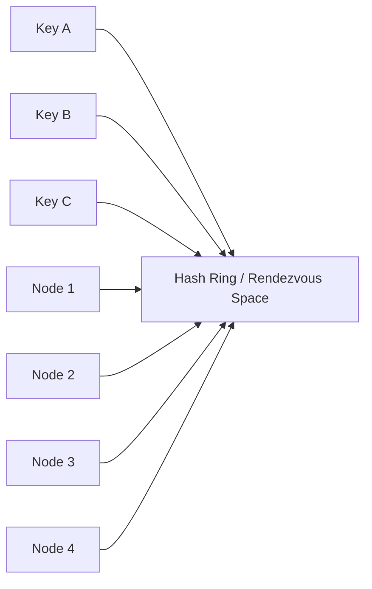

### Where it appears
- cache sharding
- distributed key-value stores
- consistent request routing in dynamic clusters

---

## 8) Health Checks (Active vs Passive)

Health checks are how a load balancer decides whether a server is healthy enough to receive traffic.

| Type | Examples | Benefits | Drawbacks |
|---|---|---|---|
| Active | HTTP `/health`, TCP probes, gRPC health checks | Proactive and accurate | Extra traffic and tuning overhead |
| Passive | Timeouts, 5xx spikes, connection resets | Low overhead, simple | Slower to respond and can route around bad nodes too long |

### Active health checks
The load balancer periodically probes each server.

### Passive health checks
The load balancer infers health from observed traffic or request failures.

### Good production pattern
Use both: active checks for health verification and passive checks for quick failure detection under real traffic.

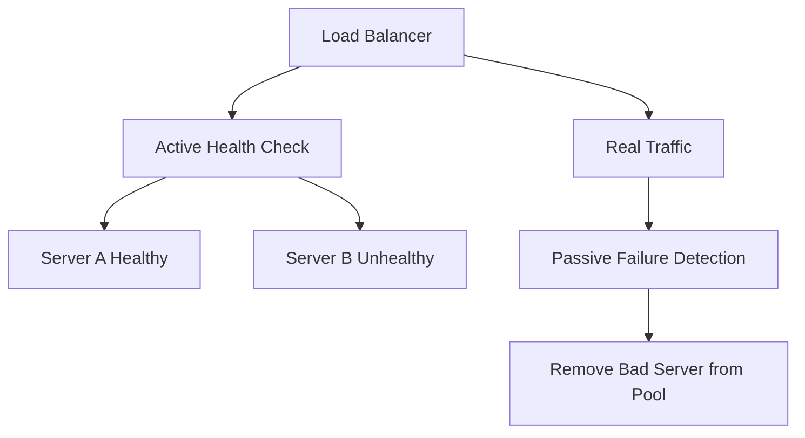

### Interview point
This is often the difference between a system that “looks healthy” and a system that truly recovers from failure.

---

## 9) Sticky Sessions

Sticky sessions send the same client back to the same backend instance for subsequent requests.

| Question | Answer |
|---|---|
| Why use them? | Some apps store session state in memory |
| Benefits | Preserves local session state and reduces repeated auth/cart setup |
| Problems | Uneven load, poor recovery if a node fails, not ideal for stateless systems |
| Preferred alternative | Distributed session stores, JWTs, external caches, stateless apps |

### Better alternatives
Modern systems usually prefer:
- distributed session stores
- JWTs or signed tokens
- external session/cache backends
- stateless app servers

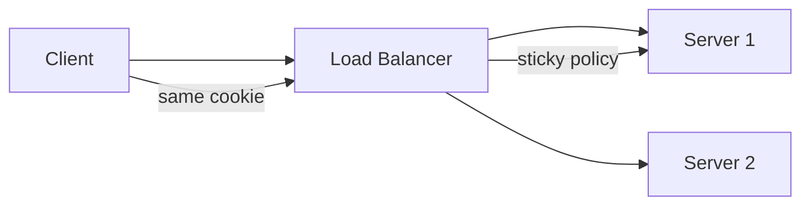

### Good interview answer
Sticky sessions are useful when the app is stateful, but in scalable cloud systems you should prefer stateless services and shared external state.

---

## 10) Load Balancer Failover

Failover is the process of switching traffic to a backup or secondary load balancer when the primary becomes unhealthy.

| Pattern | How it works | Strengths | Weaknesses |
|---|---|---|---|
| Active-active | Multiple LBs serve traffic at once | Higher availability, better throughput | More complexity |
| Active-passive | Primary handles traffic; backup stays ready | Simpler and cheaper | Slower failover and less immediate capacity |

### Typical mechanisms
- virtual IP (VIP) reassignment
- health check and route switching
- keepalived / VRRP / BGP-based failover
- regional failover orchestration

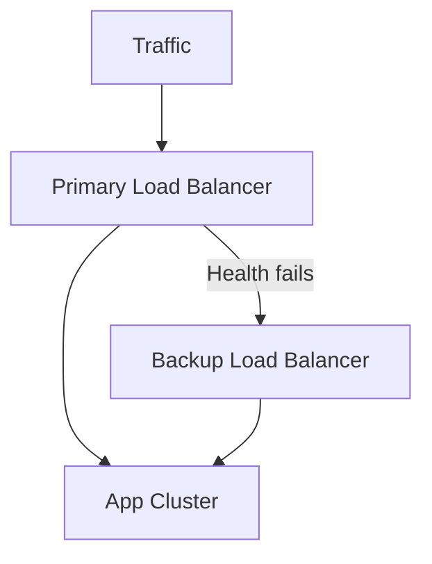

### Practical point
For critical systems, failover should be tested regularly. A standby that has never been exercised can still fail during a real outage due to misconfiguration or stale state.

---

## 11) Load Shedding

Load shedding is the intentional dropping or deprioritizing of some requests to protect the system from overload.

| Scenario | Action | Goal |
|---|---|---|
| Traffic exceeds capacity | Reject low-priority requests | Prevent cascading failure |
| Peak demand | Limit background work | Preserve critical path |
| Extreme overload | Return 429 / degrade optional features | Keep core services alive |

### Why it happens
When traffic exceeds capacity, accepting everything can trigger cascading failure. It is better to selectively discard lower-value work than to let the whole system collapse.

### Good trade-off
Load shedding is usually better than total outage, but it must be designed carefully so critical tasks still get priority.

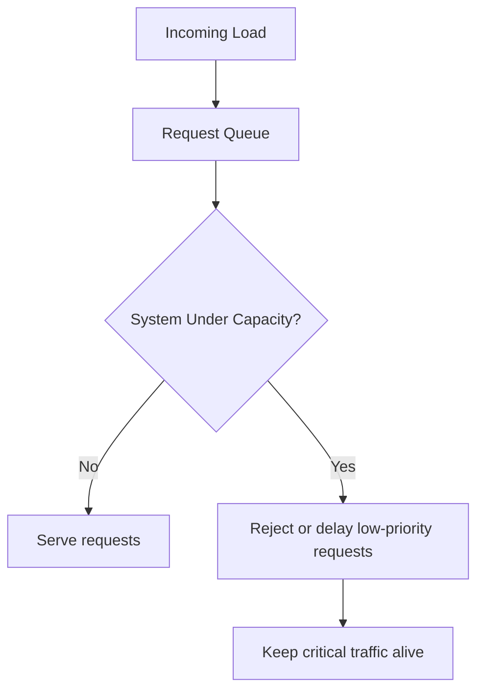

### Interview takeaway
A strong candidate explains that load shedding is not a sign of failure; it is an intentional admission-control strategy that protects service health and user experience.

---

## Final takeaway

| Decision area | Good default mindset | Main trade-off |
|---|---|---|
| Request distribution | Spread load across healthy nodes | Must consider fairness vs latency |
| Routing policy | Use geo-aware or health-aware rules when needed | More complexity |
| State handling | Favor stateless services | Needs external session/cache infrastructure |
| Resilience | Add health checks and failover | Operational overhead grows |
| Overload control | Shed low-priority work early | Some requests are intentionally dropped |

The key interview idea is not to memorize terms but to explain the trade-offs:

- round robin is simple but less aware of uneven capacity
- consistent hashing helps with stable routing
- DNS helps with geo routing but is coarse-grained
- health checks prevent unhealthy nodes from receiving traffic
- sticky sessions may work for stateful apps but should not be the default for modern stateless platforms
- failover and load shedding protect availability when systems approach overload

When you can explain why a design decision is chosen and what trade-offs it introduces, you are already thinking like a strong system design candidate.
