# Load Balancing

Load balancing distributes incoming traffic across multiple backend servers so no single node becomes overloaded, unavailable, or a bottleneck. In production systems, it improves throughput, availability, fault tolerance, and user experience.

At a high level, it sits in front of application servers, databases, caches, or even entire data centers and decides where to send each request based on health, capacity, geography, or routing policy.

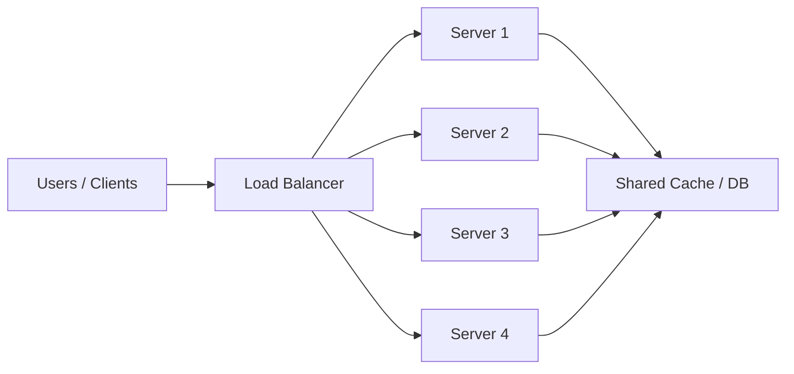

## 1) What are Load Balancers?

A load balancer is a component that distributes traffic across multiple backend instances.

| Layer | Routing basis | Best for | Typical use |
|---|---|---|---|
| L4 | IP, TCP, UDP metadata | Connection-level routing | High-throughput, simple traffic distribution |
| L7 | HTTP headers, URLs, cookies, app-level attributes | Request-aware routing | Routing by path, user, region, or service |

### Why load balancers matter
Without a load balancer, a single server may become overloaded. With one, traffic is spread across healthy instances so that:

- request latency stays stable under load
- failures are isolated to a subset of machines
- scaling becomes easier
- services stay available through redundancy

### Common use cases

| Use case | Goal |
|---|---|
| Web app traffic distribution | Avoid hot servers |
| Multi-region routing | Reduce latency and improve resilience |
| Burst protection | Absorb sudden spikes |
| Health checks + failover | Remove unhealthy nodes automatically |
| Blue-green / canary rollouts | Route traffic gradually |

### Important distinction
A load balancer does not magically make a system scalable if the backend itself is the bottleneck. It only distributes work efficiently; the real system still needs proper database scaling, caching, async processing, and capacity planning.

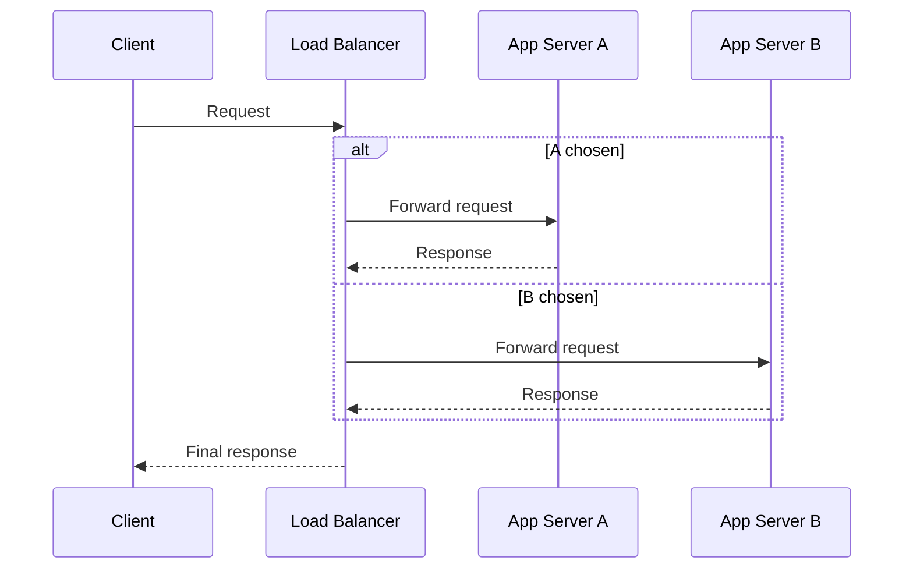

### Interview angle
When asked in an interview, explain not just the definition but the purpose: load balancers reduce risk, improve performance, support availability, and enable horizontal scaling.

---

## 2) Load Balancing Algorithms

The algorithm decides which backend receives the next request. The best choice depends on workload, capacity, and health.

| Algorithm | How it works | Best for | Strengths | Weaknesses |
|---|---|---|---|---|
| Round Robin | Cycles through servers in order | Similar-capacity nodes | Simple, predictable | Ignores uneven server load |
| Weighted Round Robin | Higher-capacity servers get more requests | Mixed-power pools | Better capacity matching | Still not load-aware |
| Least Connections | Sends traffic to server with fewest active connections | Uneven request durations | Good for busy workloads | Doesn't consider latency directly |
| Least Response Time | Chooses the fastest server by latency + connection count | Latency-sensitive services | Strong performance signal | More complex |
| IP Hash / Client Hashing | Hashes client key to fixed server | Sticky routing / session affinity | Stable routing | Can create skew and poor load distribution |
| Random | Picks a server at random | Simple fallback | Very easy to implement | Unbalanced under load |

### Choosing an algorithm
Choose based on the workload and the constraint you need to address:

- traffic distribution
- resource utilization
- latency
- session affinity requirements
- rebalancing cost

| Situation | Real-world example | Good starting choice |
|---|---|---|
| Servers have similar capacity and requests are short and stateless | A web tier serving mostly uniform page or API requests | Round Robin |
| Servers have known, consistently different capacity | A larger instance can handle roughly twice the traffic of a smaller one | Weighted Round Robin |
| Requests or connections last for very different lengths of time | A reporting API mixes quick lookups with long-running exports, or a service holds open connections | Least Connections |
| Response latency is the main goal and backend response-time measurements are reliable | A user-facing API routes among healthy replicas with different observed response times | Least Response Time |
| A client must keep reaching the same backend | A legacy application keeps a shopping cart in local memory | IP Hash / Client Hashing |

Client hashing can create hot spots when client traffic is uneven or the backend pool changes. Prefer shared session state when possible; use affinity only when the application needs it.

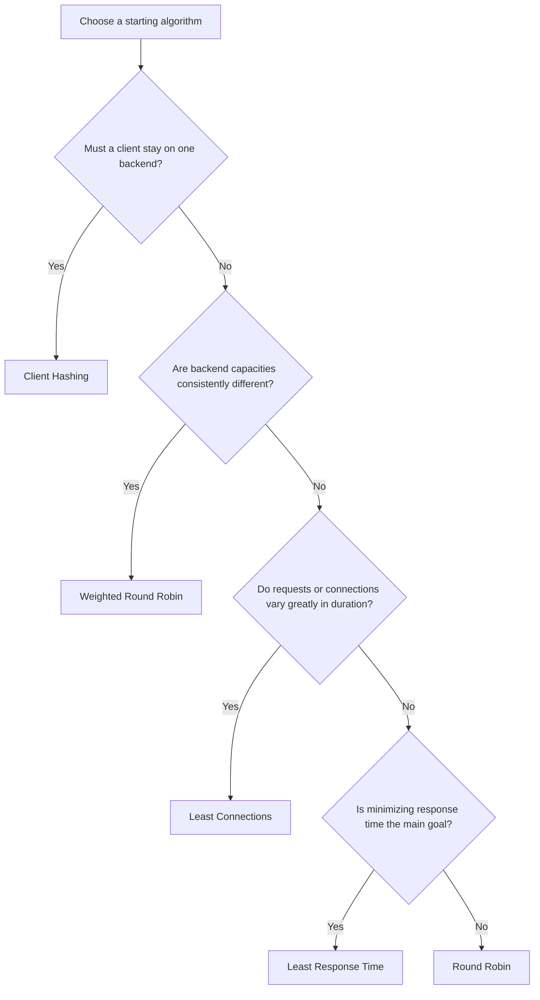

Treat this as a starting point, not a substitute for measurement: compare latency, errors, and backend utilization under representative traffic, and revisit the choice as the workload changes.

### Interview insight
Good answers mention that load balancing is not a one-size-fits-all problem. Different algorithms optimize for fairness, speed, or session consistency.

---

## 3) DNS Load Balancing

DNS load balancing returns different IPs for the same domain based on DNS policy. It is often used for geographic distribution and high availability.

| Aspect | Summary |
|---|---|
| How it works | Resolver gets one or more IPs; provider may rotate them |
| Best use | Global routing and failover |
| Strengths | Simple, cheap, region-aware |
| Limits | Cached responses, coarse control, not per-request |

### Benefits
- simple to deploy
- supports global traffic routing
- helps spread load across regions

### Limitations
- DNS caching can cause stale routing decisions
- TTL (time to live) controls refresh frequency
- lower control than L4/L7 load balancers
- not ideal for per-request decisions

### Use cases
- route users to the nearest healthy data center
- failover when a region becomes unhealthy
- distribute traffic across multiple public endpoints

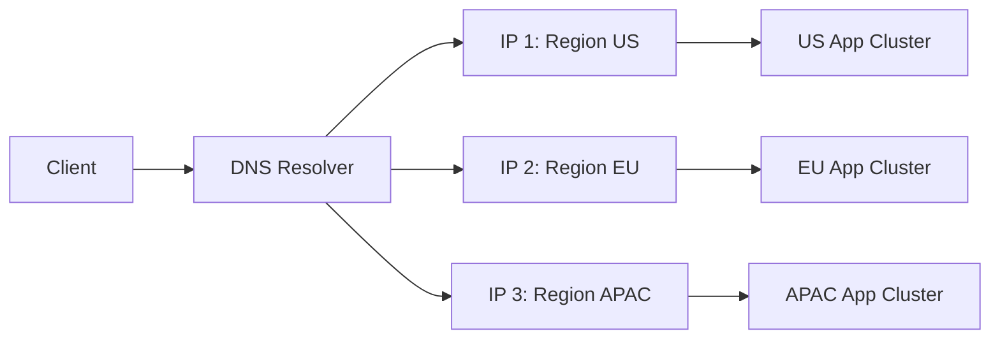

### Important nuance
DNS load balancing is often used at the edge, but it is not a full replacement for in-region load balancers. It is coarse-grained and works well for geography, not for fine-grained request-level control.

---

## 4) Anycast Routing

Anycast routes multiple servers in different locations to the same IP address. Network routing sends traffic to the nearest or best available instance based on BGP and routing table decisions.

| Aspect | Summary |
|---|---|
| Typical use | CDNs, DDoS mitigation, global ingress |
| Strengths | Very low latency, good failover across regions |
| Challenges | Hard to debug, operationally complex |

### How it works
Each server advertises the same IP address to the Internet. The network routes the user to the closest or most optimal edge based on topology, latency, or health.

### Benefits
- very low latency for global users
- strong for edge services and content delivery
- good failover capability across regions

### Challenges
- routing is controlled by the network, not the app
- requires careful operational setup and coordination
- not every system can use it easily

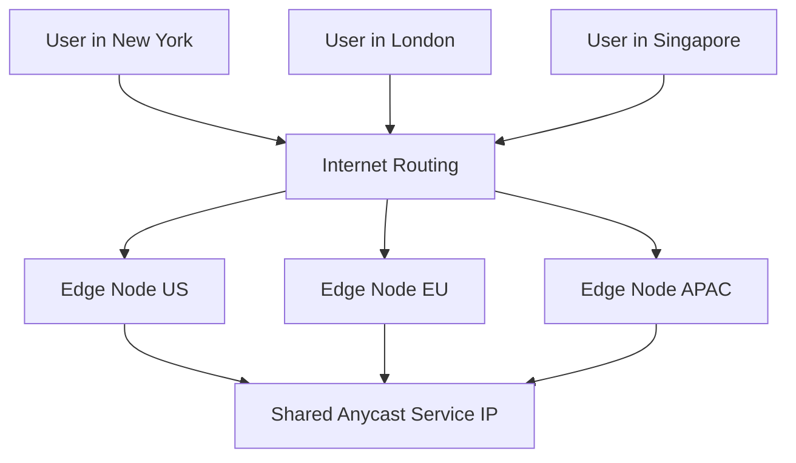

### Interview angle
Anycast is a network-level routing optimization; DNS and application load balancers are more policy- or app-driven.

---

## 5) Global vs Regional Load Balancers

| Scope | Used for | Strengths | Trade-offs |
|---|---|---|---|
| Global | Multi-region routing, disaster recovery, geo-aware latency | Lower user latency, better resilience | More complexity |
| Regional | Traffic inside one region/zone | Simpler, cheaper, local failover | Less resilient to regional outages |

### Global load balancer
Used when:
- user traffic is spread across geographies
- you need failover across regions
- you want to route users to the closest healthy site

Typical responsibilities:
- geo-routing
- cross-region health checks
- DNS or edge-based traffic steering
- disaster recovery orchestration

### Regional load balancer
Used inside a region to:
- distribute requests across servers in a single zone
- handle local failover and health-aware routing
- keep traffic within a data center or region

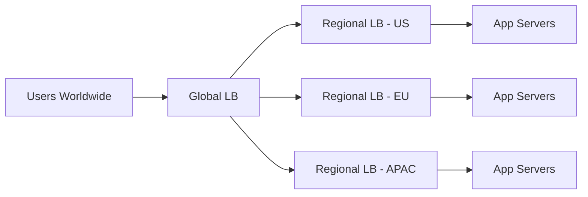

### Design implication
For a global service, a common pattern is: edge/global routing first, then regional balancing, then application-level scaling.

---

## 6) Hardware vs Software Load Balancers

| Type | Strengths | Weaknesses | Best fit |
|---|---|---|---|
| Hardware LB | Very high throughput, specialized features, enterprise support | Expensive, less flexible, slower to adapt | On-prem, SLA-heavy environments |
| Software LB | Cost-effective, programmable, cloud-friendly | Needs tuning, host-resource dependent | Cloud-native and hybrid systems |

### Hardware load balancers
Dedicated appliances designed for high-throughput networking and enterprise-grade reliability.

### Software load balancers
Run on commodity servers or VMs. Common examples include NGINX, HAProxy, Envoy, and cloud-managed load balancers.

### Which to choose?
- enterprise networking with strict SLA and specialized hardware -> hardware LB
- cloud-native, dynamic, API-driven architectures -> software or managed LB

### Interview answer
Hardware is often chosen for performance-critical, on-prem enterprise environments, while software load balancers dominate cloud-native and hybrid systems because they are easier to automate and scale.

---

## 7) Rendezvous Hashing

Rendezvous hashing, also called highest-random-weight hashing (HRW), deterministically assigns each key to the server with the highest score. It is useful when the server pool can change but keys should keep a stable owner.

| Aspect | Summary |
|---|---|
| Assignment rule | Choose the server with the highest hash score for the key |
| Best use | Cache sharding, partitioned storage, dynamic clusters |
| Benefit | Adding or removing a server moves only the keys whose winner changes |

### How it works
For each key, compute a score for every available server using a stable hash of the key and server ID. Assign the key to the server with the highest score. Because the scores are deterministic, the same key and server set produce the same owner wherever the algorithm runs.

### How is a score calculated?
The score is not a server's load or a value assigned manually. Hash the user key together with a unique server ID:

```text
score(user, server) = H(user_key, server_id)
```

For example, hash the pairs `(user:42, Node A)`, `(user:42, Node B)`, and `(user:42, Node C)` separately. A fixed-width hash produces an integer for each pair; compare those integers directly, or normalize them to the range `[0, 1)` for display. In the example below, the scores are illustrative normalized hash outputs, so `user:42` is assigned to Node B because `0.91` is highest. The same pair always produces the same score, while a different user or server ID produces a different score.

| Key | Score on Node A | Score on Node B | Score on Node C | Owner |
|---|---:|---:|---:|---|
| `user:42` | 0.18 | **0.91** | 0.37 | Node B |
| `user:73` | 0.82 | 0.24 | 0.55 | Node A |

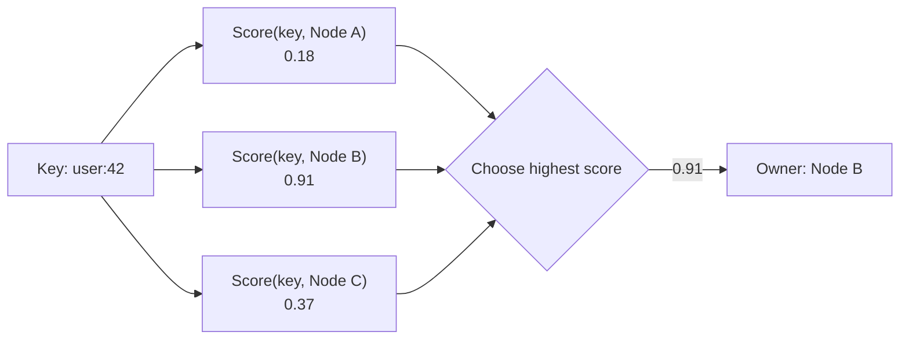

### What happens when the server pool changes?
If Node B is removed, `user:42` moves to Node C, its next-highest scoring server. Keys owned by other nodes keep their owners. If a node is added, only keys for which the new node scores higher than their current owner move to it.

With well-distributed scores and equally weighted nodes, removing one of `N` nodes moves about `1/N` of keys; adding a node to a pool of `N` moves about `1/(N+1)`. These are expected proportions, not guarantees for every key set. By contrast, a simple `hash(key) % N` assignment can remap most keys when `N` changes.

### Practical considerations
- Use stable, unique server IDs as hash inputs; changing an ID is effectively removing one node and adding another.
- All clients that compute assignments must use the same hash function and server list.
- For replicated data, choose the top `R` distinct servers by score instead of only the top one.
- A straightforward implementation scores every key against every server, so assignment work grows with the size of the server pool.

### Where it appears
- cache sharding
- distributed key-value stores
- consistent request routing in dynamic clusters

---

## 8) Health Checks (Active vs Passive)

Health checks determine whether a backend should remain in the load-balancer pool. The goal is to detect failure quickly without repeatedly removing and re-adding a server for a transient problem.

| Type | How it works | Examples | Strengths | Limitations |
|---|---|---|---|---|
| Active | The load balancer sends probes on a schedule | HTTP `/health`, TCP connect, gRPC health API | Detects failure even when traffic is low; consistent across nodes | Adds probe traffic; a probe result may differ from real request behavior |
| Passive | The load balancer observes real requests and connections | Timeouts, connection failures, 5xx rate, retries | Uses low overhead and reflects real client experience | May be slow when traffic is low or noisy; a few bad requests can trigger false positives |

### Active health checks

An active check regularly sends a lightweight request to every backend. A TCP check verifies only that a connection can be established, while an HTTP or gRPC check can verify application readiness.

A good health endpoint is designed for the question it answers:

| Endpoint/check | Checks | Use |
|---|---|---|
| `/livez` | Is the process able to handle requests? | Restart or replace a dead process |
| `/readyz` | Are required dependencies and initialization complete? | Remove a backend from traffic, but do not necessarily restart it |
| Deep `/health` | Database, cache, queue, disk, or downstream dependencies | Use carefully; one unhealthy dependency can remove an entire pool |

The probe interval, timeout, success threshold, and failure threshold should be tuned independently:

- **Probe interval:** how often each backend is checked.
- **Timeout:** how long one probe is allowed to run.
- **Success threshold:** consecutive successes required before re-adding a backend.
- **Failure threshold:** consecutive failures required before removing a backend.

For example, with a 5-second interval and a failure threshold of 3, a backend that fails one or two isolated probes remains eligible. After 3 consecutive failures it is removed and is not retried until it passes the configured success threshold.

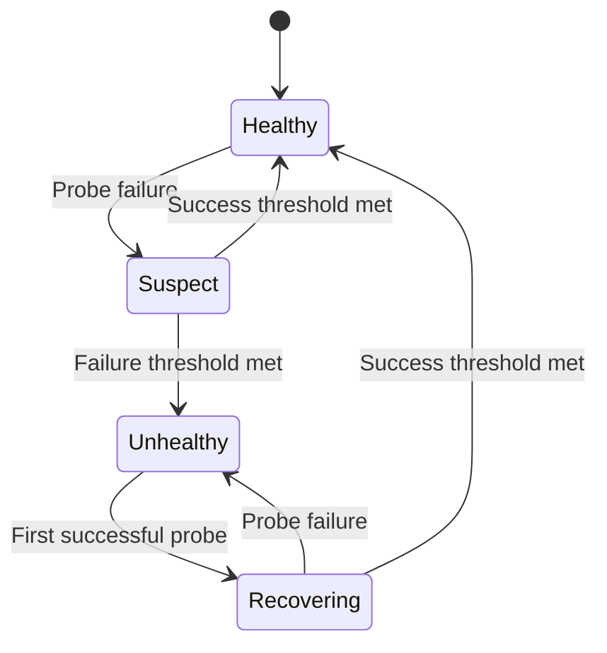

This hysteresis prevents a noisy check from repeatedly adding and removing a backend. Adding a short drain period can also stop new traffic while existing requests finish.

### Passive health checks

Passive detection uses observations from traffic that the load balancer is already forwarding. A backend may be removed when a rolling window contains too many timeouts, connection resets, 502/503/504 responses, or refused connections.

To avoid blaming an entire node for one bad request:

- evaluate a minimum request count or a rolling error percentage
- use thresholds separate from normal active health
- exclude expected application responses such as a 404 or a client cancellation
- cool down a removed backend before routing traffic to it again

Passive checks respond faster than waiting for the next active probe, but they are weak under low traffic. If only one request is sent to a backend and it fails, the error might reflect the request itself rather than backend-wide failure.

### Health signal design

Health is a routing decision, not a binary signal for the whole system. Prefer a readiness endpoint that verifies the work the instance can safely perform:

```text
/readyz
200: instance is initialized and ready for traffic
503: instance is starting, draining, overloaded, or blocked on a required dependency
```

A pod should also stop advertising itself after it begins shutdown. Otherwise, the load balancer may keep sending requests to an instance that is closing listeners or terminating.

Active and passive signals complement each other:

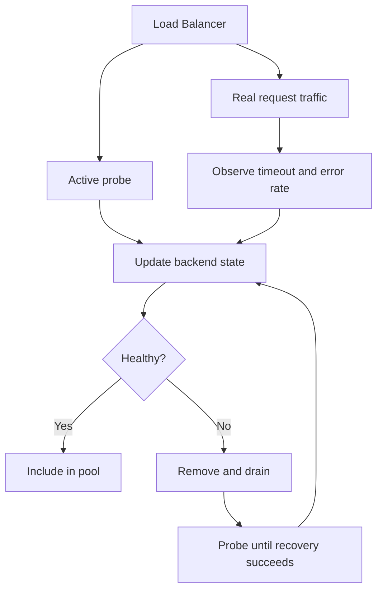

### Good production pattern

Use active checks for a baseline health and readiness signal, plus passive checks to react quickly to failures seen by real traffic. Keep active endpoints cheap and deterministic, and do not make them depend on every optional downstream service.

| Scenario | Recommended approach |
|---|---|
| Rolling deployment | Readiness check for initialization; success threshold before routing starts |
| Sudden backend crash | Passive detection for rapid removal and active probe for recovery |
| Dependency outage | Mark readiness false only if the backend cannot serve meaningful traffic |
| Draining instance | Stop new traffic, finish existing requests, then shut down |
| Low-traffic backend | Rely mainly on active probes; passive samples may be too small |

### Common failure modes

- **Liveness used as readiness:** a live process that cannot serve traffic remains in the pool.
- **No thresholds:** one transient timeout ejects an otherwise healthy backend.
- **Aggressive re-add:** a server flaps between healthy and unhealthy, creating retry storms.
- **Traffic-sensitive false alarms:** one malformed request or small 5xx sample marks the node unhealthy.
- **Dependency coupling:** a failure in an optional service incorrectly makes every replica unavailable.
- **Probe from the wrong network path:** the probe succeeds even though user traffic cannot reach the backend.

### Interview answer

Health checks tell the load balancer which replicas are eligible for traffic. Active checks provide proactive, consistent verification, while passive checks use real-time evidence to catch failures quickly. A strong answer describes thresholds and hysteresis, readiness versus liveness, and the tradeoff between fast failure detection and false removals.

---

## 9) Sticky Sessions

Sticky sessions send the same client back to the same backend instance for subsequent requests.

| Question | Answer |
|---|---|
| Why use them? | Some apps store session state in memory |
| Benefits | Preserves local session state and reduces repeated auth/cart setup |
| Problems | Uneven load, poor recovery if a node fails, not ideal for stateless systems |
| Preferred alternative | Distributed session stores, JWTs, external caches, stateless apps |

### Better alternatives
Modern systems usually prefer:
- distributed session stores
- JWTs or signed tokens
- external session/cache backends
- stateless app servers

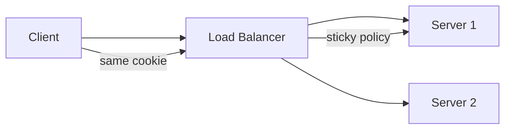

### Good interview answer
Sticky sessions are useful when the app is stateful, but in scalable cloud systems you should prefer stateless services and shared external state.

---

## 10) Load Balancer Failover

Failover is the process of switching traffic to a backup or secondary load balancer when the primary becomes unhealthy.

| Pattern | How it works | Strengths | Weaknesses |
|---|---|---|---|
| Active-active | Multiple LBs serve traffic at once | Higher availability, better throughput | More complexity |
| Active-passive | Primary handles traffic; backup stays ready | Simpler and cheaper | Slower failover and less immediate capacity |

### Typical mechanisms
- virtual IP (VIP) reassignment
- health check and route switching
- keepalived / VRRP / BGP-based failover
- regional failover orchestration

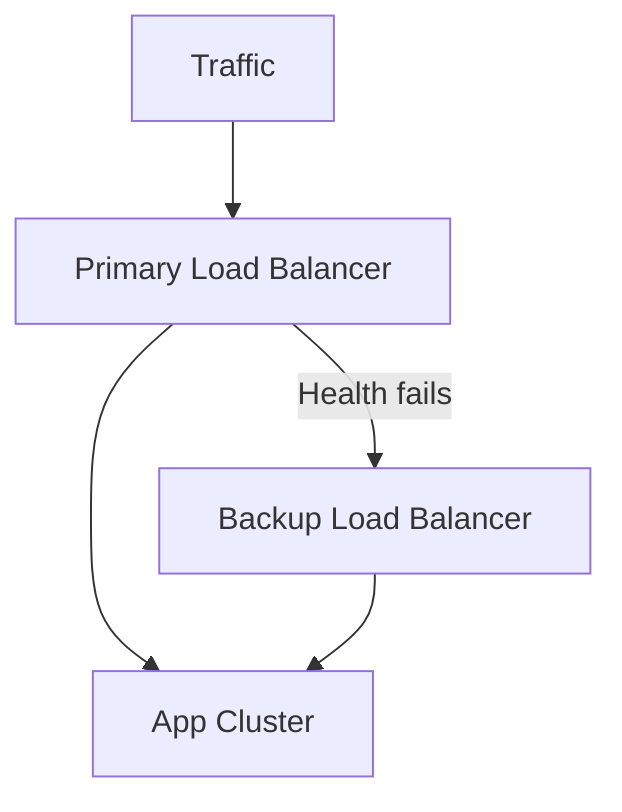

### Practical point
For critical systems, failover should be tested regularly. A standby that has never been exercised can still fail during a real outage due to misconfiguration or stale state.

---

## 11) Load Shedding

Load shedding is the intentional dropping or deprioritizing of some requests to protect the system from overload.

| Scenario | Action | Goal |
|---|---|---|
| Traffic exceeds capacity | Reject low-priority requests | Prevent cascading failure |
| Peak demand | Limit background work | Preserve critical path |
| Extreme overload | Return 429 / degrade optional features | Keep core services alive |

### Why it happens
When traffic exceeds capacity, accepting everything can trigger cascading failure. It is better to selectively discard lower-value work than to let the whole system collapse.

### Good trade-off
Load shedding is usually better than total outage, but it must be designed carefully so critical tasks still get priority.

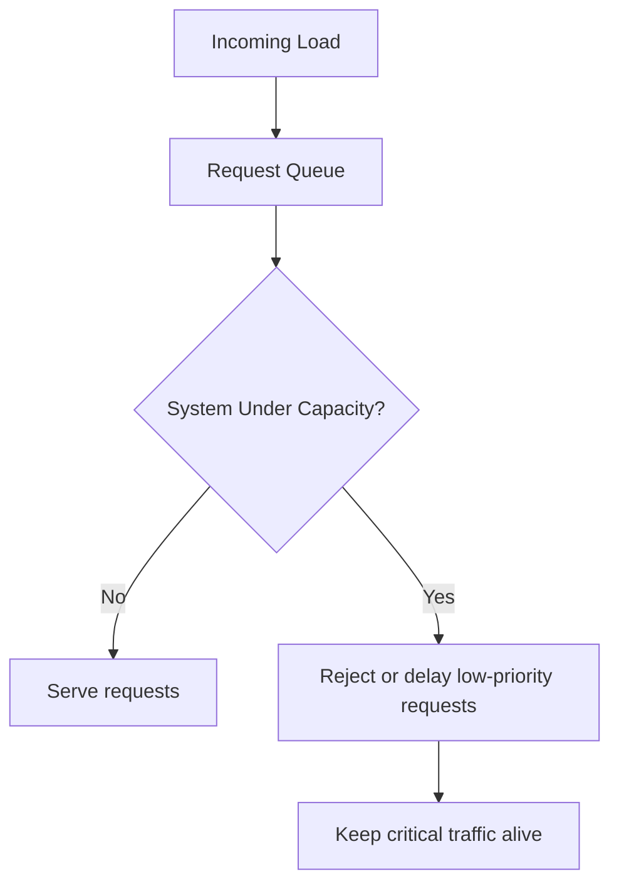

### Interview takeaway
A strong candidate explains that load shedding is not a sign of failure; it is an intentional admission-control strategy that protects service health and user experience.

---

## Final takeaway

| Decision area | Good default mindset | Main trade-off |
|---|---|---|
| Request distribution | Spread load across healthy nodes | Must consider fairness vs latency |
| Routing policy | Use geo-aware or health-aware rules when needed | More complexity |
| State handling | Favor stateless services | Needs external session/cache infrastructure |
| Resilience | Add health checks and failover | Operational overhead grows |
| Overload control | Shed low-priority work early | Some requests are intentionally dropped |

The key interview idea is not to memorize terms but to explain the trade-offs:

- round robin is simple but less aware of uneven capacity
- consistent hashing helps with stable routing
- DNS helps with geo routing but is coarse-grained
- health checks prevent unhealthy nodes from receiving traffic
- sticky sessions may work for stateful apps but should not be the default for modern stateless platforms
- failover and load shedding protect availability when systems approach overload

When you can explain why a design decision is chosen and what trade-offs it introduces, you are already thinking like a strong system design candidate.
