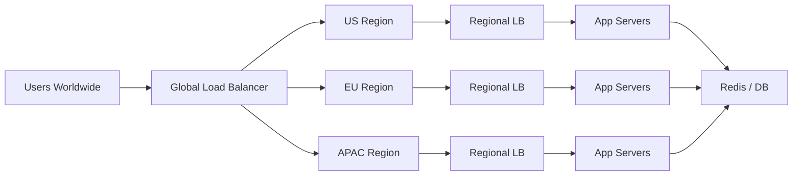
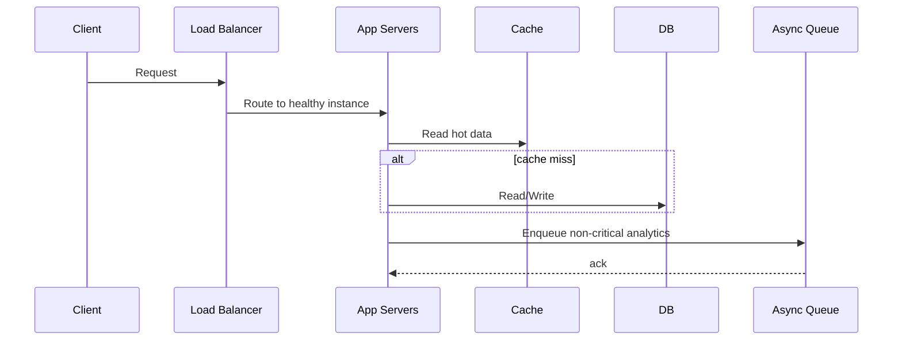
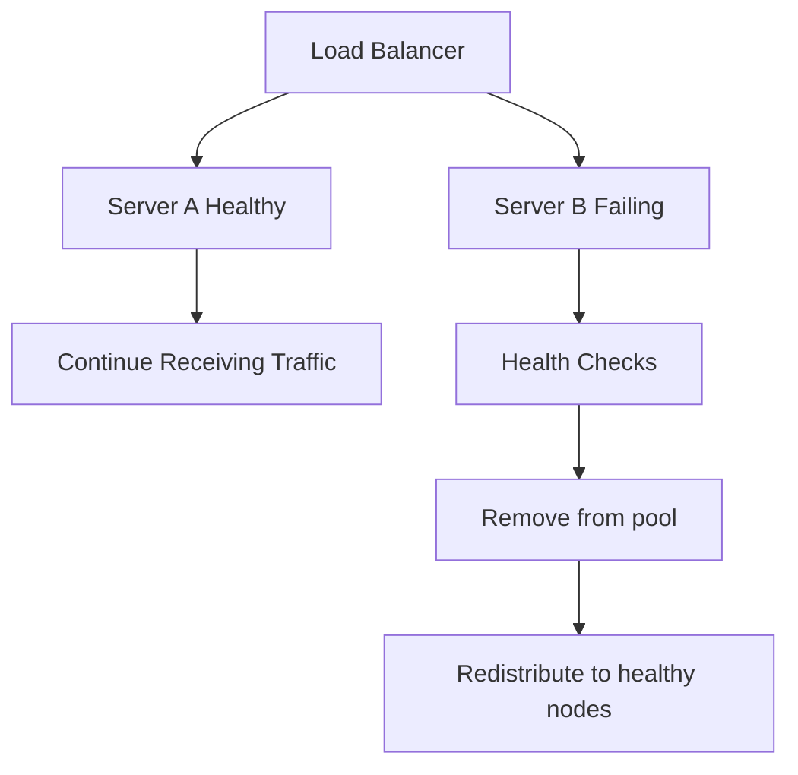
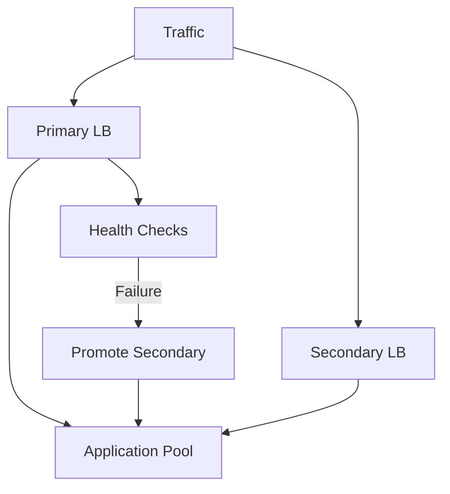

# Real-World Interview Questions and Model Answers

This file focuses on realistic load balancing and traffic management questions that often appear in system design interviews.

## 1) Interview Question: Design a globally available web application with low latency.

### Strong answer

I would start by separating traffic routing from backend execution. At the edge, I would use a global load balancer or DNS-based routing to send users to the nearest healthy region. Inside each region, I would place a regional load balancer in front of stateless app servers.

### Key design points

- use geographic routing to reduce latency
- run multiple app instances behind each regional load balancer
- perform health checks to remove unhealthy nodes
- use CDNs for static content
- keep the app stateless so scaling is easy

### Trade-off discussion

Global traffic routing adds complexity and operational overhead, but it gives significantly better latency and failover capability for users across multiple regions.

---

## 2) Interview Question: A website gets 10x traffic during a flash sale. How do you handle it?

### Strong answer

The primary goal is to prevent overload while preserving the core user experience. I would scale the web tier horizontally, protect the database, and use load shedding for non-critical work.

### Important tactics

- add application replicas behind a load balancer
- cache popular product and cart pages
- use read replicas for catalog queries
- queue analytics and recommendation jobs asynchronously
- apply rate limiting and degrade optional features under extreme pressure

### Interview signal

This answer shows awareness that scaling is not only about more servers; it is about protecting the critical path and shedding low-priority work during overload.

---

## 3) Interview Question: A load balancer is routing traffic to unhealthy servers. What would you do?

### Strong answer

I would add health checks and failure detection at multiple layers. This includes active checks such as HTTP or TCP probes, plus passive checks based on failed requests and timeout behavior.

I would also ensure that the balancer stops routing traffic to nodes that fail readiness checks and drains active connections before removing them from rotation.

### Strong answer quality

The best candidates explain that health detection must be proactive and automated. Otherwise a server may continue receiving traffic even while it is failing.

---

## 4) Interview Question: Should we use sticky sessions for a modern microservice app?

### Model answer

Usually no, unless the application genuinely depends on local in-memory session state. Sticky sessions create uneven load, make failover more difficult, and are a poor fit for stateless services.

In modern microservice systems, I would prefer:

- stateless application servers
- a distributed session store or shared cache
- JWTs or signed tokens for user identity
- a load balancer that does smart routing without session affinity

### Why this matters

Sticky sessions are a quick fix for a stateful app, but they often become a liability as the system grows. A more scalable pattern is to externalize session state and keep the app stateless.

---

## 5) Interview Question: Why would you choose a software load balancer instead of a hardware appliance?

### Strong answer

For most modern cloud-native systems, software load balancers are the better choice because they are flexible, cost-effective, and easy to automate. Tools like NGINX, HAProxy, Envoy, and cloud-managed balancers integrate naturally into CI/CD, autoscaling, and container environments.

A hardware load balancer may still be useful in high-scale enterprise environments where dedicated networking performance or specialized features are critical.

### Balanced answer

The key is to match the design to the environment. A cloud application should not usually depend on expensive appliance-based routing when software-based and managed options can meet the requirement with lower operational friction.

---

## 6) Interview Question: What is the difference between DNS load balancing and regional load balancing?

### Model answer

DNS load balancing is a coarse-grained routing technique usually based on domain resolution. It is useful for sending users to different regions or assigning a different IP address at a high level.

Regional load balancing happens after the client reaches that region. It decides which internal node or service instance should handle the request. DNS does not have the same request-level visibility or control as L4/L7 load balancers.

### Example

A user in Europe may resolve to an EU IP through DNS. Once the request reaches the EU region, the regional load balancer can distribute traffic across multiple application servers based on health and connection count.

---

## 7) Interview Question: A service is overloaded. Should we always add more servers behind the load balancer?

### Strong answer

Not always. More servers help only if the system is horizontally scalable and the bottleneck is not in a shared dependency such as a database, queue, or third-party API.

If the bottleneck is the database, adding app servers only increases pressure. The right fix may be:

- caching
- read replicas
- query optimization
- partitioning or sharding
- asynchronous processing
- load shedding for non-critical traffic

### Excellent framing

A strong interview answer explains that scaling the front-end without fixing the bottleneck often creates a larger pileup behind a single dependency.

---

## 8) Interview Question: How would you design a failover plan for a critical load balancer?

### Strong answer

I would run at least two load balancers in a redundant configuration, with active-active or active-passive behavior depending on failover needs. I would use health checks, VIP reassignment, and rapid detection to ensure that if the primary fails, the secondary takes over without long downtime.

### Operational maturity signal

In interviews, this is a good sign because it shows you think beyond the raw architecture and into real production operations: testing, health validation, and recovery planning.

---

## 9) Interview Question: When would you prefer Anycast over a standard regional load balancer?

### Model answer

I would prefer Anycast when a service needs to be globally low-latency and highly resilient at the network edge, such as a CDN, DNS entry service, or public API gateway with many distributed users.

A regional load balancer is usually simpler and easier to reason about, but Anycast offers better route optimization at the network layer when you need geographic closeness and regional failover.

---

## 10) Interview Question: Why is load shedding a valid design strategy?

### Model answer

When a system is overloaded, accepting every request may create a broader outage. Load shedding lets the system stay healthy by dropping or deprioritizing low-value work while protecting critical business flows.

This is particularly important for systems under DDoS pressure, sudden traffic spikes, or dependency saturation. A well-designed shed strategy prioritizes user-critical traffic and makes the service partially available instead of fully failing.

---

## Final reflection

The strongest answers in interviews are not the longest ones; they are the ones that clearly explain the trade-offs. Load balancing is not just about placing traffic somewhere. It is about deciding:

- which layer to route at
- which algorithm to use
- how health is measured
- whether session affinity is required
- when to fail over
- when to shed load

Good system design candidates are able to connect those decisions to real user outcomes: lower latency, higher availability, smoother recovery, and a system that remains healthy under pressure.
