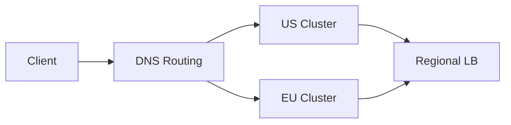

# Practice Questions and Answers

This file helps you review the most common interview questions around load balancing and traffic distribution.

## 1) What is the main purpose of a load balancer?

Answer:

A load balancer distributes incoming requests across multiple backend servers so that no single server becomes overloaded. It improves throughput, increases availability, allows real-time failover, and makes horizontal scaling practical.

In production, a load balancer does not replace bottleneck analysis. If the database is slow or the app is CPU-bound, the load balancer can only spread work more efficiently; it cannot solve a backend bottleneck by itself.

---

## 2) When would you use round robin versus least connections?

Answer:

Round robin is a good choice when all servers are similar in capacity and the traffic pattern is uniform. It is simple and predictable.

Least connections is better when requests vary in duration and some servers are handling more work than others. It adapts to actual back-end utilization rather than only route count.

For example, if one backend is slower and already has a large queue, least connections helps keep request distribution more even.

---

## 3) Why is DNS load balancing not enough for all systems?

Answer:

DNS load balancing is useful for coarse geographic routing and failover, but it has limited granularity. The DNS result may be cached by clients or resolvers, which makes decisions stale. It also cannot inspect request content or per-connection health as precisely as a layer 7 load balancer.

So DNS is often used at the edge, while L4/L7 load balancers handle local traffic distribution inside a region.

---

## 4) What is the difference between L4 and L7 load balancing?

Answer:

L4 routing uses network-level information such as IP address and TCP/UDP metadata. It is fast and good for connection distribution.

L7 routing understands application data such as HTTP paths, headers, cookies, or URL patterns. It allows smarter decisions like routing `/checkout` to a dedicated service or sending mobile clients to a different backend pool.

In general:

- L4 is simpler and faster
- L7 is more expressive and more expensive computationally

---

## 5) When should you use sticky sessions?

Answer:

Sticky sessions are useful when session state is stored locally on the server and a user must consistently hit the same node. This may be true in older monolithic apps or certain legacy architectures.

However, sticky sessions are not the preferred pattern in modern scalable systems because they create uneven load, complicate failover, and make scaling harder. Standard solutions are stateless services with external session stores, JWTs, or a shared cache.

---

## 6) What are active vs passive health checks?

Answer:

Active health checks are explicit checks that the load balancer performs periodically, such as HTTP `/health`, TCP probes, or gRPC liveness tests.

Passive health checks infer health from real traffic, such as timeout events, connection resets, or increased 5xx responses.

The best systems usually combine both: active checks detect unhealthy instances early, and passive checks catch issues that might not be seen during scheduled probes.

---

## 7) What is failover in load balancing?

Answer:

Failover means traffic is redirected to a healthy backup component when the primary load balancer or backend fails.

Examples include:

- active-active configuration with multiple LBs
- active-passive deployment with a warm standby
- using VIP reassignment or health-based route switching

A strong design includes not just the failover mechanism but also testing, DNS/health checks, and graceful drain behavior when a node is removed from service.

---

## 8) Why is Anycast useful?

Answer:

Anycast allows multiple servers to advertise the same IP address. The network routes clients to the nearest or best instance. This reduces latency and improves resilience for global services.

It is often used by CDNs and large edge services, especially where traffic must be served from multiple locations without a user reaching a distant origin.

---

## 9) What is rendezvous hashing and why do people care about it?

Answer:

Rendezvous hashing assigns keys to servers based on a hash score. When a node is added or removed, only a limited subset of keys are remapped, reducing churn compared to naive hashing.

This is critical in caching and sharding systems where redistributing large amounts of data can trigger huge cache miss storms or expensive rebalancing operations.

---

## 10) What is load shedding?

Answer:

Load shedding is the intentional dropping or deprioritizing of requests when the system is overloaded. It protects the system from global failure.

For example, a video platform may degrade recommendations or background analytics when demand spikes. The system still serves critical requests such as payment or login, while low-priority work is delayed or rejected.

This is often preferable to a full outage because it preserves the core user experience.

---

## 11) What are the trade-offs of global versus regional load balancing?

Answer:

Global load balancing improves latency by sending users to the closest healthy region and helps route around regional outages. It is more complex because it requires DNS, edge routing, inter-region health management, and sometimes cross-region replication.

Regional load balancing is simpler and faster to operate locally but cannot protect the system if an entire region fails.

The best architecture often combines both: a global routing layer that identifies the best region and regional load balancers that distribute traffic inside the region.

---

## 12) How would you explain load balancing to a non-technical stakeholder?

Answer:

Think of a load balancer as a traffic manager for a busy service. If one server is overloaded or unavailable, it sends new requests to other healthy servers. This keeps the service faster, more reliable, and better able to handle peak traffic.

The goal is to make the system feel smooth and dependable even when traffic spikes or one backend has a problem.

---

## Quick revision checklist

Before an interview, be ready to explain:

- the difference between L4 and L7 load balancing
- when each algorithm is appropriate
- how DNS and Anycast differ
- why health checks matter
- when sticky sessions are useful and when they are not
- what failover and load shedding mean in practice
- how global and regional balancing complement each other
- why consistent hashing helps in sharded systems
