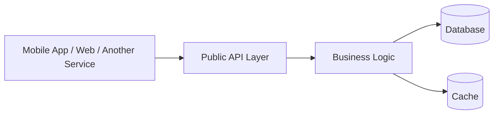
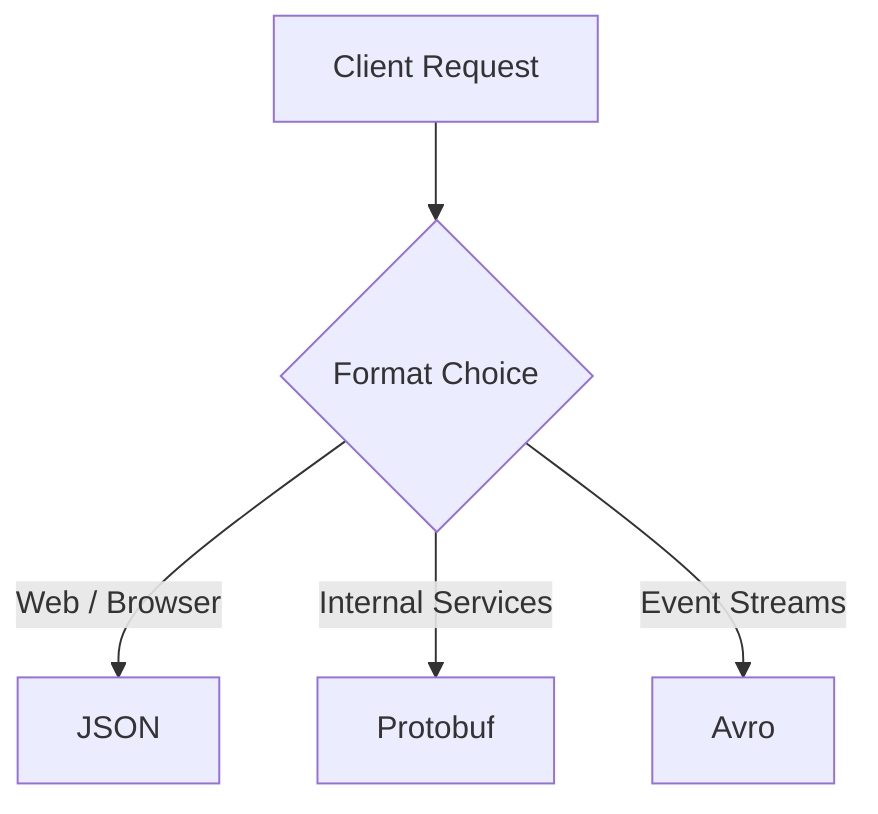
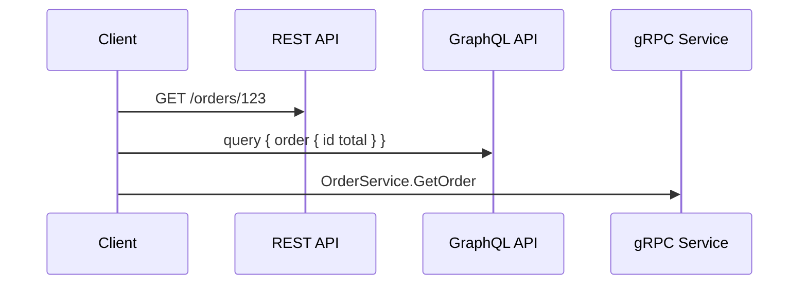
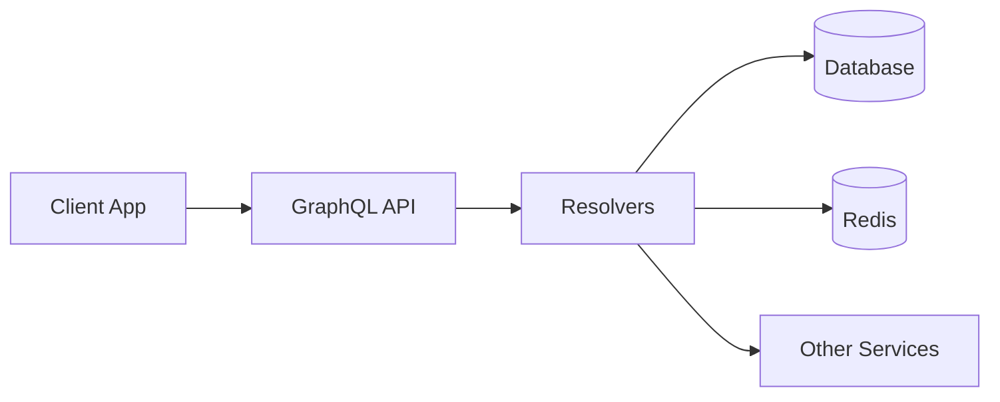
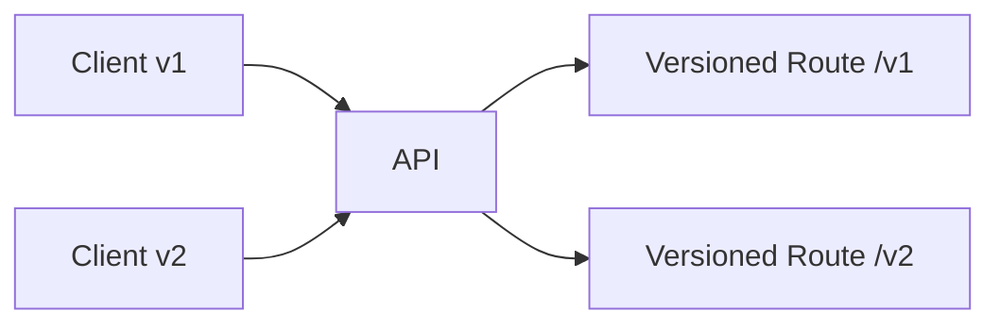
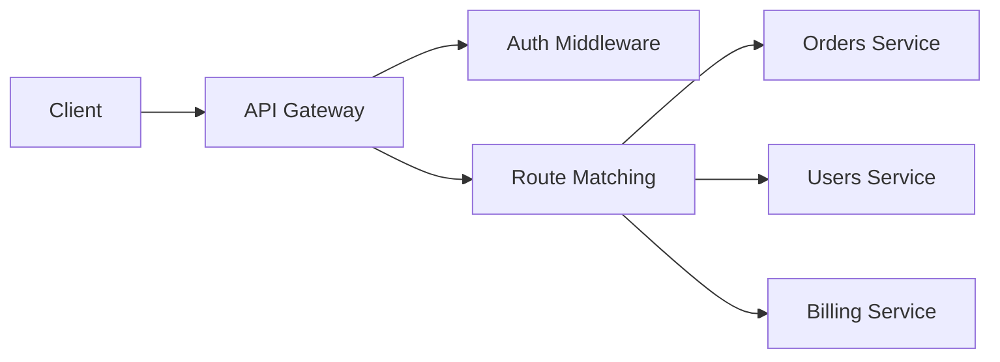
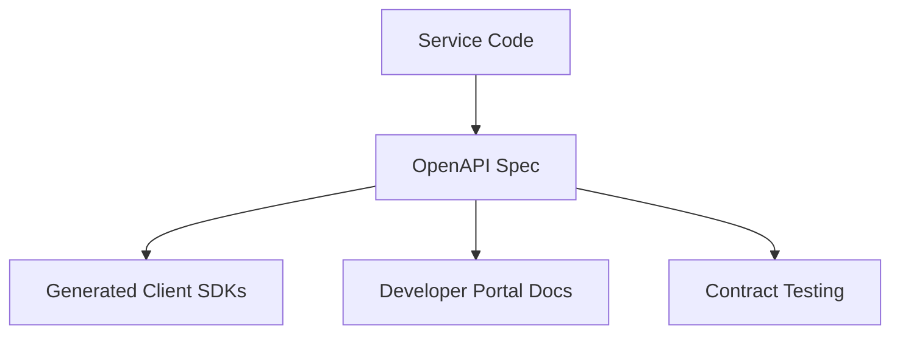

# API Design

APIs are the contracts that let independent systems communicate. A good API is not just technically functional; it must be clear, evolvable, secure, observable, and aligned with business needs. In interviews, the strongest answers explain trade-offs: when to choose REST over GraphQL, how to version an API without breaking clients, how to handle retries safely, and how to model contracts across services.

## 1) What is an API?

An API (Application Programming Interface) defines how one software component talks to another. It describes inputs, outputs, expectations, and failure behavior. The most important idea is that the consumer depends on a contract, not on internal implementation details.

### API as a contract
An API hides internal complexity. For example, a mobile app does not need to know the database or caching strategy of the backend. It only needs to know the request and response shape.



### Why APIs matter
- Decouple frontend and backend teams
- Allow services to evolve independently
- Make system boundaries explicit
- Enable third-party integrations and platform business models

### Interview angle
When asked "what is an API?" the best answer is: an API is a stable boundary that defines allowed communication between systems while hiding implementation details. Stability, clarity, and versioning matter as much as functionality.

---

## 2) Data Formats (JSON, Protobuf, Avro)

APIs move data between processes, and that data must be encoded in a format that both sides understand.

### JSON
JSON is the dominant format for web APIs because it is human-readable, easy to debug, and widely supported.

Pros:
- easy to inspect in logs and Postman
- language-agnostic
- great for browser-based APIs

Cons:
- verbose
- slower to serialize/deserialize than binary formats
- weaker schema enforcement without tools

### Protobuf (Protocol Buffers)
Protobuf is a binary serialization format developed by Google. It is compact and fast, making it ideal for internal service-to-service communication.

Pros:
- compact and efficient
- strong schema support
- fast serialization

Cons:
- not human-readable
- requires generated code
- less friendly for browser clients

### Avro
Avro is a schema-based binary serialization system often used in data pipelines and event logs.

Pros:
- rich schema evolution
- good for streaming and analytics
- works well with schema registries

Cons:
- less common in direct synchronous API contracts
- more ecosystem-specific than JSON

### Choosing a format
- Public REST APIs: JSON
- Internal microservices: Protobuf or JSON depending on latency and complexity
- Event streaming and data pipelines: Avro or JSON depending on ecosystem



### Interview insight
Good candidates explain that format choice is not just about readability; it impacts performance, schema evolution, compatibility, and tooling.

### Format comparison

| Format | Best for | Strengths | Trade-offs |
|---|---|---|---|
| JSON | Public APIs, browser clients | Human-readable, easy tooling, ubiquitous | Verbose, weaker schema enforcement |
| Protobuf | Internal microservices, latency-sensitive calls | Compact, fast, strong schema | Less readable, generated code required |
| Avro | Event streams, data pipelines | Schema evolution, stream-friendly | More ecosystem-specific, less common for direct HTTP APIs |

---

## 3) API Architectural Styles

API design is not only about HTTP verbs. It is about communication model and semantics.

### REST
REST is resource-oriented. Resources are nouns and are identified by URLs. Actions are represented by HTTP methods such as GET, POST, PUT, PATCH, DELETE.

Strengths:
- simple mental model
- easy to cache and debug
- works well for CRUD and web resources

Weaknesses:
- over-fetching and under-fetching can happen
- versioning and pagination can add complexity
- not ideal for highly nested or graph-like data access

### GraphQL
GraphQL exposes a single query endpoint where clients request exactly the fields they need.

Strengths:
- reduces over-fetching
- great for mobile and complex UIs
- flexible front-end data access

Weaknesses:
- can create N+1 database problems if not designed carefully
- harder caching than REST using standard HTTP caching tools
- more complex server-side query validation and authorization

### gRPC
gRPC is an RPC framework built on HTTP/2 and Protobuf. It is designed for low-latency, strongly typed service-to-service communication.

Strengths:
- compact binary payloads
- streaming support
- strong contracts and generated clients

Weaknesses:
- harder debugging than JSON
- not browser-native
- requires compatibility plan when evolving schemas

### Event-driven APIs
These are often asynchronous: a producer emits an event, and one or more services react to it.

Examples:
- order created event
- payment processed event
- user profile updated event

Strengths:
- decoupled services
- easier scale-out for spikes
- supports fan-out and async workflows

Weaknesses:
- eventual consistency
- harder operational debugging
- more complex retry and deduplication design



### Interview takeaway
Choose the style based on business needs: REST for simplicity and standardization, GraphQL for flexible read-heavy clients, gRPC for efficient internal RPC, and event-driven flows for decoupled async systems.

### Architectural style comparison

| Style | Use case | Strengths | Watch-outs |
|---|---|---|---|
| REST | Public APIs, CRUD-heavy systems | Simple, cacheable, standards-based | Over/under-fetching, versioning complexity |
| GraphQL | Complex client UIs, nested reads | Flexible queries, reduced over-fetching | N+1 risks, authorization complexity, harder caching |
| gRPC | Internal service-to-service | Low latency, type safety, streaming | Harder debug tooling, not browser-native |
| Event-driven | Async workflows, decoupled processing | Independent scaling, fan-out | Eventual consistency, retry/dedupe complexity |

---

## 4) REST API Design

REST designs APIs around resources and standard HTTP semantics. A good REST API should be predictable and follow common conventions.

### Core principles
- Resource names are nouns: `/users`, `/orders`, `/products`
- HTTP methods express actions:
  - GET: read
  - POST: create
  - PUT: replace or upsert
  - PATCH: partial update
  - DELETE: delete
- Use status codes clearly:
  - 200 OK
  - 201 Created
  - 202 Accepted
  - 204 No Content
  - 400 Bad Request
  - 401 Unauthorized
  - 404 Not Found
  - 409 Conflict
  - 429 Too Many Requests
  - 500 Internal Server Error

### Resource modeling
The model should reflect the domain, not implementation internals.

Example API for orders:
- GET /orders
- GET /orders/{id}
- POST /orders
- PATCH /orders/{id}
- DELETE /orders/{id}

### Designing a good URL
Good URLs are stable, hierarchical, and readable.

Prefer:
- /users/123/orders
- /products/456/reviews

Avoid:
- /getUserOrders?id=123
- /createOrder
- /doStuff

### Naming and consistency
Use consistent plural naming, lowercase paths, and predictable conventions. Avoid mixing resource names and action names in the same route.

### REST and caching
REST works well with HTTP caching headers such as Cache-Control, ETag, and If-None-Match. A strong API design understands which resources are cacheable and which are not.

### Common anti-patterns
- Making endpoints action-based rather than resource-based
- Overloading GET with side effects
- Using 200 for every error case
- Returning huge nested payloads without pagination

### Interview angle
A good API design answer shows how URLs, methods, status codes, and idempotent semantics work together to form a coherent contract.

---

## 5) GraphQL Deep Dive

GraphQL allows the client to specify the exact structure of the response. It is especially useful when a UI needs data from many related objects in a single request.

### Core concepts
- Query: read data
- Mutation: change data
- Subscription: stream data over time
- Schema: contract for what is allowed

Example:

```graphql
query GetUserOrders($userId: ID!) {
  user(id: $userId) {
    id
    name
    orders {
      id
      total
      status
    }
  }
}
```

### Why people like it
- eliminates over-fetching and under-fetching
- good for mobile clients with varying network conditions
- simplifies composition of data from multiple services

### Challenges and trade-offs
- N+1 problem: if a resolver fetches related records one by one, latency can explode
- Authorization complexity: field-level access must be enforced carefully
- Caching: standard HTTP caching is less straightforward than REST
- Operational complexity: a single GraphQL endpoint can become a bottleneck if not designed well

### Production patterns
- Use DataLoader to batch database calls
- Enforce query depth, complexity, and rate limits
- Validate and authorize at field level
- Split domain ownership between schema modules



### When GraphQL is a good fit
- rich frontend apps with nested data requirements
- APIs with multiple screens depending on the same data model
- product teams that want flexibility without many custom endpoints

### When not to use it
- simple CRUD-heavy workloads
- use cases where standard HTTP caching and CDN patterns are critical
- internal service communication where gRPC or REST is more straightforward

---

## 6) gRPC Deep Dive

gRPC is a modern RPC framework based on HTTP/2 and Protobuf. It is especially strong for low-latency internal communication between services.

### Why it matters
Backend services often talk to each other frequently. gRPC reduces payload size and improves latency while giving a strict contract.

### RPC model
A service definition defines methods and message shapes:

```proto
service OrderService {
  rpc GetOrder(GetOrderRequest) returns (OrderResponse);
  rpc CreateOrder(CreateOrderRequest) returns (OrderResponse);
  rpc StreamOrders(StreamOrdersRequest) returns (stream OrderResponse);
}
```

### Benefits
- compact binary payloads
- strict schema validation at compile time
- built-in streaming support
- good for polyglot microservice communication

### Downsides
- harder to debug with browsers or ad-hoc tools
- more tooling and code generation complexity
- versioning and backward compatibility need care

### Common use cases
- internal inventory, auth, and recommendation services
- real-time streaming systems
- high-throughput service communication

### Interview angle
If the interviewer asks about "which style for internal services," a strong answer is: gRPC when you need efficient, strongly typed, low-latency communication; REST when you need broad external compatibility and developer ergonomics.

---

## 7) API Versioning Strategies

APIs must evolve without unexpectedly breaking clients. Versioning is the discipline of managing Change.

### Common strategies

#### 1. URI versioning
- /v1/users
- /v2/users

Pros:
- very explicit
- easy to understand and debug

Cons:
- can lead to duplicate logic and maintenance burden

#### 2. Header-based versioning
- Accept: application/vnd.company.user.v2+json

Pros:
- keeps URLs clean
- allows negotiation

Cons:
- less visible to clients and debugging tools

#### 3. Content negotiation
The server chooses behavior based on media type or query parameter.

Pros:
- flexible and standard
- works well with compatible contract evolution

Cons:
- slightly more complexity for clients

### Best practice
Versioning should be a last resort, not a default. Prefer additive, backward compatible changes where possible: add optional fields, avoid removing fields, introduce new endpoints rather than breaking old ones.



### Interview insight
A strong answer explains both the technical and business cost of breaking changes. A single incompatible API change can break mobile apps, partner integrations, and downstream services.

---

## 8) Idempotency

Idempotency means that repeating the same request has the same effect as making it once.

### Why it matters
Network retries are common. Clients may retry a request because the connection dropped, the server timed out, or the response was lost.

Without idempotency, repeated payment, order, or refund requests can cause duplicate side effects.

### Idempotency patterns
- idempotency keys for POST requests
- unique constraints in the database
- safe retry logic with deduplication
- using resource state to detect duplicates

### Example
Payment API:
- POST /payments
- request includes Idempotency-Key: 1234
- server stores the key and the result
- if the same key is sent again, return the original result

### Common mistakes
- assuming retry is safe for all POST requests
- using timestamps as uniqueness without dedupe logic
- allowing duplicate side effects on events or payouts

### Interview angle
For high-risk APIs such as payments, inventory reservations, and order creation, idempotency is not optional; it is a correctness requirement.

---

## 9) Pagination and Filtering

Large collections must be retrieved in chunks. APIs need predictable patterns for limiting, sorting, and filtering data.

### Pagination strategies

#### Offset-based pagination
- ?page=2&limit=50

Pros:
- easy to implement and explain

Cons:
- can be inefficient at large offsets
- inconsistent under concurrent writes

#### Cursor-based pagination
- ?cursor=abc123&limit=50

Pros:
- better for large datasets
- more stable under inserts and deletes

Cons:
- more complex to implement and reason about

### Filtering
Filtering allows clients to request subsets of data.

Examples:
- /products?category=electronics
- /orders?status=shipped&customer_id=42
- /users?created_after=2024-01-01

### Sorting
Sort needs explicit semantics to avoid ambiguous behavior.

Examples:
- /orders?sort=created_at:desc
- /users?sort=name:asc

### Why it matters
Without proper pagination and filtering, APIs become slow, expensive, and hard to consume.

### Interview insight
The strongest answer distinguishes data access patterns: for stable data feeds, cursor pagination is often more scalable; for small tables, offset pagination is simpler.

---

## 10) Routing

Routing defines how incoming requests are matched to the correct controller, service, or handler.

### Common router responsibilities
- path matching
- method matching (GET, POST, PUT, etc.)
- parameter extraction
- auth and middleware checks
- request validation
- forwarding to the service layer

### Example API gateway routing



### Good routing design
- clear domain boundaries
- stable API namespaces
- centralized auth and rate limiting
- route-specific policies

### Common pitfalls
- overloading a single service with unrelated routes
- inconsistent route names across teams
- mixing internal and external routing logic

---

## 11) Serialization and Deserialization

Serialization is the process of converting an in-memory object into a byte stream or wire format. Deserialization reverses that process.

### Example
An object in code:

```json
{
  "id": 42,
  "email": "user@example.com",
  "status": "ACTIVE"
}
```

must be converted into JSON, Protobuf, or another wire format before being sent.

### Why this matters
- determines compatibility between service versions
- impacts performance and network cost
- influences error handling and schema evolution

### Problems to watch for
- mismatch between field names and serialized keys
- dropping fields during deserialization
- relying on implicit defaults that change behavior over time

### Best practices
- use explicit schemas
- validate the payload after deserialization
- avoid silently ignoring unknown fields unless intentionally designed

---

## 12) Request Validation and Transformation

Incoming requests must be validated before business logic runs. Validation protects the system from malformed data, injection, and invalid workflows.

### Validation responsibilities
- required fields
- type checks
- length and format constraints
- permission checks
- semantic validation such as "a user cannot book a flight in the past"

### Validation layers
- client-side validation for UX
- server-side validation for correctness
- database constraints as final safety net

### Transformation
Many APIs transform raw input into domain objects or internal models.

Examples:
- converting strings to enums
- normalizing email addresses
- mapping external IDs to internal IDs
- sanitizing HTML or untrusted input

### Why it matters
Without validation, the system may accept invalid data, fail late, or create security issues.

### Interview example
If a request says "order_status=DELIVERED" but the order was already canceled, validation should reject the state transition or map it to a domain error.

---

## 13) CRUD API Design Deep Dive

CRUD stands for Create, Read, Update, Delete. It is the most common shape for APIs, but real systems need more than simple CRUD endpoints.

### Standard resource behaviors
- Create: POST /resource
- Read: GET /resource/{id}
- Update: PUT or PATCH /resource/{id}
- Delete: DELETE /resource/{id}

### Design decisions to think about
- Should DELETE be hard delete or soft delete?
- Should update be full replacement or partial update?
- Should reads return all fields or a projection?
- How are conflicts handled?
- What happens when a record is missing or concurrently modified?

### Example: order lifecycle
- POST /orders creates an order
- GET /orders/{id} returns the current state
- PATCH /orders/{id} updates status or shipping info
- DELETE /orders/{id} may archive instead of physically remove data

### Common pitfalls
- mapping CRUD mechanically without considering domain rules
- allowing clients to mutate forbidden states
- returning stale data due to missing concurrency control

### Good design signal
A strong API design acknowledges that CRUD is a foundation, not an end state. Business rules often require workflows beyond simple object mutation.

---

## 14) OpenAPI and API Documentation Standards

Good APIs are self-documenting and discoverable. OpenAPI is the common standard for describing HTTP APIs.

### What OpenAPI gives you
- endpoint paths and methods
- input/output schemas
- authentication requirements
- error models
- examples

### Benefits
- easier onboarding for client teams
- easier testing and code generation
- fewer ambiguous contracts
- better governance for external APIs

### Documentation quality matters
A product team may know the API, but external consumers need clear examples, constraints, and error semantics.

### Good API docs include
- request/response examples
- edge cases and validation rules
- rate limits
- retry guidance
- auth flow
- versioning notes



---

## 15) API Composition

API composition means combining data from multiple services into one coherent response.

### Why it matters
A client may need data from the user service, order service, and inventory service at once. Rather than making many individual calls, you can compose results in a gateway or aggregator layer.

### Patterns
- backend-for-frontend (BFF): tailor responses per client type
- gateway aggregation: join data from multiple domains before responding
- service orchestration: one service coordinates multiple downstream calls

### Trade-offs
- composition improves client ergonomics but adds latency and complexity
- over-composition can hide domain boundaries and create performance bottlenecks
- a gateway can become a choke point if not scaled or cached properly

### Example
A checkout page may need customer profile, cart details, promotion rules, and shipping estimates. API composition can produce one response while each domain remains separate.

---

## 16) Service Contracts

A service contract is the explicit agreement between a producer and a consumer. It includes inputs, outputs, behavior, error semantics, and compatibility expectations.

### What belongs in a service contract
- request/response schema
- required auth and quotas
- semantic behavior and idempotency expectations
- error handling and retry guidance
- versioning and backward compatibility policy

### Why contracts matter
Without contracts, teams accidentally depend on hidden assumptions. This leads to brittle integrations and outages.

### Contract design principles
- Prefer explicit schemas over implicit conventions
- Treat compatibility as a release concern
- Document failure modes and retries
- Make schema evolution intentional and deliberate

### Interview insight
Strong system design candidates do not treat APIs as implementation details. They see them as contracts that must be governed, documented, and evolved safely.

---

## Final takeaway
API design is about building communication boundaries that remain correct and useful over time.

A strong API balances:
- correctness and safety
- performance and latency
- flexibility and simplicity
- versioning and compatibility
- observability and operational cost

The best API designers reason not just about endpoints, but about contract stability, data ownership, failure modes, and long-term developer experience.

