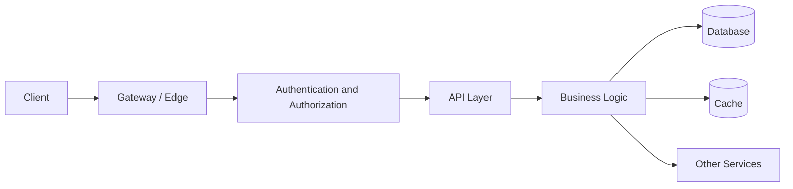
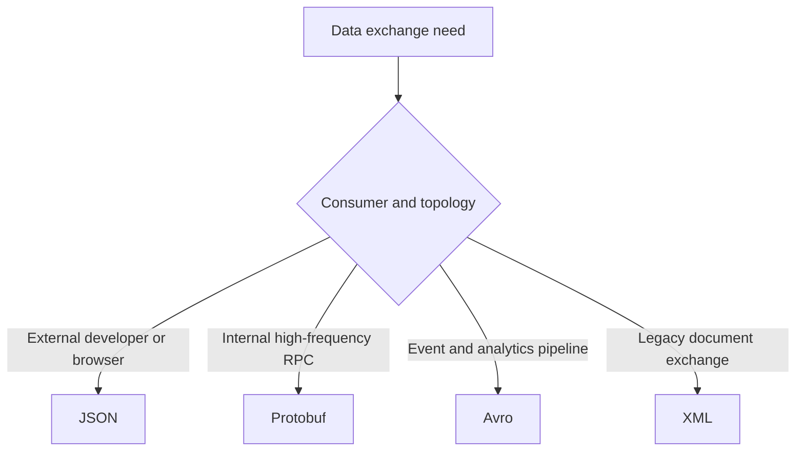
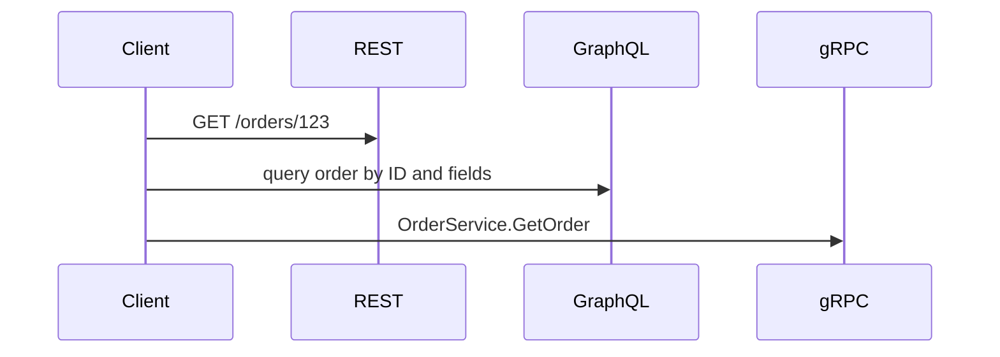
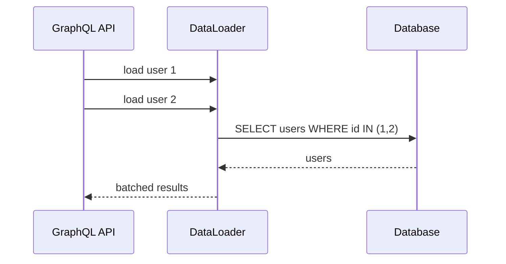
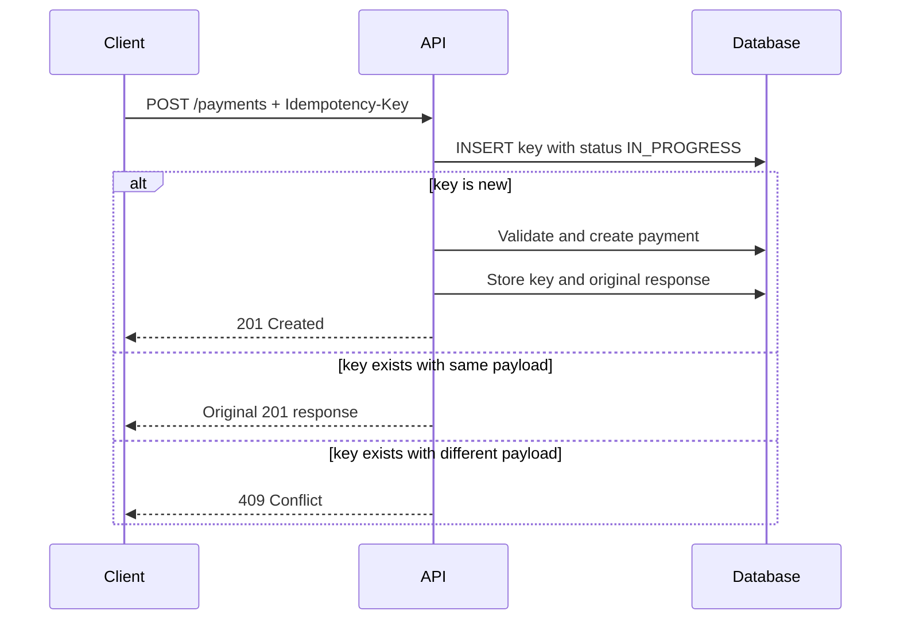
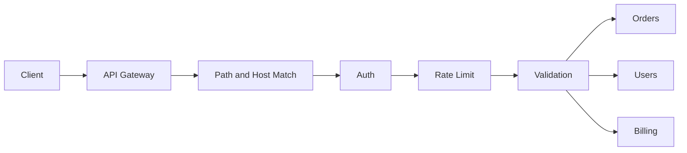
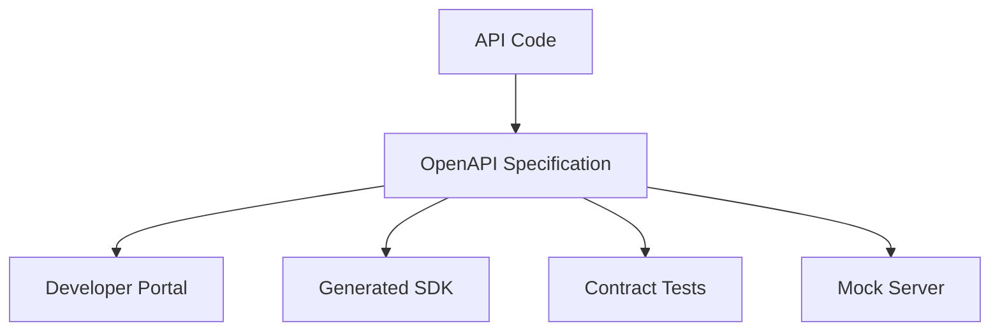
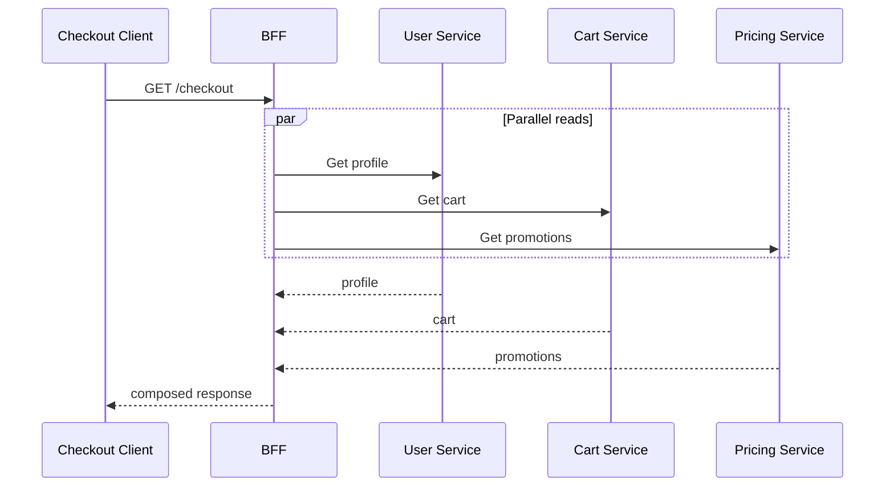
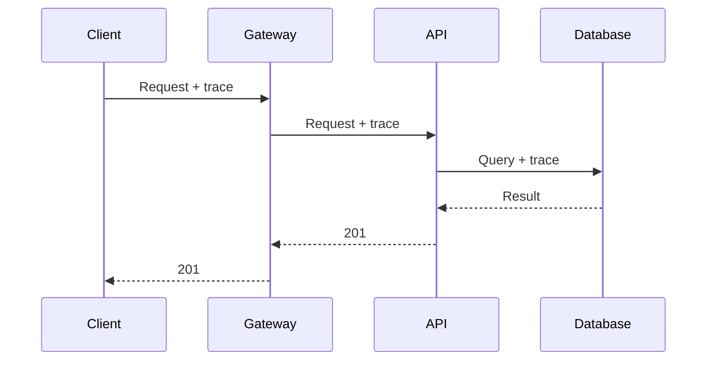

# API Design

An API is a versioned communication contract between a producer and a consumer. It defines the **allowed operations, data shape, authentication, failure behavior, compatibility rules, and operational limits**.

A strong interview answer should cover more than endpoint names. It should explain:

1. What resource or operation is being exposed.
2. Which style of communication fits the call.
3. How the contract behaves under retries, partial failure, and concurrent updates.
4. How clients are authenticated and protected from abuse.
5. How compatibility is maintained as the API evolves.
6. How latency, errors, and traffic are measured.



## 1) API Fundamentals

The consumer should depend on the contract, not on database tables, implementation classes, or network topology.

| Concept | Meaning | Design consequence |
|---|---|---|
| Interface | Operations and schemas visible to a consumer | Keep it explicit and stable |
| Implementation | Internal services, databases, algorithms | Hide it behind the contract |
| Boundary | Where data and control cross teams or systems | Define trust, ownership, and failure semantics |
| Contract | Inputs, outputs, errors, policies, and compatibility | Test it independently of implementation |
| API gateway | Shared entry point for routing, auth, limits, and policy | Use it for cross-cutting concerns, not domain logic |

A useful API is not only a collection of routes. It has predictable names, a clear data model, meaningful status codes, bounded behavior, and an evolution plan.

Before choosing endpoints or technology, establish the contract with a few direct questions:

- **Who is the consumer?** A browser, mobile application, partner system, or another service has different timeout, caching, authentication, and upgrade constraints.
- **What operation is allowed?** Reading an order and creating a payment may share a domain but require entirely different consistency guarantees.
- **Who owns the state?** The order service should expose order state rather than exposing downstream database tables.
- **What can fail?** The contract should distinguish malformed input, authorization, conflicts, downstream outages, and internal faults.
- **What may be retried?** Read and state reconciliation requests are often safe to repeat. Mutating requests need idempotency or another deduplication mechanism.

The isolation strategy should also match the communication model. Public REST APIs need stable user-facing errors and strict abuse protection. Internal RPC calls should expose typed statuses and retry metadata while preserving schemas. Event APIs need replay, dead-letter, ordering, and deduplication rules because the producer and consumer no longer participate in the same request.

---

## 2) Data Formats

A format is a trade-off among readability, payload size, processing cost, schema safety, and ecosystem compatibility.

JSON is usually the default for public APIs because it is easy for browsers and developers to inspect. It is not an inherently strong typed contract, however, so public JSON APIs still need explicit validation and versioned response structures.

Protobuf is attractive for frequent internal calls because it produces compact payloads and supports strongly typed generated clients. The operational cost is tooling: both sides must agree on generated code and compatible schemas. Avro is most useful in event and data pipelines, where a schema registry and compatible evolution are more important than direct browser access.

| Format | Best fit | Strength | Cost |
|---|---|---|---|
| JSON | Public APIs and browser clients | Ubiquitous, human-readable, easy to debug | Larger payload, weak schema by itself |
| Protobuf | Internal RPC and high-throughput services | Small payload, fast encoding, typed fields | Binary format, generated code, tooling |
| Avro | Kafka-style event/data pipelines | Strong evolution support and compact storage | Schema registry dependency, less direct HTTP use |
| XML | Legacy enterprise or document workflows | Mature schema and document tooling | Verbose and complex |



### Schema evolution

Format choice alone does not provide compatibility. The producer must evolve fields without changing existing meaning.

| Change | Usually safe? | Why |
|---|---|---|
| Add optional response field | Yes | Old consumers ignore it |
| Add optional request field with default | Yes | Existing requests continue to work |
| Rename a field | No | Producers and consumers may use different names |
| Change a field's type | No | It can fail parsing or change precision |
| Reorder an enum value | Usually no | Numeric enum values can change meaning |
| Remove a required field | No | Consumers may depend on it |
| Make an optional field required | No | Existing producers may omit it |

For binary formats, reserve deleted field numbers and names. A schema registry or backward/forward compatibility policy prevents a new producer from breaking an old consumer.

---

## 3) API Architectural Styles

Choose a style from the **interaction pattern**, not from fashion.

REST is a good starting point when operations map to resources and standard HTTP semantics are valuable. GraphQL is useful when multiple clients need different projections of a connected domain graph. gRPC is appropriate for high-frequency, strongly typed internal calls. Events should be used when the producer can publish a fact and avoid waiting for each consumer's workflow.

This distinction matters operationally. A synchronous API makes the caller wait for the result and is therefore sensitive to downstream latency and availability. An asynchronous event lets the producer acknowledge reception quickly, but moves uncertainty into replay, ordering, and eventual consistency.

| Style | Interaction | Choose when | Main concern |
|---|---|---|---|
| REST | Synchronous, resource-oriented | CRUD and external developer APIs | Over/under-fetching and cache semantics |
| GraphQL | Synchronous, client-specified graph | Multiple UI shapes over related data | Query cost and field-level authorization |
| gRPC | Synchronous RPC over HTTP/2 | Typed, low-latency internal calls | Streaming and schema evolution |
| Event-driven | Asynchronous, fact publication | Decoupling and fan-out | Ordering, replay, deduplication |
| WebSocket | Long-lived bidirectional stream | Interactive real-time sessions | Connection scale and backpressure |
| Webhook | Server-initiated callback | External notifications | Authentication and retries |



**REST vs GraphQL vs gRPC**

| Dimension | REST | GraphQL | gRPC |
|---|---:|---:|---:|
| Payload | JSON, usually larger | JSON, selected fields | Protobuf, compact |
| Browser support | Native | Native | Limited |
| Cache support | Excellent with HTTP semantics | Custom or application-level | Application-level |
| Contract flexibility | Stable resource endpoints | Flexible client queries | Generated typed clients |
| Security concern | Route/object access | Field/query-level cost | Method/object access |
| Operational complexity | Low to medium | Medium to high | Medium |

---

## 4) REST API Design

REST is resource-oriented. A URL identifies a resource or collection, while the HTTP method expresses the operation.

A good REST contract feels predictable even when a developer has not read the implementation. Resource names describe the domain, HTTP methods preserve standard semantics, response status codes communicate the outcome class, and response bodies provide stable detail. Business workflows should not be hidden behind generic fields that allow callers to mutate protected state arbitrarily.

### HTTP method semantics

| Method | Purpose | Safe? | Idempotent? | Typical status |
|---|---|---:|---:|---|
| GET | Read a representation | Yes | Yes | 200, 304 |
| HEAD | Read metadata only | Yes | Yes | 200, 304 |
| OPTIONS | Describe communication options | Yes | Yes | 204 |
| POST | Create or initiate an operation | No | No unless designed | 201, 202 |
| PUT | Replace or upsert a representation | No | Yes | 200, 201, 204 |
| PATCH | Apply a partial change | No | Ideally yes | 200, 204 |
| DELETE | Remove or retire a resource | No | Yes | 200, 202, 204 |

> Safe means no intended server-side change. Idempotent means repeated identical requests leave the server in the same state. Idempotency is not guaranteed merely because a method is labeled safe or idempotent.

### Resource naming

| Prefer | Avoid | Reason |
|---|---|---|
| `GET /users/123/orders` | `GET /getUserOrders?id=123` | URL identifies the resource hierarchy |
| `POST /orders` | `POST /createOrder` | POST already expresses creation |
| `PATCH /orders/123` | `POST /orders/123/update` | Use a resource method unless POST represents a workflow |
| `POST /orders/123/cancellations` | `DELETE /orders/123` | Cancellation is a state transition with domain meaning |

Use plural nouns, lowercase paths, stable IDs, and consistent query parameters. Do not expose table names or internal implementation classes.

### PUT versus PATCH

| Behavior | PUT | PATCH |
|---|---|---|
| Payload | Complete representation | Partial representation or operation |
| Missing field | May be cleared or treated as default | Usually unchanged |
| Conflict detection | Compare full state or version | Compare target fields or version |
| Typical format | JSON object | JSON merge patch or JSON Patch |

### Status codes

| Status | Meaning | Typical use |
|---|---|---|
| 200 | Request processed | Read or successful update |
| 201 | Resource created | Include `Location` header |
| 202 | Accepted for async processing | Return operation or job status |
| 204 | Success with no body | DELETE or update |
| 304 | Representation unchanged | Conditional GET |
| 400 | Payload or syntax invalid | Missing or malformed request fields |
| 401 | Identity missing or invalid | Authentication failure |
| 403 | Identity valid but unauthorized | Authorization failure |
| 404 | Resource absent or hidden | Missing route or resource |
| 409 | State conflict | Duplicate, stale version, invalid transition |
| 422 | Semantically invalid | Domain rule failure |
| 429 | Rate limit exceeded | Include retry metadata |
| 500 | Unexpected server failure | Use a correlation ID |
| 502/503/504 | Upstream or availability failure | Gateway or downstream timeout |

Do not return `200 OK` for every response. Status codes should carry transport semantics; the response body should carry domain details.

### Caching

| Header or mechanism | Purpose |
|---|---|
| `Cache-Control` | Defines where and for how long a response may be cached |
| `ETag` | Version identifier for a representation |
| `If-None-Match` | Conditional request for a cached representation |
| `If-Modified-Since` | Return 304 if unchanged after a time |
| `Vary` | Cache separate variants by header, such as `Accept-Encoding` |

Cache public, deterministic reads. Be careful with personalized responses, authorization, sensitive data, and stale inventory or balances.

**REST summary**

| Design area | Good default |
|---|---|
| Resources | Domain nouns, not actions or database tables |
| Methods | Standard HTTP semantics |
| Responses | Meaningful status plus machine-readable error details |
| Reads | Pagination, filtering, sorting, and conditional caching |
| Writes | Validation, idempotency, and conflict detection |

---

## 5) GraphQL Deep Dive

GraphQL has one or a small number of endpoints. A typed schema describes operations and resolvers fetch the requested fields.

The main advantage is that a client can compose a view over related fields without receiving a large fixed response. The main cost is that the server must now treat every combination of fields, depth, and page size as a potential workload. A GraphQL query is therefore not only an expression of intent; it is an operationally important execution plan.

```graphql
query GetUserOrders($userId: ID!) {
  user(id: $userId) {
    id
    name
    orders(status: OPEN, limit: 20) {
      id
      total
      status
    }
  }
}
```

| Operation | Purpose |
|---|---|
| Query | Read data |
| Mutation | Change data |
| Subscription | Receive incremental updates |
| Schema | Defines types, fields, arguments, and relationships |
| Resolver | Fetches or computes a field |

### Production concerns

The **N+1 problem** occurs when resolving a list of parent objects causes a separate database call for each child. DataLoader batches those child IDs into a smaller number of queries and caches the result for the request.

Deep or wide selections can be expensive even if each resolver is simple. Depth limits, complexity budgets, persisted queries, and page limits prevent a client from turning the flexible schema into an unbounded workload. Authorization must be field-level as well as object-level because a caller may be allowed to see an order but not its payment or customer data.

Caching is also part of schema design. Individual fields may be cacheable while the complete document is not, especially when the response depends on a role or account. Partial failures need a deliberate model: GraphQL can return successful fields and attach structured errors to fields that failed, but clients must understand that a 200 response does not always mean every requested field succeeded.

### N+1 example



**Use GraphQL when**

- Several screens need the same related domain graph.
- Clients differ in fields and payload constraints.
- Front-end teams need composition without many custom REST endpoints.

**Avoid GraphQL for**

- A simple CRUD API.
- A strongly cache-oriented CDN workload.
- A high-throughput internal machine-to-machine contract.
- Teams that cannot enforce query limits and observability.

---

## 6) gRPC Deep Dive

gRPC is a typed RPC framework built on HTTP/2 and Protobuf. It is strongest inside a service mesh or trusted microservice network.

Because method names and message fields are compiled into generated clients, many contract mismatches are caught before runtime. The trade-off is that binary payloads are less convenient to inspect and that schema evolution becomes a coordinated release concern. gRPC is often paired with gateways or REST/JSON interfaces when external consumers need easier tooling.

```proto
service OrderService {
  rpc GetOrder(GetOrderRequest) returns (OrderResponse);
  rpc CreateOrder(CreateOrderRequest) returns (OrderResponse);
  rpc StreamOrders(StreamOrdersRequest) returns (stream OrderResponse);
}

message GetOrderRequest {
  string order_id = 1;
}

message OrderResponse {
  string order_id = 1;
  string status = 2;
}
```

| Pattern | Use |
|---|---|
| Unary RPC | One request, one response |
| Server streaming | One request, ordered stream of responses |
| Client streaming | Stream of requests, one response |
| Bidirectional streaming | Independent streams in both directions |

### gRPC status categories

| Status | Meaning |
|---|---|
| `INVALID_ARGUMENT` | Client supplied invalid data |
| `UNAUTHENTICATED` | Identity is missing or invalid |
| `PERMISSION_DENIED` | Identity is valid but not allowed |
| `NOT_FOUND` | Resource does not exist or is hidden |
| `ALREADY_EXISTS` | Unique constraint conflict |
| `FAILED_PRECONDITION` | Resource state prevents the operation |
| `RESOURCE_EXHAUSTED` | Quota or capacity limit |
| `DEADLINE_EXCEEDED` | Operation exceeded its deadline |
| `UNAVAILABLE` | Temporary transport or service failure |

### Schema rules

- Never reuse a removed protobuf field number.
- Add fields as optional or with a compatible default.
- Reserve removed numbers and names.
- Use deadlines on every RPC.
- Propagate correlation and cancellation metadata.
- Distinguish retryable `UNAVAILABLE` from permanent validation errors.

---

## 7) API Versioning

Versioning is a release strategy, not a substitute for backward-compatible evolution.

| Strategy | Visibility | Strength | Trade-off |
|---|---|---|---|
| URI `/v1/orders` | High | Easy routing and debugging | Can fragment implementations |
| Header/media type | Medium | Keeps URLs stable | Hidden behavior, harder ad hoc testing |
| Query parameter | Medium | Simple for optional negotiation | API pollution and cache key concerns |
| Unversioned additive evolution | Low | Least maintenance | Must enforce field and behavior compatibility |

### Safe evolution

| Change | Recommended approach |
|---|---|
| Add optional response field | Additive change |
| Add optional request field | Additive change with default |
| Add new endpoint | Keep old endpoint and behavior |
| Change status meaning | Avoid; introduce a new operation or explicitly version |
| Deprecate field | Mark it, add replacement, communicate sunset date |
| Remove field | Measure usage, deprecate, migrate, then retire |

**Sunset plan**

1. Announce deprecation and replacement.
2. Return deprecation metadata.
3. Measure old-client usage.
4. Apply a migration period and exception process.
5. Retire the old contract only after consumers are migrated.

Versioning should account for mobile apps, partner integrations, generated SDKs, caches, and any asynchronous consumers that may remain old for longer than expected.

---

## 8) Idempotency

Idempotency guarantees the same intended operation does not create duplicate side effects when replayed.

### When it is required

| Scenario | Why |
|---|---|
| Payment or refund | Duplicate charge or payout |
| Order creation | Duplicate shipment or inventory reservation |
| Email or event publish | Duplicate customer or downstream action |
| Import or batch processing | Double-counted records |
| Reservation | Double-allocated inventory |

### Idempotency-key flow



The key should be:

- Unique for the client or account.
- Stable across retries of the same operation.
- Scoped to the operation and payload.
- Stored with the original status code and response.
- Removed only after an appropriate retention period.

Use both application-level deduplication and database constraints. A key table alone is insufficient if the payment, order, and key commit are not atomic.

| Retry case | Safe behavior |
|---|---|
| First request timed out but may have committed | Replay with the same key |
| Request in progress | Return in-progress or the final result when ready |
| Same key, same payload | Return original result or replay safely |
| Same key, changed payload | Reject with conflict |
| Non-idempotent request has no key | Do not automatically retry POST |

---

## 9) Pagination and Filtering

Pagination protects latency and memory; filtering defines the subset; sorting defines the order.

Offset pagination is easier to explain and is adequate for small or infrequently changing lists. It becomes costly as the offset grows because the database must inspect or skip many rows. Cursor and keyset pagination use a stable position and are more suitable for feeds or lists that continue to receive writes.

The choice depends on product behavior, not only on database performance. If users need direct page numbers, offset navigation may be acceptable. If they need a chronological feed that does not jump when a new record appears, a cursor is usually a better contract.

| Strategy | Request | Strength | Weakness |
|---|---|---|---|
| Offset | `?page=2&limit=50` | Simple and supports direct page jumps | Slow deep offsets and unstable under writes |
| Cursor | `?cursor=opaque&limit=50` | Stable for append-heavy feeds | No arbitrary page jumps |
| Seek/keyset | `?after_id=...&limit=50` | Efficient indexed lookup | Requires stable sorting key |
| Time window | `?start=...&end=...` | Natural for events and logs | Boundary records need explicit handling |

### Cursor pagination contract

| Response field | Meaning |
|---|---|
| `items` | Records for the current page |
| `next_cursor` | Opaque position for the following page |
| `has_more` | Whether another page is expected |
| `limit` | Maximum number requested or enforced |

Cursors should be opaque, signed or encoded safely, and tied to the filtering and sorting options. Do not expose raw database offsets or volatile IDs as cursors.

### Filtering conventions

| Example | Interpretation |
|---|---|
| `?status=SHIPPED` | Exact match |
| `?status=SHIPPED&status=PENDING` | Multiple allowed values |
| `?created_after=2026-01-01T00:00:00Z` | Lower time boundary |
| `?sort=-created_at,name` | Descending time, then ascending name |

| Design rule | Reason |
|---|---|
| Default and cap `limit` | Prevent unbounded reads |
| Make sort order explicit | Avoid database-dependent ordering |
| Include a stable tie-breaker | Cursor and offset results stay deterministic |
| Index frequently filtered columns | Avoid expensive full scans |
| Validate date and enum values | Prevent expensive or ambiguous requests |

---

## 10) Routing and API Gateways

Routing matches a request to a handler or downstream service.



| Responsibility | Recommended owner |
|---|---|
| Host/path routing | Gateway |
| TLS termination | Edge or gateway |
| Authentication | Shared gateway or identity service |
| Authorization policy | API and domain services |
| Request validation | API boundary and domain logic |
| Rate limiting | Gateway or dedicated limiter |
| Routing and service discovery | Gateway or mesh |
| Domain orchestration | Application or domain service |

Avoid putting database access or business workflows in a gateway. It should enforce cross-cutting policy and remain replaceable.

**Route design**

- Match domain namespaces consistently: `/orders`, `/users`, `/billing`.
- Keep internal routes separate from public routes.
- Reject ambiguous or shadowed routes.
- Apply route-specific limits and authorization.
- Preserve correlation and tracing IDs.

---

## 11) Serialization and Deserialization

Serialization converts an object to bytes. Deserialization converts bytes back to a value.

| Problem | Consequence | Prevention |
|---|---|---|
| Unknown fields ignored silently | Typos and schema drift | Explicit unknown-field policy |
| Implicit defaults | Behavior changes between versions | Define defaults in the schema |
| Type coercion | `true`, `1`, and `1.0` become ambiguous | Strict type validation |
| Field name mismatch | Producer and consumer lose meaning | Generate types or explicit mapping |
| Large or nested payload | Memory and CPU pressure | Limits and bounded nesting |
| Precision loss | Money or identifiers corrupt | Decimal and exact string representations |

Money should use integer minor units or decimal types with explicit currency. A database ID should not rely on JavaScript number precision unless proven safe.

### Schema contract checklist

- Required versus optional fields are explicit.
- Missing, null, and empty values have separate semantics where needed.
- Unknown fields are allowed or rejected intentionally.
- Enum values are closed and documented.
- Time values use timezone-aware ISO 8601 or a binary timestamp.
- Large fields have size limits.
- Sensitive fields are never logged accidentally.

---

## 12) Request Validation and Transformation

Validation should occur before business logic; transformation should create a trusted domain representation.

| Layer | Example responsibility |
|---|---|
| Edge | JSON size, content type, total requests, route match |
| API | Required fields, types, ranges, formats |
| Domain | Cross-field and state-transition rules |
| Database | Uniqueness, foreign keys, and integrity constraints |

Examples:

- `email` must match a supported format and be normalized.
- `quantity` must be a positive integer.
- `quantity > 10000` must be rejected before database access.
- A canceled order cannot transition to `DELIVERED`.
- A client cannot set `owner_id` to another account.

Client validation improves UX but is not a security boundary. Server validation remains mandatory. Database constraints are the final safeguard against races and bugs.

### Error stages

| Stage | Example response |
|---|---|
| Syntax | Malformed JSON |
| Structural | Missing required field |
| Type/range | Negative quantity |
| Authorization | Caller cannot update resource |
| Domain | Order has already been canceled |
| Resource | Order does not exist |
| Concurrency | Record changed since provided version |

---

## 13) CRUD and Domain APIs

CRUD is a starting pattern, not a complete domain model.

| Operation | Typical REST mapping | Important decision |
|---|---|---|
| Create | `POST /resources` | Generate IDs server-side and return `201` |
| Read | `GET /resources/{id}` | Projection and authorization |
| Replace | `PUT /resources/{id}` | Which fields are cleared |
| Update | `PATCH /resources/{id}` | Merge semantics and conflict detection |
| Delete | `DELETE /resources/{id}` | Hard delete or archival |
| Execute workflow | `POST /resources/{id}/action` | State transition and idempotency |

### CRUD versus domain operations

| CRUD-only | Domain-aware |
|---|---|
| `PATCH /orders` sets `status=SHIPPED` | `POST /orders/{id}/shipments` validates and creates shipment |
| `PATCH /accounts` sets balance | `POST /accounts/{id}/debits` performs a ledger operation |
| `PATCH /refunds` sets status | `POST /refunds/{id}/approve` checks policy |

Domain operations protect invariants and expose explicit business intent.

### Concurrency

| Mechanism | Behavior |
|---|---|
| Last-write-wins | Simple but can silently overwrite changes |
| Optimistic lock | Compare ETag or version and return 409 on mismatch |
| Pessimistic lock | Hold a database lock across a transaction |
| Compare-and-set | Atomically update only if the expected state matches |

Use optimistic concurrency for web/mobile resources and database transactions or conditional writes for critical state transitions.

---

## 14) OpenAPI and API Documentation

OpenAPI describes HTTP endpoints, schemas, parameters, authentication, and responses in a machine-readable document.



| Artifact | What it helps |
|---|---|
| Request/response schemas | Typed clients and validation |
| Examples | Disambiguate common calls |
| Authentication declarations | Generate authorization setup |
| Error schemas | Standardize client handling |
| Deprecation metadata | Manage migrations |
| Contract tests | Detect implementation/spec drift |

A usable API document should include:

- Required headers and authentication.
- Request and response examples.
- Pagination and filtering semantics.
- Validation constraints and enum values.
- Error codes and retry guidance.
- Rate limits and quotas.
- Versioning and deprecation policy.
- Long-running operation status behavior.

Documentation should be generated or validated against the implementation. A separately maintained wiki can become stale.

---

## 15) API Composition

Composition combines data from multiple domain services into a response optimized for a caller.

| Pattern | When to use | Limitation |
|---|---|---|
| Backend-for-Frontend | Each client needs a distinct response | May duplicate composition logic |
| API gateway aggregation | A common read view is useful | Gateway can become coupled or large |
| Orchestrator/service | Complex workflow or transaction coordination | Temporary coupling and failure handling |
| Choreography/events | Independent services react to facts | Eventual consistency and debugging complexity |



Parallel reads reduce latency, but partial failures still need explicit policy.

| Policy | Result |
|---|---|
| Fail fast | Return an error if required data is unavailable |
| Return partial data | Include the successful sections and explicit field failures |
| Degraded cache | Return stale approved data with metadata |
| Single source of truth | Do not duplicate mutable domain state in the composition layer |

---

## 16) Service Contracts

A service contract is the complete agreement between a producer and consumer.

| Contract element | Required detail |
|---|---|
| Schema | Request, response, event, and field semantics |
| Preconditions | Authentication, state, and required resources |
| Postconditions | What is created, changed, or scheduled |
| Errors | Stable codes and meaning |
| Timeouts | Caller and producer deadlines |
| Retry | Which operations and statuses may be replayed |
| Idempotency | Key scope and retention |
| Compatibility | Supported versions and deprecation policy |
| Security | Required permissions and data classification |
| Operations | Quotas, metrics, and support metadata |

The contract owner should test it with consumer contract tests and compatibility checks in CI. Schema compilation, linting, example validation, and backward-compatibility checks should happen before deployment.

**Contract ownership**

| Owner | Responsibility |
|---|---|
| Producer | Preserve behavior and publish deprecation changes |
| Consumer | Declare dependencies and handle defined failures |
| Platform | Enforce common auth, tracing, quotas, and governance |
| Release system | Deploy compatible versions and detect breaking changes |

---

## 17) Errors and Retry Semantics

A good error response is safe, actionable, consistent, and observable.

An error should first help the client decide whether the request can be corrected or repeated. It should then give operators enough context to find the same request in logs. Stable domain codes support client branches without coupling them to human-readable sentences.

```json
{
  "error": {
    "code": "ORDER_ALREADY_CANCELED",
    "message": "The order cannot transition to shipped.",
    "trace_id": "trace-2026-001",
    "retryable": false,
    "field_errors": []
  }
}
```

| Field | Purpose |
|---|---|
| `code` | Stable machine-readable domain category |
| `message` | Clear human-readable summary |
| `field_errors` | Field-specific validation details |
| `retryable` | Whether retrying unchanged request is useful |
| `trace_id` | Correlates logs, metrics, and support cases |
| `retry_after` | Optional delay or operation status |

Never expose stack traces, secrets, internal hostnames, or raw database errors. Expose a support correlation ID instead.

### Retry classification

| Result | Retry? | Example |
|---|---:|---|
| 400/422 | No | Payload or domain rule |
| 401/403 | No | Fix identity or permission |
| 409 | Sometimes | Retry after version or state reconciliation |
| 429 | Yes, after retry delay | Quota exceeded |
| 500 | Usually yes with limits | Unexpected server failure |
| 502/503/504 | Yes, if request is safe or deduplicated | Temporary upstream failure |
| Deadline exceeded | Only with idempotency and token budget | Operation may have committed |

Use bounded exponential backoff, jitter, and a maximum retry budget. Avoid retry storms and synchronized client retries.

---

## 18) Authentication, Authorization, and Security

Authentication establishes identity; authorization establishes permissions.

Authentication answers “who is calling,” while authorization answers “what may this caller do to this resource.” Both checks are required. A valid identity can still lack permission to read or update another account, and hiding an action from the UI does not make the API secure.

Prefer short-lived workload or user credentials, explicit write fields, and centralized policy for repeated authorization decisions. The API should still validate object ownership and domain state, because a policy engine cannot understand every business invariant.

| Concern | Mechanism |
|---|---|
| Authenticate human/API users | OAuth 2.0/OIDC, API keys, or platform identity |
| Authenticate service calls | Mutual TLS, workload identity, or signed service credentials |
| Authorize actions | RBAC, ABAC, or policy engine |
| Protect credentials | Short-lived tokens, rotation, and secret storage |
| Prevent abuse | Rate limits, quotas, bot detection, and payload limits |
| Protect data in transit | TLS and certificate validation |
| Protect data at rest | Encryption and field-level classification |

Authorization should be checked on every request and every object operation. Do not rely on route visibility or a token being valid.

| Attack or misuse | Defensive control |
|---|---|
| ID enumeration | Consistent 404/403 behavior and unpredictable identifiers |
| Excessive data exposure | Field allowlists and response DTOs |
| Mass assignment | Explicit writable fields |
| Injection | Parameterized queries and strict validation |
| Replay | Short-lived tokens and idempotency/nonce when appropriate |
| Cross-service impersonation | Workload identity and least-privilege policies |
| Excessive request cost | Depth, complexity, size, and rate limits |

Secrets must never appear in URLs, logs, or API examples. Use least privilege and audit sensitive operations.

---

## 19) Rate Limiting and Reliability

Rate limiting protects shared capacity and gives clients predictable usage.

The policy must distinguish burst traffic from sustained demand. A token bucket allows a short burst while enforcing an average rate. Sliding or fixed windows are often easier to communicate and enforce, but may permit bursts at window boundaries. For critical services, a concurrency limit can be more important than requests-per-minute because it protects in-flight capacity.

| Policy | Dimension | Example |
|---|---|---|
| Token bucket | Burst plus average rate | 100 requests/minute with burst |
| Sliding window | Rolling traffic count | 1000/hour per account |
| Fixed window | Simple time bucket | 100/minute |
| Concurrency limit | In-flight calls | 20 simultaneous writes |
| Quota | Billing or usage period | 1 million jobs/month |

Effective rate limit responses include:

- `429 Too Many Requests`
- Remaining quota
- Reset or retry time
- Stable limit identifier
- `Retry-After` where appropriate

### Reliability mechanisms

| Mechanism | Purpose |
|---|---|
| Timeout | Bound any one operation |
| Retry budget | Prevent unlimited retries |
| Backoff and jitter | Spread retry load |
| Circuit breaker | Stop calling a failing dependency |
| Bulkhead | Isolate resource pools |
| Load shedding | Reject low-priority work before collapse |
| Deadline propagation | Preserve one end-to-end timeout |
| Queue | Absorb bursts for asynchronous work |

Do not retry a potentially mutating operation without idempotency. Timeout is not proof that the operation did not succeed.

---

## 20) Observability and Performance

An API is observable when operators can understand traffic, dependency impact, and failure by request.

Metrics are useful for trends and alerts, logs explain individual events, and traces show how a request moved across the system. The three signals should use the same route, operation, tenant-safe dimensions, and correlation identifiers. Monitoring only aggregate HTTP status can hide a slow downstream dependency or an increasingly expensive GraphQL shape.

| Signal | Example metrics |
|---|---|
| Request volume | Requests/sec by route and status |
| Latency | p50, p95, p99 |
| Errors | Error rate by code and dependency |
| Saturation | CPU, memory, queue depth, connection usage |
| Business | Orders/minute, payments succeeded, reservations expired |

Logs should include correlation IDs, route, status, duration, and actor where appropriate. They should redact passwords, tokens, card data, and personal information.

### High-value tracing



Propagate trace and correlation IDs across sync calls and asynchronous messages. Tracing one slow request is as useful as a dashboard is for finding aggregate latency.

**Performance checklist**

| Area | Check |
|---|---|
| Payload | No accidental large nested objects or logs |
| Compression | Use for eligible large responses |
| Database | Bounded queries and required indexes |
| Cache | Stable cache key and invalidation policy |
| Downstream calls | Parallelize independent reads and bound deadlines |
| Capacity | Timeouts, bulkheads, and load tests |

---

## 21) Interview Framework

Use this sequence when asked to design or critique an API:

| Step | Question to answer |
|---|---|
| 1. Consumers | Who calls the API and what assumptions are in place? |
| 2. Operations | Which resource or workflow is being exposed? |
| 3. Style | REST, GraphQL, gRPC, events, or a combination? |
| 4. Contract | Method, schema, status, and error semantics |
| 5. Scale | Pagination, caching, filtering, and backpressure |
| 6. Reliability | Timeout, retry, idempotency, and partial failure |
| 7. Security | Authentication, authorization, abuse protection, and data limits |
| 8. Evolution | Backward compatibility, deprecation, and versioning |
| 9. Operations | Metrics, logs, tracing, quotas, and alerts |

The interview should tell a coherent story rather than list these topics in isolation. For example, a choice of REST affects resource modeling and HTTP caching; that choice affects pagination and conditional requests; pagination affects consistency under writes; and consistency affects concurrency and idempotency. State the initial assumption, explain the trade-off, and then name the scale or failure mode that would justify a more complex design.

### Example final answer

> I would expose order operations as a REST resource API because the primary use case is external CRUD-style access. Reads would use cursor pagination and HTTP caching. Writes would use explicit status codes, schema validation, optimistic concurrency, and idempotency keys for creation and cancellation. Authentication would establish identity, while authorization would verify account and order ownership. I would use a stable error model and trace IDs, bounded retries for downstream calls, and additive schema evolution instead of immediate breaking versions.

**Common API trade-off table**

| Concern | Simple choice | Scale or safety upgrade |
|---|---|---|
| API style | REST | GraphQL for tailored reads or gRPC internally |
| Read scale | Offset pagination | Cursor/keyset pagination |
| Write safety | Database validation | Idempotency plus conditional writes |
| Cache | Browser/CDN cache | Tenant-aware and invalidated cache |
| Public traffic | Authentication | Identity plus quotas and rate limits |
| Long operation | Synchronous response | 202 accepted with operation status |
| Change | Add fields | Contract tests and compatibility CI |

---

## Final Takeaway

API design is the discipline of keeping a communication boundary correct, understandable, secure, and evolvable.

The strongest design balances:

| Balance | Goal |
|---|---|
| Simplicity and expressiveness | Easy to use without hiding domain rules |
| Flexibility and compatibility | Change safely for existing consumers |
| Consistency and domain accuracy | Predictable conventions with meaningful workflows |
| Performance and protection | Fast enough and bounded against abuse |
| Sync and async behavior | Immediate for reads, durable for uncertain writes |
| Convenience and security | Good developer experience with least privilege |
