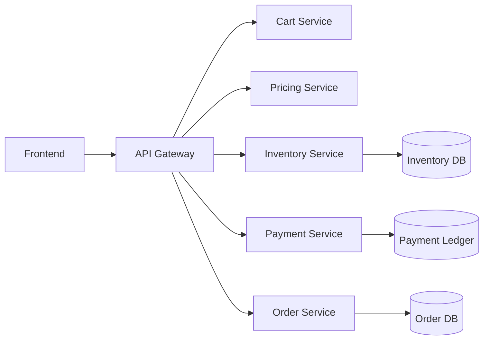
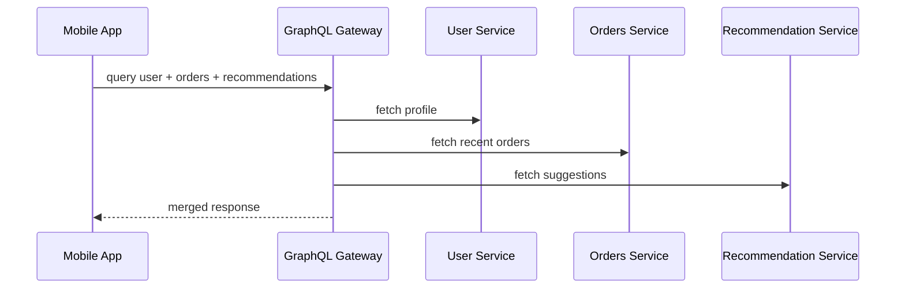
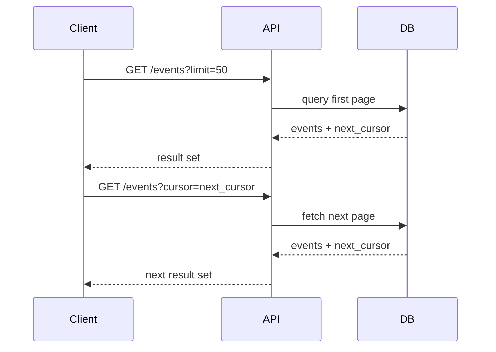

# Real-World Interview Questions and Model Answers

This file focuses on interview scenarios that resemble real production API design discussions.

## 1) Interview Question: Design the API for an e-commerce checkout flow.

### Strong answer
An e-commerce checkout API should have clear boundaries between product, cart, pricing, payment, and order services. The user experience depends on correctness, not just speed.

Key requirements:
- create and update cart
- validate pricing and inventory
- reserve stock
- collect payment
- create an order record
- support idempotency and retries

### API sketch



### Strong answer points
- Use REST for public-facing endpoints such as `/carts`, `/orders`, `/payments`
- Use idempotency keys for payment and order creation
- Validate inventory and pricing before order confirmation
- Treat payment as a transactional boundary with durable writes
- Use asynchronous eventing for notifications and analytics

### Trade-off discussion
The biggest trade-off is between speed and correctness. Checkout often prioritizes reliability and strong consistency over maximum throughput. A single payment mistake destroys trust, so correctness must be modeled explicitly.

---

## 2) Interview Question: A mobile app needs data from several backend systems. Should you use REST or GraphQL?

### Strong answer
For a mobile app with a complex screen that needs user profile, orders, reviews, and recommendations all at once, GraphQL is often a good fit. The client can request only the fields it needs and avoid multiple round trips.

However, I would still consider REST if the data model is straightforward and we need strong caching and simple operational semantics. A lot depends on whether the product team values flexibility or standardization.

### Key design points
- use GraphQL for a flexible read model on the client side
- add query complexity limits and rate limiting
- protect expensive resolver chains with batching and caching
- use authorization at the field or resolver level



### What interviewer is looking for
They want to know whether you can reason beyond "GraphQL is cool" and discuss real production pain points such as N+1 queries, rate limiting, and authorization complexity.

---

## 3) Interview Question: Your internal services need very low latency and strong typing. Which API style should you choose?

### Model answer
I would choose gRPC for internal service-to-service communication when latency, throughput, and schema quality matter more than human readability.

Example services:
- auth validation
- recommendation ranking
- inventory check
- event streaming or telemetry forwarding

Benefits:
- compact binary payloads
- strong schema contracts
- better throughput for high-frequency calls
- streaming support for real-time data

I would still keep REST or GraphQL at the public boundary for client consumption because they are easier for browsers and external developers to work with.

### Real-world nuance
The best architectures often mix styles: public HTTP APIs for humans and gRPC for internal service calls. This reduces internal network cost while keeping the external interface developer-friendly.

---

## 4) Interview Question: How would you handle versioning for a public API that already has many clients?

### Strong answer
I would first aim for additive, backward-compatible changes. If we can extend the API without breaking older clients, we avoid a major migration. Add optional fields, keep old fields as-is, and prefer new endpoints when functionality changes significantly.

If a breaking change is unavoidable, I would use a versioned route such as `/v1` and `/v2` or header-based negotiation. I would communicate deprecation windows clearly and provide migration guidance.

### Good production pattern
- maintain old endpoint behavior during migration
- add monitoring for usage of old versions
- sunset old clients with a defined timeline
- document release notes and differences between versions

```mermaid
flowchart LR
    V1[Legacy Client] --> API[Public API]
    V2[New Client] --> API
    API --> V1Route[/v1]
    API --> V2Route[/v2]
```

### What makes this a strong answer
It recognizes that versioning is not just a technical feature; it is a client compatibility and migration strategy.

---

## 5) Interview Question: A payment API is timing out after returning success. What should we do?

### Strong answer
This is an idempotency problem. The client may retry the request because it did not receive or understand the response, while the server has already processed the charge.

The fix is to require an idempotency key on payment requests and persist its result. If the same key arrives again, the server returns the original result rather than processing the payment again.

We should also:
- store payment state durably before response
- use retry-safe logic around gateways
- keep external provider calls behind retries and timeouts with bounded backoff
- add observability for duplicate payment attempts

### Why it matters
Without idempotency, a network timeout can create a duplicate charge, which is a serious operational and legal issue.

---

## 6) Interview Question: How would you design pagination for a large event feed?

### Strong answer
I would use cursor-based pagination for large event feeds because the dataset is large and changes often. Cursor pagination is more stable than offset pagination when users keep scrolling and new records are inserted in the middle.

I would also support filtering by type, date range, or related entity and define sorting semantics clearly. Example:
- /events?type=payment&since=cursor123&limit=50

### Why this is a good design
- avoids expensive offset scans
- works well with constant insertion and deletion
- makes API behavior easier to reason about in real-world usage



---

## 7) Interview Question: Why are service contracts important in a distributed system?

### Strong answer
Service contracts make dependencies explicit. They define what each service expects, what it returns, what error semantics apply, and how changes are allowed to evolve.

Without a contract, teams guess. That creates fragile integrations, hidden coupling, and outages when one service changes unexpectedly.

Good contracts include:
- schema definitions
- error models
- authentication and authorization expectations
- idempotency and retry guidance
- deprecation and compatibility policy

### Good signal in interviews
A strong candidate frames API design not only as technical plumbing but as governance and communication across teams.

---

## 8) Interview Question: How do you prevent a public API from becoming hard to maintain?

### Strong answer
I would invest in clear route design, consistent naming, explicit schemas, strong validation, documentation, and versioning policies. I would also ensure the API has error semantics that are easy to understand and not just generic 500 errors.

Additional practices:
- use OpenAPI specifications
- document auth and rate limits
- keep contracts backward compatible when possible
- separate domain-specific routes from generic helper endpoints
- monitor usage and error patterns before making changes

This is what turns an API from a pile of endpoints into a durable product contract.

---

## Final advice for mock interviews

A strong answer is not just a set of definitions. It is a set of trade-offs.

When answering API design questions, always state:
- what problem you are solving
- what constraints exist
- which trade-offs you are making
- how the design behaves under failure, retry, or scale
- what metrics and observability matter

That kind of reasoning is what real interviewers look for.
