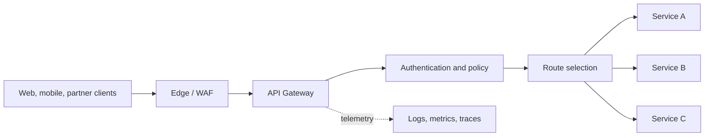
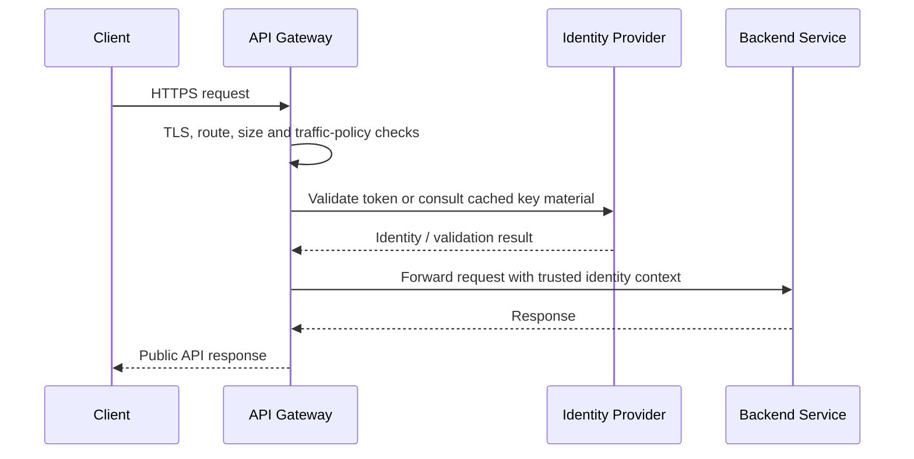
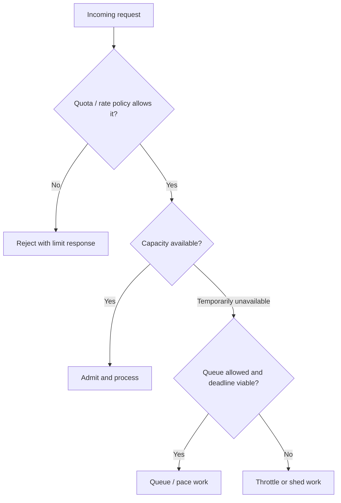
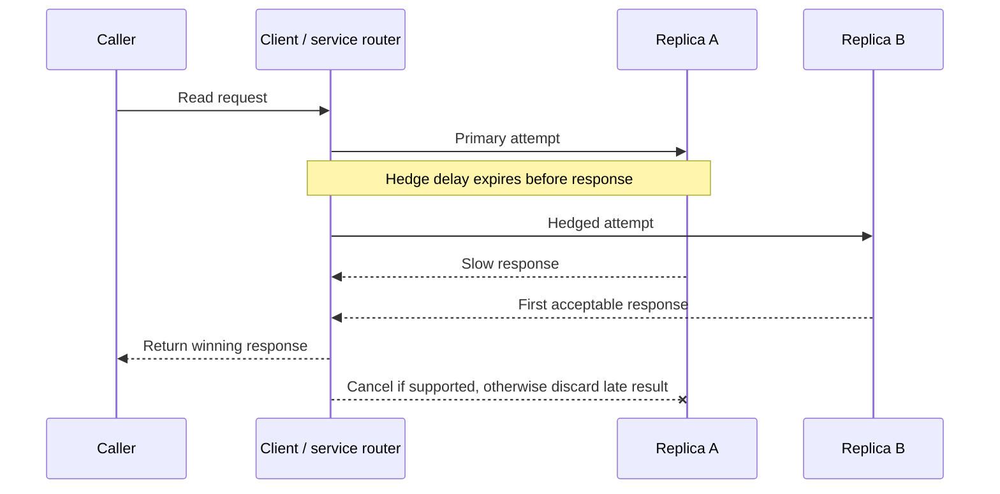

# API Infrastructure

API infrastructure is the set of shared components that receives, protects, routes, and regulates API traffic. It sits between clients and application services, so it can enforce consistent cross-cutting policies without requiring every service to implement them independently.

The gateway is not a substitute for sound service design. Services must still validate requests and authorize access to their own data. The infrastructure layer provides a consistent first line of policy enforcement, traffic control, and observability.

## 1) API Gateways

An API gateway is a managed or self-operated entry point for API traffic. It accepts a client request, applies shared policies, selects an upstream service, forwards the request, and returns the response. A gateway commonly provides:

- **Routing:** map hostnames, paths, methods, or headers to services and versions.
- **Identity and access integration:** validate credentials, propagate identity, and enforce coarse-grained access rules. Fine-grained authorization remains close to the data and business operation.
- **Traffic controls:** rate limits, request-size limits, timeouts, concurrency controls, and circuit-breaking behavior.
- **Protocol and payload mediation:** terminate TLS, translate protocols, normalize headers, or adapt legacy interfaces.
- **Operational features:** health-aware upstream selection, access logs, metrics, tracing, and deployment controls such as canaries.

### Request path

### Gateway, reverse proxy, ingress, and service mesh

These terms overlap in implementations, but describe different roles:

- A **reverse proxy** forwards requests to upstream servers and may handle TLS, load balancing, or caching. It need not provide API-specific product features.
- An **API gateway** is an API-focused reverse proxy with centralized API policies, routing, and often developer-facing controls.
- A **Kubernetes ingress controller** implements external HTTP(S) routing into a Kubernetes cluster. It may also serve as the API gateway when its features and operational model are sufficient.
- A **service mesh** manages service-to-service traffic inside an environment, typically including workload identity, telemetry, retries, and traffic policy. It does not automatically replace the north-south gateway used by external clients.

### Design and operational concerns

1. **Keep the gateway stateless where possible.** Configuration and ephemeral counters may be externalized, but avoid placing business data or long-lived workflow state in the gateway.
2. **Make it highly available.** Run multiple gateway instances across failure domains, health-check upstreams, and avoid a single shared dependency becoming a new point of failure.
3. **Set explicit budgets.** Bound request size, connection time, upstream response time, and total work. A gateway timeout must be coordinated with downstream timeouts so callers do not wait indefinitely.
4. **Preserve end-to-end security.** Strip untrusted identity headers from clients before adding trusted ones; use TLS between components when the threat model requires it; validate authorization again in the service.
5. **Observe both sides of the boundary.** Record route, status, latency, and correlation identifiers without logging credentials or sensitive payloads.
6. **Avoid a policy bottleneck.** Centralizing policies improves consistency, but a gateway outage or costly policy can affect every API. Use safe rollout, capacity tests, and a documented fail-open/fail-closed choice for each dependency.

### Gateway platform comparison

The right choice depends on deployment model, extensibility, traffic scale, and operational ownership; these options are not interchangeable products in every environment.

| Option | Typical fit | Strengths | Trade-offs |
|---|---|---|---|
| Managed cloud API gateway | Public or partner APIs on one cloud | Managed availability, integrations with cloud identity/metrics, less proxy operations | Provider-specific features and limits; less control over data plane and upgrades |
| Envoy-based gateway | Kubernetes, service platform, or custom edge | Extensible proxy, rich routing and telemetry, strong fit with service-mesh ecosystems | Requires expertise in configuration, control planes, upgrades, and production operations |
| NGINX-based gateway | High-performance HTTP reverse proxy and API edge | Mature proxying, flexible routing, broad deployment options | Advanced API management features may require additional products or integration |
| Kong Gateway | API management with plugins and a proxy data plane | Plugin ecosystem, consumer/key management, self-managed or managed options | Plugin behavior and control-plane design add operational and compatibility considerations |
| Kubernetes ingress controller | Cluster-local HTTP(S) exposure | Natural integration with Kubernetes services and deployment workflows | Often narrower API lifecycle/policy capabilities; may need a separate gateway for external product needs |

These are platform families and examples, not a feature-by-feature guarantee. Compare the deployed edition, supported integrations, current limits, and operating costs before selecting one.

## 2) Rate Limiting

Rate limiting constrains how many operations a principal may perform over a defined period or budget. A principal can be an API key, account, user, tenant, IP address, or a combination. Limits protect shared capacity, contain abusive or accidental traffic, enforce commercial plans, and make resource use fairer.

### Define the policy before choosing an algorithm

A useful policy specifies:

- **Who is limited:** identity and fallback behavior for anonymous traffic.
- **What is counted:** requests, bytes, expensive operations, or a weighted cost.
- **Where it applies:** endpoint, tenant, region, service, or system-wide.
- **The budget and interval:** for example, 300 reads per minute plus a sustained daily quota.
- **Burst behavior:** whether short bursts are allowed.
- **Exceed behavior:** reject, queue, degrade, or shed lower-priority work.

One global limit is rarely sufficient. A public API might combine a per-IP abuse limit, a per-account plan limit, and a stricter per-endpoint limit for expensive search operations. Limits should not accidentally let many API keys bypass an account-wide quota.

### Common algorithms

| Algorithm | How it works | Advantages | Limitations / best fit |
|---|---|---|---|
| Fixed window | Count requests in discrete time buckets; reset at each boundary | Simple, cheap, easy to explain | Boundary bursts can nearly double the intended short-period rate |
| Sliding-window log | Store request timestamps and count those within the rolling interval | Accurate rolling limit | Memory and write cost grow with request volume |
| Sliding-window counter | Blend current and previous fixed-window counts | Smooths boundary effects with modest state | Approximate; accuracy depends on window granularity |
| Token bucket | Refill tokens at a steady rate up to a capacity; each request spends tokens | Allows controlled bursts while bounding long-term rate | Requires choosing refill rate and burst capacity; distributed token state is a concern |
| Leaky bucket / paced queue | Admit work into a queue drained at a fixed pace; excess work is delayed or rejected | Smooths traffic sent to a downstream system | Queuing increases latency and memory use; queue bounds and deadlines are essential |

### Distributed enforcement

An in-process counter is fast but each gateway replica sees only part of traffic. If there are eight replicas with a local limit of 100 requests per minute, a client may effectively receive up to 800 requests per minute. Common approaches include:

- **Central atomic counter (for example, a Redis script):** consistent shared state and straightforward policy semantics, but adds network latency, cost, and a dependency that needs its own availability plan.
- **Partitioned or sharded counters:** distribute keys across counter nodes; improves scale but introduces routing and rebalancing complexity.
- **Local counters with periodic synchronization:** low latency and can continue through a shared-store outage, but enforcement is approximate and may overshoot.
- **Hierarchical budgets:** allocate a global or tenant budget to regions/instances, then enforce locally; this reduces per-request coordination while controlling aggregate overrun.

Choose the precision that the business policy needs. A best-effort abuse limit may tolerate small overshoot; a hard contractual quota may require stronger coordination. Define behavior during counter-store failure explicitly: fail closed protects a dependency but blocks legitimate traffic; fail open preserves availability but may exceed the intended budget.

### Client behavior and observability

For HTTP APIs, return `429 Too Many Requests` when a client-specific policy is exceeded, and include a useful retry hint such as `Retry-After` when it is safe to do so. Document any limit-related response headers, but do not expose another customer's usage. Clients should use bounded exponential backoff with jitter rather than immediate retries.

Monitor allowed and rejected requests by route and principal class, counter-store latency/errors, queue depth, and downstream saturation. Avoid high-cardinality metrics labeled by raw user IDs or API keys; use privacy-safe aggregation and keep detailed identity data in access-controlled logs only when needed.

## 3) Throttling vs. Rate Limiting

The terms are sometimes used interchangeably, so state the operational meaning in a design discussion. In this lesson:

- **Rate limiting** is the policy that defines an allowed request or work budget over time.
- **Throttling** is the mechanism that slows, queues, delays, or rejects work to keep actual processing within a safe capacity.

Rate limiting may be implemented by throttling, but throttling can also be driven by live system health rather than a fixed customer quota. For example, an account can be within its monthly quota while the service temporarily throttles requests because a database is saturated.

| Dimension | Rate limiting | Throttling |
|---|---|---|
| Primary question | “How much may this principal do?” | “How quickly can the system safely process work now?” |
| Typical trigger | Quota, plan, abuse policy, fairness | Concurrency, queue depth, CPU, downstream saturation |
| Control | Count/budget over a time interval | Pace, queue, delay, shed, or reject work |
| Scope | Often per identity, route, or tenant | Often per service, dependency, or priority class |
| Common response | Reject with 429 and a reset/retry hint | Queue/delay; return 429 or 503 if admission is denied |
| Example | 1,000 API calls per tenant per hour | At most 200 concurrent report-generation jobs |

### Practical controls

- **Concurrency limiter:** caps in-flight work. Useful when each request consumes a long-lived resource, such as a database connection or expensive job slot.
- **Queue-based smoothing:** buffers short bursts and drains at a safe rate. Bound the queue by size and age, and reject work that cannot complete before its deadline.
- **Adaptive throttling:** decreases admission as errors, latency, or saturation rise and cautiously restores capacity as health recovers. Use stable signals and hysteresis to avoid oscillation.
- **Priority-aware shedding:** preserve critical operations while deferring or rejecting optional work such as recommendations or bulk exports.

Do not treat retries as free capacity. If throttled clients retry immediately, they amplify overload. Return actionable retry guidance, use jitter, and set client deadlines so queued or delayed work does not become stale.

## 4) Request Hedging

Request hedging reduces tail latency by sending a duplicate request to another replica when the original has taken unusually long. The system uses the first acceptable response and cancels or ignores the other attempt. It is a latency technique, not a way to increase throughput or repair a failing dependency.

### Typical flow

### When hedging helps

Hedging is most useful when a small fraction of requests are slow because of transient replica-level variation, the service has independent replicas, and the request is safe to duplicate. It can reduce a high percentile such as p99 without forcing every request to use a slower timeout.

Set the hedge delay from measured latency distributions and the end-to-end deadline. A common starting point is a high latency percentile, then evaluate the latency improvement and extra work under realistic load. Hedge only a controlled fraction or within a concurrency budget; otherwise slowdowns cause more duplicates, which create still more load.

### Safety and failure modes

- Prefer idempotent reads. A non-idempotent operation (such as charging a card) must not be duplicated unless it has robust idempotency keys and deduplication semantics.
- Route the hedge to a genuinely independent replica or failure domain. Sending both attempts to the same overloaded host does not provide useful redundancy.
- Cancel the losing attempt where possible, and propagate cancellation. A response that is ignored may still consume database, CPU, and network resources.
- Respect one end-to-end deadline; the hedge must not extend the caller's total wait.
- Do not hedge when the system is already saturated or the issue is common-mode (for example, every replica is slow because the database is overloaded).
- Track hedge rate, duplicate work, cancellations, winning attempt, error rate, and latency percentiles. Automatically reduce or disable hedging when extra load outweighs the tail-latency benefit.

### Hedging compared with related controls

| Technique | Trigger | Main purpose | Main risk |
|---|---|---|---|
| Timeout | A request exceeds its deadline | Bound waiting time and resource occupancy | May abandon work that could have completed |
| Retry | An attempt fails or times out | Recover from transient failure | Serial extra load and longer completion time |
| Request hedging | A request is slow but not yet failed | Reduce tail latency by racing attempts | Parallel duplicate load; unsafe side effects |
| Failover | A target is unhealthy or unavailable | Route around a failed target | Detection delay and possible overload of remaining targets |

In interviews, explain that hedging should be a measured, bounded optimization layered on top of timeouts, cancellation, and safe request semantics—not a default retry policy.
