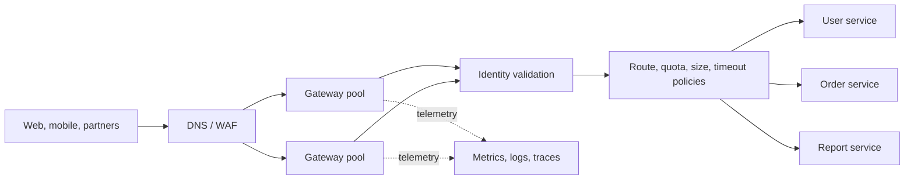
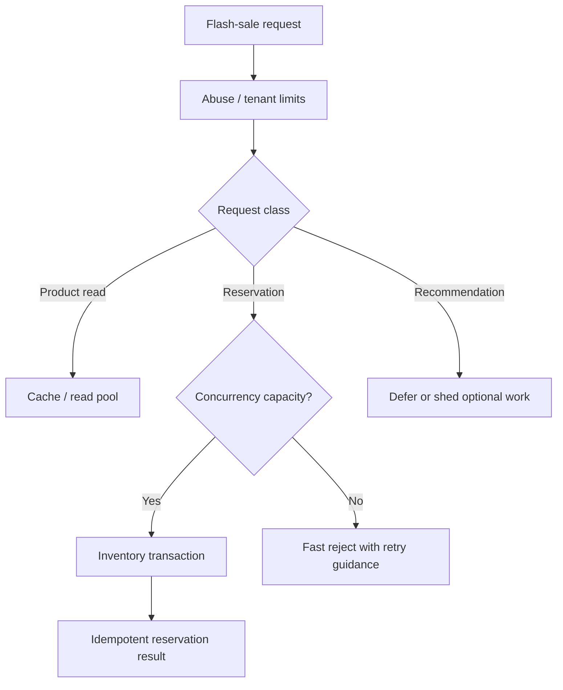
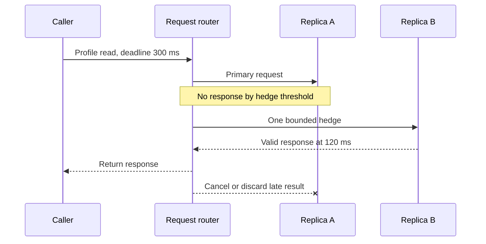

# Real-World Interview Questions and Model Answers

These scenarios are designed to practice explaining an end-to-end decision, including traffic flow, failure modes, and trade-offs.

## 1) Design an API edge for a multi-tenant SaaS product

**Interviewer:** Customers use web and mobile clients, and partner integrations call the same APIs. We have several backend services and need authentication, tenant isolation, quotas, and safe deployments. How would you design the API edge?

### Model answer

I would put a highly available gateway behind the edge/WAF and route requests to service pools by host, path, or API version. The gateway would terminate client TLS, enforce request-size and connection limits, validate credentials or tokens, apply coarse access policies and per-tenant traffic budgets, and emit route-level telemetry. It would forward a trusted identity context after stripping client-supplied identity headers.

Each service would still authorize actions against its own resources and tenant data. The gateway is a consistent policy boundary, not the source of truth for business permissions.

I would keep gateway instances stateless and spread them across failure domains. Configuration changes would be validated and rolled out gradually with rollback. For tenant limits, I would define whether the budget is per account, user, key, and route, and use an atomic shared counter or allocated regional budgets depending on the required accuracy and latency.

### Trade-offs and follow-up

- **Managed versus self-managed:** A managed gateway reduces data-plane operations but can introduce provider-specific limits. A self-managed Envoy-, NGINX-, or Kong-based option offers more control but requires upgrade, capacity, and control-plane ownership.
- **Fail-open versus fail-closed:** I would choose per policy. For example, an unavailable optional analytics policy should not block all reads, but a critical identity check should not silently become unauthenticated access.
- **Gateway versus mesh:** The gateway handles north-south client traffic; a mesh may handle east-west service traffic. They can share proxy technology without needing to be one operational component.

### What the interviewer is testing

Whether you separate edge policy from domain authorization, model tenant identity correctly, account for gateway availability, and choose a control plane based on requirements rather than brand preference.

## 2) A flash sale overloads the product and inventory APIs

**Interviewer:** A flash sale creates a sudden 20x traffic increase. Some endpoints are cheap reads, while inventory reservation is expensive and must not oversell. How do you protect the system without making all traffic unusable?

### Model answer

I would separate per-customer fairness from system-capacity protection. At the edge, apply an abuse limit by IP or credential and an account-level rate budget. Use a burst-tolerant algorithm such as token bucket for normal API traffic. For inventory reservation, enforce a strict concurrency/admission limit close to the service and use the inventory service's transactional invariant to prevent overselling; a gateway limit alone cannot guarantee inventory correctness.

I would prioritize essential flows such as checkout over optional reads or recommendations. If the reservation service is saturated, reject new reservations quickly with a retryable response only when the client can safely retry, and avoid sending an immediate retry storm. A bounded queue is appropriate only if the product can tolerate its delay and the reservation has a clear expiry and idempotency key.

For rate policy, I would compare:

| Control | Role in flash sale | Risk to manage |
|---|---|---|
| Token-bucket tenant limit | Permit brief customer bursts while bounding sustained traffic | Distributed bucket state and aggregate overshoot |
| Concurrency limit | Bound in-flight expensive reservations | Underutilization if set too low; must reflect service capacity |
| Bounded queue | Smooth a short burst of asynchronous work | Queue delay, stale reservations, and memory use |
| Priority shedding | Preserve core flows by dropping optional work first | Clearly define which features may degrade |

I would load-test with realistic request mixes, watch queue depth and database saturation, and scale only where the bottleneck has capacity to scale. A limiter protects a dependency; it does not create capacity or replace inventory correctness.

### What the interviewer is testing

Whether you avoid a single global requests-per-second number, distinguish throughput from concurrency, preserve correctness under duplicate requests, and degrade non-critical work intentionally.

## 3) A read API has bad p99 latency but healthy average latency

**Interviewer:** A profile read normally completes in 40 ms, but p99 is 900 ms. There are several independent replicas and the request is read-only. Would you hedge?

### Model answer

Possibly, after verifying the tail is caused by occasional replica-level slowness rather than a shared bottleneck. I would first inspect traces and latency distributions by replica, downstream, and request type. I would confirm that duplicate reads are safe, that replicas are independent enough to help, and that the caller has a strict overall deadline.

I would select a hedge delay from measured latency data—late enough not to duplicate normal requests, but early enough to improve the tail. I would limit the fraction and concurrency of hedges, route the second attempt to a different replica or failure domain, cancel the loser when possible, and return the first valid result. A hedge should not extend the request deadline.

Before rollout, I would compare baseline and canary p95/p99, error rates, extra downstream calls, and cancellation behavior. If both attempts tend to be slow together, or if database saturation increases, I would disable hedging and address the shared bottleneck instead.

| Approach | How it helps | Why it may not solve this case |
|---|---|---|
| Increase timeout | Reduces caller-visible timeout failures | Does not reduce p99 latency |
| Retry after failure | Can recover from transient errors | Usually waits for failure first and adds serial delay |
| Hedge after a delay | Races a slow but unfinished request | Adds parallel load and requires safe duplicate semantics |
| Improve replica selection | Avoids known slow or unhealthy replicas | Needs reliable signals and may not help random tail events |

### What the interviewer is testing

Whether you use data to diagnose the tail, understand the additional load created by hedging, and include cancellation, idempotency, deadlines, and a rollback condition.

## 4) The rate-limit store becomes unavailable

**Interviewer:** Your gateways use a shared counter store for tenant quotas. The store is timing out. What should the gateway do?

### Model answer

There is no universal answer; it depends on the promise the limit represents. I would classify policies:

- For a best-effort abuse limit, use a short-lived local fallback or temporary fail-open behavior with a conservative bound, while alerting on the degraded mode.
- For a hard contractual or costly-operation quota, fail closed or use previously allocated local budgets so aggregate usage remains bounded.
- For authentication or authorization, do not treat a counter-store failure as permission to bypass identity controls; separate that dependency and policy.

I would use a strict timeout and circuit breaker around the counter store so a slow dependency does not consume all gateway connections. The gateway should emit a distinct degraded-policy metric and avoid returning a normal success shape that hides the failure from operators. Recovery should not cause a counter stampede; restore traffic gradually and reconcile usage if the policy requires it.

### What the interviewer is testing

Whether you reason explicitly about availability versus enforcement guarantees and avoid an accidental global fail-open or fail-closed decision.

## 5) Compare gateway platforms for a new service

**Interviewer:** We run Kubernetes and need external HTTP routing today, with possible partner API keys, quotas, and version management later. Would you use an ingress controller, a managed API gateway, Envoy, NGINX, or Kong?

### Model answer

I would first clarify the required controls, who will operate the data plane, cloud portability needs, expected traffic, and whether API consumers need product-level key and quota management. I would not deploy a full API-management platform solely because an API may need more features someday.

| Option | Good initial fit | Likely gap to evaluate |
|---|---|---|
| Kubernetes ingress controller | Cluster routing and TLS for internal or simple public services | Partner onboarding, consumer lifecycle, advanced quota policy |
| Managed API gateway | Cloud-native external APIs with low proxy-operation overhead | Provider-specific behavior, limits, and cost |
| Envoy-based gateway | Programmable routing and integration with a platform control plane | Control-plane and configuration ownership |
| NGINX-based gateway | Efficient proxying and familiar HTTP operations | Whether extra API-management components are needed |
| Kong Gateway | Plugin-driven API products, consumers, and policy extensions | Plugin governance, upgrades, and control-plane operations |

I would run a small representative test that measures required policy behavior, latency overhead, failure handling, rollout safety, and cost at expected traffic. The chosen option must also have a clear owner for upgrades, configuration review, and incident response.

### What the interviewer is testing

Whether you compare operational fit and required capabilities instead of declaring one gateway universally best.
