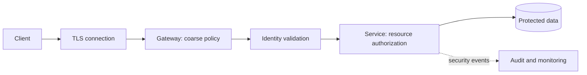
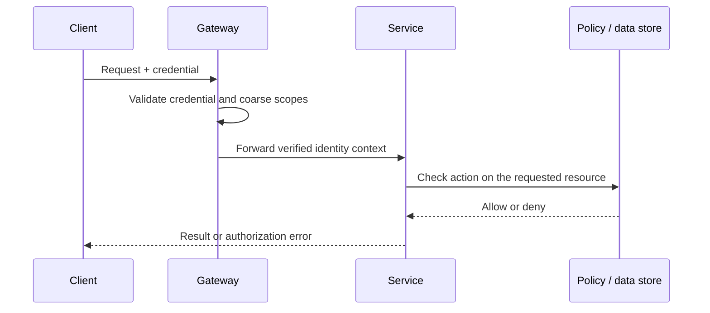

# API Security

API security protects data and operations at every boundary where a client, user, service, or operator can make a request. A secure design does not rely on one gateway setting: it combines identity verification, authorization, credential lifecycle, transport protection, least privilege, monitoring, and safe failure behavior.

The gateway can reject malformed or unauthenticated traffic early, but the service that owns a resource must enforce its own authorization rules. Treat every input—including identity headers from upstream components—as untrusted until its origin and integrity are established.

## 1) Authentication vs. Authorization

**Authentication** establishes an identity: who or what is making the request. **Authorization** decides whether that identity may perform a particular action on a particular resource. Authentication may happen once per session or request; authorization is evaluated in the context of the requested operation and current policy.

For example, a valid login proves the caller is Alice. It does not prove Alice may read invoice `INV-42`, approve a refund, or administer the organization. A secure handler should derive the caller identity from a verified credential, load or validate the target resource's tenant/owner relationship, and check the required action before returning data or performing a side effect.

| Concern | Authentication | Authorization |
|---|---|---|
| Question | Who/what is the caller? | May this caller do this action on this resource? |
| Typical inputs | Password, passkey, certificate, signed token | Subject, action, resource, tenant, policy, context |
| Result | Verified identity and authentication strength | Allow/deny, sometimes with a constrained scope |
| Common failure | Invalid or expired credentials | Valid identity lacks the required permission |
| API response | Usually 401 for missing/invalid authentication | Usually 403, or 404 when existence must be concealed |

Authorization can use roles (RBAC), attributes and context (ABAC), or explicit relationships (ReBAC). Roles are easy to reason about for broad job functions; attributes express rules such as ownership or region; relationship models are useful for collaborative resources. These models can be combined. Avoid trusting a client-supplied user ID or tenant ID as proof of access, and check access at the object level to prevent insecure direct object reference (IDOR) bugs.

### A safe request path

The identity context passed from gateway to service must be integrity-protected: remove client-supplied identity headers, use a trusted channel, and ensure the service accepts such context only from authorized upstreams. The service must not skip resource-level checks merely because the gateway authenticated the request.

## 2) Session vs. Token-Based Authentication

Both approaches establish an authenticated state across multiple requests, but they store and transport that state differently.

- **Session-based:** the client holds an opaque, hard-to-guess session identifier; the server stores session state and looks it up on requests. Revocation is straightforward because the server can invalidate the record. A cookie is commonly used in browsers.
- **Token-based:** the client presents a credential containing or referencing claims. A self-contained signed token can be validated without a session lookup, while an opaque token requires introspection or a lookup. Token validation does not by itself prove that the account is still active or that authorization is current.

| Dimension | Server-side session | Self-contained signed token | Opaque access token |
|---|---|---|---|
| Per-request state lookup | Usually yes | Usually no, until expiry/key or revocation checks | Often introspection or lookup |
| Revocation | Immediate by invalidating session | Harder without denylist/version check; short expiry limits exposure | Centralized revocation can be straightforward |
| Scaling requirement | Shared or replicated session store | Key distribution and consistent validation rules | Highly available introspection/token store |
| Client storage | Cookie or secure platform storage | Depends on client and token type | Depends on client and token type |
| Typical fit | First-party browser applications | Distributed APIs needing local validation | OAuth deployments prioritizing central control |

For browsers, `HttpOnly`, `Secure`, and an appropriate `SameSite` cookie policy reduce exposure, but cookie authentication also requires CSRF defenses when browsers automatically attach credentials. For bearer tokens, anyone who obtains the token can usually use it until it expires or is revoked; keep access tokens short-lived, avoid placing them in URLs or logs, and store them using platform-appropriate protections.

Choose based on revocation needs, client type, latency, and operational capability rather than assuming tokens are always more scalable. Sessions can scale with a reliable shared store; tokens can still require online checks for revocation, account status, or rapidly changing permissions.

## 3) JSON Web Tokens (JWT)

JWT is a compact format for claims, commonly encoded as a signed JSON object. A typical JWT has a header, payload, and signature, encoded as three Base64URL segments. **Encoding is not encryption**: a signed JWT's claims are readable by its holder. Use an encrypted format only when confidentiality is explicitly needed and supported safely; never put secrets in an ordinary signed token.

Common claims include:

- `iss` (issuer): which authority created the token.
- `sub` (subject): the principal the token represents.
- `aud` (audience): the intended API or service.
- `exp`, `nbf`, `iat`: expiration, not-before, and issue times.
- `jti`: a token identifier, useful for tracking or revocation schemes.
- `scope` or roles: granted capabilities, interpreted under the API's policy.

Validation is more than checking the signature. The API should pin allowed algorithms, verify the signature against trusted issuer keys, validate issuer and audience, enforce `exp`/`nbf` with a small justified clock-skew allowance, and reject malformed or unexpected claims. Key rotation needs an overlap period in which verifiers can retrieve the new key while still accepting valid tokens signed by the retiring key. Treat an unknown key ID as a validation failure, not as permission to guess a weaker algorithm.

| Property | Signed JWT | Encrypted JWT |
|---|---|---|
| Integrity / authenticity | Yes, if signature and claims are validated correctly | Usually provided by the signed/encrypted construction |
| Claim confidentiality | No; payload is readable | Yes, for intended recipients with the decryption key |
| Main operational cost | Key distribution, rotation, claim freshness | Encryption key management and more complex processing |
| Important caution | A valid signature does not make every claim trustworthy or current | Encryption does not remove the need for issuer, audience, time, and authorization checks |

JWTs are useful when many services need to validate a short-lived identity assertion without a per-request central lookup. They are less suitable when permissions must be revoked immediately or claims change frequently; use short lifetimes, token introspection, revocation/version checks, or an opaque token as appropriate. Do not treat possession of a valid token as authorization to every resource.

## 4) OAuth / OAuth 2.0

OAuth 2.0 is an **authorization framework** for delegated access. It allows a client application to obtain limited access to a resource server on behalf of a user or as itself, without receiving the user's password. OAuth alone does not define a universal user-login identity protocol; OpenID Connect adds that identity layer.

Important roles:

- **Resource owner:** user or entity whose resources are protected.
- **Client:** application requesting access.
- **Authorization server:** authenticates/consents and issues tokens.
- **Resource server:** API that accepts and enforces access tokens.

For interactive applications, use the Authorization Code flow with PKCE. The client creates a high-entropy verifier and sends its derived challenge with the authorization request; when exchanging the one-time authorization code, it proves possession of the verifier. This helps prevent an intercepted code from being redeemed by another party. Use exact registered redirect URIs, validate `state` to correlate the browser response and mitigate request forgery, and use `nonce` when the identity layer requires it. Do not use the implicit grant for new applications.

For machine-to-machine access, Client Credentials is appropriate when no end user is involved. Keep client secrets out of public clients such as browser apps and native apps; use a confidential backend or stronger workload identity where available. Tokens should have the narrowest audience and scopes, with a limited lifetime.

| Grant / pattern | Suitable client | User involved? | Key security condition |
|---|---|---:|---|
| Authorization Code + PKCE | Browser, native, or server-side interactive app | Yes | Exact redirect URI, `state`, PKCE verifier, one-time code |
| Client Credentials | Confidential service/client | No | Protect client authentication; scope and audience must be narrow |
| Device Authorization | Input-constrained device | Usually | User verifies the displayed code at the trusted authorization site |
| Resource Owner Password Credentials | Not recommended for new systems | Yes | Avoid; client handles the user's password and undermines delegated authorization |

OAuth access tokens are intended for APIs, not automatically for proving a user's identity to arbitrary clients. Validate token type, issuer, audience, scopes, and client context at the resource server. Treat refresh tokens as especially sensitive: rotate them where supported, bind them to the client, detect reuse, and revoke them on logout or suspected compromise.

## 5) Single Sign-On (SSO)

Single Sign-On lets a user authenticate with an identity provider (IdP) and access multiple relying applications without independently entering credentials at each application. SSO centralizes authentication, lifecycle, and policy, but each application still has to validate the login response and make its own authorization decisions.

Common protocols include SAML 2.0 and OpenID Connect. SAML is common in established enterprise browser integrations and uses signed XML assertions. OIDC is an identity layer on OAuth 2.0 and uses JSON-based ID tokens, making it a natural fit for modern web and mobile applications.

| Dimension | SAML 2.0 | OpenID Connect |
|---|---|---|
| Typical assertion | XML assertion | JWT-formatted ID token |
| Common use | Enterprise browser SSO and older integrations | Web, mobile, and API-adjacent login |
| Trust setup | Entity IDs, metadata, signing certificates, bindings | Issuer discovery, client registration, redirect URIs, signing keys |
| Validation focus | Signature, issuer, audience, recipient, time, request correlation | Signature, issuer, audience, expiry, nonce and flow correlation |
| Integration style | XML-oriented browser flows | OAuth-based flows and JSON/JWT tooling |

In either protocol, verify the signature, issuer, intended audience, expiry, and request/response correlation; enforce exact redirect or assertion-consumer endpoints; and prevent replay. SSO logout does not automatically revoke every application session or API token, so define session lifetimes and logout propagation explicitly. Provisioning/deprovisioning (for example, SCIM) is related but separate: a user may lose IdP access while stale local accounts or sessions remain unless lifecycle changes are propagated.

## 6) OpenID Connect (OIDC)

OIDC is an identity layer on top of OAuth 2.0. It defines how a client requests authentication and receives an **ID token** that communicates an authentication event and subject identity. The **access token** is for calling a resource server; the ID token is for the client to understand the login result. They are not interchangeable, and an API should not accept an ID token as an access token unless the protocol and audience explicitly define that use.

In the Authorization Code flow, the client sends the user to the provider, receives a short-lived code at a registered redirect URI, and exchanges it for tokens. The client validates the ID token's signature, issuer, audience, expiry, and `nonce`; `state` binds the browser callback to the initiating request. Discovery metadata and JWKS endpoints help clients locate provider configuration and signing keys, but clients must constrain the expected issuer and use HTTPS rather than trusting arbitrary discovery URLs.

OIDC standardizes identity claims and discovery, not application authorization. Claims such as email may be mutable or unverified unless their status is explicitly indicated. Use the stable subject identifier in the issuer's namespace, and map it to a local account carefully; do not merge accounts solely because two providers return the same email address.

## 7) API Keys

An API key is a credential that identifies a client, project, or integration. It is useful for service identification, coarse quotas, metering, and access to low-risk public APIs. A key is usually a bearer secret: possession may be enough to use it. It does **not** reliably authenticate an end user, and should not be treated as proof that a specific human is authorized.

Good key lifecycle design includes:

1. Generate keys with cryptographically secure randomness and sufficient entropy.
2. Show the secret only at creation; store a verifier/hash where practical rather than the recoverable secret.
3. Associate keys with an owner, environment, scopes, expiry, and last-used metadata.
4. Support rotation with a short overlap period and immediate revocation.
5. Restrict key permissions and quotas; separate production from development credentials.
6. Redact keys from logs, traces, URLs, analytics, screenshots, and support tickets.

| Credential | Best use | Main limitation |
|---|---|---|
| API key | Identifying an integration or project for quotas and simple access | Bearer secret; weak user identity and limited delegated authorization |
| OAuth access token | Scoped access to an API, delegated or client-based | Requires issuer/token lifecycle and correct audience/scope enforcement |
| Mutual TLS client certificate | Strong workload/client identity at a trusted transport boundary | Certificate issuance, rotation, and connection termination need operational ownership |

Keys embedded in public browser or mobile binaries cannot be kept secret. For those clients, use an appropriate user authentication flow and enforce abuse controls at the server; a public identifier may help with metering but must not be a security boundary. Restrict sensitive keys by network or resource where feasible, and alert on unusual use.

## 8) Multi-Factor Authentication (MFA)

MFA requires evidence from at least two independent factor categories:

- **Knowledge:** something the user knows, such as a password or PIN.
- **Possession:** something the user has, such as a hardware security key or authenticator.
- **Inherence:** something the user is, such as a biometric used to unlock a device-bound credential.

Two passwords are not two factors. MFA reduces risk from a stolen password, but does not make phishing, session theft, recovery abuse, or compromised devices impossible. Prefer phishing-resistant methods such as FIDO2/WebAuthn passkeys or security keys for high-risk accounts; TOTP is broadly compatible but can be phished; SMS is vulnerable to SIM swap and interception and is generally a weaker fallback.

| Method | Phishing resistance | Recovery / usability considerations |
|---|---|---|
| Passkey / FIDO2 security key | Strong; origin-bound challenge prevents common credential phishing | Device enrollment and recovery need careful account-recovery design |
| TOTP authenticator | Moderate to low; codes can be relayed to a phishing site | Works offline, but users need safe backup and device migration |
| Push approval | Depends on number matching and anti-fatigue controls | Push fatigue and accidental approval are important risks |
| SMS code | Low | Convenient fallback, but phone-number takeover and delivery failures are risks |

Require step-up authentication for sensitive actions such as changing recovery factors, exporting high-value data, or altering payment settings. Protect enrollment and recovery as strongly as normal sign-in: notify users of changes, rate-limit attempts, prevent reuse of old recovery codes, and provide auditable support procedures. A strong MFA challenge is ineffective if an attacker can bypass it through a weak recovery flow.

## 9) Service-to-Service Authentication

Service-to-service authentication establishes which workload is calling another workload. It differs from end-user authentication: a service may need to prove its own identity, preserve the initiating user's delegated context, or do both. The receiver should distinguish these identities rather than treating a trusted service as an unrestricted proxy for all users.

Common approaches include:

- **Mutual TLS (mTLS):** both peers prove possession of certificates during TLS. It offers strong workload identity and transport protection, but requires automated issuance, rotation, trust distribution, and clear termination boundaries.
- **OAuth client credentials / workload tokens:** a workload receives a short-lived token with an audience and scopes for a target API. This supports explicit authorization and avoids long-lived shared secrets, but depends on a secure token issuer and correct validation.
- **Signed requests or API secrets:** can be useful for constrained legacy integrations, but shared secrets are difficult to rotate and do not provide the same standardized identity and authorization semantics.
- **Cloud workload identity:** the platform issues short-lived credentials tied to a workload identity, avoiding static credentials in configuration when the environment supports it.

| Mechanism | Identity strength | Rotation / operations | Typical fit |
|---|---|---|---|
| mTLS workload certificate | Strong peer identity tied to a certificate | Automated PKI and trust-bundle operations required | Internal service meshes and high-assurance service links |
| Short-lived workload token | Strong issuer-verified identity plus scopes/audience | Token issuer, key rotation, and claim validation required | APIs needing fine-grained authorization across service boundaries |
| Static shared API secret | Depends on secrecy and distribution | Rotation is disruptive; leakage can affect many callers | Limited legacy or simple partner integration, with narrow scope |
| Platform workload identity | Strong identity derived from runtime/platform | Depends on cloud or orchestrator integration | Workloads within a supported cloud/platform boundary |

Use least privilege per service and per target, short credential lifetimes, automated rotation, and auditable issuance. Avoid one shared credential for an entire fleet. Validate audience to prevent a token minted for one service from being replayed to another. If user context must cross service boundaries, pass it in a verifiable, purpose-limited form and continue authorization at the service that owns the resource. Do not forward raw bearer tokens broadly without a defined trust and audience model.

### Security design checklist

- Authenticate the caller and authorize each action/resource independently.
- Use TLS, narrowly scoped credentials, short lifetimes, and automated rotation.
- Validate issuer, audience, expiry, signature, and protocol-specific correlation values.
- Keep secrets out of URLs, source code, logs, client binaries, and error messages.
- Design revocation, account recovery, key rotation, and dependency failure behavior before launch.
- Log security-relevant decisions and failures without recording raw credentials or unnecessary personal data.
