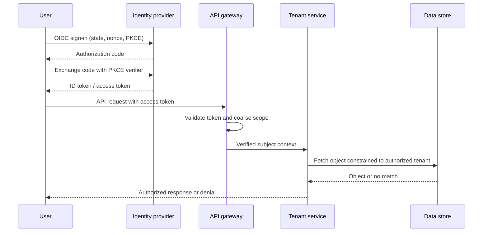

# Real-World Interview Questions and Model Answers

These scenarios practice explaining security boundaries and operational trade-offs. A strong answer identifies the assets and threat, describes the validation path, and covers key rotation, revocation, monitoring, and failure behavior.

## 1) Design authentication and authorization for a multi-tenant SaaS API

**Interviewer:** Users sign in through an enterprise identity provider. Their organizations contain projects and invoices. How would you make sure one tenant cannot access another tenant's data?

### Model answer

I would use OIDC Authorization Code with PKCE for interactive sign-in, validate the ID token at the client, and establish a secure application session or use an appropriately scoped access token for API calls. The API would validate credentials and derive the stable subject and tenant memberships from trusted identity state, not from arbitrary request headers or an untrusted tenant ID in the body.

For every operation, the service would load the target object through a tenant-constrained query and authorize the requested action against the caller's role or relationship to that object. The gateway can enforce authentication and coarse route scopes, but the service owns object-level authorization. I would test cross-tenant access explicitly, including guessed IDs, bulk endpoints, exports, and background jobs.

I would log authorization denials and suspicious tenant mismatches without logging tokens or sensitive payloads. Permission changes and user deprovisioning need a defined propagation and session-revocation strategy.

### What the interviewer is testing

Whether you separate authentication from authorization, avoid trusting caller-controlled tenant identifiers, enforce resource-level permissions, and account for lifecycle events.

## 2) A mobile app needs login and access to a protected API

**Interviewer:** The app team proposes putting a client secret and long-lived JWT in the mobile binary. What would you recommend?

### Model answer

A mobile binary is a public client; a secret embedded in it can be extracted, so it cannot authenticate the application as a confidential client. I would use an external system browser with OIDC Authorization Code and PKCE. The app should use platform-backed secure storage for refresh credentials where appropriate, keep access tokens short-lived, and request only necessary scopes and audiences.

The API would validate issuer, audience, signature, expiry, token type, and scopes, then perform resource authorization. I would avoid placing tokens in URLs, analytics, crash reports, or logs. If a static public app identifier is needed for product analytics or basic abuse controls, I would not treat it as a secret or as proof of user identity.

### Trade-offs and follow-up

- A native app may use a system browser for provider SSO and a registered app link for the redirect.
- Refresh-token rotation and reuse detection can reduce the value of a stolen refresh token.
- Device compromise cannot be solved solely by token format; use risk signals and step-up authentication for sensitive actions.

### What the interviewer is testing

Whether you understand public versus confidential clients, PKCE's role, secure token handling, and server-side authorization.

## 3) Design machine-to-machine identity for internal services

**Interviewer:** There are dozens of services across multiple environments. Today they share one static API key. How would you improve this?

### Model answer

I would first identify the platform boundary and required identity/authorization guarantees. If the platform supports workload identity, I would issue a distinct short-lived identity per workload and use either audience-restricted tokens or mTLS. Each receiving service would allow only specific caller identities and actions. A service that forwards a user request would preserve user context separately from its own workload identity.

I would migrate incrementally: inventory current consumers, introduce a new identity path, allow both credentials during a bounded transition, rotate callers, monitor remaining uses of the old key, then revoke it. Credentials should be automatically renewed, narrowly scoped, and excluded from logs. Trust roots and token signing keys need a rotation and emergency revocation plan.

| Option | Benefits | Trade-offs |
|---|---|---|
| Workload identity with short-lived tokens | Fine-grained scopes/audience, avoids static fleet secret | Requires reliable issuer and token validation |
| mTLS certificates | Strong peer identity and encrypted channel | PKI issuance, rotation, and trust distribution |
| Static API key | Simple integration and migration path | Shared-secret leakage, weak scoping, and disruptive rotation |

### What the interviewer is testing

Whether you move from shared secrets to distinct identities, define least privilege, preserve end-user context, and plan a safe migration rather than a flag-day change.

## 4) A JWT signing key is compromised

**Interviewer:** A signing key used for access tokens may have leaked. What do you do?

### Model answer

I would treat it as an active incident: stop signing with that key, establish whether unauthorized tokens were minted, and publish a trusted key set that no longer accepts the compromised key according to the response plan. Issue replacement keys and tokens, force reauthentication or refresh where necessary, and assess affected accounts and actions. I would make the containment decision explicit because immediate invalidation can disrupt every caller with a token signed by that key.

Normal rotation should use key IDs and an overlap interval so verifiers can learn a new public key before it is used. Emergency removal is different: verifiers need bounded JWKS caching and a way to rapidly distrust a key. Tokens should have short lifetimes, and logs should support investigation without retaining bearer tokens themselves.

### What the interviewer is testing

Whether you distinguish normal rotation from emergency revocation and address both containment and availability.

## 5) Add MFA to a high-value account

**Interviewer:** Users can manage payouts and recovery email addresses. How would you add MFA without creating an easy bypass?

### Model answer

I would offer phishing-resistant passkeys or security keys as the preferred factor and a carefully managed fallback. Require step-up authentication before payout changes, recovery-factor changes, or sensitive exports. Number matching can reduce push-fatigue risk if push is supported; SMS would be a weak fallback rather than the primary factor.

Enrollment and recovery are part of the authentication boundary. I would verify the existing account before enrollment, notify users when factors change, protect recovery codes, rate-limit attempts, and audit support-assisted recovery. A reset flow should not let an attacker who knows only the password remove all stronger factors.

### What the interviewer is testing

Whether you understand factor independence, phishing resistance, step-up policy, and the attack surface of account recovery.

## 6) An API key appears in an access log

**Interviewer:** A partner's key was accidentally logged and may have been copied to a support ticket. What should the system and team do?

### Model answer

Revoke or rotate the key promptly, determine the affected scope and usage window, and review audit records for unusual calls. Notify the partner through the established incident process. The key should be redacted at ingestion in gateway, application, tracing, and support tooling; searching for and removing the exposed value from accessible logs and tickets is part of containment.

Long term, keys should be displayed only once, associated with a named owner and narrow scopes, have rotation/revocation support, and avoid embedding in URLs. A hash or verifier can support lookup without keeping a recoverable secret. Alerts should detect anomalous source, volume, or endpoint use.

### What the interviewer is testing

Whether you handle a leaked credential as a security incident and address systemic logging and lifecycle weaknesses.

