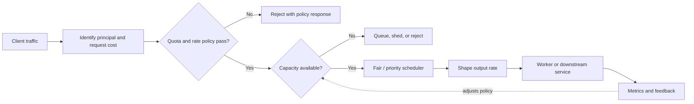
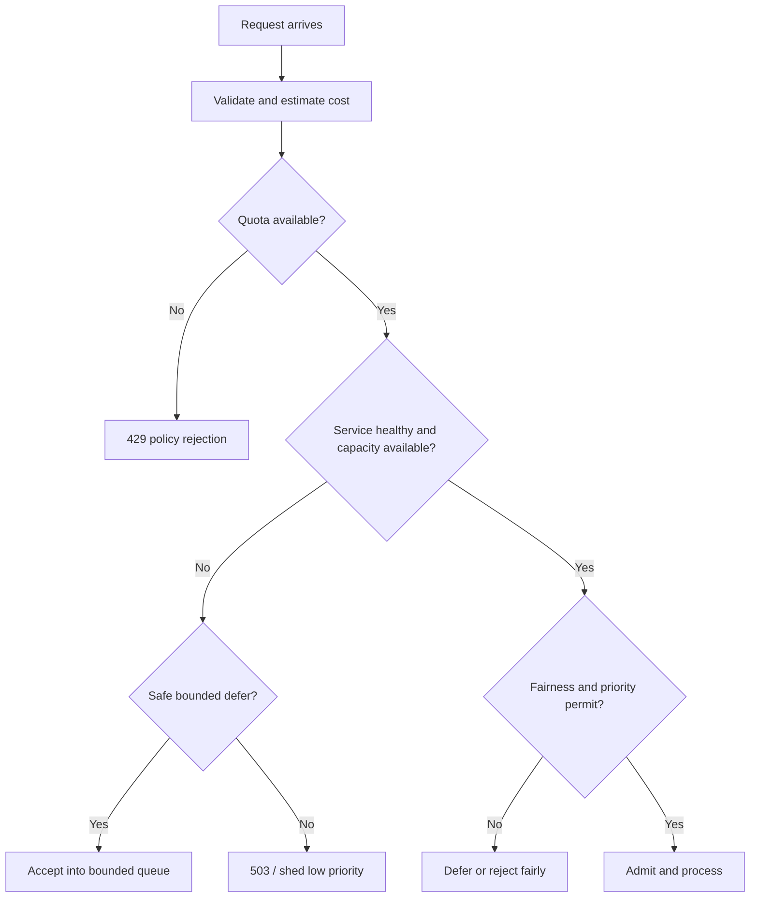

# Rate Limiting and Traffic Management

Traffic management protects shared system capacity while keeping service useful to legitimate clients. It combines customer-facing policy (quotas and fairness) with real-time protection (admission, concurrency, shaping, and shedding). These controls are related, but they answer different questions:

- **Quota:** How much work may this principal consume in a billing or policy period?
- **Rate limit:** How quickly may the principal submit work?
- **Concurrency limit:** How many operations may be in progress at once?
- **Admission control:** Is there enough safe capacity to accept this work now?
- **Traffic shaping:** How should admitted work be paced toward a constrained dependency?
- **Fair queuing / priority:** Which work should get service first when resources are scarce?

An API commonly combines several controls. Identity-based limits protect fairness, while service-wide admission protects dependencies. A limiter is not a capacity substitute: it should shed or defer excess demand predictably rather than conceal an overloaded downstream.



## 1) API Quotas and Usage-Based Limits

A quota is a budget over a policy period, such as 10,000 calls per day, 2 million weighted units per month, or 100 GB of egress. It may be a commercial entitlement, an abuse boundary, or a guard against unexpected cost. A rate limit usually constrains short-term request pace; a quota constrains accumulated usage. A client can stay below a per-second rate and still exhaust a monthly quota, or exceed a burst limit while having plenty of monthly allowance.

### Define the policy precisely

Before selecting storage or an algorithm, specify:

1. **Principal:** user, API key, account, tenant, IP, organization, or a hierarchy of these. Anonymous traffic generally needs an IP/device-level abuse control because it has no authenticated account.
2. **Metered unit:** request count, bytes, compute time, records scanned, or weighted cost. If endpoints have different costs, one request should not always equal one unit.
3. **Scope:** per endpoint, endpoint group, product tier, region, or global account. Clarify whether several API keys share one account budget.
4. **Period and reset:** fixed calendar period or rolling period; timezone and reset semantics; whether unused units carry forward.
5. **Overage behavior:** reject, charge, notify, allow a grace budget, or degrade features.
6. **Consistency requirement:** approximate enforcement may be acceptable for abuse prevention; a hard contractual cap may require tighter coordination.

### Usage-based accounting

Usage metering often has two paths: a low-latency admission counter and a durable billing/audit ledger. The admission counter answers "may this request proceed now?" The ledger records what happened for reconciliation, reporting, and disputes. Do not rely on an eventually processed analytics stream as the sole enforcement mechanism for a strict quota.

For expensive operations, reserve an estimated amount before execution, then settle actual usage afterward. Define what happens when the estimate is wrong, a worker crashes, or the client retries. Idempotency keys help ensure that a repeated request does not reserve or charge the same work multiple times. Make usage records attributable, auditable, and privacy-conscious.

### Communicating limits to clients

Return `429 Too Many Requests` when a client-specific rate policy or quota is exceeded. Provide a `Retry-After` hint when the reset time is meaningful, document any quota headers, and avoid revealing another tenant's consumption. Clients should use bounded exponential backoff with jitter and should not retry a non-retryable quota exhaustion indefinitely. If service capacity—not the client's allowance—is the constraint, use an appropriate overload response such as `503 Service Unavailable` rather than mislabeling the condition as a quota breach.

| Policy type | Main purpose | Typical scope | Typical response |
|---|---|---|---|
| Abuse limit | Contain scraping, brute force, or accidental loops | IP, credential, or route | Reject quickly, often `429` |
| Plan quota | Enforce customer entitlement | Account / tenant over day or month | Reject, notify, or apply documented overage |
| Cost budget | Bound expensive work | Tenant plus operation class | Reject or require async processing |
| System safety limit | Keep a dependency within safe load | Service, route, or region | Shed, defer, or return overload response |

## 2) Burst Traffic Handling

A burst is a short-lived rise in arrival rate above the sustained rate. Bursts may be legitimate (a flash sale, push notification, or viral post) or accidental (a retry storm or synchronized polling). Handling a burst means deciding whether to absorb, smooth, prioritize, or reject it; it does not mean accepting unlimited work.

### Estimate the burst and its effects

Measure peak-to-average ratio, burst duration, request mix, and downstream cost. A 10x increase in cheap cached reads is not equivalent to 10x more database writes. Estimate the queued work: if arrivals exceed service capacity by `arrival rate - service rate`, the backlog grows by that amount per second for as long as the overload continues. Once the burst ends, recovery time depends on spare processing capacity; operating at the exact steady-state limit leaves no capacity to drain backlog.

### Common burst controls

- **Burst-tolerant rate limit:** a token bucket allows a bounded short burst while keeping long-run average usage near the refill rate.
- **Bounded queue:** absorb brief excess demand for work whose caller can tolerate delay. Limit both queue depth and age.
- **Load shedding:** reject optional or low-priority work early when a service is saturated.
- **Caching and precomputation:** reduce repeated work for popular content or known events.
- **Autoscaling:** add capacity if the workload and dependencies scale and instance startup is fast enough.
- **Client coordination:** use jittered polling, retry-after hints, and backoff to prevent synchronized retries.

| Burst strategy | Absorbs a short spike? | Adds latency? | Important limit |
|---|---:|---:|---|
| Token bucket | Yes, up to bucket capacity | No, if admitted immediately | Burst size and shared counter accuracy |
| Bounded queue | Yes, while queue has room | Yes | Queue age, memory, and deadline |
| Autoscaling | Sometimes; depends on scale-up delay | Usually not directly | Downstream capacity and cold-start time |
| Load shedding | No; preserves critical work instead | No for rejected work | Correct priority classification |
| Cache / precompute | Reduces work at source | Usually reduces latency | Freshness and invalidation |

### Example: event launch

Suppose a launch drives 5,000 requests/second at the edge, while a reservation service safely completes 800 reservations/second. A queue cannot indefinitely absorb the 4,200/second difference. First separate cheap catalog reads from expensive reservations, cache static details, cap reservation concurrency, and allow only a bounded queue if delayed reservations are meaningful and inventory semantics support them. Otherwise reject excess attempts with retry guidance and preserve enough headroom to complete already accepted work.

## 3) Concurrency Limits

A concurrency limiter bounds in-flight operations rather than operations per second. It is valuable when requests hold scarce resources—database connections, worker slots, memory, file handles, or external provider capacity—or when request duration varies significantly. A rate limit may still admit a damaging number of slow requests if they accumulate.

Little's Law provides a useful estimate:

```text
average in-flight work = average arrival rate × average time in system
```

For example, 150 requests/second with an average service time of 0.4 seconds implies about 60 requests in flight on average. A safe limit must account for tail latency, bursts, per-request resource cost, and capacity reserved for health checks and critical operations; setting the limit exactly at the average leaves no safety margin.

### Limiter placement and behavior

- **At the edge:** rejects excess work before it consumes application resources; best for broad protection and tenant fairness.
- **At the service or dependency client:** closest to the constrained resource and able to enforce a precise pool limit.
- **Per instance:** simple and low-latency, but aggregate capacity changes with replica count and load balancing.
- **Shared/global:** enforces an aggregate cap but adds coordination latency and a dependency.

When a permit is acquired, release it on every completion path, including timeout, cancellation, and exception. Leaked permits can make a healthy service appear permanently full. Define queueing behavior explicitly: immediate rejection minimizes wasted work; a short bounded wait can smooth tiny bursts, but long waits consume connections and violate caller deadlines.

| Control | Bounds | Works best for | Watch for |
|---|---|---|---|
| Request-rate limit | Arrivals per time interval | Quotas and abuse protection | Slow requests can accumulate in flight |
| Concurrency limit | Active operations | Expensive or long-lived work | Permit leaks and uneven per-instance load |
| Queue bound | Waiting operations | Short bursts of deferrable work | Stale work and unbounded waiting time |
| Connection-pool cap | Active downstream connections | Protecting a database or provider | Pool exhaustion and head-of-line blocking |

## 4) Fair Queuing and Priority Queues

Fair queuing prevents one tenant or workload from consuming all shared capacity. Priority queues intentionally serve some work sooner than others. They solve related but different goals: fairness protects proportional access, while priority protects critical operations or deadlines.

### Fairness models

- **Round robin:** serve one item from each active queue in turn. Easy to reason about, but does not account for different work costs.
- **Weighted fair sharing:** assign each tenant or class a weight and allocate service proportionally over time. A weight of 2 should receive roughly twice the capacity of a weight of 1 under contention, subject to available work.
- **Deficit round robin:** account for variable item sizes by accumulating service credits, making it useful when job costs differ.
- **Per-tenant concurrency caps:** stop a single tenant from occupying every worker even if it is within its request-rate allowance.
- **Priority queues:** serve urgent classes first, usually with explicit aging or reserved capacity to avoid starving lower priorities.

| Scheduling policy | Fairness behavior | Suitable workload | Main risk |
|---|---|---|---|
| FIFO | Arrival order across all work | Similar-cost jobs where ordering matters | One tenant's burst blocks everyone |
| Round robin | Equal turn among active queues | Similar-cost requests partitioned by tenant | Large jobs consume more service per turn |
| Weighted fair queue | Proportional shares by configured weight | Multi-tenant services with paid tiers | Misconfigured weights and noisy cost estimates |
| Priority queue | Urgent work proceeds first | Interactive versus batch work | Starvation of low-priority work |
| Deficit round robin | Approximate fairness by byte/work cost | Variable-size jobs and packet-like workloads | More scheduler state and tuning |

Priority should be based on business and latency objectives, not user-supplied labels. A client must not be able to promote its own request by setting a header. Use bounded priority classes, reserved capacity for critical work, and aging (gradually increasing the priority of waiting work) where starvation is unacceptable. Measure queue wait time and completion time per class and tenant.

## 5) Admission Control

Admission control decides whether the system can safely accept a request now. It is a real-time capacity decision, not just a static customer quota. It can reject, defer, or accept work based on service health, dependency saturation, queue age, available worker slots, or a deadline.

### A practical admission sequence

1. Authenticate enough to identify the principal and apply cheap abuse protections.
2. Validate request shape and estimate cost before expensive processing.
3. Check applicable account quota and rate budget.
4. Check service and dependency capacity, including concurrency and queue bounds.
5. Apply priority/fairness policy and reserve resources atomically where needed.
6. Accept with a clear completion contract, or reject with a useful retry/fallback signal.



Admission should happen early enough to avoid wasting expensive work, but after enough validation to make an informed decision. For asynchronous work, acceptance means durable responsibility to process—not merely that a queue client returned success. Return a job identifier and define status, cancellation, expiration, and idempotency behavior.

Adaptive admission may lower limits when p99 latency, queue age, or downstream saturation rises. Use stable measurements, smoothing, hysteresis, and gradual recovery; reacting to every short spike can create oscillation. Keep hard safety caps even when an adaptive controller is used.

## 6) Traffic Shaping

Traffic shaping controls the rate at which admitted requests or packets are released toward a downstream system. It can smooth bursts and protect a dependency, whereas policing/rate limiting generally rejects excess traffic. Shaping is useful when delay is acceptable; it is harmful when it silently turns overload into a long queue.

### Token bucket and leaky bucket

- **Token bucket:** tokens accrue at a configured rate up to a maximum capacity. Each unit of work consumes tokens. It allows bursts up to the bucket capacity while controlling long-term average throughput.
- **Leaky bucket / paced queue:** work enters a bounded queue and drains at a steady or configured rate. It smooths output but introduces queueing delay.

For a token bucket with refill rate `r` and capacity `B`, the maximum additional burst is approximately `B` units, while sustained use approaches `r` units per second. Choose units that reflect resource cost when possible. A bucket measured only in request count can be unfair if one request costs a hundred times more than another.

| Mechanism | Output pattern | Excess behavior | Best fit |
|---|---|---|---|
| Token bucket | Average rate bounded; short bursts allowed | Reject when empty or wait for tokens | APIs that should tolerate customer bursts |
| Leaky bucket / paced queue | Smooth, near-constant output | Queue, then reject at bounded capacity | Protecting a fragile downstream from bursty producers |
| Fixed-window counter | Allowed count per discrete interval | Reject after window limit | Simple quotas where boundary bursts are acceptable |
| Sliding-window counter | Approximate rolling limit | Reject when estimated rolling usage is full | Smoother rate policy with moderate state |

Do not confuse a shaping queue with durable task storage. If work must survive process failure, use a durable queue and define redelivery, ordering, and deduplication semantics. If it is just a short in-memory pacing buffer, make loss and rejection behavior explicit.

## 7) Distributed Counters

A distributed counter makes a quota or rate decision across multiple gateway replicas, regions, or services. A local counter is fast but each instance sees only a fraction of traffic: with eight instances each independently allowing 100 requests per minute, a principal could potentially receive close to 800 requests per minute. Shared counters improve aggregate accuracy but add latency, cost, hot keys, and an availability dependency.

### Counter implementation choices

| Approach | Accuracy / coordination | Latency and availability | Typical use |
|---|---|---|---|
| In-process counter | Per-instance only; aggregate limit can overshoot | Lowest latency; survives shared-store outages | Best-effort local protection |
| Central atomic store | Stronger shared decision if increment/check is atomic | Extra network hop and store dependency | Strict per-account or per-key limits at moderate scale |
| Sharded counters | Shared state partitioned by principal/key | Higher scale; routing and hot partitions require care | Large systems with many independent principals |
| Periodic local synchronization | Approximate with bounded or unbounded overshoot | Fast locally; eventual reconciliation | Low-risk abuse controls |
| Hierarchical budget leases | Global budget allocated to regions/instances | Local decisions are fast; unused allocations can strand capacity | Multi-region systems needing bounded coordination |

An increment and limit check must be atomic, or concurrent requests can all observe the same remaining budget and overshoot. Expiration must align with the policy window. Counter keys should include all relevant dimensions, such as tenant, route class, and window, but avoid placing raw secrets in keys or logs. Hot tenants can create hot keys even when total traffic is distributed.

Choose consistency according to consequence. A small overshoot may be acceptable for a protective abuse limit; it may not be acceptable for a hard paid quota or a scarce inventory operation. Document store failure behavior separately for each policy: fail closed preserves the limit but may reject legitimate work; fail open preserves service availability but can exceed the budget. A bounded local fallback or leased budget can make the trade-off explicit.

### Operating and observing the control system

Track allowed and rejected work, queue depth and age, active concurrency, policy-store latency/errors, per-class latency, and downstream saturation. Alert on unexpected shifts in rejection rate and on control-plane degradation. Use bounded metric labels (route template, tier, region) rather than raw user IDs or API keys. Log enough to investigate policy decisions while redacting credentials and sensitive payloads.

## Summary: choose controls by the problem

| Problem | First control to consider | Complementary controls |
|---|---|---|
| One customer consumes shared resources | Per-tenant quota / fair sharing | Per-tenant concurrency cap, weighted cost |
| Short traffic burst | Token bucket or bounded queue | Cache, autoscaling, client backoff |
| Long-running work fills resources | Concurrency limit | Queue age bound, timeout, bulkhead |
| Downstream cannot sustain incoming pace | Traffic shaping or admission control | Load shedding, circuit breaker |
| Critical operations compete with bulk jobs | Priority scheduling | Reserved capacity and starvation prevention |
| Limit spans many gateway replicas | Atomic shared or leased distributed budget | Local fallback and explicit failure mode |

A sound design combines policy enforcement with operational feedback. State who is limited, what is measured, what happens at the boundary, and how the system behaves when the enforcement mechanism itself fails.
