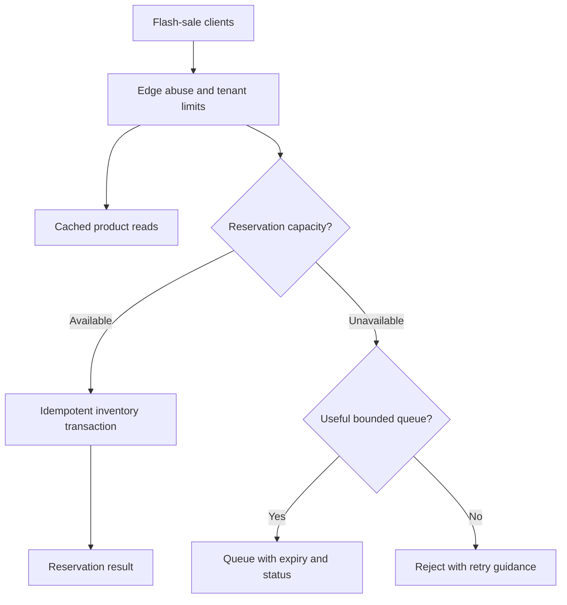

# Real-World Interview Questions and Model Answers

These scenarios practice choosing traffic controls under real constraints. In an interview, clarify the workload and business guarantees first, then explain the policy, failure behavior, and metrics.

## 1) A flash sale overloads inventory reservations

**Interviewer:** A flash sale drives 20 times normal traffic. Product reads are mostly cacheable, but inventory reservations must never oversell. How would you protect the service?

### Model answer

I would split the request classes rather than apply one global requests-per-second number. Cache product reads and scale their read path independently. For reservations, use an idempotency key and enforce the inventory invariant transactionally in the inventory service; an edge rate limit cannot guarantee that two requests will not reserve the last item.

Use an abuse limit by IP or credential, a tenant or account budget where appropriate, and a concurrency/admission limit close to the reservation dependency. If delayed reservations are meaningful, accept them into a bounded queue with an explicit expiration and status contract. Otherwise reject excess attempts quickly with retry guidance. Shed optional recommendations and analytics before checkout or reservation work.

I would load-test with realistic read/write mixes, monitor reservation latency and database saturation, and set a clear condition for disabling queueing or scaling. Correctness remains inside the inventory service; traffic management protects capacity and fairness.

### What the interviewer is testing

Whether you distinguish edge protection from data correctness, isolate traffic classes, avoid unbounded queues, and handle retries safely.

## 2) A shared counter store becomes slow

**Interviewer:** Every API gateway checks a shared counter store for tenant quotas. Store latency has risen sharply, and the gateways are beginning to time out. What do you do?

### Model answer

First, bound the counter call with a timeout and protect gateway workers with a circuit breaker or isolated connection pool. A slow quota store must not consume all request capacity. I would classify policies by consequence: a low-risk abuse limit may use a bounded local fallback or temporary approximate enforcement; a strict contractual cap may fail closed or use previously allocated budget leases. Authentication and authorization should remain separate and must not be bypassed because the quota store is unhealthy.

I would expose a degraded-enforcement metric and alert, avoid hiding the condition as a normal success, and restore traffic gradually to prevent a recovery stampede. After the incident, inspect hot keys, counter-store saturation, network latency, and whether every request needs a shared lookup. Leased regional budgets or carefully bounded local counters may reduce coordination load if the acceptable overshoot is explicit.

### What the interviewer is testing

Whether you choose fail-open or fail-closed based on policy consequences and keep a control-plane failure from cascading into a gateway outage.

## 3) Premium and free tenants share a worker pool

**Interviewer:** A few free-tier tenants submit large exports and starve latency-sensitive premium requests. How would you make access fair?

### Model answer

I would separate interactive and batch workloads into distinct queues or bulkheads, then define per-tenant concurrency limits and weighted service shares. A weighted fair queue can provide a larger share to premium traffic under contention without making the free tier permanently unable to make progress. Large exports should be charged by estimated work or bytes, not simply counted as one request.

Use bounded priority classes and aging or reserved capacity to prevent starvation. Do not trust a priority header from the client; derive class from authenticated account policy. Track wait time and completion latency by class and tenant tier, along with worker utilization and rejection rates. If a batch queue grows too old, reject or expire jobs rather than letting it consume memory indefinitely.

| Policy | Role |
|---|---|
| Per-tenant concurrency cap | Prevent one tenant from filling all worker slots |
| Weighted fair sharing | Allocate capacity proportionally while the system is contended |
| Separate batch queue | Isolate long exports from interactive work |
| Priority with aging | Serve urgent work promptly while eventually advancing lower priority |

### What the interviewer is testing

Whether you model both request cost and tenant fairness, and whether priority can starve less favored work.

## 4) A worker queue grows during a traffic spike

**Interviewer:** A job service queues requests and processes 500 jobs per second, but arrivals spike to 900 per second for 15 minutes. Should the service keep accepting jobs?

### Model answer

Not without checking queue capacity, job value lifetime, and downstream limits. The backlog grows by roughly 400 jobs per second during the spike—about 360,000 extra jobs over 15 minutes. I would estimate drain time using the post-spike arrival rate and spare processing capacity. If the queue cannot drain before jobs become stale, accept only higher-priority work, shed optional jobs, or reject new work with a clear retry policy.

I would monitor queue age as well as depth, because old work may be useless even when the queue is within a nominal size limit. Autoscaling helps only if workers can start fast enough and the downstream can handle the increased rate. Idempotent job IDs and bounded retries prevent redelivery from multiplying the backlog.

### What the interviewer is testing

Whether you quantify backlog growth and treat queueing as delayed work with a finite usefulness window, not as infinite capacity.

## 5) Design a global quota across multiple regions

**Interviewer:** A customer has a global allowance of 100,000 API units per hour and traffic is served in three regions. How do you enforce it without adding a slow cross-region request to every API call?

### Model answer

First clarify the allowed overshoot and whether the quota is contractual or best-effort. A strongly coordinated global counter can enforce a tight boundary but may add cross-region latency and turn a network partition into an availability decision. If bounded overshoot is acceptable, allocate regional or gateway budget leases from a global authority, then spend locally until a lease is exhausted. This reduces per-request coordination while limiting aggregate usage.

Lease sizes should reflect traffic distribution and the risk of stranded capacity in quiet regions. Rebalance leases cautiously, make renewal idempotent, and define behavior if a region cannot reach the authority. Maintain a durable usage ledger for reconciliation and alert on lease exhaustion and estimate-versus-actual usage. If the requirement is a hard cap, do not claim exact global enforcement from independent local counters.

### What the interviewer is testing

Whether you recognize the latency/availability/accuracy trade-off in global coordination and state the guarantee the design actually provides.

## 6) Clients retry aggressively after receiving 429

**Interviewer:** A new client integration retries every rejected request immediately. This has increased traffic during overload. What changes would you make?

### Model answer

The server should return a clear `429` and a useful `Retry-After` when the reset or retry time is known. The client should use bounded exponential backoff with jitter, cap attempts, and honor its overall deadline. For operations that create side effects, retries must include an idempotency key. I would also consider server-side load shedding and a small retry budget rather than allowing all clients to retry indefinitely.

I would measure retries and rejected requests separately from new work to see whether guidance improves the feedback loop. Documentation should say which limit was reached, how it resets, and whether retrying the same request is safe. Avoid returning a generic success-shaped response that causes clients to believe rejected work completed.

### What the interviewer is testing

Whether you treat client retry behavior as part of system load and connect rate-limit responses to safe retry semantics.
