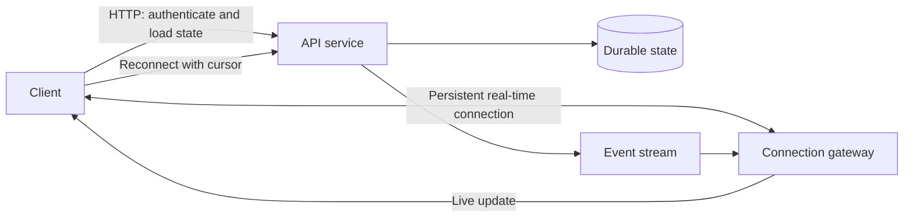
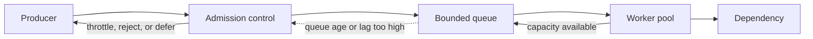
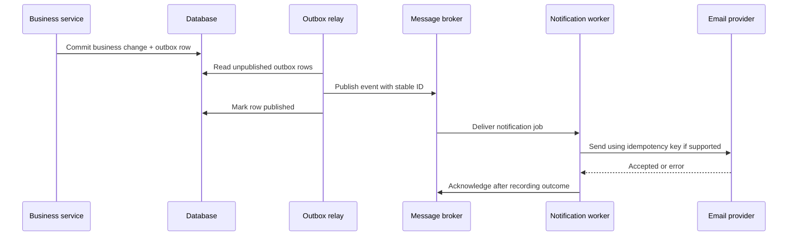

# Communication Patterns

Communication patterns describe how components exchange requests, events, and streams of data. Choosing a pattern is a system-design decision: it affects latency, coupling, failure propagation, ordering, resource use, and what the caller can promise to a user. Start with the interaction's contract—how quickly a result is needed, how long the producer and consumer may be unavailable, and what loss or duplication is acceptable—then choose a transport and delivery mechanism.

## 1. Synchronous Communication

In synchronous communication, a caller sends a request and waits for a response before continuing. HTTP request/response and gRPC unary calls are common examples. This is a good fit when the caller needs an immediate answer, such as validating a checkout or fetching a profile.

The main benefit is straightforward control flow: the result and failure are visible at the call site. The cost is temporal coupling. Both services must be reachable at the same time, and the caller's latency includes the downstream latency. A chain of calls compounds availability: if each of four independent dependencies is available 99.9% of the time and all are mandatory, the chain is available about `0.999^4`, or 99.6%, before accounting for retries and shared infrastructure.

Set explicit connection and request deadlines, propagate a remaining deadline to downstream calls, and bound concurrency. Retries should be limited to transient failures and safe operations; retrying a non-idempotent operation after a timeout can perform it twice. Avoid deep synchronous call chains for work that can be accepted and completed later.

## 2. Asynchronous Communication

In asynchronous communication, a producer hands work or an event to a broker or another durable boundary and does not wait for the consumer to finish. The immediate response can mean only “accepted,” not “completed.” This decouples service availability and smooths bursts, but introduces queue lag, duplicate delivery, eventual consistency, and more operational state.

Design the contract explicitly: what does acceptance mean, how can the caller check status, how long is work retained, how are cancellation and expiration handled, and what happens after permanent failure? Use an idempotency key or deduplication record when repeating a message could repeat a business effect. Queue length alone is not enough to judge health: oldest-message age and processing rate reveal whether users' deadlines are being missed.

| Interaction style | Caller waits for | Typical use | Main trade-off |
|---|---|---|---|
| Synchronous request/response | The operation's result | Read, validation, immediate decision | Low conceptual overhead, but couples latency and availability |
| Asynchronous command | Durable acceptance | Reports, media processing, payment workflows | Isolates failures, but result arrives later and needs status handling |
| Event notification | No business result; announces a fact | Search indexing, analytics, cache invalidation | Enables fan-out, but consumers must tolerate delay and duplicates |

## 3. Real-Time Communication

“Real-time” usually means that updates arrive within an acceptable latency budget, not that the system has a hard real-time guarantee. A chat message may tolerate tens or hundreds of milliseconds; an industrial control loop may require strict deadlines and safety controls beyond ordinary web protocols.

Separate the data path from the control path. Persistent connections carry frequent updates, while ordinary HTTP APIs can handle authentication, initial state, history, and connection setup. At scale, account for open connections, heartbeat traffic, reconnect storms, per-connection memory, fan-out, and load-balancer timeouts. Store important state durably before broadcasting it; a connected client is not a durable delivery mechanism.

The reconnect path matters: a client that disconnects must be able to resume from a cursor, fetch missed state, or receive a full snapshot. If it cannot, the system is live but not reliable.

## 4. Long Polling

With long polling, a client makes an HTTP request and the server holds it until an event is available or a timeout is reached. The client then processes the response and opens another request. It works through ordinary HTTP infrastructure and can be a pragmatic fallback when persistent streaming is unavailable.

Long polling is not a server push channel with unlimited capacity. Each outstanding request consumes connection or request-management resources, and event-free clients repeatedly reconnect. Add jitter to reconnect timing, cap held-open duration, and ensure intermediary timeouts are understood. Use a cursor or sequence number so a reconnect can recover events missed between requests. It is often appropriate for modest traffic, compatibility-oriented clients, or systems where updates are infrequent.

## 5. WebSockets

WebSockets upgrade an HTTP connection to a persistent, bidirectional channel. Either side can send frames at any time, making them suitable for chat, collaborative editing, multiplayer state, and interactive dashboards.

The protocol does not provide application-level persistence, delivery receipts, replay, or exactly-once business effects. Those require message identifiers, acknowledgments, durable storage, and reconnect/resume logic in the application. Authenticate during the handshake, authorize each subscription/action, validate message sizes and rates, and handle token expiration on long-lived connections. Gateways need connection draining, heartbeat and idle-timeout policies, and a plan for reconnect storms. Backpressure is essential: a slow client's outbound buffer must be bounded and either coalesced, dropped according to policy, or disconnected.

## 6. Server-Sent Events (SSE)

SSE is a unidirectional server-to-client event stream over HTTP. Browsers can reconnect automatically, and the `EventSource` API can carry event IDs that support resumption when the server retains a replay window. It is a good fit for progress updates, notifications, and live feeds when the client sends commands through ordinary HTTP.

SSE has a simpler directionality than WebSockets, but intermediaries may buffer streams, proxies may impose idle timeouts, and browser connection limits matter—especially without HTTP/2. Send heartbeats, set appropriate cache/proxy headers, and treat reconnect as a new subscription that must be authorized. SSE is not a durable event log: the service must retain and replay events if clients need recovery.

## 7. Webhooks

A webhook is an outbound HTTP notification from one system to a customer-controlled endpoint. The receiver can be offline, so the sender should persist delivery attempts, retry transient failures with bounded exponential backoff and jitter, and expose delivery status or replay controls.

Sign the exact request body with a shared secret or asymmetric key, include a timestamp and unique event ID, and define signature rotation. Receivers should verify the signature, reject stale replays when appropriate, and deduplicate by event ID. A successful HTTP response should acknowledge receipt, not necessarily completion of downstream work; the receiver can enqueue the event and respond quickly. Avoid placing secrets or unnecessary personal data in payloads. Treat destination URLs as security-sensitive configuration: validate allowed destinations and prevent access to internal network addresses.

## 8. WebRTC

WebRTC supports real-time peer media and data channels, commonly for audio/video calls, screen sharing, and low-latency peer data. The application still needs a signaling service to exchange session descriptions and network candidates. ICE attempts direct connectivity, while STUN helps peers discover public-facing network mappings and TURN relays traffic when direct paths fail.

The media path and the signaling path are distinct. A signaling server does not normally relay the media, and a successful signaling exchange does not guarantee peers can connect. Plan for TURN bandwidth and cost, NAT/firewall restrictions, codec negotiation, encryption, room membership, and reconnection. For group calls, a selective forwarding unit (SFU) commonly receives one stream per participant and forwards selected streams, avoiding the upload and CPU cost of every participant sending media directly to every other participant.

## 9. Message Queues

A queue holds messages until a consumer can process them. It buffers bursts, isolates producer and consumer uptime, and allows worker pools to scale independently. A competing-consumer queue generally assigns each message to one worker, which is useful for distributing tasks.

Messages need an explicit lifecycle: produced, available, leased or delivered, acknowledged, and—if attempts are exhausted—sent to a dead-letter destination. Acknowledgment should normally follow the durable business effect; acknowledging first can lose work if the worker crashes. Acknowledging after the effect can cause redelivery if the worker crashes before ack, so make the effect idempotent. Visibility timeouts or leases must exceed normal processing time or be renewed safely. Bound message size, retention, retries, and queue age.

## 10. Publish-Subscribe

In publish-subscribe (pub-sub), publishers emit events to a topic and multiple subscribers receive their own copies according to the broker's semantics. This is useful when one business fact—such as `OrderShipped`—must update notifications, analytics, and search independently. Producers need not know every consumer.

Pub-sub can be implemented with transient fan-out or with retained, replayable logs; these are not equivalent. For each subscription, define persistence, replay, ordering scope, acknowledgment, and consumer progress. A new consumer may need historical events, while a transient notification channel may only care about currently connected subscribers. Avoid publishing internal implementation details as public events; stable event contracts reduce coupling. Consumer groups often load-balance within a subscription, whereas separate subscriptions receive independent copies.

| Technology/pattern | Typical strengths | Important trade-offs | Good fit |
|---|---|---|---|
| RabbitMQ-style broker | Flexible routing, acknowledgments, work queues | Broker topology and queue capacity need careful operations | Task dispatch and routing-heavy workflows |
| Managed queue (for example, SQS) | Managed durability and elastic worker integration | Often at-least-once; ordering and visibility semantics depend on configuration | Background jobs with minimal broker operations |
| Kafka-style log | Retention, replay, high-throughput partitioned streams | Ordering is generally per partition; consumers manage offsets and lag | Event streams, replay, and multiple independent consumers |
| Redis Pub/Sub-style channel | Low-latency, simple live fan-out | Typically no durable replay for disconnected subscribers | Ephemeral updates where loss is acceptable |

These are broad patterns, not interchangeable product guarantees. Check the selected service's actual durability, ordering, retention, maximum message size, and delivery semantics before promising behavior to users.

## 11. Dead Letter Queues (DLQs)

A dead letter queue stores messages that could not be processed under the normal retry policy. It prevents a poison message from blocking a queue indefinitely and gives operators a place to diagnose and remediate failures. Common causes include invalid payloads, incompatible schemas, missing referenced data, and persistent downstream failures.

Set a finite retry policy with backoff; immediate repeated retries can amplify an outage. Record the original message ID, failure reason, attempt count, and relevant trace context, while avoiding sensitive data in logs. Alert on DLQ arrival and age. Redrive only after identifying and addressing the cause, and ensure replay is safe and rate-limited. A DLQ is not a substitute for monitoring or a guaranteed place to store data forever.

## 12. Change Data Capture (CDC)

CDC captures database changes and publishes them for downstream consumers. Log-based CDC reads the database's transaction log, preserving committed changes with lower query overhead than repeatedly polling tables. Consumers can build search indexes, caches, analytics pipelines, or integrations without each system polling the primary database.

CDC events usually describe row-level changes rather than complete business meaning. A row update does not necessarily mean “order shipped”; domain events may be a better integration contract. Handle initial snapshots, log retention, schema changes, deletes/tombstones, duplicate delivery, and ordering within a key. Monitor connector lag: if replication falls behind the database log-retention window, recovery may require a new snapshot. CDC pipelines must not be treated as synchronous transactional updates to downstream systems.

## 13. Message Delivery Semantics

Delivery guarantees describe what a consumer can observe, not whether the application effect occurs exactly once. At-most-once may lose a message but does not redeliver it. At-least-once retries until acknowledged, so duplicates are possible. “Exactly once” is meaningful only within a defined boundary—for example, a broker's atomic consume-transform-produce transaction—and does not automatically include an external payment API or database.

For business effects, use stable event IDs and an inbox/deduplication record committed atomically with the effect when possible. For external side effects, propagate an idempotency key to the provider or reconcile uncertain outcomes. Keep ordering scope explicit: global ordering is expensive; per-entity or per-partition ordering is often sufficient.

| Semantics | Loss risk | Duplicate risk | Typical design |
|---|---|---|---|
| At-most-once | Possible | No retry-induced duplicates | Best-effort telemetry or disposable updates |
| At-least-once | Low after durable acceptance, subject to retention and configuration | Yes | Durable jobs with idempotent consumers |
| Effectively-once business outcome | Depends on durable handoff and recovery | Redelivery may occur but is deduplicated | Transactional inbox/outbox, stable IDs, idempotent effect |

Do not state “exactly once” without naming the boundary, failure assumptions, and external systems excluded from the guarantee.

## 14. Backpressure Handling

Backpressure prevents a fast producer from overwhelming a slower consumer. Without it, queues and buffers grow until latency becomes unacceptable or the system runs out of memory or disk. Signals can include queue depth, oldest-message age, consumer lag, in-flight work, or an explicit demand/credit protocol.

Possible responses include slowing or pausing producers, limiting concurrency, batching, dropping/coalescing replaceable updates, rejecting new work, or adding capacity. Choose based on whether data is durable and whether staleness is acceptable. A chat typing indicator can be coalesced; a payment command cannot be silently dropped. Bound every queue and socket buffer, define overload responses, and use admission control before accepting work that cannot meet its deadline.

Scaling consumers can help only if the downstream dependency has spare capacity. Otherwise it moves the queue to that dependency and may worsen the outage.

## 15. Transactional Emails and Notifications

Email, SMS, push, and in-app notifications are external side effects and should generally be sent asynchronously. A common flow records the business change and an outbox event in one database transaction; a worker then delivers it through a provider and records its status. This avoids the dual-write failure where the database commit succeeds but event publication fails, or the event is published for a transaction that later rolls back.

Notifications should be triggered by domain state transitions, not incidental request retries. Use stable notification IDs, recipient preferences, quiet hours, localization, template versioning, and per-channel consent rules. Providers can accept a send request but later bounce or suppress it; distinguish queued, accepted, delivered, bounced, and failed states where the provider exposes them. Retry transient provider errors with backoff, but do not retry permanent invalid-address errors indefinitely. Redact personal data from logs and make user-visible notification preferences clear.

The relay can publish and crash before marking the outbox row, causing a duplicate. The consumer must therefore be idempotent; the outbox guarantees a durable handoff, not magical exactly-once delivery.

## Choosing a Communication Pattern

| Requirement | Prefer | Watch for |
|---|---|---|
| Caller needs a decision immediately | Synchronous HTTP or RPC | Deadlines, bounded retries, dependency failure |
| Work can finish later and must survive downtime | Durable queue/command | Idempotency, job status, retention, DLQ |
| Several systems react independently to a fact | Durable pub-sub/event log | Schema evolution, replay, consumer lag |
| Server sends frequent browser updates | SSE for one-way; WebSocket for two-way | Reconnect, auth, proxy behavior, slow clients |
| Browser checks infrequent updates with broad compatibility | Long polling | Open-request cost and reconnect load |
| Service notifies a customer-owned endpoint | Webhook | Signing, retries, deduplication, destination validation |
| Low-latency peer audio/video | WebRTC with signaling and TURN fallback | NAT traversal, relay cost, group topology |
| Database changes feed downstream systems | CDC | Snapshot recovery, log lag, schema and event meaning |

For every design, document the acceptance point, delivery guarantee, ordering scope, timeout, retry policy, overload behavior, recovery path, and observability signals. Those operational details are part of the communication contract.
