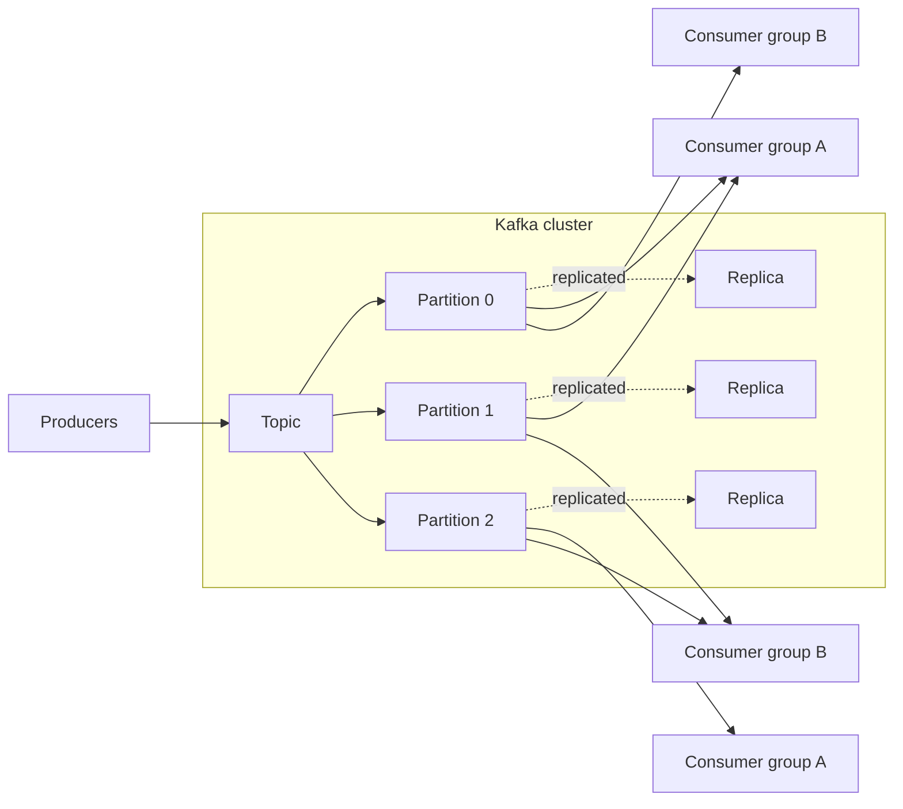
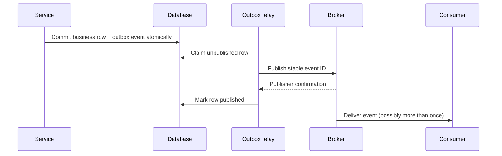
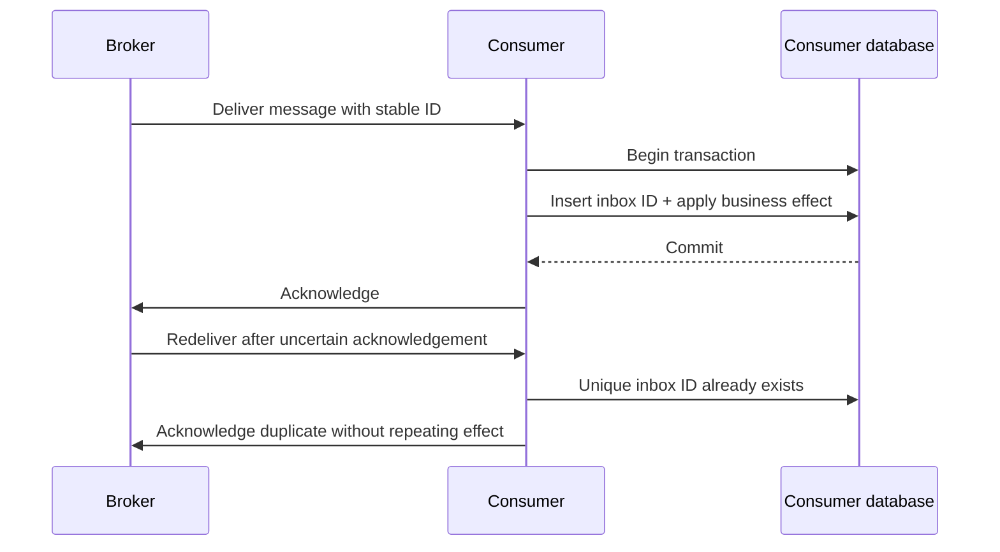
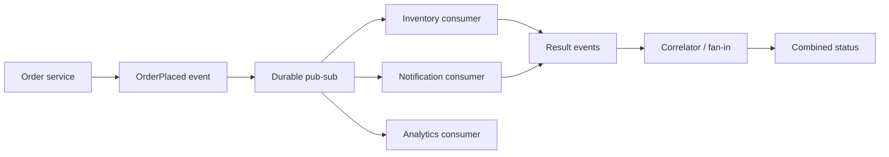
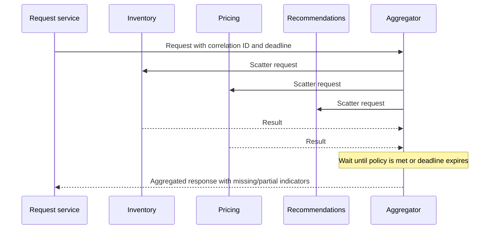
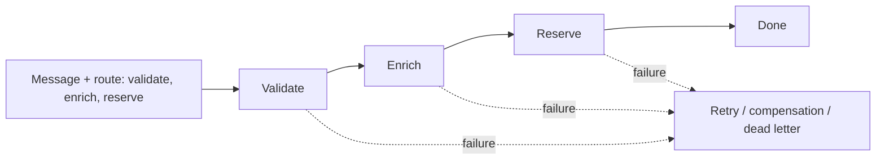
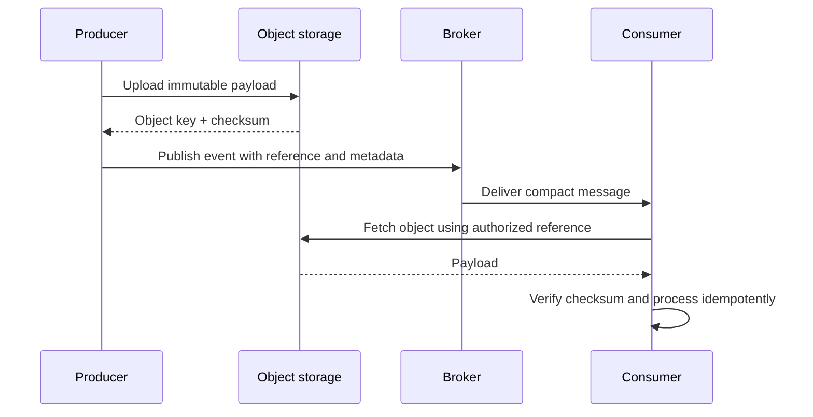

# Messaging Systems

Messaging systems let components exchange work and facts without requiring the sender and receiver to be available at the same time. A broker can buffer bursts, isolate failures, distribute data to independent consumers, and retain events for replay. These benefits come with new design responsibilities: delivery is usually asynchronous, duplicates are possible, consumers can lag, schemas evolve, and ordering is limited to a defined scope.

Start with the business contract rather than a broker feature list:

- Is the message a **command** asking one owner to do work, or an **event** recording a fact?
- What does successful publication or acknowledgement promise: accepted in memory, durably replicated, or fully processed?
- What are the required delivery, ordering, replay, and latency guarantees?
- How long must data be retained, and what is the plan for poison messages and overload?
- Which side effects must be idempotent, and how will operators inspect and recover failures?

## 1. Kafka for System Design

Apache Kafka is a distributed, partitioned append-only log. Producers append records to topic partitions; brokers replicate those partitions; consumers read records and track offsets. It is a strong fit for high-throughput event streams, change propagation, data integration, and workloads that benefit from replay or multiple independent consumer groups.

### Core building blocks

- **Topic:** a named stream of records. A topic is split into partitions to distribute storage and processing.
- **Partition:** an ordered log. Records have offsets, and ordering is guaranteed within a partition, not across the whole topic.
- **Key:** commonly determines a record's partition. A stable key such as `accountId` keeps related records together and can preserve per-account order.
- **Producer:** appends records. Idempotent producer settings can protect against duplicate writes caused by producer retries within Kafka's supported boundary.
- **Consumer group:** cooperating consumers divide partitions among themselves. A partition is assigned to at most one consumer in a group at a time; separate groups independently read the same topic.
- **Offset:** a consumer's position. Committing after processing avoids skipping unfinished work, but a crash after the side effect and before the offset commit can cause the record to be processed again.
- **Replication:** partition replicas improve availability. Acknowledgment level, replica synchronization, minimum in-sync replicas, and leader-election policy jointly affect durability and availability.

In the diagram, one consumer group shares the partitions among its members, while a second group reads the same history independently. Adding consumers beyond the partition count does not increase parallelism for that group.

### Design and operating decisions

1. **Choose partition count and key deliberately.** More partitions can improve parallelism but increase metadata, file handles, recovery work, and rebalancing cost. A hot key remains a bottleneck. Changing partition count can change key-to-partition mapping, so consider the ordering implications.
2. **Set durability as a combined policy.** Use replication and producer acknowledgments appropriate to the loss budget. Stronger acknowledgment is not sufficient if replicas are not in sync or unsafe leader election is permitted.
3. **Treat consumer offsets as progress, not business transactions.** Commit only after the required work is safely complete. Consumers should still handle repeats; use an inbox or an idempotent target write when business effects must not repeat.
4. **Plan for rebalances and slow consumers.** Keep processing bounded, handle partition revocation safely, and monitor lag and oldest-record age. A long-running handler can cause repeated rebalances or stall a partition.
5. **Use retention to serve a purpose.** Time/size retention supports replay over a finite window; compaction retains the latest value per key under Kafka's compaction rules. Neither is a substitute for an archival or business database contract.
6. **Avoid using Kafka as a universal task queue.** It can distribute work, but delayed delivery, per-message visibility, and independent deletion semantics differ from queue-oriented brokers. Select it when the log, replay, and throughput model is valuable.

Kafka transactions can atomically write records across Kafka partitions and coordinate consumed offsets for Kafka-to-Kafka processing. They do not automatically include an external database, email provider, or payment API. For those boundaries, use idempotency, an outbox/inbox, or reconciliation.

## 2. RabbitMQ vs SQS vs SNS vs Pulsar

These technologies overlap but are not interchangeable. Compare the delivery model and operational contract—not just throughput or a product's use of the word “exactly once.”

| Technology | Primary model | Routing / fan-out | Ordering scope | Operational strengths | Important trade-offs / good fit |
|---|---|---|---|---|---|
| RabbitMQ | Broker-managed queues and exchanges | Exchanges route to one or more queues using direct, topic, fanout, or header bindings | Queue order is affected by competing consumers, retries, priorities, and redelivery; do not assume end-to-end global order | Flexible routing, acknowledgements, publisher confirms, and mature work-queue patterns | You own broker topology, capacity, upgrades, and queue behavior; good for task dispatch and routing-heavy workflows |
| Amazon SQS | Managed queue | A queue distributes work to consumers; pair with SNS/EventBridge or another publisher for fan-out | Standard queues are at-least-once with best-effort ordering; FIFO queues provide ordering within message groups subject to service constraints | Low broker operations, elastic managed service, visibility timeout and DLQ integrations | Service limits, retention, payload and throughput constraints apply; visibility timeout is not a general scheduling primitive |
| Amazon SNS | Managed publish-subscribe topic | Pushes notifications to subscribers; SQS subscriptions create durable per-subscriber queues | Ordering depends on the subscription path and whether FIFO features are used | Straightforward managed fan-out and integration with multiple endpoint types | SNS is a topic, not a competing-consumer work queue; delivery/retry and filtering semantics vary by endpoint |
| Apache Pulsar | Distributed pub-sub with persistent topics and subscriptions | Topic subscriptions support distinct subscription modes; brokers and storage are separated in the architecture | Ordering depends on partitioning and subscription type; key-shared subscriptions can preserve per-key behavior when configured correctly | Multi-tenancy, topic/subscription model, and tiered storage options | More concepts and operational components than a simple managed queue; good for large multi-tenant streaming and messaging deployments |

| Requirement | Common starting point | Validate before committing |
|---|---|---|
| Flexible routing among work queues | RabbitMQ | Queue durability, quorum/replica policy, routing topology, and operational ownership |
| Minimal infrastructure operations for background jobs | SQS | Standard vs FIFO semantics, visibility timeout, redrive policy, and service quotas |
| One event delivered to several independent systems | SNS with durable SQS subscriptions, or a retained event log | Subscription durability, replay window, filtering, and per-subscriber failure handling |
| High-volume retained stream with independent replaying consumers | Kafka or Pulsar | Partition/key design, retention, consumer lag, schema management, and operational fit |

Always verify current product limits and configuration-specific guarantees. Managed versus self-managed, queue versus log, and competing consumers versus independent subscriptions are architecture choices, not merely vendor preferences.

## 3. Message Acknowledgments

An acknowledgment is a protocol signal, and its meaning depends on which direction it travels and when it is sent.

- A **publisher confirm** tells a producer that a broker accepted a publication according to the broker's configured durability/routing contract. It does not mean a consumer processed it.
- A **consumer acknowledgment** tells the broker that a delivery can be removed or considered complete for that consumer. Acknowledging before durable processing can lose work after a crash.
- A **visibility timeout / lease** temporarily hides a queue message while a worker handles it. If the lease expires before completion, another worker may receive the message; extend the lease or keep processing bounded.
- A **business acknowledgment** means the application operation completed. It is stronger than “message received” and should be represented explicitly when a caller needs the result.

Typical reliable consumer flow: receive; validate; perform the effect idempotently; durably record completion; then acknowledge. A crash between the effect and the acknowledgment causes redelivery, so the handler must be safe to repeat. If the effect and acknowledgment cannot share a transaction, use a stable message ID and an inbox/deduplication boundary.

Use explicit negative acknowledgments or retry policies for transient failures. Immediate requeue loops can consume capacity and starve healthy messages. Route exhausted or permanently invalid messages to a dead-letter path with enough context to diagnose and safely redrive them.

## 4. Message Ordering

Ordering is meaningful only when the system identifies the scope and the point at which the order is defined. A broker may preserve append order in a partition or FIFO group, while concurrent workers, retries, redelivery, and downstream writes can still alter the observed business order.

- Prefer **per-entity ordering** (for example, per order or account) over global order. It typically allows parallelism across entities.
- Use a stable partition/group key and include a sequence number or entity version when gaps or stale updates matter.
- Ensure only one active worker processes an ordered lane at a time, or make the consumer reject/defer out-of-order versions.
- Retries can block later messages in a strict-order lane. Decide whether to pause the lane, skip/quarantine the failed message, or allow later messages with explicit gap handling.
- Scaling partitions or changing keys can change placement; do not assume a key preserves one historical sequence after topology changes.

For replaceable state such as a user's latest location, a newer version can supersede an older one. For ledger-like transitions, preserve and validate sequence/version so a skipped or duplicated operation cannot corrupt state.

## 5. Message Retention

Retention determines how long an unconsumed or already-consumed message remains available. It is separate from whether a broker currently has a consumer acknowledgment for it.

- **Queue retention** usually places an upper bound on how long an unprocessed message remains available; policy and DLQ behavior are product-specific.
- **Log retention** keeps records for a configured time or size, allowing independent consumer groups to rewind and replay within the window.
- **Compaction** keeps the latest record per key over time (subject to cleanup and tombstone rules); it is useful for reconstructing current keyed state, not for retaining every historical transition forever.
- **Business retention** may be governed by audit, privacy, or regulatory requirements and often belongs in a dedicated database or archive.

Choose a window that covers expected outages, recovery, and reprocessing, and monitor remaining headroom. Too-short retention can make a prolonged outage unrecoverable; too-long retention increases storage cost and may retain personal data longer than permitted. Include deletion, backup, replay authorization, and encryption in the retention design.

## 6. Delayed Messages

Delayed delivery means a message should not become eligible for processing before a future time. It is different from retry backoff, visibility timeout, and consumer-side sleeping:

- **Retry backoff** postpones another attempt after a failed processing attempt.
- **Visibility timeout** leases an already delivered message so another worker does not process it immediately.
- **Scheduled/delayed delivery** holds a new message until its due time.

Use a native scheduled-message feature when it fits the delay range and required reliability. Some systems can approximate delays with TTL plus dead-letter routing, but bucketed TTLs, queue head-of-line behavior, and configuration complexity must be understood. A common managed-queue delay feature is limited in duration; a visibility timeout is not a replacement for a long-term scheduler. Kafka is a retained log rather than a general per-record delay queue, so delayed work usually uses a scheduler or purpose-built delay service.

At large scale, store `(dueAt, messageId, state)` in a durable scheduler index or time buckets, claim due items safely, and publish with a stable ID. Make the consumer idempotent because a scheduler can crash after publishing but before marking completion. Define cancellation, rescheduling, clock-skew tolerance, maximum delay, and what happens when the due-time backlog grows.

## 7. Message Batching

Batching groups multiple records into one publish, fetch, or write operation. It amortizes network round trips and request overhead and can improve throughput, especially for high-volume streams and remote managed services.

The trade-offs are added waiting latency, larger memory buffers, uneven batch sizes, and a larger retry unit. One invalid item can fail an entire batch unless partial failures are reported and handled correctly. Bound batches by both **maximum size** and **maximum wait time**, flush on either threshold, and apply backpressure when buffers fill.

Batch only compatible work (same destination, security context, and often partition/key lane). Track per-record IDs and outcomes so retries do not duplicate successful records from a partially failed batch. For low-volume or latency-critical traffic, use a small time threshold or avoid batching.

## 8. Transactional Outbox Pattern

The outbox pattern prevents the database/broker dual-write gap. The application writes its business change and an event row to the same database transaction. A relay later publishes committed rows. If the database transaction rolls back, neither is visible; if publication is temporarily unavailable, the outbox row remains to retry.

The relay can publish and crash before marking the row, so duplicate publication is expected. Consumers must be idempotent. A polling relay is simple but adds query load and publication delay; a CDC relay can reduce polling but adds connector and log-retention operations. Claim rows with a lease or `SKIP LOCKED`-style mechanism so multiple relays can safely share work.

Keep the outbox schema versioned, monitor oldest unpublished age and retry count, and define cleanup only after the required audit/replay period. The outbox guarantees a durable handoff from the database, not exactly-once delivery or successful downstream processing.

## 9. Inbox Pattern

The inbox pattern makes consumer effects idempotent by recording which message IDs have been handled. Within one database transaction, the consumer inserts a unique `(consumer, messageId)` record and applies the business update. If the same message is delivered again, the unique constraint detects it and the consumer can acknowledge without repeating the effect.

The inbox row and local database effect must commit atomically. If the effect is an external API call, the database transaction cannot make that call atomic; pass an idempotency key to the provider, create a second outbox, or reconcile uncertain outcomes. Retain deduplication records at least as long as a message can be replayed, and scope the key by consumer when separate consumers need independent effects.

## 10. Schema Registry and Schema Evolution

A schema registry stores or identifies event schemas and can enforce compatibility rules at publication time. It helps producers and consumers evolve independently, but it does not make a poorly designed event contract stable.

- Prefer explicit, named fields and stable semantic meaning. Do not silently reuse a field for a different meaning or unit.
- Use compatible changes such as adding an optional field with a sensible default, subject to the serialization format and registry rules.
- **Backward compatibility:** new consumers can read old data.
- **Forward compatibility:** old consumers can read new data.
- **Full compatibility:** both directions are supported under the registry's chosen definition.
- **Transitive compatibility:** compatibility is checked against more than the immediately previous version, such as every retained version.
- Treat required-field removal, type changes, enum expansion, and semantic changes as potentially breaking; test the actual readers and writers.

Avro, Protocol Buffers, and JSON Schema have different encoding, evolution, and tooling characteristics. Store a schema identifier/version with records or in the wire format, validate in CI, and test rolling deployments where old and new producers/consumers overlap. A schema registry is control-plane support; consumers still need safe handling of unknown fields, malformed payloads, and incompatible versions.

## 11. Fan-Out and Fan-In

**Fan-out** sends one event or request to multiple independent destinations. Pub-sub topics, exchange bindings, or a stream with separate consumer groups let each downstream system progress independently. Give each destination its own retry, lag, and failure isolation; a slow analytics consumer should not block an order-notification consumer unless the business contract requires it.

**Fan-in** combines results or events from multiple producers. A fan-in service may validate, correlate, and aggregate them before publishing a result. Use a correlation ID and define expected participants, duplicate handling, late/partial results, timeout, and completion conditions.

Fan-out is notification/distribution; fan-in is collection/correlation. Neither implies a distributed transaction. If a business process requires all participants to succeed, model explicit workflow state, timeouts, compensations, and a visible partial-failure state.

## 12. Scatter-Gather and Aggregator

Scatter-gather sends a request to several workers or services and gathers their responses. An **aggregator** correlates results and forms a response such as a merged search result, quote comparison, or partial dashboard.

The slowest required participant controls tail latency. Set an overall deadline and per-call budget; choose whether to wait for all, a quorum, or a deadline and return partial results. Deduplicate retries by request/correlation ID, ignore late results after terminal completion (or record them separately), and bound the number of concurrent requests. Avoid turning a synchronous API into an unbounded workflow; for long-running work, persist the aggregation state and return an operation ID.

## 13. Routing Slip

A routing slip carries the planned sequence of processing steps with a message. Each step handles the message, records or advances the next destination, and forwards it. It is useful when the route varies per request or a workflow must traverse a series of known services.

Represent progress explicitly so a retry resumes safely rather than repeating completed non-idempotent steps. Validate route entries against an allowlist; never let untrusted payloads select arbitrary service URLs. Include correlation ID, current step, retry/timeout policy, and workflow version. If the route is a durable business process with complex branching or human interaction, a workflow orchestrator may be clearer and safer than an ad hoc mutable list.

## 14. Claim Check Pattern

The claim check pattern keeps a large payload outside the broker. The message carries a small reference (the “claim check”) to an object in durable storage. This avoids broker message-size limits and reduces repeated transfer when many consumers need the same artifact.

Upload the object before publishing its reference, and define cleanup if publication fails. Use opaque identifiers or short-lived scoped access rather than public URLs; authorize the consumer and protect against path traversal and confused-deputy access. Include object version, checksum, content type, size, and expiry where appropriate. Ensure object retention exceeds message retention/replay needs, and avoid logging credentials or sensitive object contents.

## 15. Command Message and Message Envelope

A **command** requests an action from an owning service, such as `ReserveInventory`; it may be accepted, rejected, or fail. An **event** states a fact that has already occurred, such as `InventoryReserved`. Commands generally have one logical owner, while an event can have many independent subscribers. Naming a command as if it were an event can create ambiguity about whether the action has already happened.

A **message envelope** carries cross-cutting metadata around the payload. Common fields include:

| Field | Purpose |
|---|---|
| `messageId` | Stable identity for deduplication and tracing |
| `messageType` / `schemaVersion` | Identifies the contract and its version |
| `occurredAt` / `publishedAt` | Distinguishes business event time from transport publication time |
| `correlationId` / `causationId` | Connects a workflow and the message that caused this message |
| `producer` / `tenantId` | Identifies origin and tenant where applicable; validate rather than trust blindly |
| `traceContext` | Propagates distributed tracing context |
| `payload` | Domain data, kept separate from transport metadata |

Do not put secrets, bearer tokens, or unnecessary personal information in an envelope. Define which metadata is authoritative, propagate trace context safely, and preserve the original event identity through retries. A command should include enough information to perform or retrieve the operation without relying on fragile hidden state, while avoiding a snapshot so broad that the message becomes a second database.

## Design Checklist

Before choosing or operating a messaging design, state:

1. Whether the message is a command, event, or replaceable state update.
2. The durable acceptance point and exact meaning of publisher/consumer acknowledgments.
3. Delivery semantics, stable ID, idempotency strategy, and side-effect boundary.
4. Ordering key and scope; behavior for gaps, duplicates, and stale versions.
5. Retention, replay, privacy, and cleanup policy.
6. Retry/backoff, DLQ, redrive, delayed work, and cancellation behavior.
7. Capacity bounds, batching thresholds, backpressure, and overload response.
8. Schema compatibility, observability, and operator recovery procedure.
