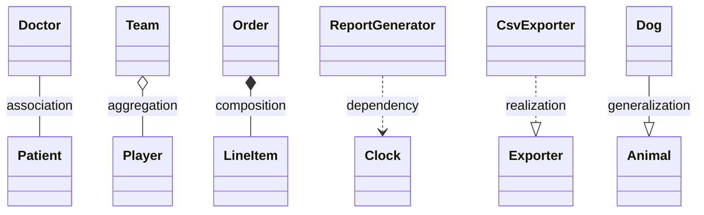

# Class Relationships — Lessons

Relationships describe how types collaborate. The best relationship is the one that matches runtime ownership, lifetime, and substitutability—not the one that makes the diagram look neat.

This lesson covers the six core relationships that show up in design interviews and UML diagrams:

- Association
- Aggregation
- Composition
- Dependency
- Realization / implementation
- Generalization / inheritance

## 1. Before choosing a relationship: ask these questions

A relationship is not just a line on a diagram. It encodes a design decision about lifecycle, authority, and change pressure.

Ask:

- Does one object own the other's lifecycle?
- Can the part exist independently outside the whole?
- Is the link permanent, or only for one operation?
- Is the dependency concrete or abstract?
- If the subtype is replaced by the base type, is the behavior still valid?

If you cannot answer these clearly, the relationship is probably being over- or under-modeled.

## 2. Association

A lasting link between objects, where either side may know about the other. The relationship is not necessarily ownership.

Example:

```java
class Doctor {
    private Patient currentPatient;
}

class Patient {
    private Doctor primaryCareDoctor;
}
```

A doctor may treat many patients, and a patient may have one doctor. But a doctor is not “made of” patients, and a patient is not “owned by” a doctor in the strong sense. The link exists because the domain says they are related.

### When association fits

- Both objects can exist independently.
- The link may change over time.
- There is a meaningful domain relationship, but not strong ownership.

### Common mistake

Modeling every two-way relationship as composition. Not every “has a” is a lifetime ownership relationship.

### Interview framing

“Association means there is a meaningful connection, but not necessarily ownership. The lifetime is independent, and the relationship may change without destroying either object.”

## 3. Aggregation

Aggregation is a whole-part relationship in which the whole has a collection of parts, but the parts may outlive the whole or be reused elsewhere.

Example:

```java
class Team {
    private List<Player> players;
}

class Player {
    private String name;
}
```

A team contains players, but players could transfer to another team, join a different squad, or be stored in another context. The team is a container, not the owner of the player's identity.

### How to tell aggregation from association

Aggregation is usually stronger than a generic association because it suggests a whole/part conceptual grouping. But the key requirement is still independence: the part can exist on its own.

### UML

UML uses a hollow diamond at the whole to indicate aggregation.

### Design guidance

Use aggregation when:

- the whole contains references to parts
- parts are conceptually members of the whole
- but the parts are not destroyed when the whole is destroyed

### Example domain decision

A `Department` may aggregate `Employee` objects. If an employee leaves the department, the employee still exists as a person in the company. That is not strong ownership.

## 4. Composition

Composition is strong ownership. The whole owns the lifecycle of the parts, and the parts are not independently reused in the modeled context.

Example:

```java
class Order {
    private List<LineItem> lineItems;

    Order() {
        this.lineItems = new ArrayList<>();
    }

    void addItem(LineItem item) {
        lineItems.add(item);
    }
}

class LineItem {
    private String sku;
    private int quantity;
}
```

An order owns its line items. If the order is deleted, the line items vanish with it. In many business systems, a line item is meaningful only as part of the order.

### Why composition matters

It tells the reader that the part's lifetime is controlled by the whole. This is not merely a “has a” relationship; it is a strong ownership relationship that affects lifecycle and deletion semantics.

### Good composition cues

- The child has no independent meaning outside the parent.
- Removing the parent removes or invalidates the child.
- The parent is responsible for creating and destroying the child.

### Common misconception

A `Car` containing an `Engine` is not automatically composition in every domain. In a dealership system, the engine may be a reusable inventory item. In a manufacturing system, it may be wholly owned by the car once assembled.

The right answer depends on the business assumptions.

## 5. Dependency

Dependency is the weakest relationship. One class temporarily uses another in a method, local variable, parameter, or factory call. It is not a persistent ownership or association relationship.

Example:

```java
class ReportGenerator {
    void generateReport(Clock clock, User user) {
        LocalDate today = clock.today();
        System.out.println("Generated for " + user.getName() + " on " + today);
    }
}
```

The `ReportGenerator` relies on a `Clock` while generating a report. It does not necessarily hold a permanent `Clock` field. The dependency is about a single operation.

### Dependency vs association

Association means a class stores a reference and may use it across many operations.
Dependency means a class uses another type as part of a single interaction or method contract.

### Design principle

Depend on abstractions when possible.

```java
interface Clock {
    LocalDate today();
}

class ReportGenerator {
    void generateReport(Clock clock, User user) {
        // use clock without caring about the concrete implementation
    }
}
```

This is looser coupling: you can swap a system clock, test clock, or fake clock without modifying the report generator itself.

## 6. Realization / implementation

A concrete type realizes or implements an interface or abstract contract. This is a relationship between a class and the contract it fulfills.

Example:

```java
interface Exporter {
    void export(String path);
}

class CsvExporter implements Exporter {
    public void export(String path) {
        // write CSV
    }
}
```

The class implements the contract, and callers can depend on the interface instead of the implementation.

### Why this matters

Realization is one of the main ways to support substitutability and polymorphism. A `CsvExporter` can be used wherever an `Exporter` is required.

### UML

UML shows a dashed line with a hollow triangle pointing to the interface or abstract contract.

### Design rule

Prefer interfaces or abstract contracts when callers should be able to work with multiple implementations and the exact implementation should be replaceable.

## 7. Generalization / inheritance

Generalization means a specialized type is a subtype of a more general type. The subtype is expected to be substitutable for the base type under the base contract.

Example:

```java
abstract class Animal {
    abstract void sound();
}

class Dog extends Animal {
    public void sound() {
        System.out.println("Woof");
    }
}
```

This is valid because a `Dog` is an `Animal` and can satisfy the `Animal` contract.

### When inheritance is appropriate

Use inheritance when:

- there is a genuine subtype relationship
- the subtype truly “is a” kind of the base
- the base contract is meaningful for all subclasses
- behavior is shared and coherent across the hierarchy

### When inheritance is dangerous

Inheritance is often wrong when:

- a subtype only partially satisfies the base contract
- the base class is a leaky implementation detail
- the subclass adds behavior that violates the parent’s assumptions
- a subclass simply reuses code but is not a true subtype

### Classic trap: Rectangle and Square

```java
class Rectangle {
    protected int width;
    protected int height;

    void setWidth(int w) { width = w; }
    void setHeight(int h) { height = h; }
    int area() { return width * height; }
}

class Square extends Rectangle {
    void setWidth(int w) { width = w; height = w; }
    void setHeight(int h) { height = h; width = h; }
}
```

`Square` is not a safe subtype of `Rectangle` if callers expect width and height to vary independently. The inherited contract for `Rectangle` allows changing one dimension without changing the other, but `Square` cannot honor that. This is a classic violation of substitutability.

## 8. Relationship selection cheat sheet

The diagram summarizes the UML notation and the kind of connection each relationship represents:



Use this quick checklist:

- If objects can exist independently and are linked as peers: Association.
- If a whole contains parts that can survive independently: Aggregation.
- If a whole owns the lifecycle of the part: Composition.
- If one class only uses another for a method or temporary operation: Dependency.
- If a class is a concrete implementation of a contract: Realization.
- If a subclass is a real subtype under the base contract: Generalization.

## 9. Coupling and design quality

Relationships affect coupling.

- A stored concrete dependency (`new DatabaseRepository()`) is harder to replace than a dependency on an interface.
- A strong composition link makes lifecycle and ownership explicit.
- Inheritance is powerful but dangerous when it hides behavioral mismatch.

The goal is not to maximize the number of “beautiful” relationships. It is to make the domain model honest: who owns what, how long it lasts, and what contract is actually being relied on.

## 10. Rule of thumb for interviews

A strong answer sounds like this:

> “I would choose composition when the part has no independent identity and is created and destroyed with the whole. I would choose aggregation when the whole contains references to parts that can still exist elsewhere. I would choose dependency when the usage is temporary and method-scoped. I would choose inheritance only when the subtype really satisfies the base contract; otherwise I prefer composition or an interface.”

That phrasing demonstrates that you are reasoning about ownership, lifecycle, and substitutability—not just drawing arrows.
