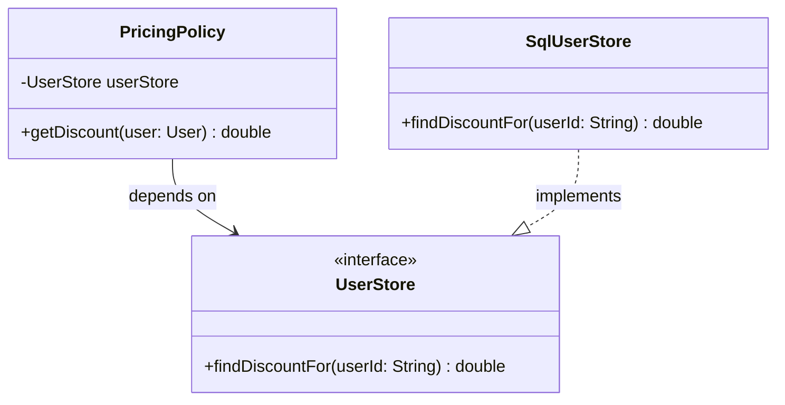

# SOLID Principles — Lesson Notes

SOLID is a set of design rules that help us preserve flexibility as software changes. The principles are valuable because they reduce coupling, clarify responsibilities, and make it easier to add behavior without rewriting large parts of the system.

The best way to use SOLID is not as a slogan checklist. It is as a lens for asking whether a specific design boundary actually reduces change cost. If a principle adds complexity without reducing real maintenance risk, it is being applied too aggressively.

## A practical way to use these notes

Start with a change request rather than trying to label code as “SOLID” or “not SOLID”:

1. Identify what is changing and who needs that change.
2. Find the code or contract that currently absorbs the change.
3. Decide whether that boundary makes unrelated changes travel together.
4. Choose the smallest design change that separates those reasons to change.
5. Check the trade-off: new indirection is useful only if it pays for itself.

| Principle | Ask yourself |
|---|---|
| SRP | Are unrelated reasons to change grouped in one module? |
| OCP | Will a new behavior force edits to stable decision logic? |
| LSP | Can every implementation honor what its callers expect? |
| ISP | Does a client depend on operations it does not need? |
| DIP | Does policy depend on infrastructure details instead of a capability? |

## 1. Single Responsibility Principle (SRP)

A class or module should have one coherent reason to change.

This is often described as “one actor” or “one responsibility,” but the important point is not literal one method per class. A class can have many methods and still be SRP-compliant if those methods support the same responsibility.

### Why it matters

When responsibilities are mixed together, a small change causes unrelated behavior to break. This creates fragile code where the system is hard to extend safely.

### Example: `ReportService`

Consider this class:

```java
class ReportService {
    void generateReport(User user) {
        List<Order> orders = orderRepository.findByUser(user);
        String html = reportFormatter.toHtml(orders);
        mailer.send(user.getEmail(), html);
    }
}
```

This class mixes:

- data access (`orderRepository`)
- formatting (`reportFormatter`)
- delivery (`mailer`)

These are three responsibilities that can change for different reasons. If the storage query changes, the formatter should not need to be touched. If we add a PDF output format, the service should not need to know about the transport layer.

### Better design

Split by responsibility:

```java
class OrderReportQueryService {
    List<Order> loadOrdersFor(User user) { ... }
}

class ReportFormatter {
    String toHtml(List<Order> orders) { ... }
}

class ReportSender {
    void send(String email, String content) { ... }
}
```

Now each module changes because of a different concern, which reduces coupling and makes tests smaller and clearer.

### Worked change: adding CSV reports

Suppose the product asks for CSV output in addition to HTML. In the mixed `ReportService`, report layout, database access, and email delivery are all in the same workflow. Editing one large class risks changing unrelated behavior and makes it hard to test the CSV rules in isolation.

With responsibilities separated, the workflow can coordinate the steps while delegating each kind of work:

```java
enum ReportFormat {
    HTML, CSV
}

interface ReportFormatter {
    String format(List<Order> orders, ReportFormat format);
}

class ReportWorkflow {
    private final OrderReportQueryService orders;
    private final ReportFormatter formatter;
    private final ReportSender sender;

    ReportWorkflow(
            OrderReportQueryService orders,
            ReportFormatter formatter,
            ReportSender sender) {
        this.orders = orders;
        this.formatter = formatter;
        this.sender = sender;
    }

    void emailReport(User user, ReportFormat format) {
        List<Order> userOrders = orders.loadOrdersFor(user);
        String content = formatter.format(userOrders, format);
        sender.send(user.getEmail(), content);
    }
}
```

`ReportFormatter` can gain CSV formatting without changing the query service or email sender. The workflow still has a responsibility: coordinating the report-delivery use case. SRP does not require splitting every step into its own class; it asks whether the steps belong to one coherent reason to change.

An orchestrator is not automatically an SRP violation. It becomes a problem when it also owns the details of querying, formatting, and transport, so that each detail changes it for a different reason.

### A quick SRP check

Ask, “If this requirement changed, would this module change?” for several unrelated requirements. If storage schema, report layout, and delivery channel changes all require editing the same implementation, that is evidence of mixed responsibilities. It is not proof by itself: consider the size of the change and whether separating it makes the design easier to understand.

### What SRP is not

SRP does not mean:

- every class must have exactly one method
- every class must be tiny
- every concept must become a separate file or object

It means the behavior should be grouped around a meaningful reason to change. If a boundary does not make meaning clearer, it is probably not a useful separation.

## 2. Open/Closed Principle (OCP)

A design should be open for extension but closed for modification.

This means we should be able to add new behavior without repeatedly changing the same stable code path.

### Why it matters

The most expensive changes are often the ones where new variants require editing a central decision point. A big `switch` statement or a class with many conditional branches tends to grow over time and becomes brittle.

### Example: shipping strategy

Bad design:

```java
class ShippingCostCalculator {
    double calculate(Order order, String method) {
        switch (method) {
            case "GROUND": return 10;
            case "EXPRESS": return 25;
            case "INTERNATIONAL": return 40;
            default: throw new IllegalArgumentException();
        }
    }
}
```

This is easy to read now, but every new shipping method requires editing the same switch. The logic is central, fragile, and easy to break.

Better design:

```java
interface ShippingStrategy {
    double calculate(Order order);
}

class GroundShipping implements ShippingStrategy { ... }
class ExpressShipping implements ShippingStrategy { ... }
```

Then a factory or registry selects the strategy. The calculator remains stable while the strategy collection grows.

For example, the selection code can look up a strategy by a typed shipping method:

```java
enum ShippingMethod {
    GROUND, EXPRESS, INTERNATIONAL
}

class ShippingService {
    private final Map<ShippingMethod, ShippingStrategy> strategies;

    ShippingService(Map<ShippingMethod, ShippingStrategy> strategies) {
        this.strategies = Map.copyOf(strategies);
    }

    double calculate(Order order, ShippingMethod method) {
        ShippingStrategy strategy = strategies.get(method);
        if (strategy == null) {
            throw new IllegalArgumentException("Unsupported shipping method: " + method);
        }
        return strategy.calculate(order);
    }
}
```

The application’s composition code registers `GROUND` with `GroundShipping` and `EXPRESS` with `ExpressShipping`. Adding another independent rule can mean implementing and registering another strategy instead of expanding a conditional in the calculator. The registration point may still need updating; OCP does not mean that no file ever changes. It means stable policy is not repeatedly rewritten for every new variant.

For example:

```java
ShippingService shipping = new ShippingService(Map.of(
    ShippingMethod.GROUND, new GroundShipping(),
    ShippingMethod.EXPRESS, new ExpressShipping()
));
```

Each strategy should own a real variation in behavior. If all strategies just return constants and there are only two choices, a map plus several classes may be harder to follow than a small conditional.

### How to test the extension point

Test both sides of the boundary:

- Each strategy calculates its method correctly, including order-dependent inputs such as weight or destination.
- The service delegates to the strategy registered for the requested method.
- An unregistered method produces an explicit error rather than silently using the wrong price.

### When a switch is still fine

A switch can still be appropriate when:

- there are only 2–3 variants
- the rules are not expected to grow much
- the logic is simple and centralized
- introducing a strategy would add more complexity than value

The key is to choose the smallest extension point that matches the real change pressure.

## 3. Liskov Substitution Principle (LSP)

A subtype must be able to replace its base type without violating the expectations of the callers.

In other words, if a client depends on an abstraction, every implementation of that abstraction must honor the same contract.

### Why it matters

A faulty inheritance hierarchy creates silent bugs. The subtype may appear compatible, but its behavior changes in ways clients do not expect.

### Example: a read-only subtype of a mutable collection

```java
class MutablePlaylist {
    void add(Song song) {
        ...
    }
}

class ReadOnlyPlaylist extends MutablePlaylist {
    @Override
    void add(Song song) {
        throw new UnsupportedOperationException();
    }
}
```

Assume the `MutablePlaylist` contract says callers may add a song. A client can accept any `MutablePlaylist` and call `add`. Passing a `ReadOnlyPlaylist` makes that valid operation fail at runtime. The subtype effectively adds a restriction that the base type does not impose, so it cannot safely replace the base type.

An operation may legitimately fail when its documented conditions are not met. Here, however, `add` is valid under the base contract, and the subtype rejects it.

### What is broken?

The issue is not just “it throws.” The deeper issue is that the subtype changes the semantics of the base type. This surprises callers and breaks substitutability.

A subtype may not:

- strengthen preconditions
- weaken postconditions
- throw for operations callers expect to succeed
- change the meaning of a valid operation in a hidden way

### Good use of inheritance

Inheritance is appropriate when the subclass genuinely acts like the parent in the same important behaviors. If the base contract says “it supports mutation,” the subtype must support mutation too unless it is a completely different abstraction.

One repair is to make the read-only capability a separate, smaller contract:

```java
interface PlaylistView {
    Song get(int index);
    int size();
}

interface EditablePlaylist extends PlaylistView {
    void add(Song song);
}
```

Code that only displays songs depends on `PlaylistView` and can use either a read-only or editable playlist. Code that adds songs depends on `EditablePlaylist`. This repairs the contract instead of relying on callers to discover a subtype-specific exception.

### Contract checklist

When checking a subtype, compare its behavior with the base contract:

- **Preconditions:** Does the subtype demand more from callers, such as rejecting an input the base type accepts?
- **Postconditions:** Does it guarantee less than the base type promises?
- **Invariants:** Does it preserve rules clients rely on, such as a valid size or stable ordering?
- **Failures:** Does it introduce new failure cases for operations that were valid on the base type?

LSP is about behavioral compatibility, not just matching method signatures. A compiler can verify that the methods exist; it cannot generally verify that their meanings are compatible.

## 4. Interface Segregation Principle (ISP)

Clients should not be forced to depend on methods they do not use.

Large interfaces are a common source of accidental coupling. When one interface is reused by unrelated clients, everyone inherits behavior they do not need.

### Example: `Worker`

```java
interface Worker {
    void print(Document doc);
    void scan(Document doc);
    void fax(Document doc);
}
```

Now a `BasicPrinter` must implement `scan` and `fax`, even though it cannot do them meaningfully. This is a bad contract because it forces irrelevant responsibilities onto a class.

### Better design

```java
interface Printer {
    void print(Document doc);
}

interface Scanner {
    void scan(Document doc);
}

interface Faxer {
    void fax(Document doc);
}
```

A `BasicPrinter` implements only `Printer`. A multifunction device can implement all three. This keeps the code honest and reduces wrong assumptions in the design.

### Follow the client, not the device catalog

Suppose a print-job screen only needs `print`, while a document-archiving service needs `scan`. If both depend on the broad `Worker` interface, a change to an unrelated operation can force implementations or test doubles to change even though the client does not use it.

With narrow interfaces, each client states the capability it needs:

```java
class PrintJobService {
    private final Printer printer;

    PrintJobService(Printer printer) {
        this.printer = printer;
    }

    void print(Document document) {
        printer.print(document);
    }
}
```

The service can be tested with a small `Printer` test double; the test does not need to invent scan or fax behavior. A physical multifunction device may implement several small interfaces. ISP concerns the shape of the contracts clients depend on, not how many interfaces a device implements.

Do not split an interface merely to make it small. Split it when different clients need different subsets or when the operations have independent reasons to change. Otherwise, extra interface names can add indirection without reducing coupling.

### Why ISP matters

It leads to cleaner abstractions and smaller, more accurate contracts. It also makes it easier to create mocks and test doubles because each dependency is narrow and purposeful.

## 5. Dependency Inversion Principle (DIP)

High-level policy should not depend on low-level details. Both should depend on abstractions.

This is different from “add a generic interface everywhere.” The abstraction must model a real capability, not hide complexity behind a meaningless generic contract.

### Example: business policy constructing a database client

Bad design:

```java
class PricingPolicy {
    private final DatabaseClient client = new DatabaseClient();

    double getDiscount(User user) {
        return client.query("select discount from users where id = ?", user.getId());
    }
}
```

This makes business logic tightly coupled to a concrete infrastructure choice. If the database changes, policy code changes too.

### Better design

```java
interface UserStore {
    double findDiscountFor(String userId);
}

class SqlUserStore implements UserStore { ... }

class PricingPolicy {
    private final UserStore userStore;

    PricingPolicy(UserStore userStore) {
        this.userStore = userStore;
    }

    double getDiscount(User user) {
        return userStore.findDiscountFor(user.getId());
    }
}
```

Now the policy depends on a capability (`UserStore`), not a concrete database client. This makes the logic easier to test and more stable under infrastructure changes.

The code-level dependency points from the policy toward the interface it needs. Infrastructure implements that interface, and application setup supplies the implementation:



At runtime, a call still travels from `PricingPolicy` to `SqlUserStore`; DIP is about the source-code dependency and contract, not about reversing runtime control flow. A composition root (for example, application startup or a dependency-injection container) constructs `SqlUserStore` and passes it into `PricingPolicy`.

For example, application startup might use `new PricingPolicy(new SqlUserStore(dataSource))`. A unit test can instead supply a tiny fake:

```java
UserStore fakeStore = userId -> 0.15;
PricingPolicy policy = new PricingPolicy(fakeStore);
assertEquals(0.15, policy.getDiscount(new User("user-42")));
```

The policy test checks business behavior without starting a database. Keep tests for `SqlUserStore` separate, where they can verify database mapping and queries.

### What DIP is not

DIP is not “always use an interface.” It is about dependency direction and abstraction quality.

A bad interface would be something like:

```java
interface GenericDatabase {
    void execute();
    Object query();
    void connect();
    void disconnect();
}
```

This is too broad and exposes implementation details. The abstraction should express the actual behavior needed by the policy, not every detail of the infrastructure.

## Applying the principles together

SOLID works best as a coordinated design strategy:

- SRP isolates change by responsibility
- OCP allows variation by extension instead of mutation
- LSP protects substitutability in inheritance hierarchies
- ISP keeps interfaces small and meaningful
- DIP keeps policy independent of infrastructure

A strong design does not maximize abstractions. It chooses boundaries that reduce accidental coupling and reflect real business or technical change.

### Interview mindset

When answering design questions, explain the trade-off:

- what the current problem is
- which contract or dependency is wrong
- what abstraction or boundary fixes it
- why the fix is worth it
- when the abstraction would become over-engineering

Good SOLID answers are practical, not doctrinal. Real software design is about managing cost, not memorizing rules.
