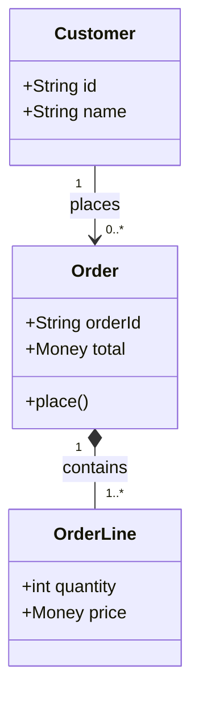
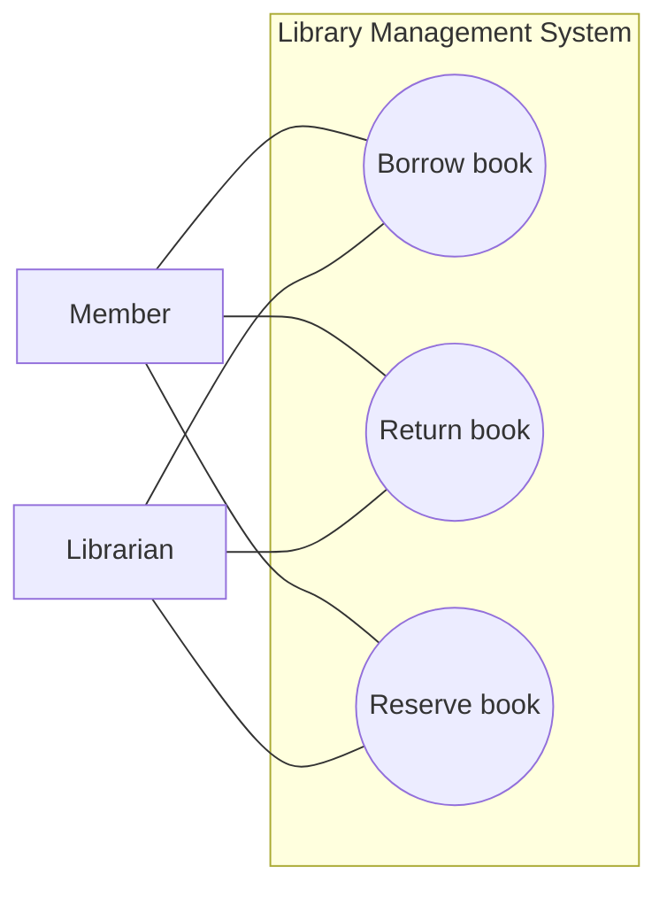
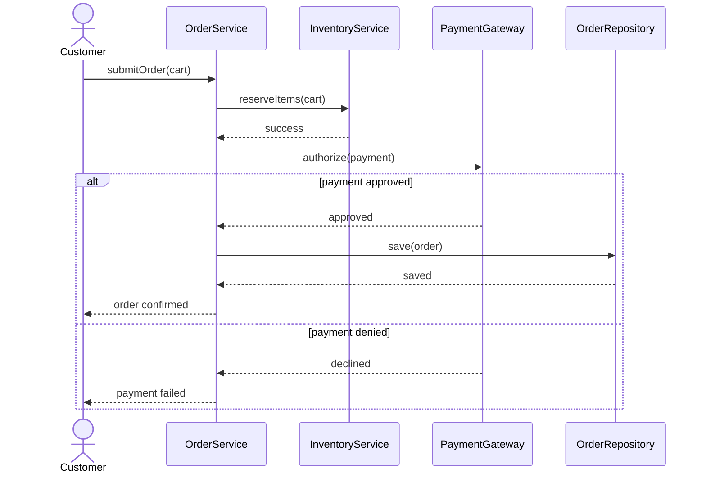
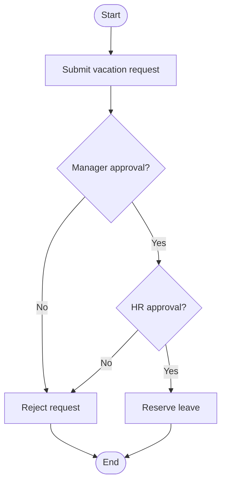
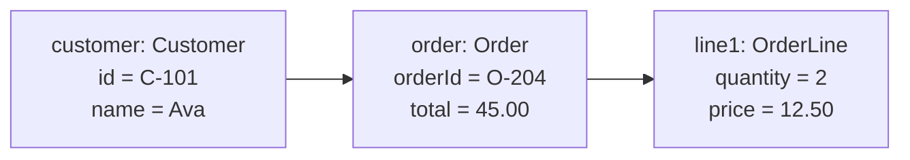
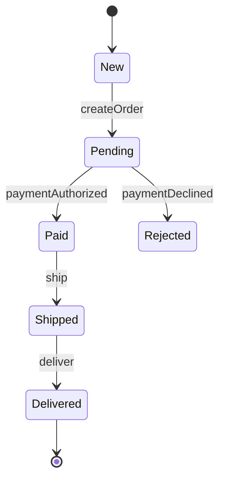
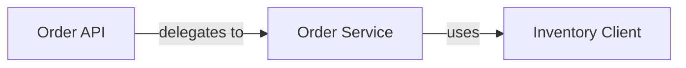

# UML Diagrams — Lesson Notes

UML is a notation family, not a design method. The real goal is to communicate a specific design question clearly: structure, flow, lifecycle, scope, or implementation boundaries. The best diagram is the one that answers the question with the least accidental complexity.

## 1. Class diagram

A class diagram shows static structure: classes, key attributes, operations, and relationships between types. It is the default diagram when the team is deciding responsibilities and ownership.

### What it helps answer

- What are the main types in the system?
- How do they relate to each other?
- Which object owns which data or lifecycle?
- Are there inheritance, association, aggregation, composition, or dependency links?

### Core elements

- Class: a type with attributes and methods
- Association: a meaningful relationship between classes
- Aggregation: whole-part relationship, but parts can exist independently
- Composition: stronger ownership; child objects usually live and die with the parent
- Inheritance: generalization/specialization
- Dependency: one class uses another in a transient or implementation-specific way
- Multiplicity: how many instances participate in the relationship, such as 1, 0..*, or 1..*

### Example

This communicates that a customer can place many orders, and each order contains multiple order lines. The relationships tell us something important about life cycle and ownership.

### What to include

Focus on the structure that matters for the decision being made. In a domain model, include the names of significant entities and cardinality. In a design model, include only the relationships that affect behavior or testing.

### What to omit

Do not spend time drawing every field or every helper method if they do not affect the domain contract. A class diagram is not the place to document every implementation detail.

### Interview rule

If a question is about who owns what and how types relate, start with a class diagram.

## 2. Use case diagram

A use case diagram focuses on user goals and system boundaries. It is excellent for scope discussions, not for deep process logic.

### What it helps answer

- Who interacts with the system?
- What goals do actors have?
- What is inside the system boundary, and what is outside it?
- What major capabilities need to be supported?

### Main elements

- Actor: a role, such as Customer, Admin, or PaymentGateway
- Use case: a service or capability, such as PlaceOrder or CancelReservation
- System boundary: a box showing the scope of the system under design
- Association: which actor participates in which use case

### Example

This clarifies goals without diving into the internal sequence of actions. It answers “what should the system do for whom?”

### Important caveat

A use case diagram is not a procedural design. It does not show the order of messages or exact validation logic. If you need a flow, use a sequence or activity diagram.

## 3. Sequence diagram

A sequence diagram shows interactions over time. It is best for one scenario: “what happens, in order, when a user does X?”

### What it helps answer

- Which objects participate?
- What messages are sent between them?
- What branch or failure path occurs?
- What actions happen in order?

### Core elements

- Lifelines: participants drawn as vertical dashed lines
- Messages: arrows between lifelines
- Activation bars: show when an object is actively handling a request
- Fragments: `alt`, `opt`, `loop`, and `par` for branching and parallelism

### Example

This explains the scenario clearly without over-committing to a class model. It exposes the decision point: whether payment is approved or declined.

### Good use

Use sequence diagrams when behavior is subtle, when you need to validate a contract, or when an interview question gives you a scenario and asks “show me the flow.”

### Avoid overloading it

Do not turn a sequence diagram into a full implementation blueprint. Show only the critical messages that validate the design choice. If every call is shown, the diagram becomes unreadable.

## 4. Activity diagram

An activity diagram shows workflow logic: actions, decisions, concurrency, and paths through the process. It emphasizes process control rather than object interactions.

### What it helps answer

- What are the steps in the workflow?
- Where are the decision points?
- Are there parallel approvals or retries?
- Which steps happen under which condition?

### Typical symbols

- Start/end nodes
- Action states
- Decision diamonds
- Fork/join bars for parallel flows
- Swimlanes to separate responsibilities by actor or component

### Example

This communicates the workflow logic, not the object-level messaging.

### When to choose it

Choose an activity diagram when the main issue is business flow, not object modeling. It is ideal for process-heavy scenarios such as approvals, order fulfillment, or ticket escalation.

## 5. Object diagram

An object diagram is a snapshot of specific instances and links. It is a concrete example of a model, not the general structure itself.

### What it helps answer

- What does a real instance graph look like?
- Which objects reference each other at a particular moment?
- How do relationships behave in a concrete scenario?

### Example

Relationships are shown as object links, not generic types:

- customer -> order
- order -> line1

### When it is useful

Object diagrams are strong for explaining edge cases, tricky model behavior, or how a real object graph is evolving. They are less useful as a general design artifact unless the team needs to illustrate a specific state.

## 6. State diagram

A state diagram focuses on a single object's lifecycle. It shows states, transitions, guards, and actions that occur in response to events.

### What it helps answer

- What states can an object be in?
- What event triggers a transition?
- What guard prevents an invalid transition?
- What actions happen on entry, exit, or transition?

### Example

A guard might be: only transition from `Pending` to `Paid` if payment authorization succeeds. That makes the invalid transition explicit rather than implicit.

### Why state diagrams matter

They are especially useful for workflows with clear lifecycle rules, such as tickets, orders, subscriptions, or devices. They help reveal invalid transitions and missing business rules.

## 7. Component diagram

A component diagram shows larger implementation units and their dependencies. It is much more architectural than object-centric.

### What it helps answer

- What logical modules or services exist?
- Which components expose interfaces or depend on others?
- Where are boundaries between subsystems and infrastructure?

### Example

This is useful when discussing how a system is partitioned. It is often used in design reviews or high-level architecture discussions where the issue is dependency direction and service boundaries.

### Good interview framing

If the problem is “how are we splitting responsibilities across modules?” use a component diagram. If the problem is “what happens in order?” use a sequence diagram.

## UML in time-bound interviews

A strong interview approach is:

1. Start with the question being asked.
2. Choose the smallest diagram that answers it.
3. Use readable names and only relevant details.
4. Add behavior or lifecycle diagrams only when the question demands them.
5. Explain omitted details verbally when notation would slow the conversation.

### Decision guide

- Structural question? Use a class diagram.
- Scope question? Use a use case diagram.
- Scenario flow question? Use a sequence diagram.
- Process logic question? Use an activity diagram.
- Concrete instance question? Use an object diagram.
- Lifecycle question? Use a state diagram.
- Module boundary question? Use a component diagram.

The key is not to memorize UML symbols; it is to choose the right view and avoid pretending that a diagram can answer a question it was never meant to answer.
