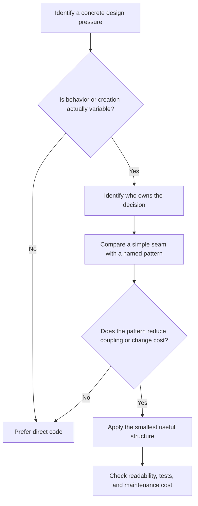

# Design Patterns Introduction — Lesson Notes

A design pattern is a named, recurring approach to a design problem in a particular context. It describes a set of roles, the collaboration between them, and the trade-offs involved; it is not a complete implementation to copy into every program.

Patterns are useful design vocabulary. Saying “this is a Strategy” can communicate that a behavior is intentionally interchangeable, but the name alone does not make the design correct. A pattern is a candidate solution to a pressure you can explain. Start with the problem and constraints, then decide whether the pattern is a simpler way to express the solution.

## What problem do patterns solve?

Software changes. A design becomes difficult to change when responsibilities are tangled, callers know too much about implementation details, or a new variation requires edits across many unrelated places. A pattern can provide a known structure for one of these recurring pressures:

- **Creation:** construction rules or product choice are becoming difficult to manage.
- **Structure:** objects need to be composed or adapted without spreading knowledge of their internals.
- **Behavior:** responsibilities or algorithms need to collaborate or vary independently.

These are broad families, not a checklist of patterns to apply. For example, a single fixed algorithm usually does not need Strategy; a function may already be a clear and testable way to represent it. A pattern pays off when its roles make an actual boundary or variation point easier to reason about.

## Why use a pattern?

Use a pattern when it makes responsibilities, object creation, collaboration, or change easier to understand. It can:

- Give a team a concise name for a known structure and its intent.
- Isolate a volatile decision so a change does not spread through callers.
- Make an alternate behavior replaceable in tests or at runtime.
- Clarify who creates, owns, calls, or notifies which objects.

For example, if an application really supports multiple shipping-cost policies, a `ShippingCostPolicy` interface and interchangeable implementations can keep checkout logic independent of the selected rule. The checkout flow asks the policy for a cost rather than embedding each calculation. This is a useful Strategy when policies are genuinely variable; for one permanent rule, it may be needless indirection.

The test for a useful pattern is not “does this resemble the UML?” It is “does this structure reduce a concrete source of coupling or change cost enough to justify its added concepts?”

## When not to use patterns

Prefer direct code when the problem is small, behavior is fixed, or the variation is hypothetical. A conditional, a constructor, or a plain function may be easier to read than a family of interfaces and classes.

Patterns have costs:

- **Indirection:** readers must follow extra objects or methods to find the behavior.
- **More concepts:** additional interfaces, implementations, factories, or lifecycle rules must be understood and maintained.
- **Over-flexibility:** an extension point can make invalid combinations possible or make simple behavior harder to configure.
- **False abstraction:** similar-looking code may represent different domain rules and should not be forced into one generalized design.

Do not treat “we might need another option someday” as proof that an extension framework is needed today. Prefer a design that is easy to adapt, but wait for real change pressure before building speculative machinery. Revisit the decision when requirements or usage provide evidence.

## Anti-patterns and pattern overuse

An **anti-pattern** is a recurring approach that appears to solve a problem but tends to create greater costs. It is not simply code that does not use a named pattern. Examples include:

- **God object:** one class accumulates unrelated responsibilities and becomes a bottleneck for changes.
- **Needless Singleton:** global access hides dependencies, couples callers to shared state, and makes isolated tests harder.
- **Pattern overuse:** applying a pattern where a simpler construct is clearer, adding indirection without reducing a real cost.
- **Speculative framework:** building registries, plugins, or layers for unconfirmed future requirements.

Patterns themselves can become anti-patterns when applied mechanically. A Factory for one obvious constructor, for example, may obscure rather than clarify object creation. Evaluate the costs in context instead of labeling a design by its pattern name.

## A practical selection method

Before choosing a pattern, answer these questions:

1. **What is the concrete pressure?** Identify a change, complexity, or coupling problem that exists now.
2. **What varies, and how often?** Distinguish real independent variation from code that only looks similar.
3. **Who should own the decision?** Keep policy decisions with the appropriate domain object or boundary.
4. **What should callers know?** Identify implementation details that callers should not need to depend on.
5. **What is the simplest solution?** Compare a direct function or conditional with the pattern's extra roles and wiring.
6. **How will you know it helped?** Look for localized changes, clearer responsibilities, easier tests, or less duplicated decision-making.

Treat the diagram as a reasoning aid, not a mandatory sequence. A useful design may use a small part of a pattern, and a pattern may be inappropriate even when the problem sounds familiar.

## Explain the trade-off

When presenting a design, describe the pressure, the chosen boundary, and what the design costs. For example:

> “The tax rule is currently fixed, so I kept it as a direct calculation. If we add independently selected tax policies, I would introduce a policy interface at the point where the rule varies. That seam would isolate the change, but adding it now would create indirection without a current benefit.”

This is stronger than saying “I used Strategy because it is extensible.” It explains why the abstraction is justified now and names the simpler alternative.
