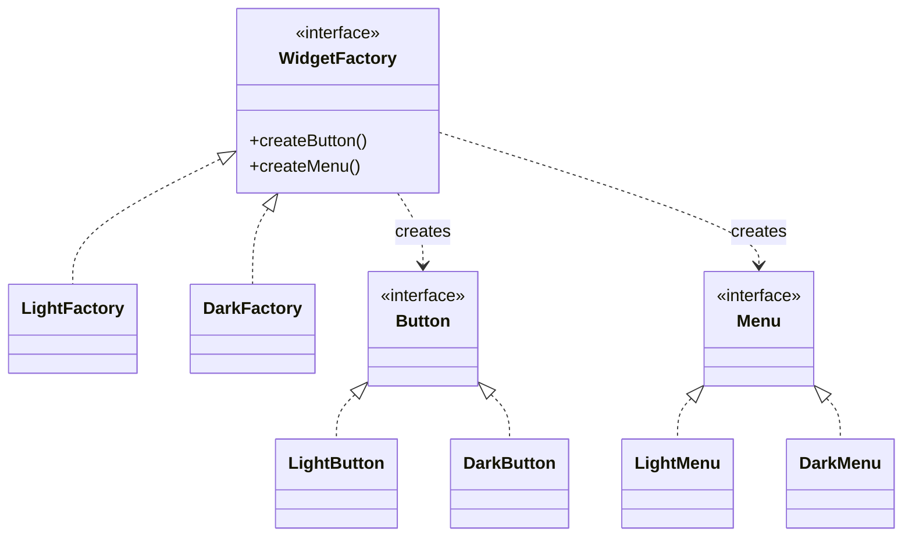
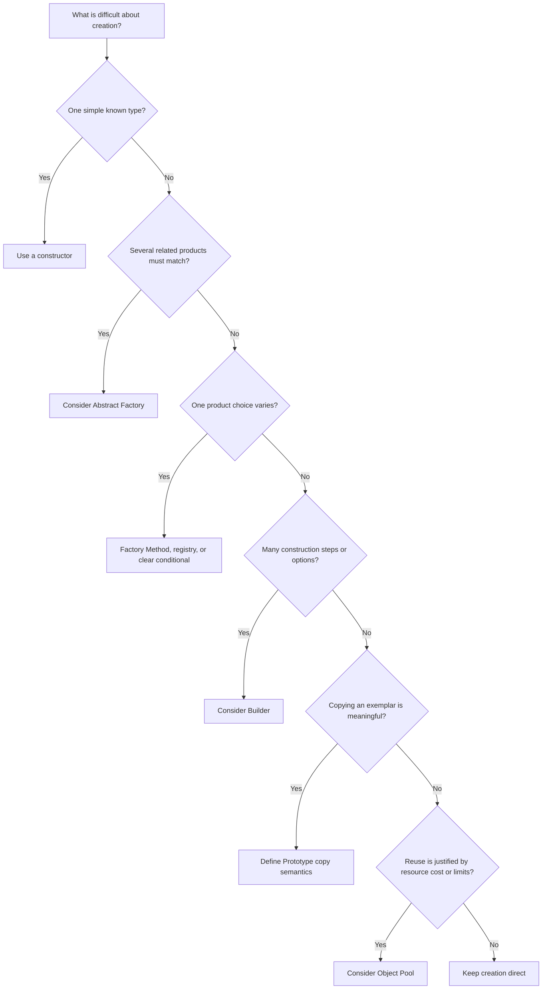

# Creational Design Patterns — Lesson Notes

Creational patterns address how objects are selected, assembled, shared, or copied. They are useful when construction itself contains meaningful policy or complexity. They are not a reason to hide a simple constructor behind extra types: choose the least complicated creation mechanism that keeps decisions clear and dependencies visible.

## Singleton

A Singleton restricts a type to one instance and exposes a way to access it. It is sometimes appropriate for a genuinely process-wide service whose lifetime and shared identity are part of the design. Examples might include immutable configuration loaded once or a process-level metrics registry, depending on the application's lifecycle.

The central trade-off is global access versus explicit ownership. A global instance hides a dependency from constructors, makes tests order-sensitive if it holds mutable state, and can couple code to a concrete implementation. Prefer creating the object at a composition root and injecting it into consumers. If one shared instance is needed, dependency injection can provide that lifetime without making the class globally accessible.

Decide explicitly whether initialization is eager or lazy, who owns shutdown, and whether state is mutable. A Singleton is not automatically thread-safe just because only one instance is intended.

## Thread-safe Singleton

If a Singleton must initialize lazily under concurrent access, the initialization mechanism must guarantee both one-time construction and safe publication of the completed instance. Prefer the language's standard facilities: static initialization, `lazy` primitives, or a synchronized once-only mechanism. Their guarantees differ by language and runtime, so use the documented facility rather than porting an idiom by name.

Hand-written double-checked locking is easy to get wrong when memory visibility and ordering are not handled correctly. Also distinguish initialization safety from safe use: a safely constructed Singleton may still contain mutable data that concurrent callers race to modify.

Test simultaneous first access if initialization is lazy, and test the service's own concurrency contract separately. If the language or framework already guarantees eager initialization, that is often simpler.

## Factory Method

Factory Method delegates product creation to a method so the creator's workflow can use a product contract without naming every concrete product. A subclass may override the creation method, or an application can use a well-defined registry or injected factory where runtime selection is needed.

For example, an import workflow can depend on a `Parser` contract while a format-specific creator supplies a CSV or JSON parser. The workflow retains common steps; the creation decision varies at the boundary. Do not introduce a factory solely to wrap `new` when the caller already knows the concrete type and no policy is being isolated.

Be precise about where selection occurs. A Factory Method is often about varying a creator's product; a registry maps an explicit key to a creator; a direct conditional may be clearest for a small, closed set of choices.

## Abstract Factory

Abstract Factory creates a family of related products through a shared interface, without exposing their concrete classes. It is useful when products must be compatible as a set. A themed UI may need a button, menu, and dialog that all follow the same platform or theme.

The client requests products from one factory and can remain independent of concrete families. This helps keep combinations consistent, but every new product kind may require changes to the factory interface and its implementations. If products do not need to vary together, separate constructors or simpler factories may be more flexible.

Keep family selection in a composition boundary, such as application startup or a feature configuration point. Avoid letting each component independently choose a theme, which could create a mismatched family.

## Builder

Builder separates the step-by-step construction of a complex value from its final representation. It is especially helpful when there are many optional settings, meaningful construction stages, or validation rules that would otherwise make constructors hard to call correctly.

A builder should make required information and invalid combinations apparent. One approach is to require essential values at builder creation and offer fluent methods only for optional values. Validate cross-field invariants before returning the finished immutable object; do not rely on every caller to remember a separate validation call.

Builders can become verbose when used for simple objects. Prefer named constructor arguments or a small parameter object when those already communicate intent. Consider whether a builder is mutable and reusable; accidental reuse can leak values from one object construction into the next.

## Prototype

Prototype creates a new object by copying a configured exemplar. It can be useful when initialization is expensive or when many objects begin from a user-customizable template.

Define copy semantics before using it. A shallow copy duplicates the top-level object but may retain references to nested mutable objects. A deep copy duplicates the relevant object graph, but may be expensive or inappropriate for resources such as open files, sockets, or database handles. Decide which state is copied, reset, shared intentionally, or excluded.

Prefer an explicit `copy` operation with documented ownership behavior over language-level cloning whose semantics are unclear. Tests should verify that mutable state which must be independent is not shared, and that intentionally shared immutable data remains safe.

## Object Pool

An Object Pool retains a bounded set of reusable objects and lends them to callers. It is appropriate only when object creation or an external resource has a measured cost or a strict capacity limit. Connection pools are common because connections are expensive and the downstream service has finite capacity.

Pooling introduces lifecycle rules: how to acquire, return, validate, time out, and close resources; what happens at exhaustion; and how to prevent one borrower's state from leaking to the next. Define whether a caller must release explicitly, how cancellation works, and how shutdown handles in-use resources.

Do not pool cheap, stateless objects just to avoid allocation. A pool can add contention and make failures harder to reason about. Measure the actual bottleneck and enforce reset/cleanup invariants before adopting one.

## Choosing a creation approach

Start with the creation problem: is the product type varying, is a compatible family required, is construction complex, is copying intentional, or is reuse required by a measured resource constraint? Keep the decision at the narrowest boundary that has the necessary information.

The diagram narrows the options; it does not replace checking lifecycle, ownership, testability, and the simpler alternative.
