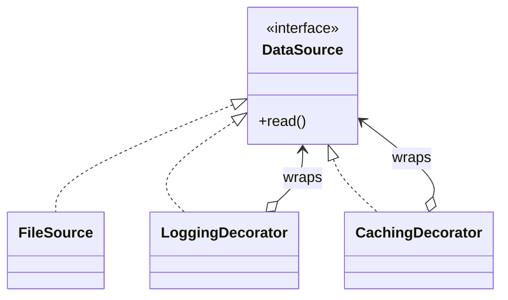
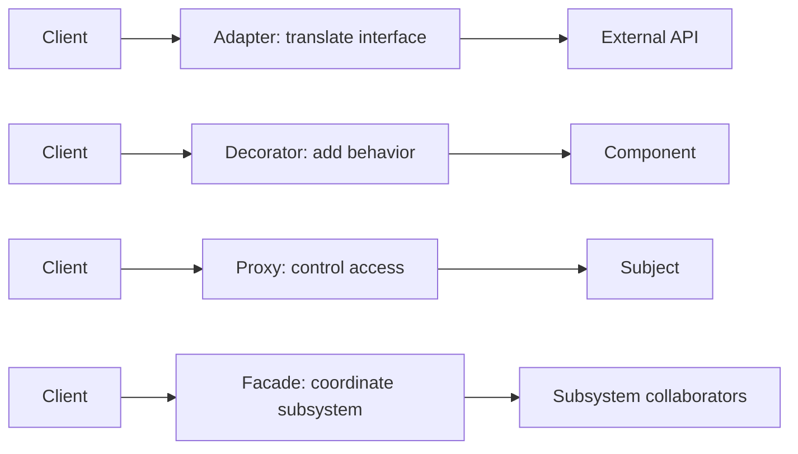

# Structural Patterns — Lesson Notes

Structural patterns describe how objects and interfaces are composed. They help when a client needs a different interface, when independent dimensions of change should not multiply subclasses, or when behavior can be assembled by wrapping objects. Start with the relationship and change pressure; similar class diagrams do not imply the same intent.

## Adapter

Adapter translates one interface into another that a client already expects. It is a useful boundary around a legacy module, vendor SDK, or external service whose types and errors should not spread through the application.

The adapter should translate both data and semantics: input/output shapes, units, error categories, and lifecycle expectations. It should not merely rename methods if callers still need to understand the external system's quirks. Keep the application's contract stable and let the adapter absorb vendor-specific changes. Do not confuse Adapter (interface compatibility) with Decorator (same interface, added behavior).

## Bridge

Bridge separates an abstraction from its implementation so both dimensions can vary independently. For example, a shape API may support several shapes and several rendering backends. If each shape-backend combination becomes a subclass, the combinations grow multiplicatively; a bridge lets a shape delegate to a renderer.

Use it when the two dimensions are independently meaningful and expected to evolve. The added indirection is not worthwhile for a tiny, fixed set of combinations. Decide which side owns policy and keep the abstraction contract focused; a Bridge is not just any object holding another object.

## Composite

Composite represents individual objects and groups through a common component contract, allowing clients to treat a tree uniformly. A filesystem-like model can have leaf files and directory nodes that contain children; operations such as display or traversal can work recursively.

Choose the component API carefully. A method such as `addChild` is meaningful for a group but not for a leaf. Options include separate leaf/composite interfaces, an explicit capability, or an API that reports an invalid operation; avoid silently ignoring unsupported calls. Define ordering, cycle prevention, ownership, and behavior on empty groups.

## Decorator

Decorator wraps an object with another object that implements the same contract, adding a responsibility without changing the wrapped object's class. Wrappers can be composed for logging, caching, compression, authorization, or retry behavior.

Order matters: caching before or after authorization, for example, can change correctness and security. Define exception propagation, resource ownership, and whether wrappers are transparent with respect to observable behavior. Too many nested decorators can make runtime behavior hard to inspect, so keep composition visible and test meaningful combinations. A Decorator keeps the interface; a Proxy primarily controls access to a subject.

## Facade

Facade gives clients a focused entry point to a subsystem with several collaborators or setup steps. It can reduce the knowledge a client needs and give the application a stable use-case-oriented API.

A facade should coordinate a meaningful operation, not become a new God object or absorb domain rules unrelated to the subsystem. It does not necessarily forbid direct subsystem access; if it is intended as a strict boundary, enforce that through module visibility and dependency rules rather than assuming clients will comply.

## Flyweight

Flyweight shares intrinsic state—data that is stable and common across many logical objects—while keeping extrinsic state, which varies per use, outside the shared object. A text editor may share glyph shape/font data while each character position and selection belongs to a document occurrence.

The key correctness issue is mutability and identity. Shared intrinsic state should generally be immutable or safely managed; mutable per-use data must not accidentally be stored in a shared flyweight. A factory/cache can intern equivalent intrinsic data, but its memory retention and concurrency behavior need consideration. Use it when repeated objects create a meaningful memory or representation cost.

## Proxy

Proxy implements the same subject contract as a real object while controlling access to it. Common reasons include lazy loading, remote calls, access checks, and resource lifecycle management.

The proxy should preserve the subject's observable contract as far as practical: expected results, errors, timing assumptions where relevant, and ownership. Remote proxies have latency and failure modes that local interfaces may hide; make those differences explicit in the contract. Authorization proxies should fail closed and must not make cache behavior bypass access checks. Use a Proxy for access control around a subject; use an Adapter when the interface itself must change.

## Distinguishing the patterns

Several patterns contain a wrapper or delegation relationship, but their purpose differs:

| Pattern | Primary intent | Client-facing interface |
|---|---|---|
| Adapter | Make an incompatible interface usable | Usually changes to the target interface |
| Decorator | Add responsibilities compositionally | Preserves the component interface |
| Proxy | Control access to a subject | Preserves the subject interface |
| Facade | Simplify interaction with a subsystem | Provides a new, focused interface |
| Bridge | Let abstraction and implementation vary independently | Separates two dimensions |

Choose based on the change the relationship is meant to isolate. A wrapper alone does not determine the pattern.
