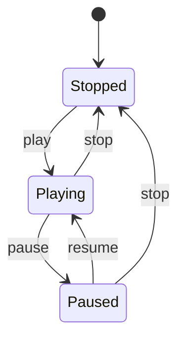
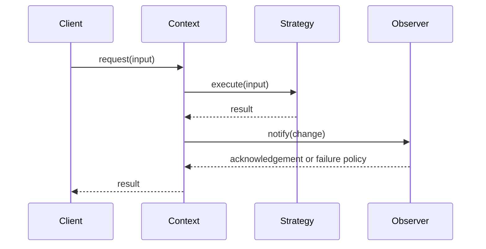

# Behavioral Patterns — Lesson Notes

Behavioral patterns make responsibilities and communication between objects explicit. They help when an algorithm varies, a request needs to be represented or routed, state changes behavior, or multiple collaborators need coordination. The main design questions are who initiates an operation, who owns its decision, how it terminates, and what happens when a participant fails.

## Strategy

Strategy encapsulates interchangeable algorithms behind a common contract. The client or composition boundary chooses a strategy, while the context delegates the varying work to it. This keeps policy selection separate from algorithm implementation and makes each algorithm independently testable.

Examples include shipping-price calculation or a ranking policy selected for a request. Use Strategy when alternatives are real and likely to change independently. A single fixed algorithm usually needs no strategy object. Keep selection rules explicit and avoid a strategy interface so generic that implementations require many flags.

## Observer

Observer lets a subject notify interested subscribers when a change or event occurs, reducing direct references between the publisher and consumers. It appears in event systems, UI updates, and domain notifications.

Define whether notifications are synchronous or asynchronous, whether order matters, what payload is delivered, and how subscriber failures are handled. Subscriptions need an explicit lifetime: unsubscribe on disposal, use scoped subscriptions, or avoid retaining listeners indefinitely. Observer is not automatically a durable message queue; if delivery must survive process failure, use a persistent messaging mechanism.

## Command

Command represents an operation as a value or object, separating the requester from the executor. A command can carry arguments and may support queueing, logging, scheduling, retries, or undo. It is useful when requests need to be delayed or recorded rather than immediately invoked.

Keep execution semantics and state explicit. Undo is not always possible: the command needs enough information to reverse its effect, and external side effects may not be reversible. Retries need idempotency or deduplication. Avoid one command class per trivial call if direct method invocation is clearer.

## Chain of Responsibility

Chain of Responsibility passes a request through ordered handlers. A handler can process it, reject it, or pass it onward. Middleware, validation pipelines, and event filters often use this structure.

Define handler ordering, whether one or many handlers may act, how a handler signals "not handled," and what happens when the chain ends. Failure should not be confused with declining responsibility. Cycles or accidental omission can cause requests to be mishandled, so construction and terminal behavior should be testable.

## State

State represents state-dependent behavior in explicit state objects or a state machine. Instead of scattering conditionals over a status field, transitions and available operations can be made visible and constrained.

First list states, events, valid transitions, and side effects. Then choose a simple enum plus transition function or state objects depending on complexity. State objects help when behavior differs substantially or grows independently; they can create needless class proliferation for a few trivial conditions. Ensure invalid transitions are rejected and state updates remain consistent with side effects.

## Template Method

Template Method defines the outline of an algorithm in a base class and lets subclasses customize selected steps through hooks. It can prevent subclasses from changing required ordering while allowing controlled variation.

Use it when the algorithm's stable sequence and extension points are clear. Subclass hooks can make control flow hard to follow, and inheritance couples implementations to the base class. Prefer composition or Strategy when the varying behavior should be selected independently or multiple dimensions vary. Document hook contracts and avoid calling overridable methods from constructors.

## Iterator

Iterator provides a traversal interface without exposing a collection's internal representation. It lets clients consume items in a consistent way while the collection controls traversal order and representation.

Decide whether iteration is lazy, whether multiple iterators can coexist, and what happens if the collection changes during iteration. Options include fail-fast iteration, snapshot iteration, or explicitly supported concurrent mutation. Iterators should have clear end-of-sequence behavior and avoid surprising resource retention for large or external data sources.

## Mediator

Mediator centralizes coordination among collaborating objects so they do not all reference each other directly. A chat room can route participant messages without every participant managing links to all others.

The mediator should coordinate interactions, not become the owner of every participant's domain logic. A large mediator can turn into a God object and make behavior difficult to locate. Keep collaboration rules cohesive, and consider events or narrower coordinators when different interactions have distinct lifecycles.

## Visitor

Visitor adds operations over a set of element types by moving the operation into a visitor and dispatching to the matching element-specific method. It is useful when the element hierarchy is relatively stable but new operations are added often, such as evaluating or serializing a stable expression tree.

Visitor makes adding a new element type costly because each visitor may need a corresponding method. It can also complicate encapsulation by exposing element details. Prefer direct polymorphic methods when operations belong naturally to each element or types change frequently. Choose based on which axis—operations or element types—is expected to vary.

## Memento

Memento captures an object's state so it can later be restored without exposing the object's internals to the snapshot owner. It is useful for undo, checkpoints, and restoring an editor state.

Snapshots can consume substantial memory, so consider deltas, bounded history, and immutable or copy-on-write data. Capture a consistent state, including related invariants, and decide how snapshots behave across schema/version changes. Do not retain external resources or mutable references accidentally. For undoable operations, a Command that records inverse information may be smaller than whole-state snapshots.

## Comparing behavioral approaches

Patterns can overlap in real systems. Strategy selects an algorithm; State changes available behavior in response to transitions; Command represents an operation; Chain routes a request; Observer broadcasts a change; Mediator coordinates known collaborators. Choose the one that matches the responsibility and lifecycle, not merely the class structure.

This sequence is illustrative: not every Strategy needs observers, and notifications may be asynchronous. The important design work is defining ownership, ordering, and error semantics.
