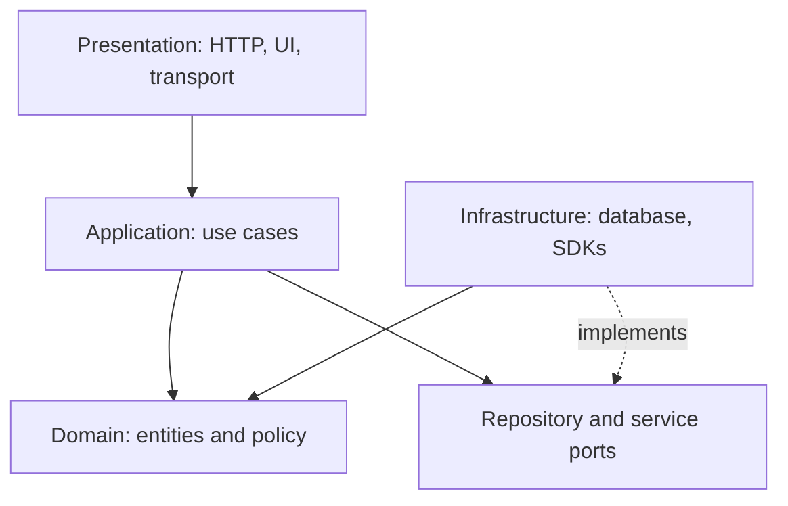
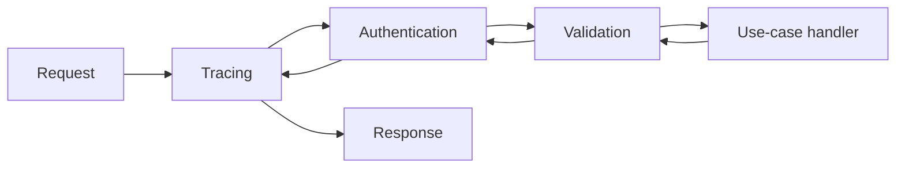
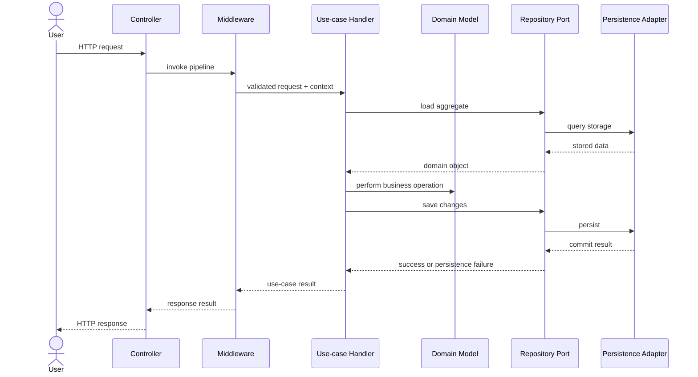

# Architectural and Practical Patterns — Lesson Notes

Architectural patterns organize responsibilities across application boundaries. Their purpose is to make policy, request handling, and infrastructure ownership easier to understand and change. Names such as controller, service, and handler vary across frameworks; define responsibilities and dependency direction instead of relying on labels.

## MVC

Model–View–Controller separates application state and behavior (Model), presentation (View), and input coordination (Controller). A controller interprets user input and selects an operation; the view renders state; the model or domain layer owns relevant data and business rules.

MVC implementations vary: some frameworks let views observe models directly, while others route updates through controllers. Keep domain decisions out of presentation glue and avoid controllers that become large workflow owners. MVC is a useful presentation organization, not a complete prescription for persistence or domain architecture.

## MVVM

Model–View–ViewModel gives the view a presentation-oriented model of state and actions. The ViewModel transforms domain/application results into display-ready values, coordinates UI state such as loading and validation, and exposes commands or actions to the view.

MVVM is particularly useful with data binding or complex UI state because view behavior can be tested without rendering the screen. Keep the ViewModel independent of concrete widgets where practical. Do not copy all domain rules into it or let it become a second domain model; it should adapt application capabilities to presentation needs.

## Layered architecture

Layered architecture groups responsibilities, often into presentation, application, domain, and infrastructure. Presentation handles transport or UI details; application coordinates use cases; domain expresses business concepts and invariants; infrastructure integrates persistence and external systems.

Dependencies should point toward stable policy where possible. An application use case can depend on a repository contract while infrastructure implements it. Layers that only forward calls add ceremony without isolation, so each layer should have a reason to exist. Avoid allowing transport-specific types or database details to leak into domain policy.

The diagram shows responsibility boundaries rather than a requirement for one class or package per box. In dependency-inversion designs, source-code dependencies should point toward the stable contracts even when runtime calls reach infrastructure.

## Repository

Repository presents a domain-oriented boundary for retrieving and persisting aggregates or other application-owned data. It lets use-case and domain code express intent without embedding database query syntax or vendor types.

Use focused contracts such as `loadOrder(id)` or `save(order)` where they express actual use cases. A generic repository with arbitrary query methods can leak persistence details or become a dumping ground. Decide whether the repository returns aggregates, projections, or both, and make transaction and not-found semantics explicit. A repository does not automatically make a system database-independent if database semantics still shape the domain contract.

## Specification

Specification encapsulates a named rule that can determine whether an object satisfies a condition. Specifications can be composed with logical operations when the rule's meaning remains clear. For example, an eligible discount might require an active customer and a minimum order value.

Specifications are useful when a rule is reused, named in the domain, or independently testable. Keep evaluation deterministic where possible and make data dependencies visible. A highly generic expression framework can obscure simple predicates; use a straightforward boolean expression when that is clearer. If specifications are translated into database queries, ensure in-memory and persisted evaluation have consistent semantics.

## Middleware

Middleware runs reusable processing around a request pipeline. A middleware stage can inspect or enrich a request, invoke the next stage, transform a response, or short-circuit processing. Common responsibilities include authentication, tracing, request limits, and error mapping.

Order is observable: tracing may wrap authentication so denied requests are traced, while error mapping may need to wrap every stage. Define short-circuit, exception, and response behavior. Keep middleware focused and avoid placing use-case-specific domain policy in a global pipeline. Ensure sensitive request data is not logged unintentionally.

The response travels outward through the wrapping stages. A stage may terminate early, for example when authentication fails; that behavior should be explicit and tested.

## Request context and propagation

Request context carries metadata scoped to one request, such as authenticated identity, cancellation, deadline, correlation ID, or tracing information. It allows downstream work to share request-level facts without global mutable state.

Keep its contents bounded and purpose-driven. Propagate cancellation and deadlines to database and network calls so abandoned work can stop. Avoid using context as an untyped bag for ordinary business inputs or storing it beyond the request lifetime. Some frameworks provide ambient context; explicit parameters may be clearer and safer when context use is optional or must be visible.

## Controllers, handlers, and services

A controller adapts a transport request into an application call and maps the outcome to a transport response. It should handle protocol concerns such as parsing, status codes, and authentication metadata, not own a full domain workflow.

A handler commonly represents one use case or request and coordinates the necessary domain operations and ports. An application service may group related use cases or provide orchestration; a domain service captures domain behavior that does not naturally belong to one entity or value object. These labels differ across architectures, so identify the actual responsibility.

Keep boundaries clear: validate transport shape at the edge, enforce business invariants in domain/application policy, and return errors in a form the caller can interpret. Avoid both an anemic maze of forwarding classes and a controller that does everything.

## Business Logic Layer (BLL)

The Business Logic Layer is a broad term for the part of an application that implements business workflows and rules, between presentation and data access in many traditional architectures. It may include application services, use-case handlers, and domain policy.

Treat BLL as a responsibility description, not necessarily a single package or service class. Keep it independent of UI and transport details. Decide where each invariant belongs: entity/value-object invariants belong with the domain concept; coordination across objects belongs to a use case or domain service as appropriate. Do not duplicate the same rule in both the BLL and domain objects, where the copies can drift.

## Unit of Work

Unit of Work groups related persistence changes into one commit boundary. It can track changes to multiple aggregates or repositories and commit them within a transaction, depending on the storage system.

Define its scope, ownership, and failure semantics. A failed commit should be observable; rollback and disposal should be reliable. Concurrent updates need a policy such as optimistic concurrency checks. A database transaction does not make calls to external systems atomic, so workflows spanning databases and remote services need a separate consistency strategy (for example, an outbox or saga), not an assumption that Unit of Work covers everything.

## Tracing a request through boundaries

The following illustrates how the pieces can collaborate for a request. The exact classes depend on the application; the important part is that each boundary owns a distinct concern.

In a Unit of Work design, repository writes may be staged and committed at a clearly chosen boundary rather than each `save` committing independently. The transaction scope and error mapping must match the application's consistency requirements.
